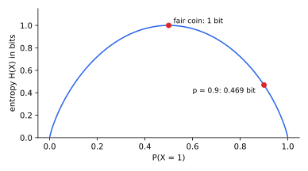

<ul class="post-sources">
<li markdown="span">질문 출처: [Science Vibe, 머신러닝 면접 질문 모음](https://jrc-park.tistory.com/259)</li>
</ul>

## 면접 답변

> 엔트로피는 확률 분포가 가진 불확실성의 크기로, 결과를 하나 관측했을 때 얻는 정보량의 기댓값입니다. 드문 사건일수록 관측했을 때 정보가 크다고 보아 사건의 정보량을 음의 로그 확률로 정의하고, 이를 확률로 평균한 것입니다. 예를 들어 공정한 동전의 엔트로피는 1비트이지만, 앞면 확률이 0.9인 동전은 결과를 어느 정도 예상할 수 있어 약 0.47비트입니다. 결과가 한 가지로 확실하면 0이고, 이산 분포에서는 모든 결과가 균등할 때 가장 큽니다. 또한 정보 이론에서는 평균 부호 길이의 하한을 뜻합니다. 머신러닝에서는 의사결정나무의 분할 기준인 정보 이득, 그리고 교차 엔트로피와 KL divergence의 기초로 쓰입니다.

## 자세한 설명

### 정의

이산 확률 변수 $$X$$의 분포를 $$p$$라 하면 엔트로피는 다음과 같다. 로그 밑이 2이면 단위는 비트, 자연로그이면 내트(nat)이다.

$$
H(X) = -\sum_x p(x) \log p(x) = \mathbb{E}_{x \sim p}\left[-\log p(x)\right]
$$

$$-\log p(x)$$를 **자기 정보(self-information)**라 한다. 확률이 작을수록 크고, 독립 사건에서는 정보량이 더해진다. $$p(x) = 0$$인 항은 $$0 \log 0 = 0$$으로 약속한다.

*이진 변수의 엔트로피. $$P(X = 1) = 0.5$$에서 최대 1비트이고, 결과가 확실한 양 끝에서 0이다.*

### 값 계산

| 분포 | 엔트로피 (비트) |
|---|---:|
| $$(0.5, 0.5)$$ | 1 |
| $$(0.9, 0.1)$$ | 0.469 |
| $$(0.99, 0.01)$$ | 0.081 |
| $$(0.5, 0.25, 0.25)$$ | 1.5 |
| 8개 결과에 균등 | 3 |

$$K$$개 결과에 대해 $$0 \le H(X) \le \log K$$이며, 왼쪽 등호는 결과가 확실할 때, 오른쪽 등호는 균등 분포일 때 성립한다.

### 부호 길이 해석

$$(0.5, 0.25, 0.25)$$인 세 기호에 부호 0, 10, 11을 주면 평균 길이는 $$0.5 \times 1 + 0.25 \times 2 + 0.25 \times 2 = 1.5$$비트로 엔트로피와 같다. 섀넌의 소스 코딩 정리에 따르면 무손실 부호의 평균 길이는 엔트로피보다 짧아질 수 없고, 여러 기호를 묶어 부호화하면 그 하한에 얼마든지 가까워질 수 있다.

### 의사결정나무의 정보 이득

양성 5개, 음성 5개인 노드의 엔트로피는 1비트이다. 어떤 분할로 $$(4, 1)$$과 $$(1, 4)$$가 되면 자식 노드의 엔트로피는 각각 0.722비트이고, 가중 평균도 0.722비트이다. **정보 이득(information gain)**은 그 차이인 $$1 - 0.722 = 0.278$$비트이다. 이는 레이블과 분할 사이의 상호 정보와 같다.

### 연속 변수의 차등 엔트로피

연속 변수에는 합 대신 적분을 쓴 **차등 엔트로피(differential entropy)** $$h(X) = -\int p(x) \log p(x)\, dx$$를 쓴다. 이산 엔트로피와 달리 음수가 될 수 있다. 예컨대 $$U(0, 1/2)$$의 밀도는 2이므로 $$h = -\log_2 2 = -1$$비트이다. 분산이 $$\sigma^2$$로 정해진 분포 중에서는 정규 분포가 차등 엔트로피를 최대화하며 그 값은 $$\tfrac{1}{2}\log(2\pi e \sigma^2)$$이다.

## 관련 개념

- **교차 엔트로피**: 분포 $$p$$의 데이터를 $$q$$에 맞춘 부호로 표현할 때의 평균 길이이다. [Q-82](/blog/2026/11/02/knowledge-82-cross-entropy/)에서 다룬다.
- **KL divergence**: 교차 엔트로피에서 엔트로피를 뺀 값이다. [Q-80](/blog/2026/11/02/knowledge-80-kl-divergence/)을 참고한다.
- **상호 정보**: 한 변수를 알 때 줄어드는 엔트로피이다. [Q-81](/blog/2026/11/02/knowledge-81-mutual-information/)에서 다룬다.
- **의사결정나무**: 정보 이득이나 지니 불순도로 분할을 고른다. [Q-8](/blog/2026/11/02/knowledge-08-decision-tree-pros-cons/)을 참고한다.

## 꼬리 질문

**Q.** 엔트로피와 지니 불순도는 어떻게 다른가요?
둘 다 균등할 때 크고 순수할 때 0인 불순도 척도입니다. 지니는 로그가 없어 계산이 빠르고, 실제로 고르는 분할은 비슷한 경우가 많습니다.

**Q.** 엔트로피가 클수록 좋은 것인가요?
목적에 따라 다릅니다. 분류 노드에서는 작을수록 순수합니다. 강화 학습의 탐색 보너스나 최대 엔트로피 모델에서는 일부러 크게 유지합니다.

**Q.** 왜 로그를 쓰나요?
독립 사건의 확률은 곱해지지만 정보량은 더해지기를 원하기 때문입니다. 몇 가지 자연스러운 공리를 두면 상수배를 제외하고 로그 형태로 유일하게 정해집니다.
