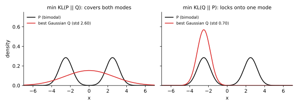

<ul class="post-sources">
<li markdown="span">질문 출처: [Science Vibe, 머신러닝 면접 질문 모음](https://jrc-park.tistory.com/259)</li>
</ul>

## 면접 답변

> KL divergence는 두 확률 분포의 차이를 재는 값으로, 실제 분포 P를 모델 분포 Q로 근사했을 때 추가로 드는 평균 정보량입니다. 항상 0 이상이고 두 분포가 같을 때만 0이 되지만, 대칭이 아니고 삼각 부등식도 만족하지 않아 수학적 거리는 아닙니다. 예를 들어 P가 (0.9, 0.1), Q가 (0.5, 0.5)이면 P에서 Q로의 값은 약 0.368내트이고 방향을 바꾸면 약 0.511내트로 다릅니다. 머신러닝에서 데이터 분포에 대한 KL을 최소화하는 것은 최대우도추정과 같고, VAE에서는 잠재 분포를 사전 분포에 가깝게 만드는 정규화 항으로 쓰입니다. 방향에 따라 근사의 성격도 달라서, 어느 쪽을 최소화하느냐는 실제적인 선택입니다.

## 자세한 설명

### 정의

같은 공간의 분포 $$P$$, $$Q$$에 대해 정의한다. 연속 분포에서는 합을 적분으로 바꾼다.

$$
D_{\text{KL}}(P \Vert Q) = \sum_x P(x) \log \frac{P(x)}{Q(x)} = \mathbb{E}_{x \sim P}\left[\log P(x) - \log Q(x)\right]
$$

$$P(x) > 0$$인데 $$Q(x) = 0$$인 $$x$$가 있으면 값은 $$+\infty$$이다. $$P(x) = 0$$인 항은 0으로 둔다.

교차 엔트로피 $$H(P, Q)$$와 엔트로피 $$H(P)$$로 쓰면 다음과 같다. 즉 $$Q$$에 최적화된 부호로 $$P$$를 표현할 때의 초과 길이이다.

$$
D_{\text{KL}}(P \Vert Q) = H(P, Q) - H(P)
$$

### 성질

- **비음수성**: $$D_{\text{KL}} \ge 0$$이고 등호는 두 분포가 같을 때만 성립한다(Gibbs 부등식). $$-\log$$가 볼록함수이므로 Jensen 부등식에서 나온다.
- **비대칭**: 일반적으로 $$D_{\text{KL}}(P \Vert Q) \ne D_{\text{KL}}(Q \Vert P)$$이다.
- **가역 변환 불변**: 연속 변수를 가역 변환해도 값이 유지된다.

$$P = (0.9, 0.1)$$, $$Q = (0.5, 0.5)$$의 계산은 다음과 같다.

$$
D_{\text{KL}}(P \Vert Q) = 0.9 \ln 1.8 + 0.1 \ln 0.2 \approx 0.368, \qquad
D_{\text{KL}}(Q \Vert P) = 0.5 \ln \tfrac{5}{9} + 0.5 \ln 5 \approx 0.511
$$

### 방향의 의미

이봉 분포 $$P$$(평균 $$\pm 2.5$$, 표준편차 0.7의 동일 혼합)에 가우시안 $$Q$$를 맞추었다. 격자 탐색으로 각 방향의 KL을 최소화한 결과이다.

*왼쪽: $$P \Vert Q$$를 최소화하면 평균 0, 표준편차 2.60으로 두 봉우리를 덮는다. 오른쪽: $$Q \Vert P$$를 최소화하면 평균 $$-2.5$$, 표준편차 0.70으로 한 봉우리에 맞는다. 대칭이므로 $$+2.5$$도 같은 최적이다.*

- **$$D_{\text{KL}}(P \Vert Q)$$ 최소화**: $$P(x) > 0$$인 곳에서 $$Q(x)$$가 작으면 큰 벌을 받으므로 $$P$$ 전체를 덮으려 한다. 가우시안의 경우 최적해는 $$P$$의 평균과 분산을 맞추는 것이다. 위 $$P$$의 표준편차 $$\sqrt{2.5^2 + 0.7^2} \approx 2.596$$과 일치한다.
- **$$D_{\text{KL}}(Q \Vert P)$$ 최소화**: $$P$$가 작은 곳에 $$Q$$를 두면 벌을 받으므로 한 봉우리 안에 머무른다. 변분 추론이 분산을 과소평가하는 경향의 원인이다.

### 머신러닝에서의 쓰임

**최대우도추정과의 동치.** 데이터 분포 $$p_{\text{data}}$$는 모델 파라미터 $$\theta$$와 무관하므로 다음이 성립한다.

$$
\arg\min_\theta D_{\text{KL}}(p_{\text{data}} \Vert p_\theta) = \arg\max_\theta \mathbb{E}_{x \sim p_{\text{data}}}\left[\log p_\theta(x)\right]
$$

**VAE.** 대각 가우시안 인코더와 표준정규 사전 분포 사이의 KL은 닫힌 형태이며, 차원 하나에 대해 다음과 같다.

$$
D_{\text{KL}}\left(\mathcal{N}(\mu, \sigma^2) \Vert \mathcal{N}(0, 1)\right) = \tfrac{1}{2}\left(\mu^2 + \sigma^2 - 1 - \ln \sigma^2\right)
$$

$$\mu = 0$$, $$\sigma = 1$$이면 0이 된다.

## 관련 개념

- **엔트로피와 교차 엔트로피**: KL의 두 구성 요소이다. [Q-79](/blog/2026/11/02/knowledge-79-entropy/), [Q-82](/blog/2026/11/02/knowledge-82-cross-entropy/)에서 다룬다.
- **상호 정보**: 결합 분포와 주변 분포의 곱 사이의 KL이다. [Q-81](/blog/2026/11/02/knowledge-81-mutual-information/)을 참고한다.
- **VAE와 ELBO**: KL 항의 역할은 [임커밋 VAE](/blog/2026/10/24/imc-06-vae/)에서 이어진다.
- **총 변동 거리**: 대칭인 분포 간 거리이며 Pinsker 부등식으로 KL과 연결된다. [Q-68](/blog/2026/11/02/knowledge-68-tv-distance/)을 참고한다.
- **GAN**: 최적 판별자 아래에서 원래의 GAN 목적은 Jensen-Shannon divergence와 연결된다. [Deep Learning 19](/blog/2026/10/22/dl-19-gans/)에서 다룬다.

## 꼬리 질문

**Q.** KL을 거리처럼 써도 되나요?
가까움의 척도로는 흔히 쓰지만 거리 공리는 만족하지 않습니다. 대칭이 필요하면 Jensen-Shannon divergence를, 지지 집합이 겹치지 않아도 의미 있는 값이 필요하면 Wasserstein 거리를 고려합니다.

**Q.** 지지 집합이 겹치지 않으면 어떻게 되나요?
$$D_{\text{KL}}(P \Vert Q)$$는 무한대가 되어 쓸모 있는 기울기를 주지 못할 수 있습니다. 그래서 모델 분포에 노이즈를 더하거나 다른 거리를 씁니다.

**Q.** 왜 변분 추론은 $$Q \Vert P$$ 방향을 쓰나요?
기댓값을 다룰 수 있는 $$Q$$에 대해 계산하므로 다룰 수 없는 $$P$$에서 샘플링하지 않아도 되고, 정규화 상수도 ELBO 유도에서 분리되기 때문입니다.
