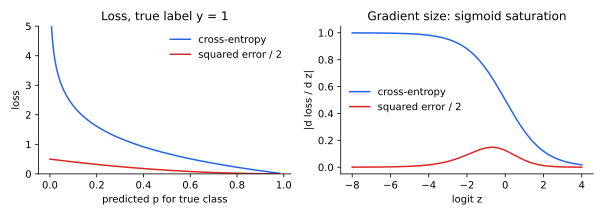

<ul class="post-sources">
<li markdown="span">질문 출처: [Science Vibe, 머신러닝 면접 질문 모음](https://jrc-park.tistory.com/259)</li>
</ul>

## 면접 답변

> 교차 엔트로피 손실은 분류 모델의 대표적인 손실 함수로, 정답 클래스의 예측 확률에 음의 로그를 취한 값을 평균합니다. 모델의 출력을 베르누이나 범주형 분포로 보면 이 값이 음의 로그 우도이므로, 최소화는 곧 최대우도추정입니다. 예측이 맞을수록 0에 가깝고 정답 확률이 0에 가까워지면 무한히 커져서, 확신에 찬 오답에 큰 벌을 줍니다. 시그모이드 출력에 제곱 오차를 쓰면 많이 틀린 샘플에서도 기울기가 포화되어 작아지는데, 교차 엔트로피는 로그가 이를 상쇄해 로짓 기준 기울기가 예측값과 정답의 차이가 됩니다. 예를 들어 소프트맥스 출력 0.659가 정답 클래스의 확률이면 손실은 약 0.417입니다. 또 무작위 예측의 손실은 클래스 수의 로그이므로, 학습 초기 값이 이와 크게 다르면 구현을 의심할 수 있습니다.

## 자세한 설명

### 형태

이론적 정의는 [Q-82](/blog/2026/11/02/knowledge-82-cross-entropy/)에서 다루었다. 샘플 $$n$$개, 정답 $$y_i$$에 대한 손실은 다음과 같다.

**이진 분류**: 로짓 $$z_i$$를 시그모이드에 통과시킨 예측 $$p_i = \sigma(z_i)$$와 $$y_i \in \{0, 1\}$$에 대해 다음과 같다.

$$
\mathcal{L} = -\frac{1}{n} \sum_{i=1}^{n} \left[y_i \log p_i + (1 - y_i) \log (1 - p_i)\right]
$$

**다중 클래스**: 로짓 $$\mathbf{z}_i \in \mathbb{R}^K$$에 소프트맥스를 적용한다. $$z_{ik}$$는 클래스 $$k$$의 로짓이다.

$$
\mathcal{L} = -\frac{1}{n} \sum_{i=1}^{n} \log \frac{\exp(z_{i y_i})}{\sum_{k=1}^{K} \exp(z_{ik})}
$$

예를 들어 로짓 $$(2, 1, 0.1)$$의 소프트맥스는 $$(0.659, 0.242, 0.099)$$이다. 정답이 각 클래스일 때 손실은 0.417, 1.417, 2.317이다.

### 최대우도와의 관계

레이블을 베르누이 분포 $$p_i^{y_i}(1 - p_i)^{1 - y_i}$$로 모델링하면, 독립인 샘플의 로그 우도에 음수를 취하고 평균한 것이 위 이진 손실이다. 다중 클래스도 범주형 분포로 같은 결과를 얻는다.

### 왜 분류에 제곱 오차보다 나은가

$$y = 1$$, $$p = \sigma(z)$$인 샘플의 로짓 기준 기울기를 비교한다. $$\tfrac{1}{2}(1 - p)^2$$는 제곱 오차이다.

$$
\frac{\partial \mathcal{L}_{\text{CE}}}{\partial z} = p - 1, \qquad
\frac{\partial}{\partial z}\left[\tfrac{1}{2}(1 - p)^2\right] = -(1 - p)^2 p
$$

제곱 오차에는 $$\sigma'(z) = p(1 - p)$$가 곱해진 것이 그대로 남아, $$p$$가 0에 가까우면 기울기도 사라진다. 교차 엔트로피에서는 $$-\log p$$의 미분 $$-1/p$$가 이를 상쇄한다.

| 로짓 $$z$$ | 예측 $$p$$ | CE 손실 | CE 기울기 크기 | $$\tfrac{1}{2}$$ 제곱 오차 | 제곱 오차 기울기 크기 |
|---:|---:|---:|---:|---:|---:|
| −6 | 0.0025 | 6.0025 | 0.9975 | 0.4975 | 0.0025 |
| −4 | 0.0180 | 4.0181 | 0.9820 | 0.4822 | 0.0173 |
| −2 | 0.1192 | 2.1269 | 0.8808 | 0.3879 | 0.0925 |
| 0 | 0.5000 | 0.6931 | 0.5000 | 0.1250 | 0.1250 |
| 2 | 0.8808 | 0.1269 | 0.1192 | 0.0071 | 0.0125 |

*왼쪽: 정답 클래스의 예측 확률에 따른 손실. 오른쪽: 로짓에 대한 기울기 크기. 많이 틀린 왼쪽 구간에서 제곱 오차의 기울기는 거의 사라진다.*

또한 로지스틱 회귀에서 교차 엔트로피는 파라미터에 대해 볼록(convex)이지만, 시그모이드에 제곱 오차를 쓰면 일반적으로 볼록하지 않다. 신경망에서는 어느 손실이든 파라미터에 대해 볼록하지 않다.

### 실무 포인트

- **로짓을 입력으로**: 확률을 구한 뒤 로그를 취하면 수치 오류가 나기 쉽다. PyTorch의 `CrossEntropyLoss`와 `BCEWithLogitsLoss`는 로짓을 받는다. `CrossEntropyLoss` 앞에 소프트맥스를 넣지 않아야 한다.
- **초기값 점검**: 균등 예측의 손실은 $$\ln K$$이다. 2클래스 0.693, 10클래스 2.303, 1,000클래스 6.908이다.
- **클래스 불균형**: 클래스 가중치나, 쉬운 샘플의 비중을 낮추는 focal loss를 쓴다. 다만 이런 조정은 확률 해석을 바꿀 수 있다.
- **레이블 스무딩(label smoothing)**: 원-핫 대신 소프트 레이블을 써서 과도한 확신을 줄인다.
- **손실과 정확도**: 정확도는 그대로인데 검증 손실만 오를 수 있다. 예측이 지나치게 확신에 차 있다는 신호이다. 보정(calibration)으로 확인한다.

## 관련 개념

- **교차 엔트로피**: 손실의 이론적 정의이다. [Q-82](/blog/2026/11/02/knowledge-82-cross-entropy/)를 참고한다.
- **시그모이드 함수**: 포화의 원인이다. [Q-20](/blog/2026/11/02/knowledge-20-sigmoid/)에서 다룬다.
- **로지스틱 회귀**: 이 손실로 학습하는 가장 기본적인 모델이다. [Machine Learning 3](/blog/2026/10/22/ml-03-logistic-regression/)에서 다룬다.
- **역전파**: 위 기울기가 망을 따라 전파된다. [Q-16](/blog/2026/11/02/knowledge-16-backpropagation/)을 참고한다.

## 꼬리 질문

**Q.** 다중 레이블 문제에서는 어떤 손실을 쓰나요?
클래스가 서로 배타적이지 않으므로 소프트맥스 대신 클래스마다 시그모이드와 이진 교차 엔트로피를 씁니다.

**Q.** 학습 손실이 0에 가까워졌는데도 로짓이 계속 커지는 이유는 무엇인가요?
분리 가능한 데이터에서는 로짓을 키울수록 손실이 줄어 최솟값에 유한한 해가 없기 때문입니다. 정규화나 조기 종료로 제어합니다.

**Q.** 회귀에는 왜 보통 MSE를 쓰나요?
가우시안 노이즈를 가정하면 음의 로그 우도가 제곱 오차가 되기 때문입니다. 즉 분류의 교차 엔트로피와 회귀의 MSE는 모두 최대우도라는 같은 원리에서 나옵니다.
