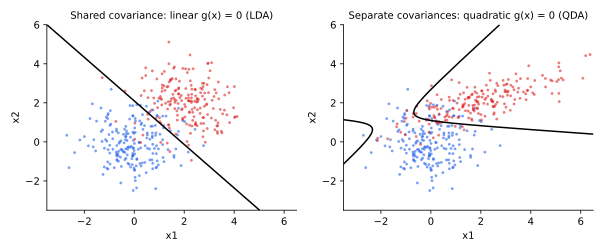

<ul class="post-sources">
<li markdown="span">질문 출처: [Science Vibe, 머신러닝 면접 질문 모음](https://jrc-park.tistory.com/259)</li>
</ul>

## 면접 답변

> 판별 함수는 입력을 받아 클래스별 점수를 내고, 그중 가장 큰 클래스로 분류하게 하는 함수입니다. 분류에는 어느 점수가 가장 큰지만 중요하므로, 점수가 꼭 확률일 필요는 없고 순서를 유지하는 변환을 해도 같은 분류기가 됩니다. 이진 분류는 함수 하나의 부호로 정할 수 있고, 그 값이 0인 곳이 결정 경계입니다. 예를 들어 평균이 (0, 0)과 (2, 2)이고 공분산이 단위 행렬이며 사전 확률이 같은 두 가우시안에서는, 판별 함수가 2x1 + 2x2 - 4가 되어 x1 + x2 = 2가 경계입니다. 공분산이 같으면 선형, 다르면 이차 경계가 나오는데 이것이 LDA와 QDA입니다. 이름이 비슷한 GAN의 판별자는 진짜와 가짜를 구분하도록 학습하는 신경망으로, 생성기 학습을 돕는 구성 요소입니다.

## 자세한 설명

### 정의

$$K$$개 클래스에 대해 함수 $$g_1(\mathbf{x}), \dots, g_K(\mathbf{x})$$를 두고 다음과 같이 분류한다.

$$
\hat{y} = \arg\max_k\, g_k(\mathbf{x})
$$

클래스 $$j$$와 $$k$$의 경계는 $$g_j(\mathbf{x}) = g_k(\mathbf{x})$$인 점들이다. 모든 $$g_k$$에 같은 단조 증가 함수를 적용해도 분류 결과는 변하지 않는다. 그래서 다음은 모두 같은 분류기를 준다.

$$
g_k(\mathbf{x}) = p(y = k \mid \mathbf{x}), \quad
g_k(\mathbf{x}) = p(\mathbf{x} \mid y = k)\, p(y = k), \quad
g_k(\mathbf{x}) = \log p(\mathbf{x} \mid y = k) + \log p(y = k)
$$

이진 분류에서는 하나의 함수 $$g(\mathbf{x}) = g_1(\mathbf{x}) - g_0(\mathbf{x})$$로 줄여 $$g(\mathbf{x}) > 0$$이면 클래스 1로 판단한다.

### 가우시안에서의 유도

클래스 $$k$$의 입력이 평균 $$\boldsymbol{\mu}_k$$, 공분산 $$\boldsymbol{\Sigma}_k$$인 가우시안이고 사전 확률이 $$\pi_k$$이면, 상수를 제외한 로그 형태의 판별 함수는 다음과 같다.

$$
g_k(\mathbf{x}) = -\tfrac{1}{2}(\mathbf{x} - \boldsymbol{\mu}_k)^\top \boldsymbol{\Sigma}_k^{-1} (\mathbf{x} - \boldsymbol{\mu}_k) - \tfrac{1}{2}\log \lvert \boldsymbol{\Sigma}_k \rvert + \log \pi_k
$$

공분산이 모두 같으면 $$\mathbf{x}$$의 이차항이 클래스끼리 소거되어 선형이 되고(LDA), 다르면 이차항이 남아 이차 경계가 된다(QDA). 공분산을 공유하는 두 클래스에서 $$g(\mathbf{x}) = \mathbf{w}^\top \mathbf{x} + w_0$$는 다음과 같다.

$$
\mathbf{w} = \boldsymbol{\Sigma}^{-1}(\boldsymbol{\mu}_1 - \boldsymbol{\mu}_0), \qquad
w_0 = -\tfrac{1}{2}(\boldsymbol{\mu}_1 + \boldsymbol{\mu}_0)^\top \boldsymbol{\Sigma}^{-1}(\boldsymbol{\mu}_1 - \boldsymbol{\mu}_0) + \log \frac{\pi_1}{\pi_0}
$$

**수치 예.** $$\boldsymbol{\mu}_0 = (0, 0)$$, $$\boldsymbol{\mu}_1 = (2, 2)$$, $$\boldsymbol{\Sigma} = \mathbf{I}$$, $$\pi_0 = \pi_1$$이면 $$\mathbf{w} = (2, 2)$$, $$w_0 = -4$$이다. 경계는 $$x_1 + x_2 = 2$$이다. 점 $$(1.5, 1)$$은 $$g = 2 \times 2.5 - 4 = 1 > 0$$이므로 클래스 1이다. 이 분포의 베이즈 오차는 $$1 - \Phi(\sqrt{8}/2) \approx 0.0786$$이다. $$\Phi$$는 표준정규 누적 분포 함수이다.

*시뮬레이션 표본에서 추정한 $$g(\mathbf{x}) = 0$$ 경계. 왼쪽은 공분산을 공유해 직선, 오른쪽은 클래스별 공분산을 써서 이차 곡선이 된다.*

### 세 가지 층위

분류기를 만드는 방식은 정보량이 많은 순으로 다음과 같이 나눌 수 있다.

| 방식 | 학습 대상 | 예 | 특징 |
|---|---|---|---|
| 생성 모델 | $$p(\mathbf{x} \mid y)$$, $$p(y)$$ | LDA, QDA, 나이브 베이즈 | 샘플링 가능, 가정이 강함 |
| 확률적 판별 모델 | $$p(y \mid \mathbf{x})$$ | 로지스틱 회귀 | 확률로 비용에 맞춰 결정 |
| 판별 함수 직접 학습 | $$g_k(\mathbf{x})$$ | 퍼셉트론, 선형 SVM | 간단함, 확률 없음 |

마지막 경우는 확률을 주지 않으므로, 오류 비용이나 클래스 비율이 달라졌을 때 임계값을 원리적으로 조정하기 어렵다. 다만 "판별 모델"과 "판별 함수"의 구분은 문헌마다 조금씩 다르다. 넓게는 $$p(y \mid \mathbf{x})$$도 판별 함수의 한 예이다.

### GAN의 판별자

질문 출처의 표기 Discrinator function은 오타로 보고 이 글에서는 판별 함수로 다루었다. GAN의 판별자(discriminator) $$D(\mathbf{x})$$는 진짜일 확률을 내는 이진 분류 신경망이며 이름만 비슷하다. 생성기가 고정이면 이진 교차 엔트로피의 최적해는 $$D^*(\mathbf{x}) = p_{\text{data}}(\mathbf{x}) / \left(p_{\text{data}}(\mathbf{x}) + p_g(\mathbf{x})\right)$$이다. 최종 목적이 분류가 아니라 생성기에 기울기를 주는 것이라는 점이 다르다. 자세한 내용은 [Deep Learning 19](/blog/2026/10/22/dl-19-gans/)에서 다룬다.

## 관련 개념

- **결정 이론**: 어떤 점수가 비용 측면에서 최적인지 알려 준다. [Q-76](/blog/2026/11/02/knowledge-76-decision-theory/)을 참고한다.
- **판별 모델과 생성 모델**: 위 표의 앞선 두 층위이다. [Q-85](/blog/2026/11/02/knowledge-85-discriminative-model/), [Q-84](/blog/2026/11/02/knowledge-84-generative-model/)에서 다룬다.
- **GDA**: 위 유도의 모델이다. [Machine Learning 5](/blog/2026/10/22/ml-05-gda/)를 참고한다.
- **SVM**: $$g(\mathbf{x}) = \mathbf{w}^\top \mathbf{x} + b$$를 마진 기준으로 학습한다. [Q-107](/blog/2026/11/02/knowledge-107-svm/)에서 다룬다.

## 꼬리 질문

**Q.** Fisher의 선형 판별은 위의 LDA와 같은가요?
Fisher의 기준은 클래스 간 분산과 클래스 내 분산의 비를 최대화하는 사영으로, 분포 가정 없이 유도됩니다. 두 클래스에서는 방향이 $$\boldsymbol{\Sigma}^{-1}(\boldsymbol{\mu}_1 - \boldsymbol{\mu}_0)$$로 같습니다. 임계값은 가우시안 가정을 더해야 정해집니다.

**Q.** QDA가 항상 LDA보다 좋은가요?
아닙니다. 클래스별 공분산을 추정하므로 파라미터가 차원의 제곱에 비례해 늘어, 표본이 적으면 분산이 커집니다. 실제 공분산이 비슷하면 LDA가 나을 수 있습니다.

**Q.** 다중 클래스에서 이진 판별 함수를 조합하면 문제가 있나요?
일대다나 일대일 투표로 합치면 어느 클래스로도 정해지지 않는 영역이 생길 수 있습니다. 클래스별 $$g_k$$를 두고 $$\arg\max$$를 쓰면 이 모호함을 피합니다.
