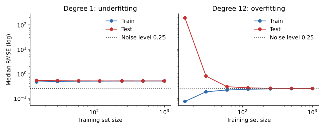

<ul class="post-sources">
<li markdown="span">질문 출처: [Science Vibe, 머신러닝 면접 질문 모음](https://jrc-park.tistory.com/259)</li>
</ul>

## 면접 답변

> 둘 다 새로운 데이터에서 성능이 나빠지지만, 틀리는 방식이 다릅니다.
> 과적합은 학습 데이터의 우연한 특성까지 외운 탓에 학습 성능이 실제 성능을 부풀리고, 학습 데이터가 조금만 바뀌어도 예측이 크게 흔들립니다.
> 과소적합은 있는 패턴을 놓쳐서 특정 구간에서 늘 같은 방향으로 틀리고, 학습 데이터에서조차 성능이 낮습니다.
> 실무에서 특히 중요한 차이는 대응 비용입니다. 예를 들어 과소적합인데 데이터를 더 모으면 비용만 쓰고 성능은 거의 그대로이고, 과적합인데 모델을 더 키우면 상황이 더 나빠집니다.
> 그래서 학습 곡선으로 어느 쪽인지 먼저 구분하는 것이 중요합니다.

## 자세한 설명

과적합 자체의 정의와 예는 [Q-13](/blog/2026/11/02/knowledge-13-overfitting/), 과소적합의 정의는 [Q-87](/blog/2026/11/02/knowledge-87-underfitting/)에서 다룬다. 여기서는 두 상태가 실제로 일으키는 문제를 나란히 비교한다.

### 문제 비교

| 관점 | 과적합 | 과소적합 |
|---|---|---|
| 일반화 성능 | 학습 성능보다 크게 낮음 | 학습 성능과 비슷하게 낮음 |
| 오차의 모양 | 예측이 데이터마다 달라짐(분산) | 같은 입력 구간에서 같은 방향으로 틀림(편향) |
| 평가의 위험 | 학습 성능을 믿으면 성능을 과대평가함 | 평가는 정직하지만 모델의 잠재력을 과소평가할 수 있음 |
| 해석의 위험 | 우연한 특징을 중요하다고 판단함 | 실제로 중요한 관계를 없다고 판단함 |
| 잔차 | 학습 데이터에서는 거의 없고, 새 데이터에서 큼 | 학습 데이터에서도 뚜렷한 구조가 남음 |
| 데이터를 늘리면 | 개선되는 경우가 많음 | 거의 개선되지 않음 |
| 잘못된 대응 | 모델을 더 키움 | 데이터 수집에 비용을 씀, 정규화를 더함 |

과소적합의 해석 위험은 쉽게 놓친다. 예를 들어 어떤 변수와 결과의 관계가 U자 모양이면 선형 모델의 계수는 0에 가깝게 나올 수 있다. 이것을 "관계가 없다"로 읽으면 틀린 결론이 된다. 과적합에서는 반대로, 표본이 적은 상황에서 잡음이 섞인 특징의 큰 계수를 실제 효과로 읽는 실수가 생긴다.

### 학습 곡선으로 본 차이

[Q-87](/blog/2026/11/02/knowledge-87-underfitting/)과 같은 합성 데이터($$y = \sin(\pi x) + \varepsilon$$, 노이즈 표준편차 0.25)에 1차와 12차 다항식을 맞추고, 데이터 크기마다 500번 반복한 RMSE의 중앙값을 그렸다.

*데이터 크기에 따른 학습 곡선(양쪽 로그 축). 1차는 처음부터 두 곡선이 약 0.5 부근에 붙어 있고, 12차는 큰 격차가 데이터가 늘면서 노이즈 수준으로 좁혀진다.*

| 학습 데이터 수 | 1차 학습 | 1차 테스트 | 12차 학습 | 12차 테스트 |
|---|---|---|---|---|
| 15 | 0.463 | 0.537 | 0.075 | 191.9 |
| 30 | 0.490 | 0.523 | 0.184 | 0.809 |
| 120 | 0.502 | 0.514 | 0.234 | 0.267 |
| 1000 | 0.508 | 0.511 | 0.248 | 0.252 |

두 가지를 읽을 수 있다.

- 데이터가 적을 때는 과적합이 훨씬 위험할 수 있다. 15개에서 12차의 테스트 RMSE는 약 192로, 1차의 0.537과 비교할 수 없이 나쁘다. 이 극단적인 값은 다항식이 구간 끝에서 크게 튀는 성질 탓이 크므로, 다른 모델에서도 이 정도라고 일반화해서는 안 된다.
- 데이터가 많을 때는 과소적합이 더 큰 문제가 된다. 1000개에서 12차는 0.252로 노이즈 수준에 거의 닿지만, 1차는 0.511에 머문다.

즉 과적합인지 과소적합인지는 모델만으로 정해지지 않고 데이터 양과의 관계로 정해진다. 같은 12차 모델이 15개에서는 심한 과적합이고 1000개에서는 거의 문제가 없다.

### 둘이 동시에 나타날 수도 있다

두 상태는 한 줄의 양끝처럼 보이지만 배타적이지 않다. 학습 오차가 기준 성능보다 높으면서 검증 오차와의 격차도 클 수 있다. 이때는 편향과 분산이 모두 높은 상태이다. 입력의 일부 구간은 잘 맞추지 못하고 다른 구간은 외우는 경우도 있으며, 신경망에서는 학습 데이터 일부 클래스에만 이런 현상이 나타나기도 한다. 그래서 전체 평균 오차와 함께 구간별, 클래스별 오차를 보는 것이 좋다.

## 관련 개념

- **편향-분산 분해**: 두 문제를 제곱 오차의 항으로 나눠 설명한다. [Q-28](/blog/2026/11/02/knowledge-28-bias-variance/)과 [Q-52](/blog/2026/11/02/knowledge-52-bias-variance-mse/)를 참고한다.
- **해결 방법**: 진단 뒤의 대응은 [Q-89](/blog/2026/11/02/knowledge-89-overfit-underfit-fixes/)에서 다룬다.
- **교차 검증**: 일반화 성능을 데이터 낭비를 줄여 추정한다. [Q-74](/blog/2026/11/02/knowledge-74-cross-validation/)를 참고한다.
- **데이터 분할**: 과적합을 발견하려면 학습에 쓰지 않은 데이터가 있어야 한다. [Q-12](/blog/2026/11/02/knowledge-12-train-test/)에서 다룬다.

## 꼬리 질문

**Q.** 둘 중 어느 쪽이 더 나쁜가요?
정해져 있지 않습니다. 데이터 양과 문제에 따라 다르고, 위 실험처럼 같은 모델도 데이터 크기에 따라 평가가 바뀝니다. 다만 과적합은 학습 성능만 보면 숨겨지므로, 검증 없이 배포했을 때 놀라는 쪽은 주로 과적합입니다.

**Q.** 학습 곡선 없이 데이터를 추가할 가치가 있는지 알 수 있나요?
학습 데이터의 일부만 써서 학습해 보면 곡선의 앞부분을 저렴하게 얻을 수 있습니다. 25%, 50%, 100%에서 검증 오차가 계속 내려가면 추가 데이터가 도움이 될 가능성이 큽니다.

**Q.** 과적합된 모델은 예측 확신도에도 문제가 있나요?
그럴 수 있습니다. 음의 로그 가능도를 계속 줄이다 보면 정확도는 그대로인데 확률값만 극단으로 가서 과신하는 모델이 됩니다. 검증 데이터로 온도 스케일링(temperature scaling) 같은 보정을 합니다.
