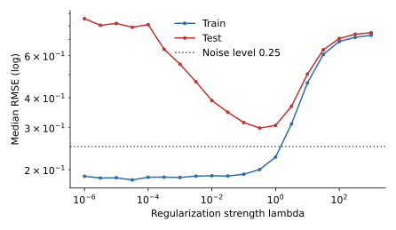

<ul class="post-sources">
<li markdown="span">질문 출처: [Science Vibe, 머신러닝 면접 질문 모음](https://jrc-park.tistory.com/259)</li>
</ul>

## 면접 답변

> 해결책은 대부분 서로 반대 방향이므로, 먼저 학습 오차와 검증 오차를 보고 진단합니다.
> 학습 오차가 낮은데 검증 오차와의 차이가 크면 과적합이고, 데이터를 늘리거나 증강하고, L2 정규화나 드롭아웃, 조기 종료를 쓰고, 필요하면 모델을 줄입니다.
> 학습 오차부터 기준 성능보다 높으면 과소적합이고, 더 표현력 있는 모델과 더 나은 특징을 쓰고, 정규화를 줄이고, 학습률과 학습 시간 같은 최적화 설정을 점검합니다.
> 예를 들어 12차 다항식에서 정규화 강도를 키워 가면 처음에는 과적합이 줄어 테스트 오차가 내려가다가, 너무 커지면 과소적합이 되어 다시 올라갑니다.
> 그래서 조절 값은 정답이 있는 것이 아니라 검증 성능으로 고르고, 최종 성능은 테스트 데이터로 한 번만 확인합니다.

## 자세한 설명

증상과 원인은 [Q-13](/blog/2026/11/02/knowledge-13-overfitting/), [Q-87](/blog/2026/11/02/knowledge-87-underfitting/), [Q-88](/blog/2026/11/02/knowledge-88-overfit-underfit-problems/)에서 다룬다. 여기서는 대응만 정리한다.

### 수단별 효과

| 수단 | 과적합 대응 | 과소적합 대응 |
|---|---|---|
| 데이터 | 더 모으기, 증강 | 양보다 입력 정보의 질을 높이기 |
| 특징 | 잡음 특징 제거, 선택 | 비선형 변환, 상호작용, 새 변수 추가 |
| 모델 크기 | 층, 차수, 트리 깊이 줄이기 | 늘리기 |
| 정규화 | 강화(L1, L2, 드롭아웃) | 완화 |
| 학습 과정 | 조기 종료 | 학습 더 오래 하기, 학습률 조정, 초기화와 정규화 층 점검 |
| 앙상블 | 배깅으로 분산 줄이기 | 부스팅으로 편향 줄이기 |

앙상블 행은 경향일 뿐이다. 부스팅도 라운드가 지나치면 과적합할 수 있다. 앙상블은 [Bagging](/blog/2026/11/02/knowledge-102-bagging/)과 [Boosting](/blog/2026/11/02/knowledge-104-boosting/)에서 다룬다.

### 실험: 하나의 조절 값으로 양쪽을 모두 보기

$$y = \sin(\pi x) + \varepsilon$$(노이즈 표준편차 0.25)에서 뽑은 30개에 12차 다항식(르장드르 기저)을 맞추고, ridge 정규화 강도 $$\lambda$$만 바꾸었다. $$\lambda$$마다 데이터를 새로 뽑아 500번 반복한 RMSE의 중앙값이다.

*정규화 강도에 따른 RMSE 중앙값(양쪽 로그 축). 왼쪽은 격차가 큰 과적합, 오른쪽은 두 곡선이 함께 높은 과소적합이다.*

| $$\lambda$$ | 학습 RMSE | 테스트 RMSE | 상태 |
|---|---|---|---|
| $$10^{-6}$$ | 0.188 | 0.857 | 과적합 |
| $$10^{-2}$$ | 0.189 | 0.389 | 과적합 완화 중 |
| 0.316 | 0.200 | 0.299 | 이 격자의 최솟값 |
| 10 | 0.461 | 0.502 | 과소적합 |
| 1000 | 0.730 | 0.748 | 심한 과소적합 |

여기서 테스트 오차로 $$\lambda$$를 비교한 것은 그림을 설명하기 위해서이다. 실제로는 이 곡선을 검증 집합이나 [교차 검증](/blog/2026/11/02/knowledge-74-cross-validation/)으로 그려서 값을 고른다. 테스트 데이터로 고르면 테스트 성능이 낙관적으로 나온다.

### 권장 순서

1. **기준을 정한다.** 사람의 성능이나 간단한 기준 모델을 목표와 비교한다.
2. **데이터와 코드를 점검한다.** 라벨 오류, 데이터 누수, 전처리 버그를 먼저 확인한다. 검증 성능이 비정상적으로 높거나 낮으면 모델보다 이쪽이 원인인 경우가 많다.
3. **학습 데이터에 맞출 수 있는지 본다.** 소량의 데이터로 손실이 거의 0까지 내려가는지 확인한다. 내려가지 않으면 표현력보다 최적화나 코드 문제일 가능성이 크다.
4. **과소적합을 먼저 없앤다.** 신경망에서는 흔히 충분히 큰 모델로 학습 오차를 먼저 낮춘다.
5. **그다음 과적합을 줄인다.** 증강과 정규화를 더하며 검증 성능을 본다.
6. **테스트 데이터는 마지막에 쓴다.**

### 흔한 실수

- 과소적합인데 드롭아웃을 더하면 문제가 더 심해진다.
- 증강을 무리하게 하면 라벨의 의미가 바뀔 수 있다. 숫자 6을 180도 돌리면 9처럼 보인다.
- 전체 데이터로 특징을 고른 뒤 교차 검증을 하면 정보가 새어 나가므로, 특징 선택도 각 fold 안에서 해야 한다.
- 검증 데이터로 설정을 너무 많이 시도하면 검증 데이터에도 과적합한다.

## 관련 개념

- **정규화(regularization)**: Ridge와 Lasso의 차이는 [Q-90](/blog/2026/11/02/knowledge-90-regularization/)에서 다룬다.
- **편향-분산 트레이드오프**: 각 수단이 어느 항을 움직이는지 설명한다. [Q-28](/blog/2026/11/02/knowledge-28-bias-variance/)과 [Machine Learning 10](/blog/2026/10/22/ml-10-bias-variance/)을 참고한다.
- **진단 실무**: 편향과 분산, 최적화와 목적함수를 구분하는 조언은 [Machine Learning 11](/blog/2026/10/22/ml-11-model-selection/)에 있다.
- **배치 정규화**: 학습을 안정시켜 과소적합 대응에 도움이 되고, 약한 정규화 효과도 있다고 알려져 있다. [Q-98](/blog/2026/11/02/knowledge-98-batch-normalization/)을 참고한다.

## 꼬리 질문

**Q.** 드롭아웃과 L2 중 무엇을 먼저 쓰나요?
정답은 없습니다. 신경망에서는 약한 가중치 감쇠를 기본으로 두고, 큰 완전연결 층이 있으면 드롭아웃을 더해 검증 성능으로 비교하는 경우가 많습니다.

**Q.** 모델을 키우면 항상 과적합이 심해지나요?
고전적인 범위에서는 대체로 그렇지만, 과매개변수화된 신경망에서는 이중 하강처럼 더 키웠을 때 오히려 테스트 오차가 줄어들기도 합니다. 파라미터 수보다 검증 성능으로 판단합니다.

**Q.** 데이터를 더 모을 수 없다면 어떻게 하나요?
증강, 전이 학습, 강한 사전 지식이 담긴 단순한 모델, 정규화를 고려합니다. 라벨 없는 데이터가 많다면 [준지도 학습](/blog/2026/11/02/knowledge-75-semi-supervised/)도 선택지입니다.
