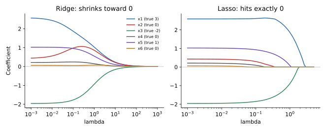

<ul class="post-sources">
<li markdown="span">질문 출처: [Science Vibe, 머신러닝 면접 질문 모음](https://jrc-park.tistory.com/259)</li>
</ul>

## 면접 답변

> 정규화는 학습 데이터에 대한 오차만 줄이지 않고 모델의 복잡도에도 제약을 걸어, 편향을 조금 늘리는 대신 분산을 줄여 일반화 성능을 높이는 기법입니다.
> 대표적으로 손실에 계수 크기의 벌점을 더하는데, Ridge는 계수 제곱합인 L2 벌점을, Lasso는 계수 절댓값 합인 L1 벌점을 씁니다.
> Ridge는 계수를 전반적으로 0 쪽으로 줄이지만 보통 정확히 0으로 만들지는 않고, Lasso는 일부 계수를 정확히 0으로 만들어 특징 선택 효과를 냅니다.
> 예를 들어 서로 강하게 상관된 두 변수가 있으면 Ridge는 계수를 둘에 나눠 주는 경향이 있고, Lasso는 그중 하나를 고르는 경향이 있습니다.
> 벌점의 세기 람다는 교차 검증으로 정하고, 특징의 단위에 영향을 받으므로 보통 먼저 표준화합니다.

## 자세한 설명

### 벌점이 있는 목적함수

입력 행렬을 $$X \in \mathbb{R}^{n \times p}$$, 타깃을 $$\mathbf{y} \in \mathbb{R}^n$$, 계수를 $$\boldsymbol{\beta} \in \mathbb{R}^p$$, 벌점의 세기를 $$\lambda \ge 0$$이라 하자.

$$
\hat{\boldsymbol{\beta}}_{\text{ridge}} = \arg\min_{\boldsymbol{\beta}} \lVert \mathbf{y} - X\boldsymbol{\beta} \rVert_2^2 + \lambda \lVert \boldsymbol{\beta} \rVert_2^2
$$

$$
\hat{\boldsymbol{\beta}}_{\text{lasso}} = \arg\min_{\boldsymbol{\beta}} \lVert \mathbf{y} - X\boldsymbol{\beta} \rVert_2^2 + \lambda \lVert \boldsymbol{\beta} \rVert_1
$$

$$\lVert \boldsymbol{\beta} \rVert_1 = \sum_j \lvert \beta_j \rvert$$이다. 절편은 보통 벌점에서 뺀다. Lasso의 손실 앞에 $$\tfrac{1}{2n}$$을 붙이는 구현도 많으므로, 라이브러리마다 $$\lambda$$의 눈금이 다를 수 있다.

Ridge는 닫힌 해가 있다.

$$
\hat{\boldsymbol{\beta}}_{\text{ridge}} = (X^\top X + \lambda I)^{-1} X^\top \mathbf{y}
$$

$$\lambda > 0$$이면 $$X^\top X + \lambda I$$는 항상 역행렬을 가지므로, $$p > n$$이거나 특징이 공선성을 가질 때도 해가 하나로 정해진다. Lasso는 일반적으로 닫힌 해가 없어 좌표 하강법 같은 반복법을 쓴다.

### 왜 Lasso만 정확히 0이 되는가

$$X^\top X = I$$인 경우에는 둘 다 최소제곱 해 $$\hat{\beta}_j^{\text{OLS}}$$로 표현된다.

$$
\hat{\beta}_j^{\text{ridge}} = \frac{\hat{\beta}_j^{\text{OLS}}}{1 + \lambda},
\qquad
\hat{\beta}_j^{\text{lasso}} = \operatorname{sign}(\hat{\beta}_j^{\text{OLS}}) \max\left(\lvert \hat{\beta}_j^{\text{OLS}} \rvert - \frac{\lambda}{2},\, 0\right)
$$

$$\lambda = 1$$이고 최소제곱 해가 $$(3, 0.4)$$라 하자.

| 방법 | $$\beta_1$$ | $$\beta_2$$ | 동작 |
|---|---|---|---|
| OLS | 3 | 0.4 | 벌점 없음 |
| Ridge | 1.5 | 0.2 | 같은 비율로 줄임 |
| Lasso | 2.5 | 0 | 같은 양을 빼고, 0을 넘으면 0으로 자름 |

L2 벌점의 기울기 $$2\lambda\beta_j$$는 $$\beta_j$$가 작아지면 함께 작아지므로, 0 근처에서는 미는 힘이 사라진다. L1 벌점의 기울기 크기는 0이 아닌 어디서나 $$\lambda$$로 일정해서, 작은 계수를 0까지 밀고 그곳에 묶어 둔다.

기하적으로는 제약 조건 형태로 볼 수 있다. L2 제약 영역은 원이고 L1 제약 영역은 축 위에 꼭짓점이 있는 마름모이므로, 손실의 등고선이 마름모의 꼭짓점에서 처음 닿기 쉽다. 꼭짓점에서는 일부 좌표가 0이다.

### 실험: 계수 경로

표준화한 특징 6개와 데이터 100개로 합성 문제를 만들었다. 참 계수는 $$(3, 0, -2, 0, 1, 0)$$이고, $$x_1$$과 $$x_2$$의 표본 상관은 0.93이다. 아래 계산의 목적함수는 $$\tfrac{1}{2n}\lVert \mathbf{y} - X\boldsymbol{\beta} \rVert_2^2$$에 Lasso는 $$\lambda \lVert \boldsymbol{\beta} \rVert_1$$, Ridge는 $$\tfrac{\lambda}{2}\lVert \boldsymbol{\beta} \rVert_2^2$$를 더한 것이다.

*합성 데이터의 계수 경로. Ridge는 계수가 매끄럽게 작아지고, Lasso는 계수가 차례로 정확히 0이 된다.*

| 방법 | $$\beta_1$$ | $$\beta_2$$ | $$\beta_3$$ | $$\beta_4$$ | $$\beta_5$$ | $$\beta_6$$ |
|---|---|---|---|---|---|---|
| OLS | 2.587 | 0.431 | -1.959 | 0.213 | 1.025 | 0.065 |
| Ridge ($$\lambda = 0.5$$) | 1.306 | 1.011 | -1.269 | 0.196 | 0.722 | 0.066 |
| Lasso ($$\lambda = 0.5$$) | 2.427 | 0 | -1.422 | 0 | 0.545 | 0 |

이 데이터에서 Lasso는 참 계수가 0인 세 변수를 모두 0으로 만들었고, Ridge는 상관된 $$x_1$$, $$x_2$$에 계수를 나눠 주어 참 계수가 0인 $$x_2$$가 1.011이 되었다. 다만 한 번의 합성 실험일 뿐이다. 상관이 강할 때 Lasso가 어느 변수를 고르는지는 표본에 따라 불안정할 수 있고, 그것이 항상 참 변수라는 보장은 없다.

### 비교

| 관점 | Ridge (L2) | Lasso (L1) |
|---|---|---|
| 계수 | 줄지만 보통 0이 아님 | 일부가 정확히 0 |
| 해 | 닫힌 해, 유일 | 반복법, 유일하지 않을 수 있음 |
| 상관된 특징 | 나눠 가짐 | 하나를 고르는 경향 |
| 잘 맞는 상황 | 작은 효과가 많은 경우 | 소수의 특징만 중요한 경우 |
| 베이즈 해석(MAP) | 가우시안 사전 분포 | 라플라스 사전 분포 |

두 벌점을 합친 **Elastic Net**은 $$\lambda_1 \lVert \boldsymbol{\beta} \rVert_1 + \lambda_2 \lVert \boldsymbol{\beta} \rVert_2^2$$을 쓰며, 희소성을 유지하면서 상관된 변수를 묶어 선택하는 경향이 있다.

벌점 외의 방법도 넓은 의미의 정규화이다. 드롭아웃, 조기 종료, 데이터 증강, 앙상블이 여기에 속한다. $$\lambda$$에 따른 학습 오차와 테스트 오차의 변화는 [Q-89](/blog/2026/11/02/knowledge-89-overfit-underfit-fixes/)의 실험에서 볼 수 있다.

## 관련 개념

- **편향-분산 트레이드오프**: $$\lambda$$를 키우면 대체로 분산은 줄고 편향은 는다. [Q-28](/blog/2026/11/02/knowledge-28-bias-variance/)을 참고한다.
- **MAP 추정**: 벌점 항은 사전 분포의 음의 로그에 해당한다. [Machine Learning 11](/blog/2026/10/22/ml-11-model-selection/)에서 다룬다.
- **교차 검증**: $$\lambda$$를 고르는 표준적인 방법이다. [Q-74](/blog/2026/11/02/knowledge-74-cross-validation/)를 참고한다.
- **Unbiased 추정과의 관계**: Ridge는 편향된 추정량이지만 MSE는 더 낮을 수 있다. [Q-56](/blog/2026/11/02/knowledge-56-unbiased-always-good/)에서 이어진다.
- **차원 축소**: Lasso는 원래 특징의 일부를 고르고, PCA는 새로운 축을 만든다. [Q-25](/blog/2026/11/02/knowledge-25-dimensionality-reduction/)를 참고한다.

## 꼬리 질문

**Q.** 왜 표준화를 먼저 하나요?
벌점은 계수의 크기를 보는데, 계수의 크기는 단위에 따라 달라집니다. 표준화하지 않으면 큰 단위로 측정된 변수는 계수가 작아 벌점을 덜 받습니다.

**Q.** L1은 0에서 미분이 안 되는데 어떻게 최적화하나요?
좌표 하강법의 소프트 임계값(soft thresholding) 업데이트나 근접 경사법(proximal gradient)을 씁니다. 수학적으로는 0에서 서브그래디언트(subgradient)를 사용합니다.

**Q.** 신경망의 weight decay는 L2 정규화와 같은가요?
기본 SGD에서는 같은 효과를 냅니다. 그러나 Adam처럼 적응형 옵티마이저에서는 손실에 L2를 더하는 것과 업데이트에서 직접 줄이는 것이 달라지므로 AdamW가 제안되었습니다. [Q-99](/blog/2026/11/02/knowledge-99-optimizers/)를 참고합니다.
