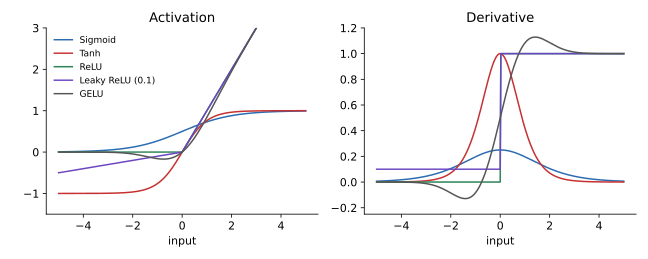

<ul class="post-sources">
<li markdown="span">질문 출처: [Science Vibe, 머신러닝 면접 질문 모음](https://jrc-park.tistory.com/259)</li>
</ul>

## 면접 답변

> 활성화 함수는 뉴런이 입력을 받아 출력을 내는 함수로, 신경망에 비선형성을 넣어 주는 역할을 합니다.
> 비선형 함수가 없으면 층을 아무리 쌓아도 선형 변환의 합성은 다시 선형 변환이어서, 한 층짜리 선형 모델과 표현력이 같습니다.
> 위키피디아의 분류로는 입력의 선형 결합에 작용하는 ridge 함수(ReLU, 시그모이드), 중심까지의 거리에 작용하는 radial 함수(가우시안 RBF), 여러 입력을 모아 값을 내는 folding 함수(풀링, 소프트맥스)가 있습니다.
> 다만 실무에서 더 흔한 구분은 모양에 따른 것으로, 시그모이드와 tanh 같은 포화형과 ReLU, Leaky ReLU, GELU 같은 ReLU 계열로 나눕니다.
> 예를 들어 은닉층에 시그모이드를 쓰면 미분값이 최대 0.25라서 깊어질수록 기울기가 빠르게 줄어들기 때문에, 요즘 은닉층의 기본값은 ReLU 계열입니다.

## 자세한 설명

### 왜 비선형이어야 하는가

활성화 함수가 항등 함수이면 두 층의 합성은 $$W_2(W_1 \mathbf{x}) = (W_2 W_1)\mathbf{x}$$로, 하나의 선형 변환이다. 비선형 함수 $$\phi$$를 사이에 넣어야 XOR 같은 비선형 관계를 표현할 수 있다. 다항식이 아닌 연속 활성화 함수를 쓰는 충분히 넓은 신경망은 컴팩트 집합 위의 연속 함수를 원하는 정밀도로 근사할 수 있다(보편 근사 정리, universal approximation theorem). 이 정리는 존재만 말할 뿐, 필요한 크기나 학습 가능성은 보장하지 않는다.

### 입력을 다루는 방식에 따른 분류: Ridge, Radial, Folding

Wikipedia의 Activation function 문서에 나오는 분류이다. 함수가 입력을 어떻게 받아들이는지를 기준으로 삼는다.

| 분류 | 형태 | 예 | 쓰임 |
|---|---|---|---|
| Ridge | $$\phi(\mathbf{w}^\top \mathbf{x} + b)$$ | 선형, ReLU, 시그모이드, 계단 함수 | 일반적인 은닉층 |
| Radial | $$\phi(\lVert \mathbf{x} - \mathbf{c} \rVert)$$ | 가우시안, 멀티쿼드릭 | RBF 네트워크 |
| Folding | 여러 입력을 집계 | 평균, 최대, 최소, 소프트맥스 | 풀링 층, 다중 분류 출력층 |

- **Ridge**: 출력이 $$\mathbf{w}$$ 방향의 투영에만 의존한다. $$\mathbf{w}$$에 수직인 방향으로는 값이 변하지 않아서 그래프가 능선(ridge)처럼 보인다.
- **Radial**: 중심 $$\mathbf{c}$$와의 거리에만 의존한다. 가우시안 $$\phi(r) = \exp(-r^2 / 2\sigma^2)$$는 중심 근처에서만 크게 반응하므로 국소적이다. 같은 거리의 점은 어느 방향이든 출력이 같다. RBF 커널은 [Machine Learning 7](/blog/2026/10/22/ml-07-kernels/)에서 다루는 커널 방법과 연결된다.
- **Folding**: 벡터를 받아 값을 집계한다. 최대 풀링은 $$\max_i x_i$$이고, 소프트맥스는 각 출력이 모든 입력에 의존한다. $$\mathbf{z} = (2, 1, 0.1)$$이면 소프트맥스 출력은 $$(0.659, 0.242, 0.099)$$로 합이 1이다.

이 분류는 교과서나 프레임워크에서 널리 쓰이는 표준이라기보다 정리를 위한 관점으로 이해하면 된다.

### 모양에 따른 분류: 포화형과 ReLU 계열

*자주 쓰는 활성화 함수와 도함수. 시그모이드와 tanh는 입력이 커지면 도함수가 0에 가까워지고, ReLU 계열은 양수 쪽 도함수가 약 1로 유지된다.*

| 함수 | 식 | 장점 | 단점 |
|---|---|---|---|
| Sigmoid | $$1 / (1 + e^{-x})$$ | 출력을 확률로 해석 | 포화, 도함수 최대 0.25, 출력이 0 중심이 아님 |
| Tanh | $$\tanh x$$ | 0 중심, 도함수 최대 1 | 양쪽에서 포화 |
| ReLU | $$\max(0, x)$$ | 계산이 간단, 양수 쪽 포화 없음 | 음수 입력만 받으면 기울기가 0(죽은 ReLU) |
| Leaky ReLU | $$\max(\alpha x, x)$$, $$0 < \alpha < 1$$ | 음수 쪽에도 기울기 유지 | $$\alpha$$를 정해야 함 |
| GELU | $$x\,\Phi(x)$$, $$\Phi$$는 표준 정규 CDF | 매끄러움, Transformer 계열에서 자주 쓰임 | 계산이 조금 더 많음 |

**기울기 소실**은 이 구분이 중요한 주된 이유이다. 역전파에서는 층마다 도함수가 곱해지므로, 가중치를 무시하고 대략적으로 보면 시그모이드 10층에서의 최대 배율은 $$0.25^{10} \approx 9.5 \times 10^{-7}$$이다. 이는 도함수만 본 상한이며, 실제 기울기는 가중치 크기와 함께 결정된다. 자세한 내용은 [Q-20](/blog/2026/11/02/knowledge-20-sigmoid/)을 참고한다.

### 어디에 무엇을 쓰는가

| 위치 | 일반적인 선택 |
|---|---|
| 은닉층 | ReLU 계열, Transformer에서는 GELU도 자주 씀 |
| 이진 분류 출력 | 시그모이드 |
| 다중 분류 출력 | 소프트맥스 |
| 회귀 출력 | 항등 함수 |
| LSTM과 GRU의 게이트 | 시그모이드(문을 여닫는 비율 표현) |

## 관련 개념

- **역전파**: 활성화 함수의 도함수가 기울기 흐름을 결정한다. [Q-16](/blog/2026/11/02/knowledge-16-backpropagation/)을 참고한다.
- **가중치 초기화**: 활성화 함수에 맞춰 초기 분산을 정한다. Xavier와 ReLU용 초기화는 [Deep Learning 7](/blog/2026/10/22/dl-07-init-batchnorm/)에서 다룬다.
- **교차 엔트로피 손실**: 소프트맥스나 시그모이드 출력과 함께 쓴다. [Q-83](/blog/2026/11/02/knowledge-83-cross-entropy-loss/)을 참고한다.
- **신경망 기초**: 항등 함수를 쓰면 안 되는 이유와 뉴런 구성은 [Machine Learning 8](/blog/2026/10/22/ml-08-neural-networks-1/)에서 다룬다.

## 꼬리 질문

**Q.** ReLU는 0에서 미분이 안 되는데 괜찮나요?
실제로는 문제가 거의 없습니다. 0에서는 서브그래디언트 중 하나(보통 0)를 쓰고, 입력이 정확히 0인 경우도 드뭅니다.

**Q.** 죽은 ReLU는 왜 생기고 어떻게 막나요?
큰 업데이트 등으로 입력이 거의 항상 음수가 되면 기울기가 0이어서 회복하기 어렵습니다. 학습률을 낮추거나, 적절히 초기화하거나, Leaky ReLU 같은 변형을 씁니다.

**Q.** 시그모이드 대신 왜 tanh가 은닉층에서 더 낫다고 하나요?
출력이 0을 중심으로 분포하고 도함수의 최댓값이 1이어서 기울기가 덜 줄어듭니다. 그래도 양쪽에서 포화되는 문제는 남습니다.
