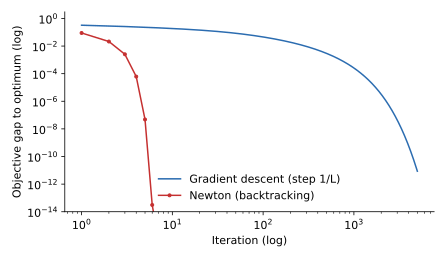

<ul class="post-sources">
<li markdown="span">질문 출처: [Science Vibe, 머신러닝 면접 질문 모음](https://jrc-park.tistory.com/259)</li>
</ul>

## 면접 답변

> 뉴턴법은 현재 위치에서 함수를 이차식으로 근사한 뒤, 그 이차식의 최솟값으로 바로 이동하는 2차 최적화 방법입니다.
> 경사하강법이 기울기만 쓰는 것과 달리 헤시안으로 곡률까지 반영하므로, 학습률을 따로 잡지 않아도 방향과 크기가 함께 정해지고 축마다 곡률이 달라도 잘 움직입니다.
> 해 근처에서는 오차가 매 단계 제곱으로 줄어드는 이차 수렴을 보입니다. 예를 들어 오차가 0.0625이면 다음 단계에 약 0.004, 그다음에 약 0.000015가 됩니다.
> 하지만 파라미터가 d개이면 헤시안 저장에 d의 제곱, 일반적인 풀이에 d의 세제곱 비용이 들고, 해에서 멀면 발산할 수 있으며, 비볼록 함수에서는 안장점으로 끌려갈 수 있습니다.
> 그래서 로지스틱 회귀 같은 저차원 볼록 문제에는 뉴턴법이나 L-BFGS를 쓰고, 큰 신경망에서는 보통 Adam 같은 1차 방법을 씁니다.

## 자세한 설명

### 유도

목적함수 $$f: \mathbb{R}^d \to \mathbb{R}$$의 현재 점 $$\mathbf{x}_t$$에서 그래디언트를 $$\mathbf{g}_t = \nabla f(\mathbf{x}_t)$$, 헤시안을 $$H_t = \nabla^2 f(\mathbf{x}_t)$$라 하자. 2차 테일러 근사는 다음과 같다.

$$
f(\mathbf{x}_t + \boldsymbol{\delta}) \approx f(\mathbf{x}_t) + \mathbf{g}_t^\top \boldsymbol{\delta} + \tfrac{1}{2}\boldsymbol{\delta}^\top H_t \boldsymbol{\delta}
$$

$$H_t$$가 양의 정부호(positive definite)이면 $$\boldsymbol{\delta}$$로 미분해 0으로 놓아 근사식의 최솟값을 얻는다.

$$
\mathbf{x}_{t+1} = \mathbf{x}_t - H_t^{-1} \mathbf{g}_t
$$

실제로는 역행렬을 구하지 않고 연립방정식 $$H_t \boldsymbol{\delta} = -\mathbf{g}_t$$를 푼다. 함수가 원래 이차식이면 이 근사는 정확하므로 한 번에 최솟값에 도달한다.

이름은 방정식의 근을 찾는 뉴턴-랩슨 $$x_{t+1} = x_t - h(x_t) / h'(x_t)$$에서 왔다. 최적화의 뉴턴법은 $$h = f'$$의 근을 찾는 것과 같다.

### 손으로 계산: 이차 수렴과 그 조건

$$f(x) = x - \ln x$$는 $$x > 0$$에서 볼록이고 $$x = 1$$에서 최소이다. $$f'(x) = 1 - 1/x$$, $$f''(x) = 1/x^2$$이므로 뉴턴 업데이트는 $$x_{t+1} = 2x_t - x_t^2$$이고, 오차로 쓰면 $$1 - x_{t+1} = (1 - x_t)^2$$이다.

| $$t$$ | $$x_t$$ | 오차 $$1 - x_t$$ |
|---|---|---|
| 0 | 0.5 | 0.5 |
| 1 | 0.75 | 0.25 |
| 2 | 0.9375 | 0.0625 |
| 3 | 0.99609 | 0.00391 |
| 4 | 0.9999847 | 0.0000153 |
| 5 | 0.9999999998 | $$2.3 \times 10^{-10}$$ |

맞는 자릿수가 단계마다 약 두 배가 된다. 그러나 이 빠른 수렴은 해 근처에서의 성질이다. 같은 함수에서 $$x_0 = 3$$으로 시작하면 $$x_1 = -3$$으로 정의역 밖에 나간다. 볼록 함수에서도 순수 뉴턴법은 발산할 수 있으므로, 실제로는 선 탐색(line search)이나 신뢰 영역(trust region)을 함께 쓴다.

### 실험: 로지스틱 회귀

합성 데이터(샘플 500개, 파라미터 10개, L2 벌점 $$10^{-3}$$, 특징의 표준편차 1에서 10까지)의 로지스틱 회귀를 비교했다. 최적점의 헤시안 조건수는 약 168이다. 뉴턴법에는 백트래킹 선 탐색을, 경사하강법에는 스텝 $$1/L$$을 썼다.

*로지스틱 회귀의 최적값과의 차이(양쪽 로그 축). 뉴턴법은 6번 만에 $$10^{-10}$$ 아래로 내려가고, 경사하강법은 1000번에도 약 $$3 \times 10^{-4}$$이다.*

단, 이 비교는 반복 횟수 기준이다. 뉴턴법의 한 단계는 경사하강법 한 단계보다 훨씬 비싸므로, 차원이 커지면 전체 시간은 역전될 수 있다.

로지스틱 회귀에 적용한 뉴턴법은 **IRLS(iteratively reweighted least squares)**라고도 부른다. 매 단계가 가중 최소제곱 문제와 같기 때문이다. 표본 $$\mathbf{x}_i$$의 예측 확률을 $$p_i$$라 할 때 헤시안은 $$\sum_i p_i(1 - p_i)\mathbf{x}_i \mathbf{x}_i^\top$$(벌점 항과 스케일 제외)이고, 이 값은 항상 양의 준정부호이다.

### 경사하강법과 비교

| 관점 | 경사하강법 | 뉴턴법 |
|---|---|---|
| 사용 정보 | 그래디언트 | 그래디언트와 헤시안 |
| 단계 비용 | $$O(d)$$ (그래디언트가 있을 때) | 저장 $$O(d^2)$$, 일반 풀이 $$O(d^3)$$ |
| 해 근처 수렴 | 선형 (강볼록일 때) | 이차 |
| 학습률 | 필요 | 기본 1, 보통 선 탐색과 함께 |
| 조건수의 영향 | 큼 | 이차식에서는 없음(아핀 불변) |
| 비볼록 함수 | 안장점에서 벗어나기 쉬움 | 순수 뉴턴은 안장점에 끌릴 수 있음 |

마지막 행이 중요하다. 순수 뉴턴법은 함수를 줄이는 방향이 아니라 $$\nabla f = 0$$인 점을 찾는다. 헤시안에 음의 고윳값이 있으면 그 방향으로는 오히려 함수값이 올라가는 쪽으로 움직여 안장점에 끌린다. 고차원 비볼록 문제에서 안장점이 왜 문제인지는 [Q-96](/blog/2026/11/02/knowledge-96-local-optimum/)에서 다룬다.

### 비용을 줄이는 변형

- **준뉴턴법(quasi-Newton), BFGS와 L-BFGS**: 그래디언트의 변화로 헤시안의 역을 근사한다. L-BFGS는 최근 벡터 몇 개만 저장한다.
- **가우스-뉴턴, 레벤버그-마콰트(Levenberg-Marquardt)**: 비선형 최소제곱용 근사이다. 후자는 $$H + \lambda I$$처럼 감쇠를 더한다.
- **헤시안-벡터 곱과 켤레 기울기법**: 헤시안 전체를 만들지 않고 자동 미분으로 곱만 계산해 방향을 구한다.

## 관련 개념

- **경사하강법**: 1차 방법의 기준이다. [Q-15](/blog/2026/11/02/knowledge-15-gradient-descent/)를 참고한다.
- **신경망에서 쓰지 않는 이유**: 뉴턴법의 이상과 현실은 [Deep Learning 4](/blog/2026/10/22/dl-04-optimization/)에서 다룬다.
- **볼록성**: 헤시안이 양의 준정부호이면 볼록이다. [Q-21](/blog/2026/11/02/knowledge-21-convex/)과 [Q-113](/blog/2026/11/02/knowledge-113-positive-definite/)을 참고한다.
- **적응형 옵티마이저**: Adam 등은 곡률에 맞춘 스케일 조절을 값싸게 흉내 내는 것으로 볼 수 있지만, 진짜 곡률을 쓰는 것은 아니다. [Q-99](/blog/2026/11/02/knowledge-99-optimizers/)를 참고한다.

## 꼬리 질문

**Q.** 왜 뉴턴법에는 학습률이 필요 없다고 하나요?
이차 근사의 최솟값이 이동량까지 정해 주기 때문입니다. 다만 근사가 부정확한 곳에서는 전체 스텝이 지나칠 수 있어서, 실제로는 선 탐색으로 스텝을 줄입니다.

**Q.** 헤시안이 양의 정부호가 아니면 어떻게 하나요?
$$H + \lambda I$$처럼 대각에 값을 더해 양의 정부호로 만들거나, 신뢰 영역 방법을 쓰거나, 준뉴턴 근사를 씁니다.

**Q.** 미니배치에서 L-BFGS를 쓰면 안 되나요?
가능은 하지만 조심해야 합니다. 그래디언트 차이로 곡률을 추정하므로 잡음에 민감하고 선 탐색도 어려워집니다. 전체 배치나 큰 배치에서 더 안정적입니다.
