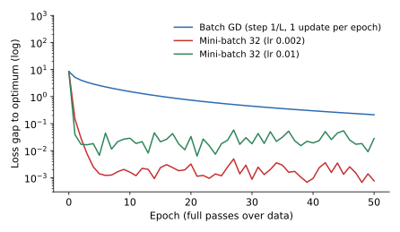

<ul class="post-sources">
<li markdown="span">질문 출처: [Science Vibe, 머신러닝 면접 질문 모음](https://jrc-park.tistory.com/259)</li>
</ul>

## 면접 답변

> SGD(확률적 경사하강법)는 전체 데이터의 그래디언트 대신, 무작위로 뽑은 샘플 하나나 미니배치의 그래디언트로 파라미터를 업데이트하는 방법입니다.
> 미니배치 그래디언트는 평균적으로 전체 그래디언트와 같은 불편 추정치이고, 잡음의 크기는 배치 크기가 커질수록 줄어듭니다.
> 데이터는 중복이 많아서 일부만 봐도 방향을 꽤 잘 알 수 있으므로, 같은 계산량으로 훨씬 많이 업데이트할 수 있습니다.
> 예를 들어 데이터 1만 개의 선형 회귀라면 전체 배치는 한 에폭에 한 번 업데이트하지만, 배치 크기 32는 313번 업데이트합니다. 조건수가 약 100인 합성 문제에서 재 보니, 한 에폭 뒤 최적값과의 손실 차이가 전체 배치는 5.14, 미니배치는 0.147이었습니다.
> 대신 학습률을 고정하면 최적점 근처에서 잡음 때문에 일정 수준 아래로 내려가지 못하므로 학습률을 점차 줄입니다.
> 참고로 실무에서 SGD라고 하면 보통 미니배치 SGD를 뜻합니다.

## 자세한 설명

### 업데이트

손실이 샘플별 손실의 평균 $$L(\mathbf{w}) = \frac{1}{n}\sum_{i=1}^n \ell_i(\mathbf{w})$$일 때, 크기 $$B$$인 미니배치 $$\mathcal{B}_t$$를 뽑아 다음과 같이 업데이트한다. $$\eta_t$$는 학습률이다.

$$
\mathbf{w}_{t+1} = \mathbf{w}_t - \eta_t\, \mathbf{g}_t,
\qquad
\mathbf{g}_t = \frac{1}{B} \sum_{i \in \mathcal{B}_t} \nabla \ell_i(\mathbf{w}_t)
$$

샘플을 균등하게 뽑으면 $$\mathbb{E}[\mathbf{g}_t] = \nabla L(\mathbf{w}_t)$$이다. 복원 추출에서 잡음의 크기는 다음과 같다.

$$
\mathbb{E}\left[\lVert \mathbf{g}_t - \nabla L \rVert^2\right] = \frac{\sigma^2}{B},
\qquad
\sigma^2 = \mathbb{E}_i\left[\lVert \nabla \ell_i - \nabla L \rVert^2\right]
$$

즉 배치를 4배로 키우면 잡음의 분산은 4분의 1, 표준편차는 2분의 1이 된다. 비용은 4배인데 잡음의 표준편차는 절반만 줄어드는 셈이다. 아래는 다음 절의 실험 데이터에서 $$\mathbf{w} = \mathbf{0}$$일 때 4000번 측정한 값으로, 위 식의 $$1/B$$ 관계와 잘 맞는다.

| 배치 크기 $$B$$ | 잡음 분산 | 분산 × $$B$$ |
|---|---|---|
| 1 | 8405 | 8405 |
| 4 | 2090 | 8359 |
| 16 | 515 | 8242 |
| 64 | 130 | 8341 |
| 256 | 32.9 | 8426 |

### 실험: 에폭당 진척과 잡음 바닥

샘플 1만 개, 특징 20개의 선형 회귀(노이즈 표준편차 0.5)에서 손실과 최적값의 차이를 비교했다. 특징의 표준편차를 1에서 10까지 달리해 헤시안의 조건수가 약 99이다. 전체 배치에는 이론적으로 안전한 표준 스텝 $$1/L$$($$L$$은 헤시안의 최대 고윳값, 약 100.8)을 주었고, 미니배치의 학습률은 몇 개를 시도해 골랐다.

*에폭에 따른 최적값과의 손실 차이(로그 축). 미니배치는 처음에 빠르게 내려간 뒤 잡음 바닥에 머물고, 학습률이 클수록 바닥이 높다.*

| 방법 | 초기 | 1 에폭 | 5 에폭 | 20 에폭 | 50 에폭 |
|---|---|---|---|---|---|
| 전체 배치 (스텝 $$1/L$$) | 8.39 | 5.14 | 2.57 | 0.737 | 0.213 |
| 미니배치 32 (학습률 0.002) | 8.39 | 0.147 | 0.0014 | 0.0032 | 0.0008 |
| 미니배치 32 (학습률 0.01) | 8.39 | 0.0393 | 0.0067 | 0.0334 | 0.0281 |

읽는 법은 다음과 같다.

- **초반은 SGD가 크게 앞선다.** 데이터 1만 개를 다 보는 비용으로 313번 업데이트하기 때문이다. 최적점에서 멀 때는 샘플들의 그래디언트 방향이 대체로 비슷하다. 다만 이 격차는 조건수에 달려 있다. 헤시안이 단위 행렬에 가까운 쉬운 문제라면 전체 배치도 몇 번 만에 수렴한다.
- **학습률을 고정하면 바닥이 있다.** 큰 학습률은 1 에폭에서 더 낮지만 바닥이 약 0.03으로 높고, 작은 학습률의 바닥은 약 0.001이다. 샘플별 그래디언트의 잡음이 최적점에서도 사라지지 않기 때문이다.
- **충분히 오래 돌리면 정밀도는 전체 배치가 앞설 수 있다.** 전체 배치는 잡음 없이 선형으로 수렴하므로 언젠가 이 바닥 아래로 내려간다. 다만 머신러닝의 목표는 학습 손실의 마지막 자리까지 줄이는 것이 아니라 일반화이다.

### 수렴과 학습률

학습률을 고정하면 잡음 바닥이 남으므로, 고전적으로는 다음 **Robbins-Monro 조건**을 만족하도록 줄인다.

$$
\sum_{t} \eta_t = \infty, \qquad \sum_{t} \eta_t^2 < \infty
$$

예를 들어 $$\eta_t \propto 1/t$$이다. 첫 조건은 충분히 멀리 갈 수 있게 하고, 둘째 조건은 잡음의 누적을 제한한다. 강볼록하고 매끄러운 경우에 $$\eta_t \propto 1/t$$이면 기대 오차가 $$O(1/t)$$로 줄어든다. 전체 배치의 선형 수렴보다는 반복당 느리지만, 반복당 비용이 $$n$$에 의존하지 않는다는 것이 장점이다. 비볼록 문제인 신경망에서는 코사인 감쇠나 단계 감쇠 같은 일정을 실험적으로 고른다.

### 실무 메모

- 한 에폭마다 데이터를 섞는다. 정렬된 순서로 배치를 만들면 그래디언트가 크게 치우친다.
- 평균 손실로 정의했다면, 배치를 키울 때 학습률도 함께 키우는 선형 스케일링 규칙이 경험적으로 쓰인다. 항상 성립하는 법칙은 아니다.
- 배치 크기의 일반화 효과는 잡음 때문이라는 설명이 많지만, 학습률과 일정을 함께 맞추면 차이가 줄어든다는 보고도 있어 아직 단정하기 어렵다. 이 논쟁은 [Q-96](/blog/2026/11/02/knowledge-96-local-optimum/)에서 다룬다.

## 관련 개념

- **경사하강법**: SGD의 전체 배치 기준이다. 배치 방식의 개요는 [Q-15](/blog/2026/11/02/knowledge-15-gradient-descent/)에서 다룬다.
- **옵티마이저**: 모멘텀과 Adam은 SGD의 그래디언트 추정치를 가공한다. [Q-99](/blog/2026/11/02/knowledge-99-optimizers/)를 참고한다.
- **강의 노트**: 미니배치와 학습률 감쇠, 튜닝은 [Deep Learning 4](/blog/2026/10/22/dl-04-optimization/)에서 자세히 다룬다.
- **역전파**: 미니배치의 그래디언트를 효율적으로 계산한다. [Q-16](/blog/2026/11/02/knowledge-16-backpropagation/)을 참고한다.

## 꼬리 질문

**Q.** 배치 크기는 어떻게 정하나요?
메모리와 속도로 먼저 범위를 정합니다. 32에서 256 사이가 흔한 시작점이지만 절대적인 값은 아닙니다. 바꾸면 학습률도 함께 다시 조정하고, 검증 성능으로 확인합니다.

**Q.** SGD의 잡음이 정말 일반화에 도움이 되나요?
그렇게 볼 근거들이 있지만 확정된 사실은 아닙니다. 지금은 유력한 가설 중 하나로 보는 것이 정확합니다.

**Q.** 복원 추출과 에폭마다 섞기는 무엇이 다른가요?
이론은 복원 추출이 다루기 쉽지만, 실무에서는 섞은 뒤 순서대로 소진하는 비복원 방식을 씁니다. 한 에폭 안에서 모든 샘플을 정확히 한 번씩 쓰게 되어 경험적으로 더 잘 동작하는 경우가 많습니다.
