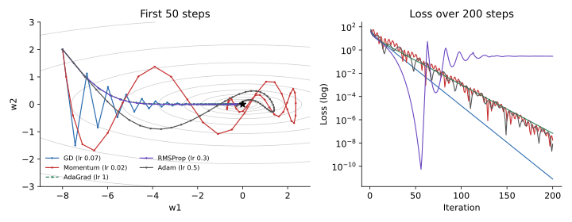

<ul class="post-sources">
<li markdown="span">질문 출처: [Science Vibe, 머신러닝 면접 질문 모음](https://jrc-park.tistory.com/259)</li>
</ul>

## 면접 답변

> 옵티마이저는 크게 그래디언트의 방향을 다듬는 계열과 파라미터별 스텝 크기를 조절하는 계열로 나눌 수 있습니다.
> 모멘텀은 과거 그래디언트를 누적해 일관된 방향으로 가속하고 진동을 줄이며, Nesterov는 앞을 내다본 지점에서 그래디언트를 계산합니다.
> AdaGrad는 그래디언트 제곱의 누적으로 나눠 자주 크게 변하는 파라미터의 스텝을 줄이지만, 누적이 계속 커져 학습률이 지나치게 작아지기 쉽고, RMSProp은 이를 지수 이동 평균으로 바꿔 해결합니다.
> Adam은 모멘텀과 RMSProp을 합치고 초기 편향까지 보정한 방법이며, AdamW는 weight decay를 그래디언트와 분리해 적응형 스케일링의 영향을 받지 않게 합니다.
> 예를 들어 빠르게 좋은 결과가 필요하거나 Transformer를 학습할 때는 AdamW를 자주 쓰고, 이미지 분류에서는 학습률 일정을 잘 맞춘 모멘텀 SGD도 여전히 많이 씁니다.
> 어느 하나가 항상 이기는 것은 아니므로, 문제와 튜닝 예산에 따라 고릅니다.

## 자세한 설명

### 공통 표기

$$\mathbf{g}_t$$는 $$t$$번째 미니배치 그래디언트, $$\eta$$는 학습률이고, 곱셈과 나눗셈, 제곱근은 원소별로 계산한다. SGD 자체는 [Q-95](/blog/2026/11/02/knowledge-95-sgd/)에서 다룬다.

$$
\text{SGD:} \quad \mathbf{w}_{t+1} = \mathbf{w}_t - \eta\, \mathbf{g}_t
$$

### 모멘텀과 Nesterov

$$
\mathbf{v}_{t+1} = \mu \mathbf{v}_t + \mathbf{g}_t,
\qquad
\mathbf{w}_{t+1} = \mathbf{w}_t - \eta\, \mathbf{v}_{t+1}
$$

$$\mu$$(보통 0.9)는 과거를 얼마나 유지할지 정한다. 그래디언트가 일정하면 스텝이 약 $$1 / (1 - \mu)$$배, 즉 10배까지 커진다. 방향이 번갈아 바뀌는 축에서는 서로 상쇄된다. **Nesterov**는 $$\mathbf{g}_t$$를 $$\mathbf{w}_t - \eta\mu\mathbf{v}_t$$에서 계산하여, 지나치기 전에 미리 보정한다.

### 적응형 학습률

**AdaGrad**: 제곱 그래디언트를 계속 더해 나눈다. 드물게 나타나는 특징에는 큰 스텝을 준다.

$$
\mathbf{s}_{t+1} = \mathbf{s}_t + \mathbf{g}_t^2,
\qquad
\mathbf{w}_{t+1} = \mathbf{w}_t - \frac{\eta\, \mathbf{g}_t}{\sqrt{\mathbf{s}_{t+1}} + \epsilon}
$$

**RMSProp**: 누적을 지수 이동 평균으로 바꿔, 오래된 값을 잊는다.

$$
\mathbf{s}_{t+1} = \rho\, \mathbf{s}_t + (1 - \rho)\, \mathbf{g}_t^2
$$

**Adam**: 일차 모멘트 $$\mathbf{m}$$과 이차 모멘트 $$\mathbf{s}$$를 함께 추적한다. 0에서 시작하므로 초기의 치우침을 $$1 - \beta^t$$로 나눠 보정한다. 원 논문의 권장값은 $$\beta_1 = 0.9$$, $$\beta_2 = 0.999$$, $$\epsilon = 10^{-8}$$이다.

$$
\mathbf{m}_t = \beta_1 \mathbf{m}_{t-1} + (1 - \beta_1)\mathbf{g}_t,
\qquad
\mathbf{s}_t = \beta_2 \mathbf{s}_{t-1} + (1 - \beta_2)\mathbf{g}_t^2
$$

$$
\hat{\mathbf{m}}_t = \frac{\mathbf{m}_t}{1 - \beta_1^t},
\qquad
\hat{\mathbf{s}}_t = \frac{\mathbf{s}_t}{1 - \beta_2^t},
\qquad
\mathbf{w}_{t+1} = \mathbf{w}_t - \frac{\eta\, \hat{\mathbf{m}}_t}{\sqrt{\hat{\mathbf{s}}_t} + \epsilon}
$$

**AdamW**: 손실에 L2를 더하면 그 항까지 $$\sqrt{\hat{\mathbf{s}}_t}$$로 나뉘어, 그래디언트가 큰 파라미터는 감쇠도 약해진다. AdamW는 감쇠를 이 나눗셈 밖에서 직접 적용한다(Loshchilov & Hutter, 2019). $$\lambda$$는 감쇠 계수이다.

$$
\mathbf{w}_{t+1} = \mathbf{w}_t - \frac{\eta\, \hat{\mathbf{m}}_t}{\sqrt{\hat{\mathbf{s}}_t} + \epsilon} - \eta\lambda \mathbf{w}_t
$$

### 비교

| 방법 | 방향 누적 | 파라미터별 스케일 | 장점 | 주의점 |
|---|---|---|---|---|
| SGD | 없음 | 없음 | 단순함 | 곡률이 다른 축에서 진동, 튜닝에 민감 |
| 모멘텀, Nesterov | 있음 | 없음 | 협곡에서 가속, 대규모 이미지 학습에 검증됨 | 학습률 일정이 중요 |
| AdaGrad | 없음 | 전체 누적 | 희소 특징에 유리 | 긴 학습에서 스텝이 너무 작아짐 |
| RMSProp | 없음 | 이동 평균 | 비정상 문제, RNN에서 많이 쓰임 | 끝에서 진동 가능 |
| Adam | 있음 | 이동 평균, 편향 보정 | 초기 튜닝이 쉬움 | 수렴 반례 존재, L2 결합 문제 |
| AdamW | 있음 | 이동 평균, 편향 보정 | 감쇠가 분리되어 Transformer 등에서 표준에 가까움 | 감쇠 계수와 일정 튜닝 필요 |

### 실험: 길쭉한 이차 함수

$$L(\mathbf{w}) = \tfrac{1}{2}(w_1^2 + 25 w_2^2)$$, 시작점 $$(-8, 2)$$(초기 손실 82)에서 잡음 없는 그래디언트로 돌렸다.

*왼쪽은 처음 50 스텝의 경로, 오른쪽은 200 스텝의 손실이다. AdaGrad(점선)와 RMSProp은 초반 경로가 거의 겹친다. 학습률은 직접 고른 값이다.*

| 방법 (학습률) | 10 스텝 | 25 스텝 | 50 스텝 | 100 스텝 |
|---|---|---|---|---|
| GD (0.07) | 7.65 | 0.850 | 0.0226 | 0.00002 |
| Momentum (0.02) | 3.40 | 6.45 | 0.424 | 0.00099 |
| AdaGrad (1.0) | 6.84 | 1.43 | 0.125 | 0.00102 |
| RMSProp (0.3) | 6.16 | 0.357 | 0.00000 | 0.398 |
| Adam (0.5) | 14.1 | 1.19 | 0.0941 | 0.00129 |

**이 표로 순위를 매기면 안 된다.** 학습률을 바꾸면 순서가 바뀌고, 잡음이 없는 2차원 이차식은 실제 신경망과 많이 다르다. 그래도 몇 가지 작동 방식은 볼 수 있다.

- **GD**: $$w_2$$ 축에서 지그재그로 움직인다. 이 문제의 안정성 한계는 $$2/25 = 0.08$$이므로, 곡률이 큰 축 때문에 학습률을 키울 수 없다.
- **Momentum**: 크게 돌며 관성으로 지나쳐서, 25 스텝에서 손실이 잠시 다시 커진다.
- **AdaGrad, RMSProp**: 초반에 그래디언트의 크기가 정규화되어, 두 축을 비슷한 크기로 움직인다.
- **RMSProp**: 50 스텝에서 거의 0에 닿고도 100 스텝에는 0.398로 돌아왔고, 200 스텝에도 약 0.29에 머문다. 그래디언트가 작아지면 분모도 작아져 스텝 크기가 줄지 않기 때문이다. 학습률을 일정에 따라 줄여야 하는 이유이다.

### 어떻게 고르는가

- **먼저 시도**: Adam이나 AdamW는 튜닝 없이도 비교적 빨리 작동하는 경우가 많다.
- **Transformer 계열**: AdamW에 warmup과 감쇠 일정을 함께 쓰는 것이 흔하다.
- **이미지 분류**: 모멘텀 SGD도 강력하다. Wilson et al.(2017)은 일부 과제에서 적응형 방법의 일반화가 더 나쁠 수 있다고 보고했지만, 충분히 튜닝하면 차이가 줄어든다는 후속 보고도 있어 단정할 수는 없다.
- **희소 특징**: AdaGrad 계열이 여전히 선택지가 된다.
- **이론적 주의점**: Adam은 일부 볼록 문제에서 수렴하지 않는 반례가 있고(Reddi et al., 2018), AMSGrad가 이를 보완하려는 변형이다.
- **풀 배치와 저차원 문제**: [뉴턴법이나 L-BFGS](/blog/2026/11/02/knowledge-94-newton-method/)가 더 나을 수 있다.

학습률 일정은 옵티마이저 종류만큼 중요할 때가 많다.

## 관련 개념

- **강의 노트**: 뉴턴법에서 Adam까지의 흐름과 학습률 튜닝은 [Deep Learning 4](/blog/2026/10/22/dl-04-optimization/)에서 다룬다.
- **경사하강법**: 모든 옵티마이저의 출발점이다. [Q-15](/blog/2026/11/02/knowledge-15-gradient-descent/)를 참고한다.
- **Weight decay와 L2**: 벌점의 의미는 [Q-90](/blog/2026/11/02/knowledge-90-regularization/)에서 다룬다.
- **손실 지형**: 안장점과 옵티마이저의 관계는 [Q-96](/blog/2026/11/02/knowledge-96-local-optimum/)을 참고한다.
- **배치 정규화**: 큰 학습률을 가능하게 해서 옵티마이저 설정에 영향을 준다. [Q-98](/blog/2026/11/02/knowledge-98-batch-normalization/)을 참고한다.

## 꼬리 질문

**Q.** Adam에서 학습률이 자동으로 정해지면 학습률을 튜닝할 필요가 없나요?
아닙니다. 파라미터 간 상대적인 스케일을 조절할 뿐 전체 $$\eta$$는 여전히 가장 중요한 하이퍼파라미터입니다.

**Q.** Adam의 $$\epsilon$$은 왜 있나요?
0으로 나누는 것을 막는 값입니다. 다만 일부 문제에서는 $$10^{-8}$$보다 큰 값을 쓰는 것이 더 안정적이어서, 단순한 수치 안전장치 이상으로 튜닝 대상이 되기도 합니다.

**Q.** 모멘텀을 쓰면 학습률은 어떻게 바꾸나요?
같은 방향의 유효 스텝이 약 $$1 / (1 - \mu)$$배로 커지므로, 모멘텀 없이 쓰던 값보다 학습률을 낮추는 것이 보통입니다. 위 실험에서도 GD는 0.07, 모멘텀은 0.02를 썼습니다.
