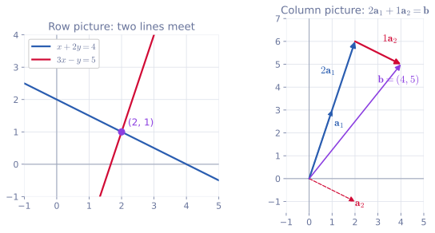

<ul class="post-sources">
<li markdown="span">[혁펜하임의 "보이는" 선형대수학](https://www.youtube.com/playlist?list=PL_iJu012NOxdZDxoGsYidMf2_bERIQaP0) 1-1–1-2강 정리</li>
</ul>

이 시리즈는 그림으로 감을 잡는 데 초점을 둔 강의를 정리한다. 같은 내용을 더 엄밀하게 다룬 [Linear Algebra 1](/blog/2026/10/22/la-01-linear-systems/)과 함께 보면 좋다.

## 선형대수학은 무엇을 공부하는가

[▶ 1-1강](https://www.youtube.com/watch?v=7vV2SF8DyQE)

### 이름은 거창하지만 다루는 것은 일차방정식이다

"대수(algebra)"는 숫자 대신 문자를 쓴다는 뜻이다. 결국 하는 일은 방정식을 푸는 것이다. 중학교에서 배운 $$x^2 - 3x + 2 = 0$$ 같은 이차방정식은 이 식을 만족하는 $$x$$를 찾는 문제였다.

선형대수학은 여기서 한 걸음 더 좁힌다. **선형 방정식(linear equation)**, 즉 구하고 싶은 미지수에 대해 일차인 방정식만 다룬다. 제곱, 지수, 로그, 사인 같은 것은 모두 빠진다. 미지수가 $$x_1, \dots, x_n$$일 때 선형 방정식은

$$
a_1 x_1 + a_2 x_2 + \cdots + a_n x_n = b
$$

꼴이다. 여기서 $$a_1, \dots, a_n$$은 **계수(coefficient)**, $$b$$는 상수항이며 둘 다 이미 아는 숫자다. 미지수끼리 곱하거나($$x_1 x_2$$) 미지수에 함수를 씌우는($$\sin x_1$$) 항이 하나라도 있으면 선형이 아니다.

다루는 범위가 좁다는 것은 오히려 장점이다. 일반적인 비선형 방정식은 어렵지만, 일차방정식만 모아 놓으면 규칙이 아주 깔끔해서 미지수가 수천 개여도 체계적으로 풀 수 있다. 그리고 신호 처리, 최적화, 딥러닝 어디에서나 이 규칙이 쓰인다.

### "선형"은 무엇에 대해 선형인가의 문제다

선형인지 아닌지는 **무엇을 미지수로 보느냐**에 따라 달라진다. $$a x^2 + b x + c = 0$$은 $$x$$에 대해서는 이차방정식이다. 그런데 $$x_1 = x^2$$, $$x_2 = x$$를 각각 별개의 미지수로 보면

$$
a x_1 + b x_2 + c = 0
$$

이 되어 $$(x_1, x_2)$$에 대한 선형 방정식, 즉 평면 위의 직선의 방정식이다. 이렇게 관점을 바꾸는 기법은 회귀 분석에서 다항식을 맞출 때 실제로 쓰인다. 다만 이 강의에서는 처음부터 미지수에 대해 일차인 식만 다룬다고 생각하면 충분하다.

### 행렬과 벡터는 선형 방정식을 적는 도구다

선형 방정식을 여러 개 모은 것을 선형대수학에서는 **행렬(matrix)**과 **벡터(vector)**로 적는다. 그래서 "선형대수학은 행렬과 벡터를 공부하는 학문"이라고 말한다. 다음 절에서 이 표기가 어떻게 나오는지 본다.

## 연립일차방정식, 행렬과 벡터

[▶ 1-2강](https://www.youtube.com/watch?v=LWSHUd1FPTs)

### 연립일차방정식

일차방정식을 여러 개 동시에 만족시키는 미지수를 찾는 문제가 **연립일차방정식(system of linear equations)**이다. 예를 들어

$$
\begin{aligned}
x + 2y &= 4 \\
3x - y &= 5
\end{aligned}
$$

를 생각한다. 두 번째 식에 2를 곱해 첫 번째 식에 더하면 $$y$$가 사라지고 $$7x = 14$$, 즉 $$x = 2$$가 된다. 이를 첫 번째 식에 넣으면 $$y = 1$$이다.

이 풀이에서 실제로 손댄 것은 무엇인가. 식에 숫자를 곱하고 다른 식에 더하는 동안 바뀐 것은 **계수**와 **우변의 숫자**뿐이었다. $$x$$, $$y$$라는 글자는 자리만 지키고 있었다. 미지수가 다섯 개, 식이 열 개쯤 되면 글자를 매번 쓰는 것도 번거롭고 알파벳도 모자란다. 그렇다면 중요한 숫자만 위치를 지켜 따로 적자는 생각이 자연스럽다.

### 계수는 행렬, 미지수와 우변은 벡터

계수를 식에 적힌 위치 그대로 옮겨 대괄호로 묶은 것이 행렬이다. 우변의 숫자는 세로로 한 줄 쌓아 묶고, 미지수도 같은 방식으로 세로로 쌓는다. 숫자를 한 줄로 쌓은 것이 벡터다.

$$
\underbrace{\begin{bmatrix} 1 & 2 \\ 3 & -1 \end{bmatrix}}_{A}
\underbrace{\begin{bmatrix} x \\ y \end{bmatrix}}_{\mathbf{x}}
=
\underbrace{\begin{bmatrix} 4 \\ 5 \end{bmatrix}}_{\mathbf{b}}
$$

이렇게 연립일차방정식 전체가 $$A\mathbf{x} = \mathbf{b}$$ 한 줄로 줄어든다.

엄밀하게는 벡터는 덧셈과 스칼라 곱이 정의된 **벡터 공간(vector space)**의 원소로 정의된다. 이 강의에서는 그 추상적인 정의 대신 "벡터는 숫자를 한 줄로 쌓은 것, 행렬은 숫자를 직사각형으로 늘어놓은 것"으로 충분하다.

### 행렬의 용어와 표기

- 가로줄을 **행(row)**, 세로줄을 **열(column)**이라 한다. "행렬"이라는 이름이 여기서 나온다.
- 행이 $$m$$개, 열이 $$n$$개인 행렬을 $$m \times n$$ 행렬이라 하고 "m by n"이라고 읽는다. 위의 $$A$$는 $$2 \times 2$$ 행렬이다. 실수 성분을 가진 $$m \times n$$ 행렬 전체의 집합은 $$\mathbb{R}^{m \times n}$$으로 적는다.
- 세로로 쌓은 벡터는 **열벡터(column vector)**, 가로로 늘어놓은 벡터는 **행벡터(row vector)**다. 위의 $$\mathbf{x}$$와 $$\mathbf{b}$$는 $$2 \times 1$$ 열벡터다. 앞으로 그냥 "벡터"라고 하면 열벡터를 뜻한다.
- $$i$$행 $$j$$열에 있는 숫자를 **성분(element, entry)**이라 하고 소문자로 $$a_{ij}$$라 쓴다. 위의 $$A$$에서 $$a_{11} = 1$$, $$a_{12} = 2$$, $$a_{21} = 3$$, $$a_{22} = -1$$이다.
- 숫자 하나는 **스칼라(scalar)**라 한다. 스칼라와 구별하려고 벡터는 굵은 소문자 $$\mathbf{x}$$, 행렬은 굵은 대문자나 대문자 $$A$$로 쓴다. (강의에서는 손글씨로 벡터 아래에 밑줄을 긋는다. 논문에서는 보통 기울이지 않은 굵은 글씨를 쓴다.)

### 행렬과 벡터의 곱

$$A\mathbf{x} = \mathbf{b}$$에서 원래의 연립방정식으로 돌아갈 수 있어야 이 표기가 의미를 가진다. 그러려면 행렬과 벡터의 곱을 다음과 같이 정의해야 한다.

> $$A\mathbf{x}$$의 $$i$$번째 성분은 $$A$$의 $$i$$번째 행과 $$\mathbf{x}$$의 성분을 차례로 곱해 더한 값이다.

$$
\begin{bmatrix} 1 & 2 \\ 3 & -1 \end{bmatrix}
\begin{bmatrix} x \\ y \end{bmatrix}
=
\begin{bmatrix} 1 \cdot x + 2 \cdot y \\ 3 \cdot x + (-1) \cdot y \end{bmatrix}
$$

첫 번째 행 $$(1, 2)$$를 $$\mathbf{x}$$와 짝지어 곱해 더하면 $$x + 2y$$, 두 번째 행 $$(3, -1)$$로 같은 일을 하면 $$3x - y$$가 나온다. 이것을 $$(4, 5)$$와 같다고 놓으면 원래의 두 식이 그대로 돌아온다. 일반적으로 $$A$$가 $$m \times n$$이면

$$
(A\mathbf{x})_i = a_{i1}x_1 + a_{i2}x_2 + \cdots + a_{in}x_n, \qquad i = 1, \dots, m
$$

이다. 행의 길이와 $$\mathbf{x}$$의 길이가 같아야 짝을 지을 수 있으므로, $$A$$의 열 개수 $$n$$과 $$\mathbf{x}$$의 성분 개수가 같아야 곱이 정의되고, 결과는 성분이 $$m$$개인 벡터다.

**확인.** 해 $$(x, y) = (2, 1)$$을 넣으면 $$1 \cdot 2 + 2 \cdot 1 = 4$$, $$3 \cdot 2 - 1 \cdot 1 = 5$$로 $$\mathbf{b} = (4, 5)$$가 나온다.

### 같은 식을 보는 두 가지 그림

*왼쪽: 식 하나가 직선 하나이고, 해는 두 직선의 교점이다. 오른쪽: 같은 해 $$(2, 1)$$은 $$A$$의 두 열을 2배, 1배 해서 더하면 $$\mathbf{b}$$가 된다는 뜻이기도 하다.*

왼쪽은 각 식(행)을 직선으로 그린 **행 그림(row picture)**이다. 파란 직선 $$x + 2y = 4$$와 빨간 직선 $$3x - y = 5$$가 $$(2, 1)$$에서 만나고, 이 교점이 두 식을 동시에 만족하는 유일한 점이다.

오른쪽은 같은 식을 열 단위로 본 **열 그림(column picture)**이다. $$A$$의 첫 번째 열 $$\mathbf{a}_1 = (1, 3)$$과 두 번째 열 $$\mathbf{a}_2 = (2, -1)$$을 쓰면

$$
A\mathbf{x} = x\,\mathbf{a}_1 + y\,\mathbf{a}_2 = 2\begin{bmatrix} 1 \\ 3 \end{bmatrix} + 1\begin{bmatrix} 2 \\ -1 \end{bmatrix} = \begin{bmatrix} 4 \\ 5 \end{bmatrix}
$$

이다. $$\mathbf{a}_1$$ 방향으로 두 칸, 이어서 $$\mathbf{a}_2$$ 방향으로 한 칸 가면 $$\mathbf{b}$$에 도착한다. 연립방정식을 푼다는 것은 "열들을 얼마씩 섞어야 $$\mathbf{b}$$가 되는가"를 찾는 일이기도 하다. 이 열 그림은 [강의 3](/blog/2026/11/05/hpla-03-matrix-product/)의 열 공간에서 핵심 관점이 된다.

### 흔한 실수

- **크기 순서를 바꿔 쓴다.** $$m \times n$$은 항상 (행의 수) $$\times$$ (열의 수)이다. $$2 \times 3$$ 행렬은 행이 2개, 열이 3개다.
- **곱할 수 없는 것을 곱한다.** $$2 \times 3$$ 행렬에는 성분이 3개인 벡터만 곱할 수 있다. 성분이 2개인 벡터를 곱하면 짝이 맞지 않는다.
- **$$a_{ij}$$의 첨자 순서를 헷갈린다.** 앞의 첨자가 행, 뒤의 첨자가 열이다. $$a_{21}$$은 2행 1열이다.
- **미지수에 대한 선형성을 착각한다.** $$a x_1 + b x_2 = c$$에서 계수 $$a, b$$가 어떤 복잡한 수여도 상관없다. 선형인지는 미지수 $$x_1, x_2$$가 일차로만 등장하는지로 판단한다.

## 정리

- 선형대수학은 미지수에 대해 일차인 방정식만 다루며, 그 덕분에 미지수가 많아도 체계적으로 풀 수 있다.
- 연립일차방정식에서 중요한 것은 계수와 우변뿐이므로, 계수를 행렬 $$A$$로, 미지수와 우변을 벡터 $$\mathbf{x}$$, $$\mathbf{b}$$로 적어 $$A\mathbf{x} = \mathbf{b}$$로 쓴다.
- $$m \times n$$ 행렬은 행이 $$m$$개, 열이 $$n$$개이고, 성분 $$a_{ij}$$는 $$i$$행 $$j$$열에 있다.
- $$A\mathbf{x}$$의 $$i$$번째 성분은 $$A$$의 $$i$$번째 행과 $$\mathbf{x}$$를 성분끼리 곱해 더한 값이다. $$A$$의 열 수와 $$\mathbf{x}$$의 길이가 같아야 한다.
- 같은 연립방정식을 직선들의 교점(행 그림)으로도, 열들을 섞어 $$\mathbf{b}$$를 만드는 문제(열 그림)로도 볼 수 있다.
