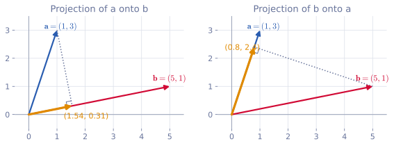
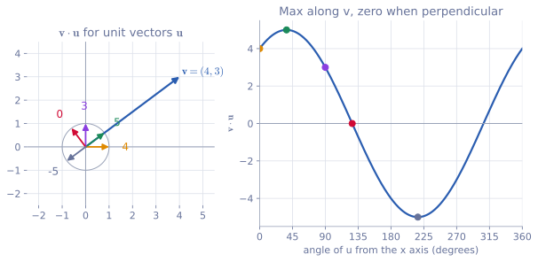
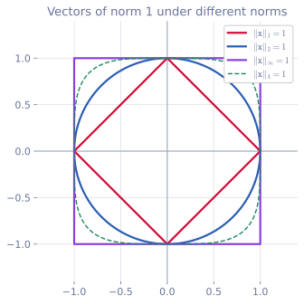

<ul class="post-sources">
<li markdown="span">[혁펜하임의 "보이는" 선형대수학](https://www.youtube.com/playlist?list=PL_iJu012NOxdZDxoGsYidMf2_bERIQaP0) 2-1–2-4강 정리</li>
</ul>

이번 강의들은 뒤에서 계속 꺼내 쓸 재료를 모으는 단계다. 필요할 때 사전처럼 찾아보는 용도로 써도 된다. 같은 내용을 다른 순서로 다룬 글로는 [Linear Algebra 1](/blog/2026/10/22/la-01-linear-systems/)(전치, 덧셈)과 [Linear Algebra 5](/blog/2026/10/22/la-05-least-squares/)(내적, 노름, 거리)가 있다.

## 벡터의 덧셈, 뺄셈, 스칼라배

[▶ 2-1강](https://www.youtube.com/watch?v=a9WcCSk_LmE)

### 벡터를 화살표로 그리기

벡터 $$\mathbf{v} = (3, 2)$$는 좌표평면에서 원점에서 점 $$(3, 2)$$까지 그린 화살표로 나타낸다. 화살표는 **크기(magnitude)**와 **방향(direction)**을 가진다.

- 크기는 화살표의 길이다. 피타고라스 정리로 $$\sqrt{3^2 + 2^2} = \sqrt{13} \approx 3.61$$이다.
- 방향은 양의 $$x$$축과 이루는 각 $$\theta$$로 말할 수 있다. $$\tan\theta = 2/3$$이므로 $$\theta = \arctan(2/3) \approx 33.7^\circ$$이다.

벡터는 크기와 방향만 같으면 같은 벡터다. 시작점이 $$(1, 1)$$이고 끝점이 $$(4, 3)$$인 화살표도 시작점을 원점으로 옮기면 $$(3, 2)$$를 가리키므로 $$\mathbf{v}$$와 같다. 벡터를 그릴 때 화살표를 평행이동해도 된다는 이 사실이 덧셈을 그림으로 이해하는 열쇠다.

### 덧셈과 뺄셈

벡터의 덧셈은 성분끼리 더한다.

$$
\begin{bmatrix} 2 \\ 1 \end{bmatrix} + \begin{bmatrix} -1 \\ 2 \end{bmatrix} = \begin{bmatrix} 1 \\ 3 \end{bmatrix}
$$

그림으로는 두 번째 화살표를 평행이동해 첫 번째 화살표의 끝점에 이어 붙인다. 첫 화살표의 시작점에서 둘째 화살표의 끝점까지 그은 화살표가 합이다. "이만큼 가고, 이어서 저만큼 간다"는 이동을 합친 것이다.

뺄셈 $$\mathbf{a} - \mathbf{b}$$는 $$\mathbf{a} + (-1)\mathbf{b}$$이다. 성분끼리 빼면 되고, 위의 예에서 $$(2, 1) - (-1, 2) = (3, -1)$$이다. 그림으로 보면 $$\mathbf{a} - \mathbf{b}$$는 $$\mathbf{b}$$의 끝점에서 $$\mathbf{a}$$의 끝점으로 가는 화살표다. $$\mathbf{b} + (\mathbf{a} - \mathbf{b}) = \mathbf{a}$$이기 때문이다.

### 스칼라배

벡터에 스칼라 $$c$$를 곱하는 **스칼라배(scalar multiplication)**는 모든 성분에 $$c$$를 곱한다.

$$
2\begin{bmatrix} 1 \\ 2 \end{bmatrix} = \begin{bmatrix} 2 \\ 4 \end{bmatrix}, \qquad
-2\begin{bmatrix} 1 \\ 2 \end{bmatrix} = \begin{bmatrix} -2 \\ -4 \end{bmatrix}
$$

$$c > 0$$이면 방향은 그대로 두고 길이만 $$c$$배 한다. $$c < 0$$이면 방향이 정반대로 뒤집힌다. $$c = 0$$이면 영벡터가 된다.

### 왜 중요한가: 두 벡터로 평면 전체를 만든다

스칼라배와 덧셈을 합치면 강력한 사실이 나온다. $$\mathbf{e}_1 = (1, 0)$$과 $$\mathbf{e}_2 = (0, 1)$$에 각각 아무 실수 $$a, b$$를 곱해 더하면

$$
a\begin{bmatrix} 1 \\ 0 \end{bmatrix} + b\begin{bmatrix} 0 \\ 1 \end{bmatrix} = \begin{bmatrix} a \\ b \end{bmatrix}
$$

이므로 $$a, b$$를 바꿔 가며 평면 위의 **모든** 벡터를 만들 수 있다. 이렇게 스칼라배해서 더하는 것을 **선형 결합(linear combination)**이라 하고, 만들 수 있는 벡터 전체가 **span**이다. 이 생각은 [강의 3](/blog/2026/11/05/hpla-03-matrix-product/)에서 열 공간으로 이어진다.

## 전치

[▶ 2-2강](https://www.youtube.com/watch?v=xlpXSqcy960)

### 정의

$$m \times n$$ 행렬 $$A$$의 $$(i, j)$$ 성분을 $$a_{ij}$$라 할 때, **전치(transpose)** $$A^T$$는 $$(i, j)$$ 성분이 $$a_{ji}$$인 $$n \times m$$ 행렬이다. 행과 열의 역할을 맞바꾸는 것이다.

$$
\begin{bmatrix} 1 & 2 \\ 3 & 4 \end{bmatrix}^T = \begin{bmatrix} 1 & 3 \\ 2 & 4 \end{bmatrix}, \qquad
\begin{bmatrix} 1 & 2 & 3 \\ 4 & 5 & 6 \end{bmatrix}^T = \begin{bmatrix} 1 & 4 \\ 2 & 5 \\ 3 & 6 \end{bmatrix}
$$

$$a_{11}, a_{22}, \dots$$처럼 $$i = j$$인 성분을 **대각 성분(diagonal entries)**, 나머지를 **비대각 성분(off-diagonal entries)**이라 한다. 정사각 행렬의 전치는 대각선을 거울 삼아 성분을 뒤집는 것이고, 대각 성분은 자리를 지킨다. 직사각 행렬은 첫 번째 행이 첫 번째 열이 되고, 두 번째 행이 두 번째 열이 된다고 생각하면 된다.

### 벡터의 전치

가장 자주 쓰는 경우는 벡터의 전치다. 열벡터를 전치하면 행벡터가 되고, 행벡터를 전치하면 열벡터가 된다.

$$
\begin{bmatrix} 1 \\ 2 \\ 4 \end{bmatrix}^T = \begin{bmatrix} 1 & 2 & 4 \end{bmatrix}
$$

벡터는 기본적으로 열벡터이므로, 행벡터는 앞으로 $$\mathbf{a}^T$$처럼 전치 기호를 붙여 쓴다.

### 성질

$$A, B$$는 연산이 정의되는 크기의 행렬, $$c$$는 스칼라다.

1. $$(A^T)^T = A$$. 두 번 뒤집으면 제자리다.
2. $$(A + B)^T = A^T + B^T$$.
3. $$(AB)^T = B^T A^T$$. **순서가 뒤집힌다.** (행렬 곱셈은 [강의 3](/blog/2026/11/05/hpla-03-matrix-product/)에서 정의한다.)
4. $$(cA)^T = cA^T$$.
5. $$\det(A^T) = \det A$$. 행렬식은 [강의 5](/blog/2026/11/05/hpla-05-elimination-determinant/)에서 다룬다.
6. $$A$$가 역행렬을 가지면 $$(A^{-1})^T = (A^T)^{-1}$$. 그래서 $$A^{-T}$$로 줄여 쓰기도 한다. 역행렬은 [강의 4](/blog/2026/11/05/hpla-04-inverse-rank-null/)에서 다룬다.

성질 3이 왜 뒤집히는지는 크기만 봐도 알 수 있다. $$A$$가 $$2 \times 3$$, $$B$$가 $$3 \times 4$$이면 $$AB$$는 $$2 \times 4$$이고 $$(AB)^T$$는 $$4 \times 2$$이다. $$B^T A^T$$는 $$(4 \times 3)(3 \times 2) = 4 \times 2$$로 크기가 맞지만, $$A^T B^T$$는 $$(3 \times 2)(4 \times 3)$$이라 곱 자체가 안 된다.

**예.** $$X = \begin{bmatrix} 1 & 2 \\ 3 & 4 \end{bmatrix}$$, $$Y = \begin{bmatrix} 0 & 1 \\ 5 & 2 \end{bmatrix}$$이면 $$XY = \begin{bmatrix} 10 & 5 \\ 20 & 11 \end{bmatrix}$$이고

$$
(XY)^T = \begin{bmatrix} 10 & 20 \\ 5 & 11 \end{bmatrix} = Y^T X^T, \qquad
X^T Y^T = \begin{bmatrix} 3 & 11 \\ 4 & 18 \end{bmatrix}
$$

로 $$Y^T X^T$$만 맞는다.

### 대칭 행렬과 에르미트 행렬

$$A^T = A$$인 행렬을 **대칭 행렬(symmetric matrix)**이라 한다. 모든 $$i, j$$에 대해 $$a_{ij} = a_{ji}$$, 즉 대각선을 기준으로 거울 대칭이다. 대칭 행렬은 정사각 행렬이어야 한다.

중요한 예가 $$A^T A$$와 $$A A^T$$다. $$A$$가 어떤 모양이든 성질 1과 3에 의해

$$
(A^T A)^T = A^T (A^T)^T = A^T A
$$

이므로 $$A^T A$$는 항상 대칭이다. $$AA^T$$도 같다. 이 사실은 최소자승법, PCA, SVD에서 계속 등장한다.

성분이 복소수인 행렬에서는 전치와 함께 **켤레 복소수(complex conjugate)**를 취한다. 복소수 $$1 + j$$의 켤레는 $$1 - j$$이다($$j = \sqrt{-1}$$). 행렬의 모든 성분에 켤레를 취하고 전치한 것을 **켤레 전치(conjugate transpose)** $$A^H$$라 하고, $$A^H = A$$인 행렬을 **에르미트 행렬(Hermitian matrix)**이라 한다. 실수 행렬에서는 켤레가 아무것도 바꾸지 않으므로 $$A^H = A^T$$이고, 에르미트는 곧 대칭이다.

## 내적과 정사영

[▶ 2-3강](https://www.youtube.com/watch?v=47axVfuf-Q0)

### 정의: 성분끼리 곱해서 더한다

같은 길이의 두 벡터 $$\mathbf{a}, \mathbf{b} \in \mathbb{R}^n$$의 **내적(dot product)**은

$$
\mathbf{a} \cdot \mathbf{b} = a_1 b_1 + a_2 b_2 + \cdots + a_n b_n
$$

이다. 결과가 스칼라이므로 **스칼라곱(scalar product)**이라고도 한다. 더 일반적인 개념인 **내적(inner product)**의 가장 기본적인 경우라서 흔히 둘을 섞어 부른다.

$$\mathbf{a} = (1, 3)$$, $$\mathbf{b} = (5, 1)$$이면 $$\mathbf{a} \cdot \mathbf{b} = 1 \cdot 5 + 3 \cdot 1 = 8$$이다.

### 전치로 쓰기

행벡터 $$\mathbf{a}^T$$와 열벡터 $$\mathbf{b}$$를 행렬 곱으로 곱하면, 강의 1에서 본 "행과 벡터를 짝지어 곱해 더하기"가 그대로 내적이다.

$$
\mathbf{a} \cdot \mathbf{b} = \mathbf{a}^T \mathbf{b} = \begin{bmatrix} 1 & 3 \end{bmatrix}\begin{bmatrix} 5 \\ 1 \end{bmatrix} = 8
$$

내적 결과는 스칼라이고 스칼라를 전치해도 그대로이므로 $$\mathbf{a}^T\mathbf{b} = (\mathbf{a}^T\mathbf{b})^T = \mathbf{b}^T\mathbf{a}$$이다. 순서를 바꿔도 값은 같다.

### 크기와 각도로 쓰기

벡터의 크기(길이)를 $$\lVert \mathbf{a} \rVert$$로 적는다. 절댓값과 구별하려고 막대를 두 개 쓴다. 성분이 몇 개든 각 성분을 제곱해 더하고 제곱근을 씌우면 된다. $$\lVert (1, 3) \rVert = \sqrt{10}$$, $$\lVert (1, 2, 3) \rVert = \sqrt{14}$$이다.

내적은 두 벡터의 크기와 사잇각 $$\theta$$로도 쓸 수 있다.

$$
\mathbf{a}^T\mathbf{b} = \lVert \mathbf{a} \rVert \, \lVert \mathbf{b} \rVert \cos\theta
$$

(증명은 코사인 법칙으로 할 수 있다.) 예에서 $$\cos\theta = 8 / (\sqrt{10}\sqrt{26}) \approx 0.496$$이므로 $$\theta \approx 60.3^\circ$$이다.

### 내적은 정사영이다

위 식을 $$(\lVert \mathbf{a} \rVert\cos\theta) \cdot \lVert \mathbf{b} \rVert$$로 묶어 보자. $$\lVert \mathbf{a} \rVert \cos\theta$$는 $$\mathbf{a}$$의 끝에서 $$\mathbf{b}$$가 놓인 직선으로 수선을 내렸을 때 생기는 그림자의 길이, 즉 $$\mathbf{a}$$를 $$\mathbf{b}$$ 위로 **정사영(orthogonal projection)**한 길이다. 그래서

> 내적 = ($$\mathbf{a}$$를 $$\mathbf{b}$$에 정사영한 길이) $$\times$$ ($$\mathbf{b}$$의 길이) = ($$\mathbf{b}$$를 $$\mathbf{a}$$에 정사영한 길이) $$\times$$ ($$\mathbf{a}$$의 길이)

이다. 성분끼리 곱해 더하는 단순한 계산 안에 이런 기하학적 의미가 들어 있다는 점이 내적의 핵심이다. ($$\theta > 90^\circ$$이면 그림자가 반대쪽에 생기고 이때 "길이"는 음수로 센다.)

*왼쪽: $$\mathbf{a}$$를 $$\mathbf{b}$$ 위로 정사영. 오른쪽: $$\mathbf{b}$$를 $$\mathbf{a}$$ 위로 정사영. 주황 화살표가 정사영된 벡터이고, 점선은 수선이다.*

왼쪽에서 주황 벡터의 길이는 $$8/\sqrt{26} \approx 1.57$$이고, 여기에 $$\lVert \mathbf{b} \rVert = \sqrt{26}$$을 곱하면 정확히 8이다. 오른쪽에서 주황 벡터의 길이는 $$8/\sqrt{10} \approx 2.53$$이고 $$\lVert \mathbf{a} \rVert = \sqrt{10}$$을 곱하면 역시 8이다.

### 자기 자신과의 내적은 길이의 제곱

$$\mathbf{a}$$와 $$\mathbf{a}$$의 사잇각은 0이고 $$\cos 0 = 1$$이므로

$$
\mathbf{a}^T\mathbf{a} = \lVert \mathbf{a} \rVert^2, \qquad \lVert \mathbf{a} \rVert = \sqrt{\mathbf{a}^T\mathbf{a}}
$$

이다. 성분으로 써도 $$a_1^2 + \cdots + a_n^2$$로 같다. 길이를 이렇게 쓰는 표기가 앞으로 아주 많이 나온다.

### 단위벡터

크기가 1인 벡터를 **단위벡터(unit vector)**라 한다. 영벡터가 아닌 $$\mathbf{a}$$를 자기 크기로 나누면 방향은 그대로이고 크기만 1이 된다.

$$
\frac{\mathbf{a}}{\lVert \mathbf{a} \rVert} = \frac{1}{\sqrt{10}}\begin{bmatrix} 1 \\ 3 \end{bmatrix} \approx \begin{bmatrix} 0.316 \\ 0.949 \end{bmatrix}
$$

이 과정을 **정규화(normalization)**라 한다.

### 내적은 닮은 정도다

$$\mathbf{u}$$가 단위벡터이면 $$\mathbf{v}^T\mathbf{u} = \lVert \mathbf{v} \rVert\cos\theta$$는 $$\mathbf{v}$$를 $$\mathbf{u}$$ 방향으로 정사영한 길이 그 자체다. 다시 말해 **$$\mathbf{v}$$가 $$\mathbf{u}$$ 방향 성분을 얼마나 가지고 있는가**를 잰다. 그래서 내적을 두 벡터가 얼마나 "닮았는가"의 척도로 쓴다.

$$\mathbf{v} = (4, 3)$$을 고정하고, 단위벡터 $$\mathbf{u}$$를 한 바퀴 돌려 보자.

- $$\mathbf{u} = (1, 0)$$: $$\mathbf{v}^T\mathbf{u} = 4$$. $$\mathbf{v}$$는 $$x$$축 방향 성분을 4만큼 가진다.
- $$\mathbf{u} = (0.8, 0.6)$$: $$\mathbf{v}^T\mathbf{u} = 3.2 + 1.8 = 5 = \lVert \mathbf{v} \rVert$$. 방향이 일치할 때 가장 크다. 가장 닮았다.
- $$\mathbf{u} = (0, 1)$$: $$\mathbf{v}^T\mathbf{u} = 3$$.
- $$\mathbf{u} = (-0.6, 0.8)$$: $$\mathbf{v}^T\mathbf{u} = -2.4 + 2.4 = 0$$. 수직이면 0이다. 전혀 닮지 않았다. $$\mathbf{v}$$에는 이 방향 성분이 전혀 없다.
- $$\mathbf{u} = (-0.8, -0.6)$$: $$\mathbf{v}^T\mathbf{u} = -5$$. 정반대 방향이면 가장 작다. 닮지 않은 것이 아니라 "반대로 닮았다".

*왼쪽: $$\mathbf{v} = (4, 3)$$과 몇 개의 단위벡터 $$\mathbf{u}$$. 숫자는 각 $$\mathbf{u}$$와의 내적이다. 오른쪽: $$\mathbf{u}$$의 각도에 따른 내적 값. 같은 색 점이 같은 $$\mathbf{u}$$다.*

오른쪽 곡선은 $$5\cos(\phi - 36.9^\circ)$$이다. 여기서 $$\phi$$는 $$\mathbf{u}$$의 각도, $$36.9^\circ$$는 $$\mathbf{v}$$의 각도다. $$\mathbf{u}$$가 $$\mathbf{v}$$와 같은 방향($$\phi \approx 36.9^\circ$$)일 때 최댓값 5, 수직일 때 0, 반대일 때 최솟값 $$-5$$를 갖는다. 수직선을 경계로 $$\mathbf{v}$$와 같은 쪽 반평면을 향하면 양수, 반대쪽 반평면을 향하면 음수다.

### 정사영 벡터 구하기

이제 그림자의 길이가 아니라 그림자 **벡터** 자체를 구한다. $$\mathbf{a}$$를 $$\mathbf{b}$$ 위로 정사영한 벡터는

- 길이가 $$\lVert \mathbf{a} \rVert\cos\theta = \dfrac{\mathbf{a}^T\mathbf{b}}{\lVert \mathbf{b} \rVert}$$이고,
- 방향이 $$\mathbf{b}$$ 방향 단위벡터 $$\dfrac{\mathbf{b}}{\lVert \mathbf{b} \rVert}$$이다.

둘을 곱하면

$$
\operatorname{proj}_{\mathbf{b}}\mathbf{a} = \frac{\mathbf{a}^T\mathbf{b}}{\lVert \mathbf{b} \rVert}\,\frac{\mathbf{b}}{\lVert \mathbf{b} \rVert} = \frac{\mathbf{a}^T\mathbf{b}}{\mathbf{b}^T\mathbf{b}}\,\mathbf{b}
$$

이다. 예에서 $$\operatorname{proj}_{\mathbf{b}}\mathbf{a} = \frac{8}{26}(5, 1) \approx (1.54, 0.31)$$, $$\operatorname{proj}_{\mathbf{a}}\mathbf{b} = \frac{8}{10}(1, 3) = (0.8, 2.4)$$로 그림의 주황 벡터와 일치한다.

**수직 조건으로 다시 유도하기.** 정사영 벡터는 $$\mathbf{b}$$ 방향이므로 어떤 스칼라 $$x$$에 대해 $$x\mathbf{b}$$로 쓸 수 있다. 그림에서 점선, 즉 $$\mathbf{a} - x\mathbf{b}$$는 $$\mathbf{b}$$와 수직이다. 수직이면 내적이 0이므로

$$
\mathbf{b}^T(\mathbf{a} - x\mathbf{b}) = 0 \quad\Longrightarrow\quad \mathbf{b}^T\mathbf{a} - x\,\mathbf{b}^T\mathbf{b} = 0 \quad\Longrightarrow\quad x = \frac{\mathbf{b}^T\mathbf{a}}{\mathbf{b}^T\mathbf{b}}
$$

이고 같은 식이 나온다. "오차가 수직이 되게 하라"는 이 논리는 [강의 5의 최소자승법](/blog/2026/11/05/hpla-05-elimination-determinant/)에서 그대로 확장된다.

### 흔한 실수

- **$$\mathbf{a}^T\mathbf{b}$$와 $$\mathbf{a}\mathbf{b}^T$$를 혼동한다.** 앞은 $$(1 \times n)(n \times 1)$$이라 스칼라이고, 뒤는 $$(n \times 1)(1 \times n)$$이라 $$n \times n$$ 행렬(외적)이다.
- **정사영 공식에서 $$\lVert \mathbf{b} \rVert$$로 한 번만 나눈다.** 길이를 구할 때는 한 번, 벡터를 구할 때는 방향 단위벡터 때문에 한 번 더 나눠서 분모가 $$\mathbf{b}^T\mathbf{b} = \lVert \mathbf{b} \rVert^2$$가 된다.
- **내적이 0이면 둘 중 하나가 영벡터라고 생각한다.** $$(4, 3)$$과 $$(-0.6, 0.8)$$처럼 영벡터가 아니어도 수직이면 0이다.

## 노름

[▶ 2-4강](https://www.youtube.com/watch?v=6B1dj6L0Xiw)

### 크기를 재는 여러 가지 방법

**노름(norm)**은 벡터의 크기를 재는 함수다. 크다, 작다를 비교할 수 있어야 하므로 결과는 항상 0 이상의 실수다. 앞에서 쓴 화살표의 길이는 그 중 하나일 뿐이고, 크기를 재는 방법은 여러 가지가 있다. 엄밀하게는 함수 $$\lVert \cdot \rVert$$가 다음을 만족하면 노름이다.

1. $$\lVert \mathbf{x} \rVert \ge 0$$이고, $$\lVert \mathbf{x} \rVert = 0$$은 $$\mathbf{x} = \mathbf{0}$$일 때뿐이다.
2. 스칼라 $$c$$에 대해 $$\lVert c\mathbf{x} \rVert = \lvert c \rvert\,\lVert \mathbf{x} \rVert$$.
3. **삼각 부등식(triangle inequality)** $$\lVert \mathbf{x} + \mathbf{y} \rVert \le \lVert \mathbf{x} \rVert + \lVert \mathbf{y} \rVert$$.

### 2-노름: 유클리드 길이

우리가 아는 물리적 길이가 **2-노름(2-norm)**, **유클리드 노름(Euclidean norm)** 또는 **L2 노름**이다.

$$
\lVert \mathbf{x} \rVert_2 = \sqrt{x_1^2 + \cdots + x_n^2} = \sqrt{\mathbf{x}^T\mathbf{x}} = (\mathbf{x}^T\mathbf{x})^{1/2}
$$

지수 $$1/2$$의 2와 제곱의 2가 이름의 "2"다. 아래 첨자 없이 $$\lVert \mathbf{x} \rVert$$라 쓰면 보통 2-노름이다.

**두 벡터 사이의 거리.** 두 점 $$\mathbf{x}$$, $$\mathbf{y}$$ 사이의 거리는 차 $$\mathbf{x} - \mathbf{y}$$의 길이다. $$\mathbf{x} - \mathbf{y}$$는 $$\mathbf{y}$$의 끝점에서 $$\mathbf{x}$$의 끝점으로 가는 화살표이기 때문이다.

$$
d(\mathbf{x}, \mathbf{y}) = \lVert \mathbf{x} - \mathbf{y} \rVert_2
$$

$$\mathbf{x} = (4, 1)$$, $$\mathbf{y} = (1, 5)$$이면 $$\mathbf{x} - \mathbf{y} = (3, -4)$$이고 거리는 $$\sqrt{9 + 16} = 5$$다. 중학교의 두 점 사이 거리 공식을 따로 외울 필요가 없다.

### 1-노름과 p-노름

2-노름에서 제곱과 제곱근의 2를 1로 바꾸면 **1-노름(L1 노름)**이다. 다만 성분이 음수이면 크기가 음수가 될 수 있으므로 절댓값을 씌운다.

$$
\lVert \mathbf{x} \rVert_1 = \lvert x_1 \rvert + \cdots + \lvert x_n \rvert
$$

격자 모양의 도로를 따라 가로, 세로로만 움직일 때의 이동 거리와 같아서 **맨해튼 거리(Manhattan distance)**라고도 한다.

이를 일반화한 것이 **p-노름(p-norm)**이다. $$p \ge 1$$인 실수에 대해

$$
\lVert \mathbf{x} \rVert_p = \left( \lvert x_1 \rvert^p + \cdots + \lvert x_n \rvert^p \right)^{1/p}
$$

이다. $$p = 1$$이면 1-노름, $$p = 2$$이면 2-노름이다. (2-노름에서도 엄밀히는 $$\lvert x_i \rvert^2$$이다. 실수에서는 $$x_i^2$$와 같지만 복소수에서는 다르다.) $$p < 1$$이면 삼각 부등식이 깨져서 노름이 아니다. 예를 들어 $$p = 1/2$$에서 $$(1, 0)$$과 $$(0, 1)$$은 각각 크기가 1인데 합 $$(1, 1)$$의 "크기"는 $$(1 + 1)^2 = 4 > 1 + 1$$이 된다.

### 무한대 노름

$$p$$를 한없이 키우면 어떻게 될까. 절댓값이 가장 큰 성분을 $$M$$이라 하면, $$p$$제곱을 했을 때 $$M$$보다 작은 성분들은 $$M^p$$에 비해 무시할 만큼 작아진다. 그래서 $$p$$제곱의 합에 $$1/p$$제곱을 씌우면 $$M$$만 남는다.

$$
\lVert \mathbf{x} \rVert_\infty = \lim_{p \to \infty} \lVert \mathbf{x} \rVert_p = \max_i \lvert x_i \rvert
$$

이것이 **무한대 노름(infinity norm)** 또는 **최대 노름(max norm)**이다.

**예.** $$\mathbf{x} = (3, -4)$$이면

| 노름 | 계산 | 값 |
|---|---|---|
| $$\lVert \mathbf{x} \rVert_1$$ | $$3 + 4$$ | 7 |
| $$\lVert \mathbf{x} \rVert_2$$ | $$\sqrt{9 + 16}$$ | 5 |
| $$\lVert \mathbf{x} \rVert_3$$ | $$(27 + 64)^{1/3}$$ | 약 4.50 |
| $$\lVert \mathbf{x} \rVert_\infty$$ | $$\max(3, 4)$$ | 4 |

$$p$$가 커질수록 값이 줄어들어 최대 성분 4에 다가간다.

### 노름이 1인 벡터들의 모양

각 노름에서 크기가 1인 벡터를 모두 모아 끝점만 찍으면 어떤 모양이 될까. 벡터를 화살표 대신 끝점으로 나타내면, 점들이 모여 곡선이나 영역을 이룬다.

- **2-노름**: $$\sqrt{x^2 + y^2} = 1$$은 반지름 1인 원이다.
- **1-노름**: $$\lvert x \rvert + \lvert y \rvert = 1$$. 1사분면에서는 $$x + y = 1$$이라는 선분이고, 나머지 사분면도 부호만 바꿔 같은 방식으로 그리면 꼭짓점이 $$(\pm 1, 0)$$, $$(0, \pm 1)$$인 마름모가 된다.
- **무한대 노름**: $$\max(\lvert x \rvert, \lvert y \rvert) = 1$$. 한 성분의 절댓값이 정확히 1이고 다른 성분은 그 이하인 점들, 즉 $$(1, 0)$$, $$(1, 0.5)$$, $$(1, 1)$$ 등이 모여 한 변이 2인 정사각형이 된다.

*크기가 1인 벡터들의 끝점. 빨강은 1-노름(마름모), 파랑은 2-노름(원), 보라는 무한대 노름(정사각형), 초록 점선은 사이에 있는 4-노름이다.*

$$p$$가 1에서 무한대로 커질수록 마름모가 원을 거쳐 정사각형으로 부풀어 오른다. 같은 노름 값 1을 얻으려면 무한대 노름에서는 더 바깥으로 나가야 한다는 뜻이다. 거꾸로 말해 같은 벡터를 재면

$$
\lVert \mathbf{x} \rVert_\infty \le \lVert \mathbf{x} \rVert_2 \le \lVert \mathbf{x} \rVert_1
$$

이다. 위의 예 $$(3, -4)$$에서도 $$4 \le 5 \le 7$$이었다. 행렬에 대해서도 노름을 정의할 수 있는데, 이는 뒤의 강의에서 필요할 때 다룬다.

### 흔한 실수

- **1-노름에서 절댓값을 빠뜨린다.** $$(3, -4)$$의 1-노름은 $$3 + (-4) = -1$$이 아니라 7이다.
- **노름 기호를 절댓값 기호와 섞는다.** 스칼라의 절댓값은 $$\lvert c \rvert$$, 벡터의 노름은 $$\lVert \mathbf{x} \rVert$$이다.
- **$$\lVert \mathbf{x} \rVert^2$$와 $$\lVert \mathbf{x} \rVert$$를 같은 것으로 다룬다.** $$\mathbf{x}^T\mathbf{x}$$는 길이의 **제곱**이다. 길이가 필요하면 제곱근을 씌워야 한다.

## 정리

| 개념 | 식 | 그림으로 보면 |
|---|---|---|
| 덧셈 | 성분끼리 더한다 | 화살표를 이어 붙인다 |
| 스칼라배 $$c\mathbf{v}$$ | 모든 성분에 $$c$$를 곱한다 | 길이를 $$\lvert c \rvert$$배, $$c < 0$$이면 방향 반전 |
| 전치 $$A^T$$ | $$(A^T)_{ij} = a_{ji}$$ | 대각선 기준으로 뒤집기, $$(AB)^T = B^T A^T$$ |
| 내적 $$\mathbf{a}^T\mathbf{b}$$ | $$\sum_i a_i b_i = \lVert \mathbf{a} \rVert\lVert \mathbf{b} \rVert\cos\theta$$ | 정사영 길이 곱하기 다른 벡터의 길이, 닮은 정도 |
| 정사영 | $$\dfrac{\mathbf{a}^T\mathbf{b}}{\mathbf{b}^T\mathbf{b}}\mathbf{b}$$ | 수선의 발, 오차가 $$\mathbf{b}$$와 수직 |
| 2-노름 | $$\sqrt{\mathbf{x}^T\mathbf{x}}$$ | 화살표의 길이, 단위원 |
| 1-노름 | $$\sum_i \lvert x_i \rvert$$ | 마름모 |
| 무한대 노름 | $$\max_i \lvert x_i \rvert$$ | 정사각형 |
