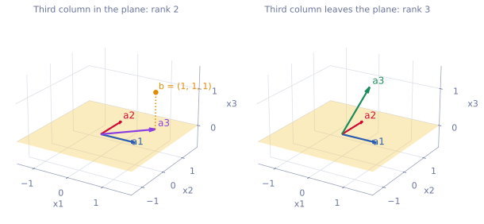
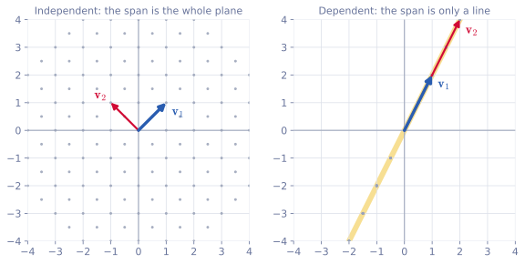

<ul class="post-sources">
<li markdown="span">[혁펜하임의 "보이는" 선형대수학](https://www.youtube.com/playlist?list=PL_iJu012NOxdZDxoGsYidMf2_bERIQaP0) 2-5–2-7강 정리</li>
</ul>

같은 주제를 더 형식적으로 다룬 글로 [Linear Algebra 2](/blog/2026/10/22/la-02-span/)(span, 행렬 곱셈의 네 관점)와 [Linear Algebra 3](/blog/2026/10/22/la-03-independence-basis-rank/)(선형 독립, 기저, 랭크)이 있다. 여기서는 그림과 직관을 앞세운다.

## 행렬 곱셈과 네 가지 관점

[▶ 2-5강](https://www.youtube.com/watch?v=Lo8FsB1anzQ)

### 출발점: 같은 계수, 다른 우변

[강의 1](/blog/2026/11/05/hpla-01-intro/)에서 연립방정식 $$x + 2y = 4$$, $$3x - y = 5$$를 $$A\mathbf{x} = \mathbf{b}$$로 썼다. 이제 계수는 같고 우변만 다른 연립방정식을 하나 더 풀고 싶다고 하자.

$$
\begin{aligned}
x_1 + 2y_1 &= 4 \\
3x_1 - y_1 &= 5
\end{aligned}
\qquad\qquad
\begin{aligned}
x_2 + 2y_2 &= -1 \\
3x_2 - y_2 &= 4
\end{aligned}
$$

두 문제의 미지수를 구별하려고 첨자를 붙였다. 계수 행렬은 공통이므로 한 번만 쓰고, 미지수 벡터와 우변 벡터를 각각 옆으로 나란히 붙이면

$$
\begin{bmatrix} 1 & 2 \\ 3 & -1 \end{bmatrix}
\begin{bmatrix} x_1 & x_2 \\ y_1 & y_2 \end{bmatrix}
=
\begin{bmatrix} 4 & -1 \\ 5 & 4 \end{bmatrix}
$$

가 된다. 이것이 행렬과 행렬의 곱이다. 새로운 것은 없다. **행렬과 벡터의 곱을 여러 번 하고 그 결과를 옆으로 쌓은 것**이다. 오른쪽 행렬의 첫 번째 열에 대한 행렬-벡터 곱이 결과의 첫 번째 열이 되고, 두 번째 열에 대한 곱이 결과의 두 번째 열이 된다. (해는 $$(x_1, y_1) = (2, 1)$$, $$(x_2, y_2) = (1, -1)$$이다.)

### 정의와 크기 규칙

$$A$$가 $$m \times n$$, $$B$$가 $$n \times k$$일 때 $$AB$$는 $$m \times k$$ 행렬이고, 그 $$(i, j)$$ 성분은 $$A$$의 $$i$$번째 행과 $$B$$의 $$j$$번째 열을 성분끼리 곱해 더한 값이다.

$$
(AB)_{ij} = a_{i1}b_{1j} + a_{i2}b_{2j} + \cdots + a_{in}b_{nj}
$$

여기서 두 가지 규칙이 바로 나온다.

- **안쪽 크기가 맞아야 한다.** $$A$$의 행과 $$B$$의 열을 짝지으려면 $$A$$의 열 수와 $$B$$의 행 수가 같아야 한다. $$(2 \times 2)(2 \times 3)$$은 되지만 $$(2 \times 2)(3 \times 2)$$는 안 된다.
- **결과의 크기는 바깥 크기다.** $$(m \times n)(n \times k) = m \times k$$. 여러 개를 곱할 때도 성분을 하나하나 계산하지 않고 크기를 알 수 있다. $$(4 \times 3)(3 \times 5)(5 \times 2)$$는 $$4 \times 2$$다. 인공 신경망의 층을 지날 때마다 벡터의 크기가 바뀌는 것을 이렇게 추적한다.

### 교환 법칙은 성립하지 않는다

숫자에서는 $$3 \times 4 = 4 \times 3$$이지만 행렬에서는 일반적으로 $$AB \neq BA$$이다.

- $$m \times k$$와 $$k \times n$$을 곱할 수 있어도, 순서를 바꾸면 $$(k \times n)(m \times k)$$이 되어 $$n \neq m$$이면 곱 자체가 정의되지 않는다.
- 둘 다 $$2 \times 2$$여서 순서를 바꿔 곱할 수 있어도 결과가 다르다.

$$A = \begin{bmatrix} 1 & 2 \\ 3 & -1 \end{bmatrix}$$, $$B = \begin{bmatrix} 2 & 1 \\ 1 & -1 \end{bmatrix}$$이면

$$
AB = \begin{bmatrix} 4 & -1 \\ 5 & 4 \end{bmatrix}, \qquad
BA = \begin{bmatrix} 5 & 3 \\ -2 & 3 \end{bmatrix}
$$

이다. 그래서 행렬 곱에서는 순서를 반드시 지켜야 한다.

### 관점 1: 내적의 모음

$$A$$를 행벡터로, $$B$$를 열벡터로 쪼갠다. 행벡터는 열벡터에 전치를 붙여 $$\mathbf{a}_i^T$$로 쓴다.

$$
AB =
\begin{bmatrix} \mathbf{a}_1^T \\ \mathbf{a}_2^T \end{bmatrix}
\begin{bmatrix} \mathbf{b}_1 & \mathbf{b}_2 \end{bmatrix}
=
\begin{bmatrix} \mathbf{a}_1^T\mathbf{b}_1 & \mathbf{a}_1^T\mathbf{b}_2 \\ \mathbf{a}_2^T\mathbf{b}_1 & \mathbf{a}_2^T\mathbf{b}_2 \end{bmatrix}
$$

결과의 $$(i, j)$$ 성분은 $$A$$의 $$i$$번째 행과 $$B$$의 $$j$$번째 열의 [내적](/blog/2026/11/05/hpla-02-vectors/)이다. 정의를 그대로 블록으로 쓴 것이다. 위 예에서 $$(AB)_{12} = (1, 2) \cdot (1, -1) = -1$$이다.

### 관점 2: 랭크 1 행렬의 합

반대로 $$A$$를 열벡터로, $$B$$를 행벡터로 쪼갠다.

$$
AB =
\begin{bmatrix} \mathbf{a}_1 & \mathbf{a}_2 \end{bmatrix}
\begin{bmatrix} \mathbf{b}_1^T \\ \mathbf{b}_2^T \end{bmatrix}
= \mathbf{a}_1\mathbf{b}_1^T + \mathbf{a}_2\mathbf{b}_2^T
$$

크기로 보면 $$(m \times 1)(1 \times k)$$짜리 곱, 즉 **외적(outer product)**의 합이다. 위 예에서는

$$
\begin{bmatrix} 1 \\ 3 \end{bmatrix}\begin{bmatrix} 2 & 1 \end{bmatrix}
+ \begin{bmatrix} 2 \\ -1 \end{bmatrix}\begin{bmatrix} 1 & -1 \end{bmatrix}
= \begin{bmatrix} 2 & 1 \\ 6 & 3 \end{bmatrix} + \begin{bmatrix} 2 & -2 \\ -1 & 1 \end{bmatrix}
= \begin{bmatrix} 4 & -1 \\ 5 & 4 \end{bmatrix}
$$

로 같은 답이 나온다. 외적 $$\mathbf{u}\mathbf{v}^T$$의 모든 열은 $$\mathbf{u}$$의 스칼라배이므로 이런 행렬의 **랭크(rank)**는 1이다(랭크는 [강의 4](/blog/2026/11/05/hpla-04-inverse-rank-null/)에서 정의한다). 그래서 이 관점은 행렬 곱을 **랭크 1 행렬들의 합**으로 본다. 공분산 행렬을 계산하거나 SVD로 행렬을 근사할 때 이 관점이 쓰인다.

### 관점 3: 열 공간으로 보기, 가장 중요한 관점

이번에는 행렬-벡터 곱 $$A\mathbf{x}$$를 본다. $$A$$를 열로 쪼개면

$$
A\mathbf{x} =
\begin{bmatrix} \mathbf{a}_1 & \mathbf{a}_2 & \mathbf{a}_3 \end{bmatrix}
\begin{bmatrix} x_1 \\ x_2 \\ x_3 \end{bmatrix}
= x_1\mathbf{a}_1 + x_2\mathbf{a}_2 + x_3\mathbf{a}_3
$$

이다. **$$A\mathbf{x}$$는 $$A$$의 열들을 $$\mathbf{x}$$의 성분만큼 스칼라배해서 더한 것**이다. 강의 1의 열 그림에서 $$2\mathbf{a}_1 + 1\mathbf{a}_2 = \mathbf{b}$$로 본 것이 바로 이 관점이다.

이 관점이 중요한 이유는 $$\mathbf{x}$$를 바꿀 때 $$A\mathbf{x}$$가 어디까지 갈 수 있는지를 그림으로 보여 주기 때문이다. [강의 2](/blog/2026/11/05/hpla-02-vectors/)의 끝에서 $$(1, 0)$$과 $$(0, 1)$$에 아무 실수를 곱해 더하면 평면 전체를 만든다고 했다. 마찬가지로 $$x_1, x_2, x_3$$를 모든 실수로 바꿔 가며 $$A\mathbf{x}$$의 끝점을 전부 찍으면 어떤 영역이 생긴다. 이 영역이 $$A$$의 **열 공간(column space)**이다. 다음 절에서 제대로 정의한다.

여기서 주의할 점이 있다. $$\mathbf{x}$$를 실수 전체에서 마음대로 고를 수 있어도 열 공간이 늘 공간 전체가 되는 것은 아니다.

$$
A = \begin{bmatrix} 1 & 0 & 1 \\ 0 & 1 & 1 \\ 0 & 0 & 0 \end{bmatrix}
$$

의 열은 모두 세 번째 성분이 0이다. 그러니 $$x_1, x_2, x_3$$를 아무리 바꿔도 $$A\mathbf{x}$$의 세 번째 성분은 0이고, $$A\mathbf{x}$$는 $$x_1x_2$$ 평면을 벗어나지 못한다. $$\mathbf{b} = (1, 1, 1)$$에는 절대로 도달할 수 없으므로 $$A\mathbf{x} = \mathbf{b}$$의 해는 없다.

*왼쪽: 세 열이 모두 노란 평면($$x_3 = 0$$) 위에 있으면 열 공간은 그 평면이고, 평면 밖의 $$\mathbf{b} = (1, 1, 1)$$에는 닿을 수 없다. 오른쪽: 세 번째 열이 평면 밖을 향하면 열 공간이 3차원 공간 전체로 넓어진다.*

행렬과 행렬의 곱도 이 관점으로 볼 수 있다. $$AB = A\begin{bmatrix} \mathbf{b}_1 & \mathbf{b}_2 \end{bmatrix} = \begin{bmatrix} A\mathbf{b}_1 & A\mathbf{b}_2 \end{bmatrix}$$이므로, $$AB$$의 각 열은 $$A$$의 열들의 선형 결합이다. 이 절의 맨 처음에 본 "행렬-벡터 곱을 옆으로 쌓은 것"이 바로 이것이다.

### 관점 4: 행 공간으로 보기

관점 3을 행에 대해 하면 된다. 행벡터 $$\mathbf{x}^T$$를 $$A$$의 왼쪽에 곱하고 $$A$$를 행으로 쪼개면

$$
\mathbf{x}^T A =
\begin{bmatrix} x_1 & x_2 \end{bmatrix}
\begin{bmatrix} \mathbf{a}_1^T \\ \mathbf{a}_2^T \end{bmatrix}
= x_1\mathbf{a}_1^T + x_2\mathbf{a}_2^T
$$

로 $$A$$의 행들의 선형 결합이다. 예를 들어 $$\begin{bmatrix} 1 & 1 \end{bmatrix}\begin{bmatrix} 1 & 2 \\ 3 & -1 \end{bmatrix} = (1, 2) + (3, -1) = (4, 1)$$이다. 관점 3이 열 공간을 그린다면 관점 4는 **행 공간(row space)**을 그린다. 트랜스포머의 어텐션처럼 여러 행벡터를 가중합하는 계산을 읽을 때 유용하다.

| 관점 | 쪼개는 방법 | 결과를 읽는 법 |
|---|---|---|
| 1. 내적 | $$A$$는 행, $$B$$는 열 | $$(AB)_{ij} = \mathbf{a}_i^T\mathbf{b}_j$$ |
| 2. 랭크 1 합 | $$A$$는 열, $$B$$는 행 | $$AB = \sum_k \mathbf{a}_k\mathbf{b}_k^T$$ |
| 3. 열 공간 | $$A$$는 열 | $$A\mathbf{x} = \sum_j x_j\mathbf{a}_j$$ |
| 4. 행 공간 | $$A$$는 행 | $$\mathbf{x}^T A = \sum_i x_i\mathbf{a}_i^T$$ |

### 흔한 실수

- **$$AB = BA$$라고 가정한다.** 크기가 맞아도 일반적으로 다르다. $$(A + B)^2 = A^2 + AB + BA + B^2$$이지 $$A^2 + 2AB + B^2$$이 아니다.
- **관점 2에서 행과 열을 거꾸로 짝짓는다.** $$A$$의 $$k$$번째 **열**과 $$B$$의 $$k$$번째 **행**을 짝지어야 한다.
- **관점 3에서 열 대신 행을 섞는다.** $$A\mathbf{x}$$는 $$A$$의 **열**들의 결합이다. 행들의 결합은 $$\mathbf{x}^T A$$다.

## Span과 열 공간

[▶ 2-6강](https://www.youtube.com/watch?v=g0eaDeVRdZk)

### 선형 결합

벡터 $$\mathbf{v}_1, \mathbf{v}_2, \mathbf{v}_3$$에 스칼라 $$a_1, a_2, a_3$$를 곱해서 더한

$$
a_1\mathbf{v}_1 + a_2\mathbf{v}_2 + a_3\mathbf{v}_3
$$

을 **선형 결합(linear combination)**이라 한다. 곱하고 더하기만 하므로 "선형"이고, 주어진 벡터들을 조합해서 만들었으므로 "결합"이다. 계수 $$a_i$$는 "재료 $$\mathbf{v}_i$$를 얼마나 쓸 것인가"를 정하는 손잡이라고 보면 된다.

### Span

주어진 벡터들의 선형 결합으로 만들 수 있는 **모든** 벡터의 집합을 그 벡터들의 **span**이라 한다.

$$
\operatorname{Span}\{\mathbf{v}_1, \dots, \mathbf{v}_p\} = \{\, a_1\mathbf{v}_1 + \cdots + a_p\mathbf{v}_p \;:\; a_1, \dots, a_p \in \mathbb{R} \,\}
$$

영어 동사 span은 "(다리 따위가) 걸치다, 펼쳐지다"라는 뜻이다. 재료 벡터를 늘이고 줄이고 더해서 펼쳐지는 영역이라고 생각하면 된다. 이 영역을 끝점의 모임으로 그리면 점, 선, 면, 또는 더 높은 차원의 공간이 된다.

*회색 점은 $$a, b$$를 $$-3$$부터 $$3$$까지 $$0.5$$ 간격으로 바꿔 가며 찍은 $$a\mathbf{v}_1 + b\mathbf{v}_2$$의 끝점이다. 왼쪽: $$\mathbf{v}_1 = (1, 1)$$, $$\mathbf{v}_2 = (-1, 1)$$이면 점들이 평면 전체로 퍼진다. 오른쪽: $$\mathbf{v}_1 = (1, 2)$$, $$\mathbf{v}_2 = (2, 4)$$이면 모든 점이 한 직선 위에 머문다.*

- 왼쪽: $$a, b$$를 실수 전체로 넓히면 점들이 평면을 빈틈없이 채운다. 즉 $$\operatorname{Span}\{(1, 1), (-1, 1)\} = \mathbb{R}^2$$이다. 예를 들어 $$(3, 1)$$은 $$a - b = 3$$, $$a + b = 1$$을 풀면 $$a = 2$$, $$b = -1$$이므로 $$2(1, 1) - (-1, 1) = (3, 1)$$로 만들 수 있다.
- 오른쪽: $$\mathbf{v}_2 = 2\mathbf{v}_1$$이라서 $$a\mathbf{v}_1 + b\mathbf{v}_2 = (a + 2b)\mathbf{v}_1$$이다. 결국 $$\mathbf{v}_1$$의 스칼라배만 만들 수 있으므로 span은 원점을 지나는 직선이다. 계수를 실수 전체로 잡았다고 해서 공간 전체가 나오는 것이 아니다.
- 극단적으로 $$\operatorname{Span}\{(0, 0)\}$$은 원점 한 점뿐이다.

3차원 공간에서는 방향이 다른 벡터 두 개의 span이 원점을 지나는 평면이다. 위의 3차원 그림 왼쪽의 노란 평면이 그런 예다.

### 벡터 공간과 열 공간

span으로 만들어진 영역은 선형 결합에 대해 닫혀 있다. 그 안의 벡터들을 다시 선형 결합해도 그 영역을 벗어나지 않는다. 이런 집합을 **벡터 공간(vector space)**이라 하고, $$\mathbb{R}^n$$ 안에 들어 있는 것은 **부분 공간(subspace)**이라고 한다. "이 벡터들이 이 공간을 span한다"는 동사로도 쓴다.

이제 앞에서 미뤄 둔 정의를 정확히 쓸 수 있다. 행렬 $$A$$의 **열 공간**은 $$A$$의 열들이 span하는 벡터 공간이다.

$$
C(A) = \operatorname{Span}\{\mathbf{a}_1, \dots, \mathbf{a}_n\} = \{\, A\mathbf{x} : \mathbf{x} \in \mathbb{R}^n \,\}
$$

열 공간을 **치역(range)**이라고도 하고 $$\mathcal{R}(A)$$로 쓰기도 한다. "$$A$$가 내놓을 수 있는 결과의 범위"라는 뜻이다. 따라서

> $$A\mathbf{x} = \mathbf{b}$$의 해가 존재한다 $$\iff$$ $$\mathbf{b}$$가 $$A$$의 열 공간에 들어 있다.

이다. 해의 존재 여부가 "$$\mathbf{b}$$가 그 영역 안에 있는가"라는 그림 문제로 바뀐 것이다.

### 흔한 실수

- **span을 유한한 집합으로 생각한다.** $$\operatorname{Span}\{(1, 2)\}$$은 벡터 하나가 아니라 직선 위의 무수히 많은 벡터다.
- **벡터가 $$n$$개이면 span이 $$n$$차원이라고 생각한다.** 오른쪽 그림처럼 벡터 두 개가 직선 하나만 span할 수 있다. 차원은 다음 절의 선형 독립에 달려 있다.
- **span이 원점을 지나지 않을 수 있다고 생각한다.** 계수를 모두 0으로 두면 영벡터가 나오므로 span은 항상 원점을 포함한다.

## 선형 독립과 기저

[▶ 2-7강](https://www.youtube.com/watch?v=mOOI4-BfjGQ)

### 직관: 쓸모 있는 팀원을 뽑기

어떤 벡터들로 span하느냐에 따라 만들 수 있는 영역의 차원이 달라졌다. 그렇다면 넓은 영역을 만들어 내는 "좋은" 벡터 묶음은 어떤 것일까.

회사를 차려서 사람을 뽑는다고 비유해 보자. 각 사원은 벡터이고, 사원이 일을 얼마나 열심히 하느냐가 계수다. 회사가 만들어 낼 수 있는 결과물 전체가 span이다.

- $$(1, 0)$$과 $$(0, 1)$$을 뽑으면 두 사람이 각자 다른 일을 하므로, 둘이 일하는 양을 조절해 평면 전체의 결과를 낼 수 있다.
- $$(1, 2)$$를 뽑은 뒤 $$(2, 4)$$를 뽑으면 두 번째 사람은 첫 번째 사람이 두 배로 일하면 해낼 수 있는 일만 한다. 아무리 둘이 일해도 결과물은 직선 위에 머문다. 두 번째 사람을 뽑은 것이 낭비다. 그 사람 탓이 아니라 이미 할 수 있는 일을 하는 사람을 또 뽑은 탓이다.
- 대신 $$(-1, 1)$$처럼 다른 방향의 사람을 뽑으면 결과물이 평면 전체로 넓어진다. 꼭 수직일 필요는 없다. $$(1, 2)$$와 조금이라도 다른 방향이면 새로운 가능성을 열어 준다.

이처럼 각자 "다른 사람들이 대신할 수 없는 고유한 방향"을 가진 벡터 묶음을 **선형 독립(linearly independent)**이라 한다. 위 3차원 그림의 오른쪽에서 평면 밖을 향하는 초록 벡터가 그런 역할을 한다. 파랑과 빨강만으로는 평면에 갇혀 있지만, 초록 벡터가 평면을 위로 밀어 올려 3차원 공간 전체를 span하게 만든다. 만약 초록 벡터도 평면 안에 있었다면(왼쪽 그림의 보라 벡터) span은 평면에서 더 넓어지지 않았을 것이다.

### 정의

벡터 $$\mathbf{v}_1, \dots, \mathbf{v}_p$$가

$$
c_1\mathbf{v}_1 + c_2\mathbf{v}_2 + \cdots + c_p\mathbf{v}_p = \mathbf{0}
$$

을 만족하는 경우가 $$c_1 = c_2 = \cdots = c_p = 0$$ **하나뿐**이면 선형 독립이다. 0이 아닌 계수가 섞인 해가 있으면 **선형 종속(linearly dependent)**이다.

- $$(1, 2)$$와 $$(2, 4)$$: $$2(1, 2) - 1(2, 4) = (0, 0)$$이므로 계수 $$(2, -1)$$로 영벡터를 만들 수 있다. 종속이다.
- $$(1, 2)$$와 $$(-1, 1)$$: $$c_1(1, 2) + c_2(-1, 1) = \mathbf{0}$$은 $$c_1 - c_2 = 0$$, $$2c_1 + c_2 = 0$$이다. 첫 식에서 $$c_1 = c_2$$이고 둘째 식에 넣으면 $$3c_1 = 0$$이므로 $$c_1 = c_2 = 0$$뿐이다. 독립이다.

비유와 정의가 같은 말인 이유는 이렇다. 0이 아닌 계수 $$c_j$$가 있으면 그 항을 넘기고 $$c_j$$로 나눠 $$\mathbf{v}_j$$를 나머지 벡터들의 선형 결합으로 쓸 수 있다. 즉 $$\mathbf{v}_j$$는 남이 대신할 수 있는 사람이다. 반대로 어떤 벡터가 나머지의 선형 결합이면 그 벡터를 넘겨 0이 아닌 계수(그 벡터의 계수 $$-1$$)를 가진 해를 얻는다. 자세한 증명은 [Linear Algebra 3](/blog/2026/10/22/la-03-independence-basis-rank/)에 있다.

선형 독립인 벡터의 개수는 그 벡터들이 span하는 공간의 **차원(dimension)**과 같다. 독립인 벡터가 2개이면 평면(2차원), 3개이면 3차원, 100개이면 100차원 공간을 span한다.

### 기저

**기저(basis)**는 관점을 반대로 한 것이다. 먼저 벡터 공간이 주어지고, 그 공간을 이루는 필수 재료를 찾는다. 벡터 공간 $$V$$의 기저는 다음 두 조건을 만족하는 벡터들의 집합이다.

1. $$V$$를 span한다. (재료가 모자라지 않다.)
2. 선형 독립이다. (쓸데없는 재료가 없다.)

$$\mathbb{R}^2$$를 예로 들면

- $$\{(1, 0), (0, 1)\}$$은 기저다. 이를 **표준 기저(standard basis)**라 한다. 서로 수직이고 크기가 1이어서 **정규 직교 기저(orthonormal basis)**이기도 하다.
- $$\{(1, 0), (1, 1)\}$$도 기저다. 수직은 아니지만 독립이고 평면 전체를 span한다. 예를 들어 $$(3, 2) = 1 \cdot (1, 0) + 2 \cdot (1, 1)$$이다.
- $$\{(1, 2), (2, 4)\}$$는 기저가 아니다. 직선만 span하고 독립도 아니다.
- $$\{(1, 0), (0, 1), (1, 1)\}$$도 기저가 아니다. 평면을 span하지만 셋째 벡터가 앞의 둘의 합이라 독립이 아니다.

이처럼 기저는 하나로 정해지지 않는다. 하지만 같은 공간의 기저는 언제나 **같은 개수**의 벡터로 이루어지고, 그 개수가 공간의 차원이다. $$\mathbb{R}^2$$의 기저는 무엇이든 벡터가 정확히 2개다.

기저가 좋은 이유는 공간 안의 모든 벡터를 기저 벡터의 선형 결합으로 **딱 한 가지 방법으로** 쓸 수 있기 때문이다. 만약 두 가지 방법이 있다면 둘을 빼서 0이 아닌 계수로 영벡터를 만들 수 있으므로 독립이라는 조건에 어긋난다. 그래서 기저가 정해지면 그 계수가 벡터의 "좌표" 노릇을 한다. 기저 $$\{(1, 0), (1, 1)\}$$에서 $$(3, 2)$$의 좌표는 $$(1, 2)$$다.

### 흔한 실수

- **선형 독립을 수직과 혼동한다.** $$(1, 0)$$과 $$(1, 1)$$은 수직이 아니지만 독립이다. 영벡터가 아닌 벡터들이 서로 수직이면 늘 독립이지만, 그 역은 성립하지 않는다.
- **벡터 하나만 보고 "이 벡터가 종속이다"라고 말한다.** 종속은 묶음의 성질이다. $$\{(1, 2), (2, 4)\}$$에서 어느 쪽이 "남는" 벡터인지는 정해지지 않는다. 어느 하나를 빼면 나머지가 독립이 된다.
- **$$\mathbb{R}^n$$에서 $$n$$개보다 많은 벡터가 독립일 수 있다고 생각한다.** $$\mathbb{R}^2$$의 벡터 3개는 언제나 종속이다. 평면의 차원이 2이기 때문이다.
- **영벡터를 포함한 묶음을 독립이라고 한다.** $$1 \cdot \mathbf{0} = \mathbf{0}$$이므로 영벡터가 하나라도 있으면 종속이다.

## 정리

- 행렬 곱 $$AB$$는 $$A$$와 $$B$$의 각 열의 행렬-벡터 곱을 옆으로 쌓은 것이다. $$(m \times n)(n \times k) = m \times k$$이고, 일반적으로 $$AB \neq BA$$이다.
- 행렬 곱은 내적의 모음, 랭크 1 행렬의 합, 열들의 선형 결합, 행들의 선형 결합이라는 네 관점으로 볼 수 있다. 가장 중요한 것은 $$A\mathbf{x} = \sum_j x_j\mathbf{a}_j$$라는 열 관점이다.
- 선형 결합으로 만들 수 있는 모든 벡터의 집합이 span이고, $$A$$의 열들의 span이 열 공간 $$C(A)$$이다. $$A\mathbf{x} = \mathbf{b}$$는 $$\mathbf{b} \in C(A)$$일 때만 해를 갖는다.
- 어느 벡터도 나머지의 선형 결합이 아닐 때, 즉 $$\sum c_i\mathbf{v}_i = \mathbf{0}$$의 해가 모두 0인 계수뿐일 때 선형 독립이다. 독립인 벡터의 개수가 span의 차원이다.
- 기저는 공간을 span하는 선형 독립인 벡터 묶음이다. 기저는 여러 개가 있지만 벡터의 개수는 항상 같고, 모든 벡터를 기저로 나타내는 방법은 하나뿐이다.
