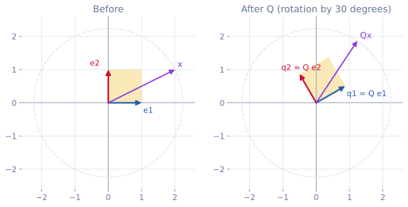
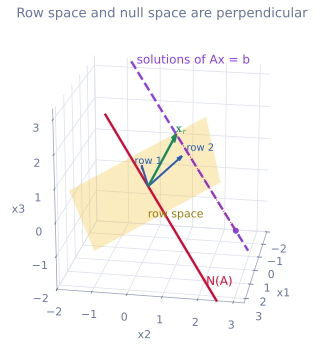
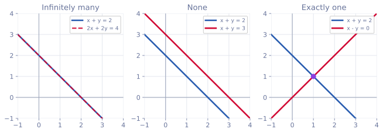

<ul class="post-sources">
<li markdown="span">[혁펜하임의 "보이는" 선형대수학](https://www.youtube.com/playlist?list=PL_iJu012NOxdZDxoGsYidMf2_bERIQaP0) 2-8–2-12강 정리</li>
</ul>

지금까지 모은 재료는 벡터의 연산, 전치, 내적, 노름([강의 2](/blog/2026/11/05/hpla-02-vectors/)), 그리고 행렬 곱셈, 열 공간, 선형 독립, 기저([강의 3](/blog/2026/11/05/hpla-03-matrix-product/))다. 이번에는 이 재료로 처음 목표였던 질문, **$$A\mathbf{x} = \mathbf{b}$$의 해가 몇 개인가**에 답한다. 같은 내용을 다른 각도에서 다룬 글로 [Linear Algebra 1](/blog/2026/10/22/la-01-linear-systems/)(역행렬)과 [Linear Algebra 3](/blog/2026/10/22/la-03-independence-basis-rank/)(랭크)이 있다.

## 항등 행렬, 역행렬, 대각 행렬, 직교 행렬

[▶ 2-8강](https://www.youtube.com/watch?v=XqOvyfMUAwA)

### 왜 필요한가

숫자 방정식 $$3x = 6$$은 양변에 3의 역수 $$1/3$$을 곱해 $$x = 2$$로 푼다. $$A\mathbf{x} = \mathbf{b}$$도 $$A$$의 "역수"에 해당하는 것이 있다면, 변수가 몇 개든 한 번에 풀 수 있다. 그 역할을 하는 것이 역행렬이고, 역행렬을 정의하려면 먼저 숫자 1에 해당하는 행렬이 필요하다.

### 항등 행렬

곱셈의 **항등원(identity)**은 어떤 수에 곱해도 그 수가 그대로 나오게 하는 수, 즉 1이다. 행렬에서 이 역할을 하는 것이 **항등 행렬(identity matrix)** $$I$$다. 대각 성분이 모두 1이고 나머지는 모두 0인 정사각 행렬이다.

$$
I_2 = \begin{bmatrix} 1 & 0 \\ 0 & 1 \end{bmatrix}, \qquad
I_3 = \begin{bmatrix} 1 & 0 & 0 \\ 0 & 1 & 0 \\ 0 & 0 & 1 \end{bmatrix}
$$

**정사각 행렬(square matrix)**은 행과 열의 수가 같은 행렬이다.

왜 이 모양이어야 하는지는 [강의 3의 관점 3](/blog/2026/11/05/hpla-03-matrix-product/)으로 바로 보인다. $$A\mathbf{e}_1$$, 즉 $$A$$에 $$(1, 0, 0)$$을 곱하면 첫 번째 열을 1배, 나머지 열을 0배 해서 더하므로 **$$A$$의 첫 번째 열을 그대로 꺼낸다.** $$(0, 1, 0)$$은 두 번째 열을, $$(0, 0, 1)$$은 세 번째 열을 꺼낸다. 그러니 $$AI_3 = \begin{bmatrix} A\mathbf{e}_1 & A\mathbf{e}_2 & A\mathbf{e}_3 \end{bmatrix}$$는 열을 하나씩 꺼내 제자리에 놓은 것이고, 결과는 $$A$$다.

앞에 곱할 때도 마찬가지다. 관점 4로 보면 $$I$$의 각 행이 $$A$$의 행을 하나씩 꺼내 제자리에 놓는다. 다만 크기에 주의해야 한다. $$A$$가 $$2 \times 3$$이면

$$
I_2 A = A = A I_3
$$

로, 앞에는 $$2 \times 2$$, 뒤에는 $$3 \times 3$$ 항등 행렬을 곱한다. 크기를 구별할 때 $$I_n$$처럼 첨자를 붙인다.

### 역행렬

$$n \times n$$ 행렬 $$A$$에 대해

$$
A A^{-1} = A^{-1} A = I
$$

를 만족하는 행렬 $$A^{-1}$$을 $$A$$의 **역행렬(inverse matrix)**이라 한다. 숫자에서 $$3^{-1} = 1/3$$이라 쓰는 것을 본뜬 표기다. 역행렬이 있는 행렬을 **가역(invertible)**이라 한다.

- 역행렬은 정사각 행렬에 대해서만 정의한다.
- 정사각 행렬이라도 역행렬이 **없을 수 있다.** 숫자 0에 역수가 없는 것과 비슷하다.
- 일반적인 행렬 곱과 달리 $$A$$와 $$A^{-1}$$은 어느 쪽 순서로 곱해도 $$I$$가 된다.

**$$A\mathbf{x} = \mathbf{b}$$ 풀기.** $$A$$가 가역이면 양변의 **왼쪽에** $$A^{-1}$$을 곱해

$$
A^{-1}A\mathbf{x} = A^{-1}\mathbf{b} \quad\Longrightarrow\quad I\mathbf{x} = A^{-1}\mathbf{b} \quad\Longrightarrow\quad \mathbf{x} = A^{-1}\mathbf{b}
$$

를 얻는다. 행렬 곱은 순서가 중요하므로 "양변에 곱한다"가 아니라 "양변의 왼쪽에 곱한다"라고 해야 정확하다.

**예.** 강의 1의 $$A = \begin{bmatrix} 1 & 2 \\ 3 & -1 \end{bmatrix}$$의 역행렬은

$$
A^{-1} = \frac{1}{7}\begin{bmatrix} 1 & 2 \\ 3 & -1 \end{bmatrix}
$$

이다. (우연히 $$A$$ 자신의 $$1/7$$배다. $$AA^{-1}$$을 직접 곱해 $$I$$가 나오는지 확인해 보면 좋다.) 그러면 $$\mathbf{x} = A^{-1}(4, 5) = \frac{1}{7}(4 + 10, 12 - 5) = (2, 1)$$로 강의 1의 해와 같다. 역행렬을 실제로 계산하는 방법과 역행렬이 존재하는 조건은 [강의 5](/blog/2026/11/05/hpla-05-elimination-determinant/)에서 다룬다.

### 대각 행렬

대각 성분 이외의 성분이 모두 0인 행렬을 **대각 행렬(diagonal matrix)**이라 한다. 대각 성분은 아무 값이나 되고 0이어도 된다. 항등 행렬도 대각 행렬이다. 대각 행렬은 $$a_{ij} = a_{ji} = 0$$ ($$i \neq j$$)이므로 언제나 대칭이다.

정사각이 아닌 행렬에도 같은 말을 쓴다. $$\begin{bmatrix} 5 & 0 & 0 \\ 0 & 3 & 0 \end{bmatrix}$$처럼 $$i \neq j$$인 성분이 모두 0인 직사각 행렬을 **직사각 대각 행렬(rectangular diagonal matrix)**이라 하고, 정사각인 것과 구별할 때는 **정사각 대각 행렬**이라 한다. 직사각 대각 행렬은 SVD에서 등장한다.

논문에서 자주 보는 표기 $$\operatorname{diag}$$는 두 가지 뜻으로 쓰인다.

- 벡터를 넣으면 그 성분을 대각에 늘어놓은 대각 행렬: $$\operatorname{diag}(1, 2, 4) = \begin{bmatrix} 1 & 0 & 0 \\ 0 & 2 & 0 \\ 0 & 0 & 4 \end{bmatrix}$$
- 행렬을 넣으면 대각 성분을 꺼낸 벡터: $$\operatorname{diag}\left(\begin{bmatrix} 1 & 2 & 3 \\ 4 & 5 & 6 \\ 7 & 8 & 9 \end{bmatrix}\right) = (1, 5, 9)$$

어느 뜻인지는 쓰는 사람이 정하기 나름이므로, 직접 쓸 때는 어떤 뜻인지 밝혀 두는 것이 좋다.

### 직교 행렬

**직교 행렬(orthogonal matrix)** $$Q$$는 열들이 **정규 직교(orthonormal)**인 정사각 행렬이다. 정규 직교란 다음 두 조건을 말한다.

- 서로 다른 열끼리 수직이다: $$i \neq j$$이면 $$\mathbf{q}_i^T\mathbf{q}_j = 0$$.
- 각 열의 크기가 1이다: $$\mathbf{q}_i^T\mathbf{q}_i = 1$$. ([강의 2](/blog/2026/11/05/hpla-02-vectors/)의 정규화를 떠올리면 된다.)

항등 행렬이 가장 간단한 예다. 열들이 표준 기저이고 서로 수직이며 크기가 1이다.

직교 행렬의 가장 큰 장점은 **역행렬이 전치**라는 것이다. $$Q^TQ$$를 [관점 1(내적)](/blog/2026/11/05/hpla-03-matrix-product/)로 계산해 보자. $$Q^T$$의 $$i$$번째 행은 $$Q$$의 $$i$$번째 열 $$\mathbf{q}_i^T$$이므로

$$
(Q^TQ)_{ij} = \mathbf{q}_i^T\mathbf{q}_j = \begin{cases} 1 & i = j \\ 0 & i \neq j \end{cases}
$$

이다. 즉 $$Q^TQ = I$$이고, 따라서

$$
Q^{-1} = Q^T
$$

다. (정사각 행렬에서는 $$Q^TQ = I$$이면 $$QQ^T = I$$도 성립하므로 행들도 정규 직교다.) 일반적인 행렬의 역행렬은 계산이 꽤 번거롭지만 직교 행렬은 성분의 자리만 바꾸면 끝이다. 통신의 OFDM이나 신호 처리의 푸리에 변환처럼 직교 행렬(복소수 버전)을 쓰는 시스템이 계산하기 쉬운 이유가 여기에 있다.

**예: 회전 행렬.** 평면에서 $$30^\circ$$ 회전하는 행렬

$$
Q = \begin{bmatrix} \cos 30^\circ & -\sin 30^\circ \\ \sin 30^\circ & \cos 30^\circ \end{bmatrix} \approx \begin{bmatrix} 0.866 & -0.5 \\ 0.5 & 0.866 \end{bmatrix}
$$

의 두 열은 $$0.866 \cdot (-0.5) + 0.5 \cdot 0.866 = 0$$으로 수직이고, 각각 $$0.866^2 + 0.5^2 = 1$$로 크기가 1이다.

*왼쪽: 표준 기저 $$\mathbf{e}_1, \mathbf{e}_2$$와 벡터 $$\mathbf{x} = (2, 1)$$. 오른쪽: $$Q$$를 곱한 뒤. 정사각형은 회전만 하고 모양이 그대로이며, $$Q\mathbf{x}$$는 같은 점선 원 위에 있다.*

$$Q\mathbf{e}_1$$, $$Q\mathbf{e}_2$$는 각각 $$Q$$의 첫째, 둘째 열이다. 그림에서 단위 정사각형이 크기와 직각을 유지한 채 돌아갔다. $$\mathbf{x} = (2, 1)$$은 $$Q\mathbf{x} \approx (1.23, 1.87)$$로 가는데, 길이는 둘 다 $$\sqrt{5} \approx 2.24$$다. 일반적으로

$$
\lVert Q\mathbf{x} \rVert^2 = (Q\mathbf{x})^T(Q\mathbf{x}) = \mathbf{x}^TQ^TQ\mathbf{x} = \mathbf{x}^T\mathbf{x} = \lVert \mathbf{x} \rVert^2
$$

이므로 직교 행렬은 길이를 보존한다. 직교 행렬이 하는 일은 회전과 뒤집기(반사)뿐이다.

성분이 복소수인 행렬에서 같은 역할을 하는 것을 **유니터리 행렬(unitary matrix)** $$U$$라 한다. 복소수 벡터의 내적은 전치 대신 켤레 전치를 써서 $$\mathbf{a}^H\mathbf{b}$$로 정의하기 때문에, 유니터리 행렬은 $$U^HU = I$$, 즉 $$U^{-1} = U^H$$를 만족한다. 실수에서는 켤레가 아무 일도 하지 않으므로 직교 행렬과 같다.

### 흔한 실수

- **열이 서로 수직이기만 하면 직교 행렬이라고 생각한다.** $$\begin{bmatrix} 2 & 0 \\ 0 & 3 \end{bmatrix}$$은 열이 수직이지만 크기가 1이 아니라서 직교 행렬이 아니다. 실제로 $$Q^TQ = \operatorname{diag}(4, 9) \neq I$$이다. 이름은 "직교"지만 조건은 "정규 직교"다.
- **$$A\mathbf{x} = \mathbf{b}$$에서 $$\mathbf{x} = \mathbf{b}A^{-1}$$로 쓴다.** 왼쪽에 곱해야 하므로 $$\mathbf{x} = A^{-1}\mathbf{b}$$다. $$\mathbf{b}A^{-1}$$은 크기부터 맞지 않는다.
- **직사각 행렬의 역행렬을 구하려 한다.** 역행렬은 정사각 행렬에만 정의된다. 직사각 행렬의 대안은 [강의 10](/blog/2026/11/05/hpla-10-svd/)의 유사 역행렬이다.

## 랭크

[▶ 2-9강](https://www.youtube.com/watch?v=HMST0Yc7EXE)

### 정의

행렬 $$A$$의 **랭크(rank)**는 $$A$$의 열 중에서 선형 독립인 열의 최대 개수다. [강의 3](/blog/2026/11/05/hpla-03-matrix-product/)에서 독립인 벡터가 $$r$$개이면 $$r$$차원 공간을 span한다고 했으므로, 랭크는 곧 **열 공간의 차원**이다.

$$
\operatorname{rank} A = (\text{독립인 열의 수}) = \dim C(A)
$$

행렬의 랭크를 알면 그 열들이 몇 차원을 span하는지, 다음 절의 영공간이 몇 차원인지, 그래서 해가 몇 개인지까지 알 수 있다.

### 독립인 열의 수 = 독립인 행의 수

놀라운 사실은 **독립인 행의 수도 랭크와 같다**는 것이다. 식으로 쓰면

$$
\operatorname{rank} A = \operatorname{rank} A^T
$$

이다. 전치하면 행이 열이 되므로, $$A^T$$의 독립인 열의 수가 $$A$$의 독립인 행의 수이기 때문이다. 따라서 랭크는 열 공간의 차원이면서 동시에 행 공간의 차원이다. (증명은 [Linear Algebra 3](/blog/2026/10/22/la-03-independence-basis-rank/)의 랭크 분해 $$A = CR$$로 볼 수 있다. 랭크가 $$r$$이면 $$A$$의 모든 행이 $$R$$의 $$r$$개 행의 선형 결합이 된다.)

### 예시

$$
A = \begin{bmatrix} 1 & 2 & 3 \\ 2 & 4 & 6 \end{bmatrix}
$$

에서 둘째 열은 첫째 열의 2배, 셋째 열은 3배다. 그러면 "어느 열이 독립인가"라고 물으면 답이 하나로 정해지지 않는다. 첫째 열을 기준으로 하면 나머지가 종속이고, 셋째 열을 기준으로 해도 나머지가 그 스칼라배다. 하지만 **독립인 열이 몇 개인가**는 분명히 1개다. 그래서 $$\operatorname{rank} A = 1$$이고, 열 공간은 $$\mathbb{R}^2$$ 안의 직선 하나다. 행을 봐도 둘째 행이 첫째 행의 2배라서 독립인 행은 1개다.

$$
B = \begin{bmatrix} 1 & 0 & 1 \\ 0 & 1 & 1 \end{bmatrix}
$$

은 첫째, 둘째 열만으로 $$\mathbb{R}^2$$ 전체를 span하고 셋째 열은 그 합이라 없어도 된다. $$\operatorname{rank} B = 2$$다. 행으로 보면 두 행 $$(1, 0, 1)$$, $$(0, 1, 1)$$이 독립이므로 3차원 공간 안에서 평면을 span한다.

### 랭크의 상한과 이름

$$m \times n$$ 행렬에서 독립인 열은 $$n$$개를, 독립인 행은 $$m$$개를 넘을 수 없으므로

$$
\operatorname{rank} A \le \min(m, n)
$$

이다. $$B$$는 $$2 \times 3$$이라 랭크가 최대 2인데, 실제로 2를 다 채웠다. 랭크가 상한에 닿은 정도에 따라 이름이 붙는다.

| 이름 | 조건 | 예 |
|---|---|---|
| **full column rank** | $$\operatorname{rank} A = n$$ (열이 모두 독립) | 세로로 긴 $$3 \times 2$$, 랭크 2 |
| **full row rank** | $$\operatorname{rank} A = m$$ (행이 모두 독립) | 가로로 긴 $$B$$ ($$2 \times 3$$, 랭크 2) |
| **full rank** | 정사각 행렬에서 $$\operatorname{rank} A = n$$ | 강의 1의 $$2 \times 2$$ 행렬 $$A$$ |
| **rank deficient** | $$\operatorname{rank} A < \min(m, n)$$ | 위의 $$A$$ ($$2 \times 3$$, 랭크 1) |

정사각이 아닌 행렬에는 full column rank와 full row rank를 구별해 쓰고, 정사각 행렬에는 간단히 full rank라고 한다.

## 영공간

[▶ 2-10강](https://www.youtube.com/watch?v=Eizc9TSRYMQ)

### 정의

열 공간에 이어 또 하나의 중요한 벡터 공간이 **영공간(null space)**이다. null은 "아무것도 없음"이라는 뜻이고, 그 이름처럼

$$
N(A) = \{\, \mathbf{x} : A\mathbf{x} = \mathbf{0} \,\}
$$

이다. 열 관점으로 읽으면 $$A\mathbf{x} = x_1\mathbf{a}_1 + \cdots + x_n\mathbf{a}_n$$이므로, 영공간은 **열들의 선형 결합이 영벡터가 되게 하는 계수 벡터들의 집합**이다. 열 공간처럼 열들이 span하는 공간에 놓인 벡터들이 아니라, 열에 곱하는 **계수**들의 공간이라는 점을 헷갈리면 안 된다.

### 예시 1: 영공간이 직선

$$
B = \begin{bmatrix} 1 & 0 & 1 \\ 0 & 1 & 1 \end{bmatrix}
$$

- $$\mathbf{x} = \mathbf{0}$$이면 당연히 $$B\mathbf{x} = \mathbf{0}$$이다. 영벡터는 언제나 영공간에 있다.
- 열들이 모두 독립이었다면 정의상 영벡터만 있겠지만, 랭크가 2이고 열은 3개다. 셋째 열이 첫째 열과 둘째 열의 합이므로 $$1 \cdot \mathbf{a}_1 + 1 \cdot \mathbf{a}_2 - 1 \cdot \mathbf{a}_3 = \mathbf{0}$$이다. 즉 $$(1, 1, -1) \in N(B)$$다.
- $$B\mathbf{x} = \mathbf{0}$$이면 양변에 스칼라를 곱해도 $$B(c\mathbf{x}) = \mathbf{0}$$이므로, $$(2, 2, -2)$$, $$(-1, -1, 1)$$ 등 모든 스칼라배가 들어간다.

따라서 $$N(B) = \operatorname{Span}\{(1, 1, -1)\}$$이고, 이는 3차원 공간 안의 직선이다. 열 $$\mathbf{a}_j$$는 2차원 벡터인데 영공간은 3차원 공간에 있다. **영공간은 열 공간의 일부가 아니라 아예 다른 공간에 산다.** $$A$$가 $$m \times n$$이면 $$\mathbf{x}$$의 성분이 $$n$$개이므로, 영공간은 행벡터와 같은 공간 $$\mathbb{R}^n$$에 있다.

### 예시 2: 영공간이 평면

$$
A = \begin{bmatrix} 1 & 2 & 3 \\ 2 & 4 & 6 \end{bmatrix}
$$

은 독립인 열이 하나다. 둘째 열은 첫째 열의 $$-2$$배로 상쇄할 수 있고, 셋째 열은 첫째 열의 $$-3$$배로 상쇄할 수 있다.

$$
A\begin{bmatrix} -2 \\ 1 \\ 0 \end{bmatrix} = \mathbf{0}, \qquad
A\begin{bmatrix} -3 \\ 0 \\ 1 \end{bmatrix} = \mathbf{0}
$$

두 벡터를 $$\mathbf{n}_1$$, $$\mathbf{n}_2$$라 하면, 이들의 선형 결합도 $$A(c_1\mathbf{n}_1 + c_2\mathbf{n}_2) = c_1 A\mathbf{n}_1 + c_2 A\mathbf{n}_2 = \mathbf{0} + \mathbf{0}$$으로 영공간에 있다. $$\mathbf{n}_1$$과 $$\mathbf{n}_2$$는 서로 독립이므로 $$N(A) = \operatorname{Span}\{\mathbf{n}_1, \mathbf{n}_2\}$$는 3차원 공간 안의 평면, 즉 2차원이다.

### 랭크와 영공간의 차원: rank-nullity

두 예를 나란히 놓아 보자.

| 행렬 | 열의 수 $$n$$ | 랭크 $$r$$ | $$\dim N$$ |
|---|---|---|---|
| $$B$$ | 3 | 2 | 1 |
| $$A$$ | 3 | 1 | 2 |

합하면 항상 열의 수가 된다. 일반적으로 $$m \times n$$ 행렬 $$A$$의 랭크를 $$r$$이라 하면

$$
\dim N(A) = n - r
$$

이다. 이를 **rank-nullity 정리**라 한다. 직관적으로, 열 $$n$$개 중 $$r$$개만 독립이고 나머지 $$n - r$$개는 각각 독립인 열들로 상쇄할 수 있어 영공간의 독립인 방향을 하나씩 만든다.

full column rank이면 $$r = n$$이라 $$\dim N(A) = 0$$이다. 이때 영공간에 아무것도 없는 것은 아니다. $$\mathbf{x} = \mathbf{0}$$ 한 점만 들어 있고, 점은 0차원이다.

### 행 공간과 영공간은 수직이다

$$A\mathbf{x} = \mathbf{0}$$을 [관점 1(내적)](/blog/2026/11/05/hpla-03-matrix-product/)로 읽으면, $$A$$의 각 행과 $$\mathbf{x}$$의 내적이 모두 0이라는 뜻이다. 첫째 행과 수직이고 둘째 행과도 수직이면, 두 행의 어떤 선형 결합과 내적해도 $$0 + 0 = 0$$이다. 즉 $$\mathbf{x}$$는 행 공간 전체와 수직이다. 영공간의 모든 벡터가 그러므로

> 행 공간 $$C(A^T)$$와 영공간 $$N(A)$$는 $$\mathbb{R}^n$$ 안에서 서로 수직이다.

행 공간의 차원은 랭크 $$r$$이고 영공간의 차원은 $$n - r$$이므로, 두 공간의 차원을 합하면 정확히 $$n$$이다. 두 공간은 원점에서만 만나며 $$\mathbb{R}^n$$을 수직인 두 조각으로 나눈다.

*$$B$$의 행 공간(노란 평면)과 영공간(빨간 직선)은 서로 수직이다. 보라 점선은 $$B\mathbf{x} = (3, 3)$$의 해 전체로, 영공간과 평행하고 행 공간과는 $$\mathbf{x}_r$$에서 만난다.*

파란 화살표는 $$B$$의 두 행이고, 이들이 span하는 노란 평면이 행 공간이다. 빨간 직선 $$N(B) = \operatorname{Span}\{(1, 1, -1)\}$$은 이 평면을 수직으로 뚫고 지나간다. 실제로 $$(1, 1, -1) \cdot (1, 0, 1) = 0$$, $$(1, 1, -1) \cdot (0, 1, 1) = 0$$이다.

### 왼쪽 영공간과 네 개의 부분 공간

$$A\mathbf{x}$$를 열 공간으로 봤듯이 $$\mathbf{y}^TA$$는 행 공간으로 본다. 이에 대응해서 $$\mathbf{y}^TA = \mathbf{0}^T$$, 즉 $$A^T\mathbf{y} = \mathbf{0}$$을 만족하는 $$\mathbf{y}$$의 집합을 **왼쪽 영공간(left null space)** $$N(A^T)$$라 한다. $$\mathbf{y}$$를 $$A$$의 왼쪽에 곱하기 때문에 붙은 이름이다. $$A$$의 행과 열의 역할을 바꾸면 앞의 결과를 그대로 쓸 수 있다.

- $$\mathbf{y}$$의 성분은 $$m$$개이므로 왼쪽 영공간은 $$\mathbb{R}^m$$에 있다.
- $$A^T$$는 $$n \times m$$이고 랭크가 $$r$$이므로 $$\dim N(A^T) = m - r$$이다.
- $$\mathbf{y}$$는 $$A$$의 모든 열과 내적이 0이므로 **열 공간과 수직**이다. 열 공간의 차원 $$r$$과 합하면 $$m$$이다.

**예.** $$A = \begin{bmatrix} 1 & 2 & 3 \\ 2 & 4 & 6 \end{bmatrix}$$의 열 공간은 $$\operatorname{Span}\{(1, 2)\}$$이고 왼쪽 영공간은 $$\operatorname{Span}\{(2, -1)\}$$이다. $$A^T(2, -1) = (2 - 2, 4 - 4, 6 - 6) = \mathbf{0}$$이고, $$(1, 2) \cdot (2, -1) = 0$$으로 수직이다. 차원은 $$1 + 1 = 2 = m$$이다.

이렇게 행렬 하나에서 네 개의 부분 공간이 나온다.

| 공간 | 사는 곳 | 차원 | 수직인 짝 |
|---|---|---|---|
| 행 공간 $$C(A^T)$$ | $$\mathbb{R}^n$$ | $$r$$ | 영공간 |
| 영공간 $$N(A)$$ | $$\mathbb{R}^n$$ | $$n - r$$ | 행 공간 |
| 열 공간 $$C(A)$$ | $$\mathbb{R}^m$$ | $$r$$ | 왼쪽 영공간 |
| 왼쪽 영공간 $$N(A^T)$$ | $$\mathbb{R}^m$$ | $$m - r$$ | 열 공간 |

### $$A$$는 무엇을 어디로 보내는가

$$\mathbb{R}^n$$의 아무 벡터 $$\mathbf{x}$$는 행 공간 성분 $$\mathbf{x}_r$$과 영공간 성분 $$\mathbf{x}_n$$의 합으로 쓸 수 있다($$\mathbf{x} = \mathbf{x}_r + \mathbf{x}_n$$). 여기에 $$A$$를 곱하면

$$
A\mathbf{x} = A\mathbf{x}_r + A\mathbf{x}_n = A\mathbf{x}_r + \mathbf{0} = A\mathbf{x}_r
$$

이다. 영공간 성분은 $$A$$를 거치면 영벡터로 사라지고, 결과는 행 공간 성분만으로 정해진다. 그러니 $$A\mathbf{x}_r = \mathbf{b}$$이면 $$\mathbf{x}_r$$에 영공간의 어떤 벡터를 더해도 여전히 $$\mathbf{b}$$로 간다.

위 그림이 바로 이 상황이다. $$\mathbf{x}_r = (1, 1, 2)$$는 두 행의 합이라 행 공간에 있고, $$B\mathbf{x}_r = (3, 3)$$이다. 여기에 영공간 방향 $$(1, 1, -1)$$을 몇 배든 더한 점들, 즉 보라 점선 전체가 $$B\mathbf{x} = (3, 3)$$의 해다. 예를 들어 $$\mathbf{x}_r + 2(1, 1, -1) = (3, 3, 0)$$도 해다(보라 점). 이 해 집합이 영공간과 평행한 직선이라는 것이 다음 절의 핵심이다.

## $$A\mathbf{x} = \mathbf{b}$$의 해의 개수

[▶ 2-11강](https://www.youtube.com/watch?v=nNI2TlD598c)

### 중학교 그림에서 출발

미지수가 2개, 식이 2개이면 식 하나가 직선 하나이고, 해는 두 직선의 공통점이다.

*왼쪽: 두 식이 같은 직선이라 해가 무수히 많다. 가운데: 평행한 두 직선이라 해가 없다. 오른쪽: 한 점 $$(1, 1)$$에서 만나 해가 하나다.*

미지수가 5개, 식이 10개쯤 되면 이런 그림을 그릴 수 없다. 대신 랭크와 열 공간, 영공간으로 같은 판단을 한다. 판단의 기준은 두 가지뿐이다.

1. **해가 있는가?** $$\mathbf{b}$$가 열 공간 $$C(A)$$에 있으면 있고, 없으면 없다.
2. **해가 있다면 몇 개인가?** 해 하나 $$\mathbf{x}_p$$를 찾으면 $$\mathbf{x}_p$$에 영공간의 벡터를 더한 것도 모두 해다. 영공간이 $$\{\mathbf{0}\}$$이면 해가 하나, 그보다 크면 무수히 많다.

두 번째를 식으로 쓰면, $$A\mathbf{x}_p = \mathbf{b}$$이고 $$A\mathbf{x}_n = \mathbf{0}$$이면 $$A(\mathbf{x}_p + \mathbf{x}_n) = \mathbf{b} + \mathbf{0} = \mathbf{b}$$이다. 거꾸로 해 두 개의 차는 $$A(\mathbf{x} - \mathbf{x}_p) = \mathbf{b} - \mathbf{b} = \mathbf{0}$$이라 영공간에 있다. 따라서 해 전체는

$$
\mathbf{x} = \mathbf{x}_p + \mathbf{x}_n, \qquad \mathbf{x}_n \in N(A)
$$

이다. $$\mathbf{x}_p$$를 **특수해(particular solution)**, 이 전체를 **일반해(complete solution)**라 한다. 미분방정식에서 특수해에 동차해를 더해 일반해를 만드는 것과 같은 구조다.

### 경우 1: full column rank ($$r = n$$)

세로로 긴 행렬에서 흔하다. $$10 \times 3$$ 행렬이라면 열 3개가 독립이므로 열 공간은 $$\mathbb{R}^{10}$$ 안의 3차원 부분 공간이다. 10차원 공간에서 3차원은 아주 얇은 조각이라 $$\mathbf{b}$$가 그 안에 있을 수도, 없을 수도 있다. 반면 영공간은 $$n - r = 0$$차원이라 영벡터뿐이다.

> 해가 **없거나 딱 하나**다.

**예.** $$C = \begin{bmatrix} 1 & 0 \\ 0 & 1 \\ 1 & 1 \end{bmatrix}$$ (랭크 2). $$\mathbf{b} = (1, 2, 3)$$이면 앞의 두 식에서 $$x_1 = 1$$, $$x_2 = 2$$이고 셋째 식 $$x_1 + x_2 = 3$$도 맞으므로 해는 $$(1, 2)$$ 하나다. $$\mathbf{b} = (1, 2, 0)$$이면 셋째 식이 $$3 = 0$$이 되어 해가 없다. 이 $$\mathbf{b}$$는 열 공간 밖에 있다. 이런 경우에 "가장 가까운 해"를 찾는 것이 [강의 5](/blog/2026/11/05/hpla-05-elimination-determinant/)의 최소자승법이다.

### 경우 2: full row rank ($$r = m$$)

가로로 긴 행렬에서 흔하다. $$3 \times 10$$ 행렬이라면 랭크가 3이므로 열 공간이 $$\mathbb{R}^3$$ 전체다. 어떤 $$\mathbf{b} \in \mathbb{R}^3$$도 열 공간 밖에 있을 수 없으니 해는 반드시 있다. 게다가 영공간이 $$10 - 3 = 7$$차원이나 된다.

> 해가 **항상 있고, 무수히 많다** ($$n > m$$일 때).

**예.** $$B = \begin{bmatrix} 1 & 0 & 1 \\ 0 & 1 & 1 \end{bmatrix}$$, $$\mathbf{b} = (3, 3)$$이면 $$\mathbf{x}_p = (3, 3, 0)$$이 해이고, 일반해는

$$
\mathbf{x} = \begin{bmatrix} 3 \\ 3 \\ 0 \end{bmatrix} + t\begin{bmatrix} 1 \\ 1 \\ -1 \end{bmatrix}, \qquad t \in \mathbb{R}
$$

이다. 앞 절 그림의 보라 점선이 이것이다.

### 경우 3: 정사각 full rank ($$r = m = n$$)

full column rank이면서 full row rank인 경우다. 열 공간이 전체라 해가 항상 있고, 영공간이 $$\{\mathbf{0}\}$$이라 해가 하나다. 이때 $$A$$는 가역이고 $$\mathbf{x} = A^{-1}\mathbf{b}$$다.

> 해가 **딱 하나** 있다.

### 경우 4: rank deficient ($$r < m$$, $$r < n$$)

정사각이든 세로로 길든 가로로 길든 상관없다. 열 공간이 $$\mathbb{R}^m$$ 전체가 아니므로 $$\mathbf{b}$$가 밖에 있을 수 있고, 영공간이 0차원보다 크다.

> 해가 **없거나 무수히 많다.**

**예.** $$A = \begin{bmatrix} 1 & 2 & 3 \\ 2 & 4 & 6 \end{bmatrix}$$ (랭크 1). 열 공간은 직선 $$\operatorname{Span}\{(1, 2)\}$$이다.

- $$\mathbf{b} = (1, 1)$$은 $$(1, 2)$$의 스칼라배가 아니므로 열 공간 밖이다. 해가 없다. 식으로도 첫 식의 2배가 $$2 = 1$$을 요구한다.
- $$\mathbf{b} = (2, 4)$$는 열 공간 안이다. $$\mathbf{x}_p = (2, 0, 0)$$이 해이고, 영공간이 2차원이므로 일반해는 $$(2, 0, 0) + s(-2, 1, 0) + t(-3, 0, 1)$$로 무수히 많다.

### 한눈에 보기

| 경우 | 열 공간 | 영공간 | 해의 개수 |
|---|---|---|---|
| full column rank, $$r = n < m$$ | 일부 | $$\{\mathbf{0}\}$$ | 0 또는 1 |
| full row rank, $$r = m < n$$ | 전체 $$\mathbb{R}^m$$ | $$n - m$$차원 | 무수히 많음 |
| 정사각 full rank, $$r = m = n$$ | 전체 | $$\{\mathbf{0}\}$$ | 정확히 1 |
| rank deficient, $$r < m$$, $$r < n$$ | 일부 | $$n - r$$차원 | 0 또는 무수히 많음 |

해가 "딱 두 개"인 경우는 없다. 두 해가 있으면 그 차가 영공간의 영이 아닌 벡터이고, 그 스칼라배를 더해 해를 무수히 만들 수 있기 때문이다.

### 흔한 실수

- **식이 미지수보다 많으면 해가 없다고 단정한다.** 경우 1의 $$\mathbf{b} = (1, 2, 3)$$처럼 $$\mathbf{b}$$가 열 공간 안에 있으면 해가 있다.
- **식이 미지수보다 적으면 해가 반드시 무수히 많다고 단정한다.** full row rank일 때만 해의 존재가 보장된다. 행이 종속이면(예: $$x + y = 2$$, $$2x + 2y = 5$$) 해가 없을 수 있다.
- **영공간을 열 공간 안에서 찾는다.** $$m \times n$$ 행렬의 영공간은 $$\mathbb{R}^n$$, 열 공간은 $$\mathbb{R}^m$$에 있다.

## 랭크 예제

[▶ 2-12강](https://www.youtube.com/watch?v=7LDebT9p4es)

앞의 개념을 한 번에 점검하는 문제다.

### 문제

$$3 \times 3$$ 실수 행렬 $$A$$가 다음 두 조건을 만족한다.

1. $$A\mathbf{x} = (1, 2, b)$$가 해를 갖게 하는 실수 $$b$$는 정확히 하나다.
2. $$A\mathbf{x} = (1, 1, b)$$는 어떤 실수 $$b$$에 대해서도 해가 없다.

$$\operatorname{rank} A$$를 구하라.

### 풀이

해가 있다는 것은 우변이 열 공간 $$C(A)$$에 있다는 뜻이다. $$b$$가 변할 때 $$(1, 2, b)$$는 점 $$(1, 2, 0)$$을 지나고 $$x_3$$축과 평행한 수직선 위를 움직인다. 그러므로 조건은 이렇게 바뀐다.

1. 수직선 $$\ell_1 = \{(1, 2, b)\}$$는 $$C(A)$$와 **정확히 한 점**에서 만난다.
2. 수직선 $$\ell_2 = \{(1, 1, b)\}$$는 $$C(A)$$와 **만나지 않는다.**

또 $$C(A)$$는 부분 공간이므로 반드시 원점을 지난다. 랭크 $$r$$에 따라 $$C(A)$$는 원점($$r = 0$$), 원점을 지나는 직선($$r = 1$$), 평면($$r = 2$$), $$\mathbb{R}^3$$ 전체($$r = 3$$)다. 하나씩 지운다.

- **$$r = 3$$이 아니다.** $$C(A) = \mathbb{R}^3$$이면 모든 우변에 해가 있어 조건 2에 어긋난다.
- **$$r = 0$$이 아니다.** $$C(A) = \{\mathbf{0}\}$$이면 $$A\mathbf{x}$$는 언제나 영벡터인데, $$(1, 2, b)$$는 첫 성분이 1이라 영벡터가 될 수 없다. 조건 1에 어긋난다.
- **$$r = 2$$가 아니다.** $$C(A)$$가 원점을 지나는 평면이라 하자. 이 평면이 $$x_3$$축 방향 $$(0, 0, 1)$$을 포함하는 "세워진" 평면이면, $$\ell_1$$과 한 점에서 만나는 순간 $$\ell_1$$ 전체가 평면에 들어가 버린다. 그러면 $$b$$가 무수히 많아져 조건 1에 어긋난다. 그러므로 평면은 기울어져 있어야 한다. 그런데 기울어진 평면은 법선 벡터 $$\mathbf{n} = (n_1, n_2, n_3)$$의 $$n_3$$가 0이 아니고, $$\ell_2$$ 위의 점이 평면에 있을 조건 $$n_1 + n_2 + n_3 b = 0$$은 $$b = -(n_1 + n_2)/n_3$$로 항상 풀린다. 수직선은 기울어진 평면을 반드시 뚫고 지나가는 것이다. 조건 2에 어긋난다.

남은 것은 $$r = 1$$이다. 실제로 가능한지 확인한다. 조건 1에서 만나는 점을 $$(1, 2, b_0)$$이라 하면 $$C(A)$$는 원점과 이 점을 지나는 직선 $$\operatorname{Span}\{(1, 2, b_0)\}$$이다.

- 조건 1: $$(1, 2, b) = c(1, 2, b_0)$$이려면 첫 성분에서 $$c = 1$$, 따라서 $$b = b_0$$ 하나뿐이다.
- 조건 2: $$(1, 1, b) = c(1, 2, b_0)$$이려면 첫 성분에서 $$c = 1$$, 둘째 성분에서 $$c = 1/2$$이라 모순이다. 어떤 $$b$$로도 불가능하다.

두 조건이 모두 성립하므로

$$
\operatorname{rank} A = 1
$$

이다. 구체적인 예로 $$b_0 = 3$$을 골라 $$A = \begin{bmatrix} 1 \\ 2 \\ 3 \end{bmatrix}\begin{bmatrix} 1 & 1 & 1 \end{bmatrix}$$로 두면 모든 열이 $$(1, 2, 3)$$이다. $$\mathbf{x} = (1/3, 1/3, 1/3)$$이면 $$A\mathbf{x} = (1, 2, 3)$$이므로 $$b = 3$$에서만 해가 있고, $$(1, 1, b)$$는 $$(1, 2, 3)$$의 스칼라배가 될 수 없다.

### 이 문제가 가르쳐 주는 것

- "해가 있다"를 "우변이 열 공간에 있다"로 번역하면 대수 문제가 그림 문제가 된다.
- 열 공간은 부분 공간이라 **반드시 원점을 지난다.** 이 한 가지 사실이 $$r = 2$$를 지우는 데 결정적이다.
- 랭크는 열 공간의 차원이므로, 가능한 랭크를 하나씩 열 공간의 모양(점, 직선, 평면, 전체)으로 바꿔 놓고 조건과 맞춰 보면 된다.

## 정리

- 항등 행렬 $$I$$는 곱해도 행렬을 바꾸지 않는다. 가역인 정사각 행렬 $$A$$에는 $$AA^{-1} = A^{-1}A = I$$인 역행렬이 있고, $$A\mathbf{x} = \mathbf{b}$$의 해는 $$\mathbf{x} = A^{-1}\mathbf{b}$$다.
- 직교 행렬은 열이 정규 직교인 정사각 행렬이고, $$Q^{-1} = Q^T$$이며 길이를 보존한다(회전, 반사).
- 랭크는 독립인 열의 수 = 독립인 행의 수 = 열 공간의 차원이다. $$\operatorname{rank} A \le \min(m, n)$$이다.
- 영공간 $$N(A) = \{\mathbf{x} : A\mathbf{x} = \mathbf{0}\}$$는 $$\mathbb{R}^n$$에 있고 차원이 $$n - r$$이며, 행 공간과 수직이다. 왼쪽 영공간은 $$\mathbb{R}^m$$에 있고 차원이 $$m - r$$이며, 열 공간과 수직이다.
- $$A\mathbf{x} = \mathbf{b}$$의 해는 $$\mathbf{b} \in C(A)$$일 때만 있고, 있다면 $$\mathbf{x}_p + N(A)$$ 전체다. 그래서 해의 개수는 0, 1, 무수히 많음 중 하나다.
