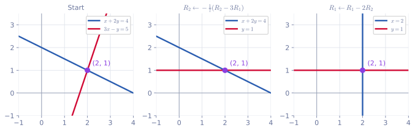
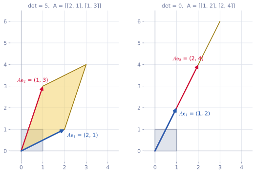
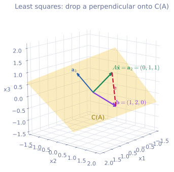

<ul class="post-sources">
<li markdown="span">[혁펜하임의 "보이는" 선형대수학](https://www.youtube.com/playlist?list=PL_iJu012NOxdZDxoGsYidMf2_bERIQaP0) 3-1–3-5강 정리</li>
</ul>

[강의 4](/blog/2026/11/05/hpla-04-inverse-rank-null/)에서는 $$A\mathbf{x} = \mathbf{b}$$의 해가 **몇 개인지**를 랭크와 영공간으로 판정했다. 이번에는 해를 **실제로 구하는** 방법(가우스-조던 소거법)과 그 연장인 역행렬 계산, 행렬에서 숫자 하나를 뽑아내는 두 함수(행렬식, 트레이스), 그리고 해가 없을 때 가장 가까운 답을 찾는 최소자승법을 다룬다. 최소자승법은 지금까지 배운 열 공간, 내적, 랭크, 역행렬이 한꺼번에 쓰이는 첫 번째 응용이다.

## 가우스-조던 소거법

[▶ 3-1강](https://www.youtube.com/watch?v=Q1zCibRtI2A)

### 이미 아는 방법을 규칙으로 정리하기

**가우스-조던 소거법(Gauss-Jordan elimination)**은 이름이 거창할 뿐, 중학교에서 연립방정식을 풀던 방법을 변수와 식이 많아져도 기계적으로 따라 할 수 있게 정리한 것이다. [강의 1](/blog/2026/11/05/hpla-01-intro/)의 연립방정식

$$
\begin{aligned}
x + 2y &= 4 \\
3x - y &= 5
\end{aligned}
$$

을 중학교 방식으로 풀어 보자. 첫 식에 3을 곱하면 $$3x + 6y = 12$$이고, 이것을 둘째 식에서 빼면 $$x$$가 사라져 $$-7y = -7$$, 즉 $$y = 1$$이다. 여기서 대입하는 대신 한 번 더 같은 일을 한다. $$y = 1$$의 2배를 첫 식에서 빼면 $$x = 2$$가 남는다.

두 식에서 "같은 것을 빼도 되는" 이유는 둘째 식이 $$3x + 6y$$와 $$12$$가 **같은 값**이라고 말해 주기 때문이다. 같은 값을 양변에서 빼는 것이니 해는 바뀌지 않는다.

### 확장 행렬과 세 가지 행 연산

계산하는 동안 실제로 움직이는 것은 계수와 우변의 숫자뿐이다. 그래서 $$x$$, $$y$$, $$=$$를 떼고 $$A$$ 옆에 $$\mathbf{b}$$를 붙인 **확장 행렬(augmented matrix)** $$[A \mid \mathbf{b}]$$만 적는다.

$$
\left[\begin{array}{cc|c} 1 & 2 & 4 \\ 3 & -1 & 5 \end{array}\right]
$$

각 행이 식 하나다. 해를 바꾸지 않는 연산은 세 가지뿐이다. 이를 **기본 행 연산(elementary row operation)**이라 한다.

1. 한 행에 **0이 아닌** 상수를 곱한다.
2. 한 행의 상수배를 다른 행에 더하거나 뺀다.
3. 두 행의 자리를 바꾼다. (식의 순서는 해와 상관없다.)

목표는 왼쪽 부분을 항등 행렬로 만드는 것이다. 그러면 각 행이 "$$x = \cdot$$", "$$y = \cdot$$"를 뜻하게 되어 오른쪽에 답이 그대로 나온다.

$$
\left[\begin{array}{cc|c} 1 & 2 & 4 \\ 3 & -1 & 5 \end{array}\right]
\xrightarrow{R_2 - 3R_1}
\left[\begin{array}{cc|c} 1 & 2 & 4 \\ 0 & -7 & -7 \end{array}\right]
\xrightarrow{-\frac{1}{7}R_2}
\left[\begin{array}{cc|c} 1 & 2 & 4 \\ 0 & 1 & 1 \end{array}\right]
\xrightarrow{R_1 - 2R_2}
\left[\begin{array}{cc|c} 1 & 0 & 2 \\ 0 & 1 & 1 \end{array}\right]
$$

$$R_i$$는 $$i$$번째 행을 뜻한다. 마지막 행렬은 $$I\mathbf{x} = (2, 1)$$, 즉 $$x = 2$$, $$y = 1$$이다.

### 그림으로 보면: 직선은 바뀌어도 교점은 그대로

*행 연산을 할 때마다 두 직선이 바뀌지만 교점 $$(2, 1)$$은 그대로다. 마지막에는 두 직선이 축에 평행한 $$x = 2$$, $$y = 1$$이 되어 답을 바로 읽을 수 있다.*

[강의 4](/blog/2026/11/05/hpla-04-inverse-rank-null/)의 행 그림(row picture)으로 보면 소거법이 무엇을 하는지 분명해진다. 행 연산은 직선을 **교점을 축으로 돌리는** 작업이다. 둘째 행에서 첫째 행의 3배를 빼면 빨간 직선이 수평선 $$y = 1$$로 바뀌고, 첫째 행에서 둘째 행의 2배를 빼면 파란 직선이 수직선 $$x = 2$$로 바뀐다. 두 직선을 다르게 만들었을 뿐 둘 다 원래 교점을 지나므로 해는 변하지 않는다.

### 변수가 셋인 예

$$
\begin{aligned}
2x + y - z &= 8 \\
-3x - y + 2z &= -11 \\
-2x + y + 2z &= -3
\end{aligned}
$$

전략은 두 단계다. 먼저 **위에서 아래로** 내려가며 대각선 아래를 0으로 만들고(전진 소거), 그다음 **아래에서 위로** 올라가며 대각선 위를 0으로 만든다(후진 소거).

**전진 소거.** 첫 열의 $$-3$$과 $$-2$$를 없애기 위해 $$R_2 + \frac{3}{2}R_1$$, $$R_3 + R_1$$을 한다.

$$
\left[\begin{array}{ccc|c} 2 & 1 & -1 & 8 \\ -3 & -1 & 2 & -11 \\ -2 & 1 & 2 & -3 \end{array}\right]
\longrightarrow
\left[\begin{array}{ccc|c} 2 & 1 & -1 & 8 \\ 0 & 1/2 & 1/2 & 1 \\ 0 & 2 & 1 & 5 \end{array}\right]
$$

둘째 열의 2를 없애기 위해 $$R_3 - 4R_2$$를 한다.

$$
\longrightarrow
\left[\begin{array}{ccc|c} 2 & 1 & -1 & 8 \\ 0 & 1/2 & 1/2 & 1 \\ 0 & 0 & -1 & 1 \end{array}\right]
$$

대각선 아래가 모두 0인 삼각형 모양이 되었다. 이 시점에서 마지막 행은 이미 $$-z = 1$$이다.

**후진 소거.** 셋째 행으로 위의 $$z$$ 항을 지운다. $$R_2 + \frac{1}{2}R_3$$, $$R_1 - R_3$$을 하고, 이어서 둘째 행으로 첫째 행의 $$y$$ 항을 지운다($$R_1 - 2R_2$$).

$$
\longrightarrow
\left[\begin{array}{ccc|c} 2 & 1 & 0 & 7 \\ 0 & 1/2 & 0 & 3/2 \\ 0 & 0 & -1 & 1 \end{array}\right]
\longrightarrow
\left[\begin{array}{ccc|c} 2 & 0 & 0 & 4 \\ 0 & 1/2 & 0 & 3/2 \\ 0 & 0 & -1 & 1 \end{array}\right]
$$

이제 왼쪽은 대각 행렬이다. 각 행을 대각 성분으로 나누면($$\frac{1}{2}R_1$$, $$2R_2$$, $$-R_3$$) 왼쪽이 항등 행렬이 되고

$$
x = 2, \qquad y = 3, \qquad z = -1
$$

을 얻는다. 원래 식에 넣어 보면 $$4 + 3 + 1 = 8$$, $$-6 - 3 - 2 = -11$$, $$-4 + 3 - 2 = -3$$으로 모두 맞는다.

### 흔한 실수

- **행에 0을 곱한다.** 식 하나가 $$0 = 0$$으로 사라져 정보가 없어진다. 곱하는 상수는 반드시 0이 아니어야 한다.
- **확장 행렬의 오른쪽을 빼먹는다.** 행 연산은 행 전체, 즉 우변 숫자까지 함께 적용해야 한다.
- **열끼리 더하거나 뺀다.** 열 연산은 식이 아니라 변수를 섞는 것이라 해가 달라진다. 소거법은 행 연산만 쓴다.

## 가우스-조던 소거법으로 역행렬 구하기

[▶ 3-2강](https://www.youtube.com/watch?v=L9gOujaGv4Q)

### 역행렬도 연립방정식이다

$$2 \times 2$$ 행렬의 역행렬 공식은 많이 외우지만, 소거법을 알면 바로 유도할 수 있다. $$AX = I$$를 [강의 3의 관점 3](/blog/2026/11/05/hpla-03-matrix-product/)으로 열마다 나누어 읽으면

$$
A\mathbf{x}_1 = \mathbf{e}_1, \qquad A\mathbf{x}_2 = \mathbf{e}_2
$$

다. $$X$$의 첫째 열 $$\mathbf{x}_1$$은 우변이 $$\mathbf{e}_1 = (1, 0)$$인 연립방정식의 해이고, 둘째 열 $$\mathbf{x}_2$$는 우변이 $$\mathbf{e}_2 = (0, 1)$$인 연립방정식의 해다. 즉 **역행렬을 구하는 것은 계수 행렬이 같은 연립방정식 $$n$$개를 푸는 것**이다.

계수 행렬이 같으면 소거 과정에서 하는 행 연산도 똑같다. 그러니 확장 행렬을 따로 $$n$$번 만들 필요 없이 우변을 옆으로 다 붙여서 한 번에 처리한다.

$$
[\,A \mid I\,] \;\xrightarrow{\text{행 연산}}\; [\,I \mid A^{-1}\,]
$$

왼쪽이 항등 행렬이 되었을 때 오른쪽에 남는 것이 역행렬이다.

**예.** [강의 4](/blog/2026/11/05/hpla-04-inverse-rank-null/)의 $$A = \begin{bmatrix} 1 & 2 \\ 3 & -1 \end{bmatrix}$$로 해 보자.

$$
\left[\begin{array}{cc|cc} 1 & 2 & 1 & 0 \\ 3 & -1 & 0 & 1 \end{array}\right]
\xrightarrow{R_2 - 3R_1}
\left[\begin{array}{cc|cc} 1 & 2 & 1 & 0 \\ 0 & -7 & -3 & 1 \end{array}\right]
\xrightarrow{-\frac{1}{7}R_2}
\left[\begin{array}{cc|cc} 1 & 2 & 1 & 0 \\ 0 & 1 & 3/7 & -1/7 \end{array}\right]
\xrightarrow{R_1 - 2R_2}
\left[\begin{array}{cc|cc} 1 & 0 & 1/7 & 2/7 \\ 0 & 1 & 3/7 & -1/7 \end{array}\right]
$$

오른쪽 블록 $$\frac{1}{7}\begin{bmatrix} 1 & 2 \\ 3 & -1 \end{bmatrix}$$이 강의 4에서 본 $$A^{-1}$$과 같다.

### $$2 \times 2$$ 역행렬 공식 유도

같은 일을 문자로 한다. $$A = \begin{bmatrix} a & b \\ c & d \end{bmatrix}$$이고 $$a \neq 0$$이라 하자. ($$a = 0$$이면 먼저 두 행을 바꾼다.)

1. $$R_2 - \frac{c}{a}R_1$$: 둘째 행이 $$\left[\, 0,\; \frac{ad - bc}{a} \;\middle\vert\; -\frac{c}{a},\; 1 \,\right]$$이 된다.
2. 둘째 행에 $$\frac{a}{ad - bc}$$를 곱한다: $$\left[\, 0,\; 1 \;\middle\vert\; \frac{-c}{ad - bc},\; \frac{a}{ad - bc} \,\right]$$.
3. $$R_1 - bR_2$$: 첫째 행이 $$\left[\, a,\; 0 \;\middle\vert\; \frac{ad}{ad - bc},\; \frac{-ab}{ad - bc} \,\right]$$이 된다. ($$1 + \frac{bc}{ad - bc} = \frac{ad}{ad - bc}$$)
4. 첫째 행을 $$a$$로 나눈다.

오른쪽 블록을 모으면

$$
A^{-1} = \frac{1}{ad - bc}\begin{bmatrix} d & -b \\ -c & a \end{bmatrix}
$$

이다. 외우는 요령은 "$$a$$와 $$d$$는 자리를 바꾸고, $$b$$와 $$c$$는 부호를 바꾸고, 앞에 $$\frac{1}{ad - bc}$$"다.

### 역행렬이 있을 조건

위 계산의 2단계에서 $$ad - bc$$로 나누었다. $$ad - bc = 0$$이면 나눌 수 없고, 실제로 둘째 행의 왼쪽이 $$[0, 0]$$이 되어 항등 행렬을 만들 수 없다. 이 숫자 하나가 역행렬의 존재를 결정하므로 **행렬식(determinant)**이라는 이름을 붙이고 $$\det A$$로 쓴다.

역행렬이 있는 행렬을 **가역(invertible)** 또는 **비특이(nonsingular)** 행렬, 없는 행렬을 **특이(singular)** 행렬이라 한다. $$n \times n$$ 행렬 $$A$$에 대해 다음은 모두 같은 말이다.

- $$A$$가 가역이다.
- $$\det A \neq 0$$이다.
- $$A$$가 full rank다($$\operatorname{rank} A = n$$).
- $$N(A) = \{\mathbf{0}\}$$이다.

뒤의 두 조건은 [강의 4](/blog/2026/11/05/hpla-04-inverse-rank-null/)의 rank-nullity로 연결된다. 랭크가 $$n$$이면 영공간의 차원은 $$n - n = 0$$이다. 거꾸로 영공간에 영이 아닌 $$\mathbf{x}$$가 있으면 $$A\mathbf{x} = A\mathbf{0} = \mathbf{0}$$이라 서로 다른 두 입력이 같은 출력으로 가므로 되돌릴 방법이 없다.

### 역행렬의 성질

$$A$$, $$B$$가 같은 크기의 가역 행렬이고 $$k \neq 0$$인 스칼라일 때 다음이 성립한다.

| 성질 | 이유 |
|---|---|
| $$(AB)^{-1} = B^{-1}A^{-1}$$ | $$AB\,B^{-1}A^{-1} = A\,I\,A^{-1} = I$$ |
| $$(ABC)^{-1} = C^{-1}B^{-1}A^{-1}$$ | 위를 두 번 쓴다 |
| $$(kA)^{-1} = \frac{1}{k}A^{-1}$$ | $$kA \cdot \frac{1}{k}A^{-1} = I$$ |
| $$(A^T)^{-1} = (A^{-1})^T$$ | $$A^T(A^{-1})^T = (A^{-1}A)^T = I^T = I$$ |
| $$\det(A^{-1}) = \frac{1}{\det A}$$ | 다음 절의 $$\det(AB) = \det A \det B$$ |

첫 줄은 양말과 신발에 비유하곤 한다. 양말을 신고 신발을 신었으면, 벗을 때는 신발부터 벗는다. 행렬 곱은 교환 법칙이 성립하지 않으므로 순서가 뒤집히는 것을 꼭 기억해야 한다.

## 행렬식

[▶ 3-3강](https://www.youtube.com/watch?v=F_7zPoosry8)

### 행렬식은 넓이의 배율이다

행렬식은 정사각 행렬의 성분으로 스칼라 하나를 만드는 함수이고, 그 숫자에 행렬에 관한 정보가 압축되어 있다. 가장 그림이 잘 그려지는 해석은 **넓이(부피)가 몇 배가 되는가**이다.

*왼쪽: $$A$$는 넓이 1인 단위 정사각형을 넓이 5인 평행사변형으로 보낸다. 오른쪽: 두 열이 평행한 행렬은 정사각형을 선분으로 납작하게 만든다. 넓이가 0이 되니 행렬식도 0이다.*

$$A$$를 곱하면 $$\mathbf{e}_1$$은 첫째 열로, $$\mathbf{e}_2$$는 둘째 열로 간다. 그래서 단위 정사각형은 두 열이 만드는 평행사변형이 되고, 그 넓이가 $$\lvert \det A \rvert$$다. 왼쪽 그림의 $$A = \begin{bmatrix} 2 & 1 \\ 1 & 3 \end{bmatrix}$$은 $$\det A = 2 \cdot 3 - 1 \cdot 1 = 5$$이고, 평행사변형의 넓이도 5다. 오른쪽 행렬 $$\begin{bmatrix} 1 & 2 \\ 2 & 4 \end{bmatrix}$$은 둘째 열이 첫째 열의 2배라 평면 전체가 직선 하나로 눌린다. 넓이가 0이고, $$1 \cdot 4 - 2 \cdot 2 = 0$$이다.

이 그림으로 "행렬식이 0이면 역행렬이 없다"가 자연스럽게 이해된다. 평면이 직선으로 눌리면 직선 위의 한 점으로 온 입력이 무수히 많아서, 출력만 보고 입력을 되돌릴 수 없다. (행렬식의 부호는 방향, 즉 뒤집혔는지를 알려 준다. 행렬을 평면을 변형하는 함수로 보는 관점은 [Linear Algebra 4](/blog/2026/10/22/la-04-linear-transformation/)와 [강의 7](/blog/2026/11/05/hpla-07-eigen/)에서 더 다룬다.)

### $$3 \times 3$$ 행렬식: 여인수 전개

$$
A = \begin{bmatrix} a & b & c \\ d & e & f \\ g & h & i \end{bmatrix}
$$

의 행렬식은

$$
\det A = a\,(ei - fh) - b\,(di - fg) + c\,(dh - eg)
$$

이다. 복잡해 보이지만 구조는 단순하다.

- $$a$$ 뒤의 $$ei - fh$$는 $$a$$가 있는 **행과 열을 지우고 남은** $$2 \times 2$$ 행렬 $$\begin{bmatrix} e & f \\ h & i \end{bmatrix}$$의 행렬식이다. $$b$$, $$c$$ 뒤도 마찬가지다.
- 부호는 성분의 위치 $$(i, j)$$에서 $$i + j$$가 짝수이면 $$+$$, 홀수이면 $$-$$다. $$a$$는 $$(1, 1)$$, $$b$$는 $$(1, 2)$$, $$c$$는 $$(1, 3)$$이라 $$+, -, +$$가 된다.

이렇게 큰 행렬의 행렬식을 작은 행렬의 행렬식들로 쪼개 계산하는 방법을 **여인수 전개(cofactor expansion)** 또는 **라플라스 전개(Laplace expansion)**라 한다. 부호까지 붙인 작은 행렬식을 **여인수(cofactor)**라 한다. 첫 행이 아닌 다른 행이나 열을 따라 전개해도 같은 값이 나온다.

**예.** 앞 절의 계수 행렬 $$M = \begin{bmatrix} 2 & 1 & -1 \\ -3 & -1 & 2 \\ -2 & 1 & 2 \end{bmatrix}$$에 적용하면

$$
\det M = 2\,\big((-1)(2) - (2)(1)\big) - 1\,\big((-3)(2) - (2)(-2)\big) + (-1)\,\big((-3)(1) - (-1)(-2)\big) = -8 + 2 + 5 = -1
$$

이다. 소거법과 비교해 보면 재미있다. 전진 소거로 얻은 삼각 행렬의 대각 성분이 $$2$$, $$\frac{1}{2}$$, $$-1$$이었는데, 이 셋을 곱해도 $$-1$$이다. 한 행의 상수배를 다른 행에 더하는 연산은 행렬식을 바꾸지 않고, 삼각 행렬의 행렬식은 대각 성분의 곱이기 때문이다(아래 성질 4). 실제 컴퓨터도 큰 행렬의 행렬식을 이렇게 소거법으로 계산한다.

### 행렬식의 성질

$$A$$, $$B$$는 $$n \times n$$ 행렬, $$c$$는 스칼라다.

1. **$$\det A = 0 \iff A$$는 특이 행렬이다.** 행렬식이 가장 자주 쓰이는 이유다.
2. **열(또는 행)이 하나라도 다른 열들의 선형 결합이면 $$\det A = 0$$이다.** rank deficient이면 평행사변형이 납작해지기 때문이다.
3. **대각 행렬의 행렬식은 대각 성분의 곱이다.** 축마다 $$d_i$$배 늘리면 부피는 $$d_1 d_2 \cdots d_n$$배가 된다. 대각 성분에 0이 하나라도 있으면 특이 행렬이다.
4. **삼각 행렬의 행렬식도 대각 성분의 곱이다.** 대각선 한쪽이 모두 0인 행렬을 **삼각 행렬(triangular matrix)**이라 한다. 대각선 위쪽에만 값이 있으면 **위 삼각 행렬(upper triangular)**, 아래쪽에만 있으면 **아래 삼각 행렬(lower triangular)**이다. 예를 들어 $$\det\begin{bmatrix} 3 & 7 & 1 \\ 0 & -2 & 5 \\ 0 & 0 & 4 \end{bmatrix} = 3 \cdot (-2) \cdot 4 = -24$$이다.
5. **$$\det I = 1$$이다.**
6. **$$\det(cA) = c^n \det A$$이다.** $$c$$는 $$n$$개의 열에 각각 곱해지므로 $$c$$가 아니라 $$c^n$$이 나온다. 앞의 $$3 \times 3$$ 행렬 $$M$$이면 $$\det(3M) = 27 \cdot (-1) = -27$$이다.
7. **$$\det A^T = \det A$$이다.**
8. **$$\det(AB) = \det A \det B$$이다.** 넓이를 $$\det B$$배 한 뒤 $$\det A$$배 하면 모두 $$\det A \det B$$배다. 아주 자주 쓰인다.
9. **$$\det(A^{-1}) = 1/\det A$$이다.** 8에서 $$\det A \det(A^{-1}) = \det(AA^{-1}) = \det I = 1$$이다.
10. **$$\det A = \lambda_1\lambda_2\cdots\lambda_n$$이다.** $$\lambda_i$$는 $$A$$의 고윳값이다. [강의 7](/blog/2026/11/05/hpla-07-eigen/)에서 다룬다. 고윳값이 하나라도 0이면 특이 행렬이다.

### 흔한 실수

- **$$\det(A + B) = \det A + \det B$$라고 쓴다.** 행렬식은 곱에 대해서만 쪼개진다. $$\det(I + I) = \det(2I) = 2^n$$이지 $$2$$가 아니다.
- **$$\det(cA) = c\det A$$라고 쓴다.** $$c^n$$이다(성질 6).
- **여인수 전개에서 부호를 빠뜨린다.** 체스판처럼 $$+, -, +$$가 번갈아 나온다.

## 트레이스

[▶ 3-4강](https://www.youtube.com/watch?v=XnrNaMqf24k)

### 정의

정사각 행렬 $$A$$의 **트레이스(trace)**는 대각 성분을 모두 더한 것이다.

$$
\operatorname{tr} A = a_{11} + a_{22} + \cdots + a_{nn} = \sum_{i=1}^{n} a_{ii}
$$

여기서 $$a_{ii}$$는 $$i$$번째 행, $$i$$번째 열의 성분이다. 행렬식과 마찬가지로 정사각 행렬에만 정의한다.

### 왜 쓸모가 있나

정의는 허무할 정도로 쉽지만, 머신 러닝과 신호 처리에서 아주 많이 쓰인다. 최적화는 **손실 함수(loss function)**를 최소화하는 문제이고, "작아졌다", "커졌다"를 말하려면 손실은 반드시 **스칼라**여야 한다. 벡터 $$(1, 3)$$과 $$(2, 1)$$은 어느 쪽이 더 크다고 말할 수 없다. 트레이스는 행렬을 넣어도 결과가 항상 스칼라이고, 아래의 성질 덕분에 트레이스 안에서는 행렬의 자리를 바꿀 수 있다. 그래서 행렬을 변수로 하는 함수를 미분할 때, 일단 스칼라를 $$1 \times 1$$ 행렬로 보고 트레이스를 씌운 다음 자리를 바꿔 정리하는 기법을 자주 쓴다.

### 성질

1. $$\operatorname{tr}(A + B) = \operatorname{tr} A + \operatorname{tr} B$$. 대각 성분끼리 더해지기 때문이다.
2. $$\operatorname{tr}(cA) = c\operatorname{tr} A$$. 행렬식의 $$c^n$$과 달리 그냥 $$c$$배다.
3. $$\operatorname{tr} A^T = \operatorname{tr} A$$. 전치는 대각 성분을 그대로 둔다.
4. $$\operatorname{tr}(AB) = \operatorname{tr}(BA)$$. 단, $$A$$가 $$m \times n$$이면 $$B$$는 $$n \times m$$이어야 한다. 그래야 $$AB$$($$m \times m$$)와 $$BA$$($$n \times n$$)가 모두 정사각이다.
5. 벡터 버전: $$\mathbf{x}, \mathbf{y} \in \mathbb{R}^n$$이면 $$\mathbf{x}^T\mathbf{y} = \operatorname{tr}(\mathbf{x}^T\mathbf{y}) = \operatorname{tr}(\mathbf{y}\mathbf{x}^T)$$. 내적은 스칼라라서 트레이스를 씌워도 그대로이고, 그 안에서 4번으로 자리를 바꾼 것이다. 예를 들어 이차 형식은 $$\mathbf{x}^TA\mathbf{x} = \operatorname{tr}(A\mathbf{x}\mathbf{x}^T)$$로 쓸 수 있다.
6. **순환 성질(cyclic property)**: $$\operatorname{tr}(ABCD) = \operatorname{tr}(BCDA) = \operatorname{tr}(CDAB) = \operatorname{tr}(DABC)$$. 맨 앞의 행렬을 맨 뒤로 보내는 것(또는 반대)만 허락된다.
7. $$\operatorname{tr} A = \lambda_1 + \lambda_2 + \cdots + \lambda_n$$. 고윳값의 합이다. 행렬식이 고윳값의 곱인 것과 짝을 이룬다([강의 7](/blog/2026/11/05/hpla-07-eigen/)).

### 숫자로 확인

**성질 4.** $$A = \begin{bmatrix} 1 & 2 & 0 \\ 0 & 1 & 3 \end{bmatrix}$$ ($$2 \times 3$$), $$B = \begin{bmatrix} 1 & 0 \\ 2 & 1 \\ 0 & 1 \end{bmatrix}$$ ($$3 \times 2$$)이면

$$
AB = \begin{bmatrix} 5 & 2 \\ 2 & 4 \end{bmatrix}, \qquad
BA = \begin{bmatrix} 1 & 2 & 0 \\ 2 & 5 & 3 \\ 0 & 1 & 3 \end{bmatrix}
$$

이다. 크기도 성분도 전혀 다르지만 $$\operatorname{tr}(AB) = 5 + 4 = 9$$, $$\operatorname{tr}(BA) = 1 + 5 + 3 = 9$$로 같다.

**성질 6은 아무 순서나 되는 게 아니다.** $$P = \begin{bmatrix} 1 & 1 \\ 0 & 1 \end{bmatrix}$$, $$Q = \begin{bmatrix} 1 & 0 \\ 1 & 1 \end{bmatrix}$$, $$R = \begin{bmatrix} 1 & 0 \\ 0 & 0 \end{bmatrix}$$이면 $$\operatorname{tr}(PQR) = \operatorname{tr}(QRP) = \operatorname{tr}(RPQ) = 2$$이지만 $$\operatorname{tr}(PRQ) = 1$$이다. $$PRQ$$는 $$PQR$$을 원형으로 돌린 것이 아니라 $$Q$$와 $$R$$을 맞바꾼 것이다.

### 흔한 실수

- **트레이스 안에서 교환 법칙이 성립한다고 생각한다.** 돌리기(순환)만 된다. 행렬이 두 개일 때는 돌리기와 맞바꾸기가 같아서 착각하기 쉽다.
- **$$\operatorname{tr}(AB) = \operatorname{tr} A \operatorname{tr} B$$라고 쓴다.** 위 예에서 $$A$$와 $$B$$는 트레이스가 정의되지도 않는다. 곱으로 쪼개지는 것은 행렬식이다.

## 최소자승법과 정사영 행렬

[▶ 3-5강](https://www.youtube.com/watch?v=B_WZdmCGqBc)

### 문제 상황: 해가 없을 때

$$A$$가 $$10 \times 3$$이고 랭크가 3(full column rank)이라 하자. 열 공간 $$C(A)$$는 10차원 공간 안의 3차원 부분 공간이다. 10차원 안의 3차원은 아주 얇은 조각이라, $$\mathbf{b}$$가 아무렇게나 주어지면 거의 확실히 그 밖에 있다. 그러면 [강의 4](/blog/2026/11/05/hpla-04-inverse-rank-null/)에서 본 대로 $$A\mathbf{x}$$를 아무리 바꿔도 $$\mathbf{b}$$가 될 수 없고, $$A\mathbf{x} = \mathbf{b}$$는 해가 없다.

실제 데이터는 대부분 이렇다. 알고 싶은 값 $$\mathbf{x}$$가 그대로 관측되지 않고 행렬 $$A$$를 거친 뒤 잡음 $$\mathbf{n}$$이 더해져서

$$
\mathbf{b} = A\mathbf{x} + \mathbf{n}
$$

으로 측정된다. 잡음은 아무 방향으로나 튀므로 $$\mathbf{b}$$는 열 공간 밖으로 삐져나온다. 해가 없다고 포기하는 대신 **$$A\mathbf{x}$$를 $$\mathbf{b}$$에 최대한 가깝게 만드는 $$\mathbf{x}$$**라도 찾자는 것이 **최소자승법(least squares)**이다.

"가깝다"를 정확히 하기 위해 **오차 벡터(error vector)** $$\mathbf{e} = \mathbf{b} - A\mathbf{x}$$를 정의하고, 그 길이를 최소화한다. 제곱근이 없는 편이 다루기 쉬우므로 길이의 제곱을 최소화해도 답은 같다.

$$
\hat{\mathbf{x}} = \arg\min_{\mathbf{x}} \lVert \mathbf{b} - A\mathbf{x} \rVert^2
$$

$$\lVert \mathbf{e} \rVert^2 = e_1^2 + \cdots + e_m^2$$는 오차 성분의 제곱(square)의 합이고, 이것을 가장 작게(least) 만드니 least squares, 최소자승(제곱)법이라는 이름이 붙었다. $$\hat{\mathbf{x}}$$는 "x hat"이라 읽고, 최적해임을 표시한다.

### 기하학적 풀이: 수선의 발

$$\mathbf{x}$$를 바꾸면 $$A\mathbf{x}$$는 열 공간 위를 돌아다닌다. 평면 위의 점 중 평면 밖의 점 $$\mathbf{b}$$에 가장 가까운 것은 **수선의 발**, 즉 $$\mathbf{b}$$에서 평면에 수직으로 내린 점이다. 다른 어떤 점을 고르면 피타고라스 정리에 따라 빗변이 되어 더 멀다. 따라서 최적일 때 오차 $$\mathbf{e} = \mathbf{b} - A\hat{\mathbf{x}}$$는 **열 공간 전체와 수직**이어야 한다.

열 공간 전체와 수직이라는 것은 열 공간을 만드는 모든 열 $$\mathbf{a}_1, \dots, \mathbf{a}_n$$과 수직이라는 것이다. 각 열과의 내적을 한 번에 쓰면 $$A^T$$의 행이 곧 $$A$$의 열이므로

$$
A^T(\mathbf{b} - A\hat{\mathbf{x}}) = \mathbf{0}
$$

이다. 정리하면

$$
A^TA\,\hat{\mathbf{x}} = A^T\mathbf{b}
$$

를 얻는다. 이를 **정규 방정식(normal equation)**이라 한다. normal은 "수직"이라는 뜻이다.

### $$A^TA$$는 가역이다

$$A$$가 $$m \times n$$이면 $$A^TA$$는 $$n \times n$$ 정사각 행렬이다. 위 예에서는 $$3 \times 10$$과 $$10 \times 3$$을 곱해 $$3 \times 3$$이 된다. 그리고 다음이 성립한다.

$$
\operatorname{rank}(A^TA) = \operatorname{rank} A
$$

(이유: $$A\mathbf{x} = \mathbf{0}$$이면 당연히 $$A^TA\mathbf{x} = \mathbf{0}$$이다. 거꾸로 $$A^TA\mathbf{x} = \mathbf{0}$$이면 왼쪽에 $$\mathbf{x}^T$$를 곱해 $$\lVert A\mathbf{x} \rVert^2 = 0$$, 즉 $$A\mathbf{x} = \mathbf{0}$$이다. 두 행렬의 영공간이 같고 열의 수도 $$n$$으로 같으니 rank-nullity로 랭크도 같다.)

$$A$$가 full column rank이면 $$A^TA$$의 랭크도 $$n$$, 즉 full rank라 가역이다. 정규 방정식의 양변 왼쪽에 $$(A^TA)^{-1}$$을 곱하면

$$
\hat{\mathbf{x}} = (A^TA)^{-1}A^T\mathbf{b}
$$

이다. 식은 복잡해 보이지만 한 일은 "오차가 열 공간과 수직이 되게 하라" 하나뿐이다. 미분해서 그래디언트를 0으로 놓아도 같은 식이 나온다. 그 유도는 [Linear Algebra 5](/blog/2026/10/22/la-05-least-squares/)에 있다.

### 정사영 행렬

최적해를 대입하면 $$\mathbf{b}$$에 가장 가까운 열 공간 위의 점은

$$
A\hat{\mathbf{x}} = \underbrace{A(A^TA)^{-1}A^T}_{P_A}\,\mathbf{b}
$$

다. 행렬 $$P_A = A(A^TA)^{-1}A^T$$를 곱하는 것만으로 아무 벡터나 열 공간 위로 수직으로 떨어뜨리므로 **정사영 행렬(projection matrix)**이라 한다. [강의 2](/blog/2026/11/05/hpla-02-vectors/)에서 벡터 하나 위로의 정사영을 배웠는데, 그것을 여러 열이 span하는 공간으로 넓힌 것이다. 정사영 행렬은 두 가지 성질을 가진다.

- $$P_A^2 = P_A$$: 이미 평면 위에 있는 점을 다시 내려도 그대로다.
- $$P_A^T = P_A$$: 대칭이다.

### 예: 강의 4에서 해가 없던 연립방정식

[강의 4](/blog/2026/11/05/hpla-04-inverse-rank-null/)의 경우 1에서

$$
A = \begin{bmatrix} 1 & 0 \\ 0 & 1 \\ 1 & 1 \end{bmatrix}, \qquad \mathbf{b} = \begin{bmatrix} 1 \\ 2 \\ 0 \end{bmatrix}
$$

은 셋째 식이 $$3 = 0$$을 요구해 해가 없었다. 최소자승해를 구해 보자.

$$
A^TA = \begin{bmatrix} 2 & 1 \\ 1 & 2 \end{bmatrix}, \qquad
A^T\mathbf{b} = \begin{bmatrix} 1 \\ 2 \end{bmatrix}
$$

$$\det(A^TA) = 3 \neq 0$$이고 $$2 \times 2$$ 공식으로 $$(A^TA)^{-1} = \frac{1}{3}\begin{bmatrix} 2 & -1 \\ -1 & 2 \end{bmatrix}$$이다. 따라서

$$
\hat{\mathbf{x}} = \frac{1}{3}\begin{bmatrix} 2 & -1 \\ -1 & 2 \end{bmatrix}\begin{bmatrix} 1 \\ 2 \end{bmatrix} = \begin{bmatrix} 0 \\ 1 \end{bmatrix}, \qquad
A\hat{\mathbf{x}} = \begin{bmatrix} 0 \\ 1 \\ 1 \end{bmatrix}, \qquad
\mathbf{e} = \mathbf{b} - A\hat{\mathbf{x}} = \begin{bmatrix} 1 \\ 1 \\ -1 \end{bmatrix}
$$

이다. 확인해 보면 $$\mathbf{e} \cdot \mathbf{a}_1 = 1 + 0 - 1 = 0$$, $$\mathbf{e} \cdot \mathbf{a}_2 = 0 + 1 - 1 = 0$$으로 오차가 두 열 모두와 수직이다. 오차의 제곱합은 $$\lVert \mathbf{e} \rVert^2 = 3$$이고, 다른 어떤 $$\mathbf{x}$$를 넣어도 이보다 작아지지 않는다. (예를 들어 앞의 두 식을 정확히 맞추는 $$\mathbf{x} = (1, 2)$$는 오차가 $$(0, 0, -3)$$이라 제곱합이 9다.)

*노란 평면이 열 공간 $$C(A)$$다. 보라색 $$\mathbf{b}$$는 평면 밖에 있고, 평면에 수직으로 내린 점이 $$A\hat{\mathbf{x}} = (0, 1, 1)$$이다. 빨간 점선 $$\mathbf{e}$$가 평면과 수직이다.*

이 예에서는 우연히 $$A\hat{\mathbf{x}}$$가 둘째 열 $$\mathbf{a}_2$$와 같다($$\hat{\mathbf{x}} = (0, 1)$$). 정사영 행렬은

$$
P_A = \frac{1}{3}\begin{bmatrix} 2 & -1 & 1 \\ -1 & 2 & 1 \\ 1 & 1 & 2 \end{bmatrix}
$$

이고, $$P_A\mathbf{b} = \frac{1}{3}(2 - 2 + 0,\; -1 + 4 + 0,\; 1 + 2 + 0) = (0, 1, 1)$$로 같은 점이 나온다.

### 흔한 실수

- **$$\mathbf{e}$$가 $$A\hat{\mathbf{x}}$$ 하나와만 수직이면 된다고 생각한다.** 필요한 조건은 열 공간 **전체**와 수직, 즉 모든 열과 수직인 것이다. 그래서 $$A^T\mathbf{e} = \mathbf{0}$$이라는 $$n$$개의 식이 나온다.
- **$$(A^TA)^{-1} = A^{-1}(A^T)^{-1}$$로 쪼개서 $$\hat{\mathbf{x}} = A^{-1}\mathbf{b}$$라고 한다.** $$A$$가 직사각 행렬이면 $$A^{-1}$$은 존재하지 않는다. 쪼갤 수 있는 것은 $$A$$가 정사각 가역일 때뿐이고, 그때는 애초에 정확한 해가 있다.
- **rank deficient인 $$A$$에도 같은 공식을 쓴다.** 그때는 $$A^TA$$가 가역이 아니다. 해결책은 [강의 10](/blog/2026/11/05/hpla-10-svd/)의 유사 역행렬(pseudo inverse)이다.

## 정리

| 주제 | 핵심 |
|---|---|
| 가우스-조던 소거법 | 확장 행렬 $$[A \mid \mathbf{b}]$$에 세 가지 행 연산을 해서 왼쪽을 $$I$$로 만들면 오른쪽이 해다 |
| 역행렬 | $$[A \mid I] \to [I \mid A^{-1}]$$. $$2 \times 2$$이면 $$A^{-1} = \frac{1}{ad - bc}\begin{bmatrix} d & -b \\ -c & a \end{bmatrix}$$ |
| 가역 조건 | $$\det A \neq 0$$, full rank, $$N(A) = \{\mathbf{0}\}$$는 모두 같은 말 |
| 행렬식 | 넓이(부피)의 배율. $$\det(AB) = \det A\det B$$, $$\det(cA) = c^n\det A$$, 삼각 행렬은 대각 성분의 곱, 고윳값의 곱 |
| 트레이스 | 대각 성분의 합. $$\operatorname{tr}(AB) = \operatorname{tr}(BA)$$, 순환 성질, 고윳값의 합 |
| 최소자승법 | 오차 $$\mathbf{b} - A\hat{\mathbf{x}}$$가 $$C(A)$$와 수직. $$A^TA\hat{\mathbf{x}} = A^T\mathbf{b}$$, $$\hat{\mathbf{x}} = (A^TA)^{-1}A^T\mathbf{b}$$ |
| 정사영 행렬 | $$P_A = A(A^TA)^{-1}A^T$$, $$P_A^2 = P_A = P_A^T$$ |
