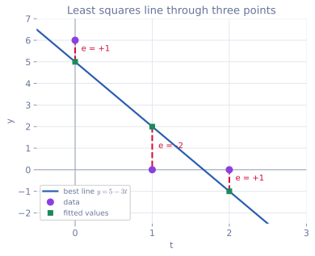

<ul class="post-sources">
<li markdown="span">[혁펜하임의 "보이는" 선형대수학](https://www.youtube.com/playlist?list=PL_iJu012NOxdZDxoGsYidMf2_bERIQaP0) 4-1–4-3강 정리</li>
</ul>

[강의 1](/blog/2026/11/05/hpla-01-intro/)부터 [강의 5](/blog/2026/11/05/hpla-05-elimination-determinant/)까지가 중간고사 범위에 해당한다. 이번 글은 문제를 풀면서 그 내용을 점검한다. 문제는 강의의 주제에 맞춰 새로 구성했고, 숫자는 모두 직접 계산해 확인했다. 각 문제 뒤에 그 문제가 무엇을 가르쳐 주는지 적었다.

## 중간고사 대비

[▶ 4-1강](https://www.youtube.com/watch?v=Ya1810qcvjg)

### 문제 1: 랭크와 네 부분 공간

$$
A = \begin{bmatrix} 1 & 2 & 0 & 1 \\ 0 & 0 & 1 & 2 \\ 1 & 2 & 1 & 3 \end{bmatrix}
$$

의 랭크를 구하고, 열 공간, 영공간, 행 공간, 왼쪽 영공간의 차원과 기저를 하나씩 구하라. 또 $$A\mathbf{x} = \mathbf{b}$$가 해를 가질 조건을 $$\mathbf{b} = (b_1, b_2, b_3)$$로 나타내라.

**풀이.** 열을 $$\mathbf{a}_1, \dots, \mathbf{a}_4$$라 하자. 열끼리의 관계를 찾으면

- $$\mathbf{a}_2 = 2\mathbf{a}_1$$이다.
- $$\mathbf{a}_4 = (1, 2, 3) = \mathbf{a}_1 + 2\mathbf{a}_3$$이다.
- $$\mathbf{a}_1 = (1, 0, 1)$$과 $$\mathbf{a}_3 = (0, 1, 1)$$은 서로 스칼라배가 아니므로 독립이다.

따라서 독립인 열은 2개이고 $$\operatorname{rank} A = 2$$다. 행으로 봐도 셋째 행이 첫째 행과 둘째 행의 합이라 독립인 행이 2개다([강의 4](/blog/2026/11/05/hpla-04-inverse-rank-null/)의 "독립인 열의 수 = 독립인 행의 수").

- **열 공간** $$C(A)$$: $$\operatorname{Span}\{(1, 0, 1), (0, 1, 1)\}$$, $$\mathbb{R}^3$$ 안의 평면, 2차원.
- **영공간** $$N(A)$$: 위의 두 관계를 "합이 0이 되는 계수"로 바꾸면 된다. $$-2\mathbf{a}_1 + \mathbf{a}_2 = \mathbf{0}$$에서 $$(-2, 1, 0, 0)$$, $$-\mathbf{a}_1 - 2\mathbf{a}_3 + \mathbf{a}_4 = \mathbf{0}$$에서 $$(-1, 0, -2, 1)$$. 두 벡터는 독립이고, rank-nullity로 차원이 $$4 - 2 = 2$$이므로 이 둘이 기저다.
- **행 공간** $$C(A^T)$$: 독립인 두 행 $$(1, 2, 0, 1)$$, $$(0, 0, 1, 2)$$가 기저, 2차원. 실제로 영공간의 두 벡터와 각각 내적하면 $$-2 + 2 = 0$$, $$-1 + 1 = 0$$, $$0$$, $$-2 + 2 = 0$$으로 모두 수직이다.
- **왼쪽 영공간** $$N(A^T)$$: 행 사이의 관계 $$R_1 + R_2 - R_3 = \mathbf{0}$$에서 $$\mathbf{y} = (1, 1, -1)$$. 차원은 $$m - r = 3 - 2 = 1$$이다.

해가 있을 조건은 $$\mathbf{b} \in C(A)$$다. 열 공간과 왼쪽 영공간은 수직이고 차원을 합하면 3이므로, $$\mathbf{b}$$가 열 공간에 있다는 것은 $$\mathbf{b}$$가 $$(1, 1, -1)$$과 수직이라는 것과 같다.

$$
b_1 + b_2 - b_3 = 0
$$

식으로 봐도 자연스럽다. 셋째 식의 좌변은 첫째와 둘째 식 좌변의 합이므로 우변도 $$b_3 = b_1 + b_2$$여야 모순이 없다.

**배울 점.** 영공간의 기저는 "열 사이의 관계"를 계수로 적은 것이고, 왼쪽 영공간의 기저는 "행 사이의 관계"를 계수로 적은 것이다. 그리고 왼쪽 영공간은 해의 존재 조건을 한 줄로 알려 준다.

### 문제 2: 행렬식의 성질

$$3 \times 3$$ 행렬 $$A$$, $$B$$가 $$\det A = 2$$, $$\det B = -3$$을 만족한다. 다음을 구하라.

(a) $$\det(2A^TB^{-1})$$ (b) $$\det(A^{-1}BA)$$ (c) $$\det(-A)$$

**풀이.** [강의 5](/blog/2026/11/05/hpla-05-elimination-determinant/)의 성질을 차례로 쓴다.

(a) 스칼라 2는 3개의 열에 모두 곱해지므로 $$2^3$$이 나온다.

$$
\det(2A^TB^{-1}) = 2^3 \cdot \det A^T \cdot \det B^{-1} = 8 \cdot 2 \cdot \left(-\frac{1}{3}\right) = -\frac{16}{3}
$$

(b) $$\det(A^{-1}BA) = \frac{1}{\det A} \cdot \det B \cdot \det A = \det B = -3$$. 행렬 곱의 순서는 바꿀 수 없지만, 행렬식은 숫자라서 곱한 뒤에는 순서가 상관없다.

(c) $$-A = (-1)A$$이므로 $$\det(-A) = (-1)^3\det A = -2$$다. $$2 \times 2$$였다면 $$(-1)^2 = 1$$이라 부호가 바뀌지 않는다.

**배울 점.** $$\det(cA) = c^n\det A$$의 $$n$$을 빠뜨리는 실수가 가장 흔하다. 그리고 (b)처럼 $$P^{-1}AP$$ 꼴은 행렬식을 바꾸지 않는다. 이 꼴은 [강의 11](/blog/2026/11/05/hpla-11-lu-similar/)의 닮은 행렬로 다시 나온다.

### 문제 3: 트레이스

임의의 $$m \times n$$ 행렬 $$A$$에 대해 $$\operatorname{tr}(A^TA)$$가 $$A$$의 모든 성분의 제곱의 합임을 보이고, $$A = \begin{bmatrix} 1 & 2 \\ 3 & 4 \end{bmatrix}$$로 확인하라.

**풀이.** $$A^TA$$의 $$(j, j)$$ 성분은 [관점 1(내적)](/blog/2026/11/05/hpla-03-matrix-product/)로 $$A$$의 $$j$$번째 열과 자기 자신의 내적, 즉 $$\lVert \mathbf{a}_j \rVert^2 = \sum_i a_{ij}^2$$이다. 트레이스는 이것을 $$j = 1, \dots, n$$에 대해 더하므로

$$
\operatorname{tr}(A^TA) = \sum_{j=1}^{n}\sum_{i=1}^{m} a_{ij}^2
$$

이다. 예에서 $$A^TA = \begin{bmatrix} 10 & 14 \\ 14 & 20 \end{bmatrix}$$이고 트레이스는 $$30$$, 성분의 제곱합도 $$1 + 4 + 9 + 16 = 30$$이다.

**배울 점.** 이 값의 제곱근을 **프로베니우스 노름(Frobenius norm)** $$\lVert A \rVert_F$$라 한다. 행렬 전체의 "크기"를 스칼라 하나로 재는 방법이라 손실 함수에 자주 나오고, 트레이스로 쓰면 순환 성질을 이용해 미분하기 쉬워진다. 또 성분의 제곱합이 0이면 모든 성분이 0이므로, $$\operatorname{tr}(A^TA) = 0$$이면 $$A = O$$다.

### 문제 4: 참, 거짓

- (a) $$A$$, $$B$$가 가역이면 $$A + B$$도 가역이다.
- (b) 정사각 행렬 $$A$$, $$B$$에 대해 $$\det(AB) = \det(BA)$$다.
- (c) 직교 행렬 $$Q$$의 행렬식은 $$1$$ 또는 $$-1$$이다.
- (d) $$A$$가 $$3 \times 5$$ 행렬이면 $$N(A)$$에 영이 아닌 벡터가 있다.
- (e) 같은 크기의 정사각 행렬 $$A$$, $$B$$에 대해 $$\operatorname{tr}(AB) = \operatorname{tr} A \operatorname{tr} B$$다.

**풀이.**

- (a) **거짓.** $$A = I$$, $$B = -I$$이면 둘 다 가역이지만 $$A + B = O$$다. 가역성은 곱에 대해서는 유지되지만($$(AB)^{-1} = B^{-1}A^{-1}$$) 합에 대해서는 아니다.
- (b) **참.** 둘 다 $$\det A\det B$$다. $$AB \neq BA$$여도 행렬식은 같다.
- (c) **참.** $$Q^TQ = I$$의 양변에 행렬식을 취하면 $$\det Q^T\det Q = (\det Q)^2 = 1$$이다. 회전은 $$+1$$, 반사는 $$-1$$이다.
- (d) **참.** 랭크는 $$\min(3, 5) = 3$$ 이하이므로 영공간의 차원은 $$5 - r \ge 2$$다.
- (e) **거짓.** $$A = B = I_2$$이면 $$\operatorname{tr}(AB) = 2$$인데 $$\operatorname{tr} A\operatorname{tr} B = 4$$다.

**배울 점.** 행렬식은 곱과 잘 어울리고, 트레이스는 합과 잘 어울린다. 반대 조합은 일반적으로 성립하지 않는다.

## $$A\mathbf{x} = \mathbf{b}$$의 해의 개수, 10+1 문제

[▶ 4-2강](https://www.youtube.com/watch?v=fMk84aazEdM)

[강의 4](/blog/2026/11/05/hpla-04-inverse-rank-null/)의 판정법을 짧은 문제로 반복해 익힌다. 기준은 두 가지뿐이다.

1. **해가 있는가?** $$\mathbf{b} \in C(A)$$인가.
2. **몇 개인가?** 해가 있다면 $$N(A) = \{\mathbf{0}\}$$일 때 하나, 아니면 무수히 많다.

$$A$$가 $$m \times n$$, 랭크가 $$r$$이면 열 공간이 $$\mathbb{R}^m$$ 전체인지는 $$r = m$$인지로, 영공간이 $$\{\mathbf{0}\}$$인지는 $$r = n$$인지로 판정한다. 각 문제에서 해의 개수로 가능한 것을 모두 답하라.

**문제 1.** $$A$$는 $$3 \times 3$$이고 랭크가 3이다.

정사각 full rank라 열 공간이 전체이고 영공간이 $$\{\mathbf{0}\}$$이다. **어떤 $$\mathbf{b}$$든 정확히 1개.**

**문제 2.** $$A$$는 $$3 \times 5$$이고 랭크가 3이다.

$$r = m$$이라 열 공간이 $$\mathbb{R}^3$$ 전체이고 해가 항상 있다. 영공간은 $$5 - 3 = 2$$차원이다. **항상 무수히 많음.**

**문제 3.** $$A$$는 $$5 \times 3$$이고 랭크가 3이다.

$$r = n$$이라 영공간은 $$\{\mathbf{0}\}$$이지만, 열 공간은 $$\mathbb{R}^5$$ 안의 3차원이라 $$\mathbf{b}$$가 밖에 있을 수 있다. **0개 또는 1개.**

**문제 4.** $$A$$는 $$4 \times 4$$이고 $$\det A = 0$$이다.

$$\det A = 0$$이면 $$r < 4$$다. 열 공간이 전체가 아니고 영공간이 0차원보다 크다. **0개 또는 무수히 많음.** 정사각 행렬이라고 해가 하나인 것은 아니다.

**문제 5.** $$A = \begin{bmatrix} 1 & 2 \\ 2 & 4 \end{bmatrix}$$, $$\mathbf{b} = (3, 6)$$.

열 공간은 $$\operatorname{Span}\{(1, 2)\}$$이고 $$(3, 6) = 3(1, 2)$$이라 그 안에 있다. 랭크 1, 영공간 1차원이므로 **무수히 많음.** 예: $$(3, 0) + t(-2, 1)$$.

**문제 6.** 같은 $$A$$, $$\mathbf{b} = (3, 5)$$.

$$(3, 5)$$는 $$(1, 2)$$의 스칼라배가 아니다. **0개.** 식으로 보면 첫 식의 2배가 $$6 = 5$$를 요구한다.

**문제 7.** $$A = \begin{bmatrix} 1 & 0 \\ 0 & 1 \\ 1 & 1 \end{bmatrix}$$, $$\mathbf{b} = (1, 2, 3)$$.

앞의 두 식에서 $$\mathbf{x} = (1, 2)$$이고 셋째 식 $$1 + 2 = 3$$도 맞는다. full column rank이므로 **정확히 1개.**

**문제 8.** 같은 $$A$$, $$\mathbf{b} = (1, 2, 0)$$.

셋째 식이 $$3 = 0$$이 되어 **0개.** 이 경우의 "가장 가까운 해"를 [강의 5](/blog/2026/11/05/hpla-05-elimination-determinant/)에서 최소자승법으로 구했다.

**문제 9.** $$A\mathbf{x} = \mathbf{0}$$ (동차 방정식), $$A$$는 아무 행렬.

$$\mathbf{0}$$은 언제나 열 공간에 있다($$\mathbf{x} = \mathbf{0}$$이 해). **1개 또는 무수히 많음.** full column rank일 때만 1개다. 0개인 경우는 없다.

**문제 10.** $$A\mathbf{x} = \mathbf{b}$$의 서로 다른 해 $$\mathbf{x}_1 \neq \mathbf{x}_2$$를 알고 있다.

$$A(\mathbf{x}_1 - \mathbf{x}_2) = \mathbf{b} - \mathbf{b} = \mathbf{0}$$이라 $$\mathbf{x}_1 - \mathbf{x}_2$$는 영공간의 영이 아닌 벡터다. 그러면 $$\mathbf{x}_1 + t(\mathbf{x}_1 - \mathbf{x}_2)$$가 모든 $$t$$에 대해 해다. **무수히 많음.** 해가 딱 2개인 경우는 존재하지 않는다.

**문제 +1 (보너스).** $$m \times n$$ 행렬 $$A$$에 대해 **모든** $$\mathbf{b} \in \mathbb{R}^m$$마다 $$A\mathbf{x} = \mathbf{b}$$의 해가 정확히 하나다. $$A$$는 어떤 행렬이어야 하는가?

모든 $$\mathbf{b}$$에 해가 있으려면 열 공간이 $$\mathbb{R}^m$$ 전체, 즉 $$r = m$$이어야 한다. 해가 하나뿐이려면 영공간이 $$\{\mathbf{0}\}$$, 즉 $$r = n$$이어야 한다. 따라서 $$m = n = r$$, **$$A$$는 정사각 가역 행렬**이어야 한다. 이때 해는 $$\mathbf{x} = A^{-1}\mathbf{b}$$다. 역행렬이 정사각 행렬에만 정의되는 이유를 해의 개수 쪽에서 본 것이기도 하다.

**배울 점.** 크기(세로로 긴지, 가로로 긴지)만으로는 해의 개수가 정해지지 않는다. 랭크를 행의 수 $$m$$, 열의 수 $$n$$과 비교하는 두 번의 비교가 전부다.

| 조건 | 해의 존재 | 해의 유일성 |
|---|---|---|
| $$r = m$$ | 항상 있음 | |
| $$r < m$$ | $$\mathbf{b}$$에 따라 다름 | |
| $$r = n$$ | | 있다면 하나 |
| $$r < n$$ | | 있다면 무수히 많음 |

## 최소자승법 3 문제

[▶ 4-3강](https://www.youtube.com/watch?v=g-3B8b-8u5Q)

### 문제 1: 세 점을 지나는 가장 좋은 직선

세 점 $$(t, y) = (0, 6), (1, 0), (2, 0)$$에 가장 잘 맞는 직선 $$y = c + dt$$를 최소자승법으로 구하라. 각 점에서의 오차와 오차의 제곱합도 구하라.

**풀이.** 세 점을 모두 지나는 직선이 있다면 다음 세 식을 만족해야 한다.

$$
\begin{aligned}
c + 0 \cdot d &= 6 \\
c + 1 \cdot d &= 0 \\
c + 2 \cdot d &= 0
\end{aligned}
\qquad\Longleftrightarrow\qquad
\underbrace{\begin{bmatrix} 1 & 0 \\ 1 & 1 \\ 1 & 2 \end{bmatrix}}_{A}\begin{bmatrix} c \\ d \end{bmatrix} = \underbrace{\begin{bmatrix} 6 \\ 0 \\ 0 \end{bmatrix}}_{\mathbf{b}}
$$

둘째, 셋째 식에서 $$d = 0$$, $$c = 0$$인데 첫째 식이 $$0 = 6$$이 되어 해가 없다. 세 점이 한 직선 위에 있지 않기 때문이다. 정규 방정식 $$A^TA\hat{\mathbf{x}} = A^T\mathbf{b}$$를 세운다.

$$
A^TA = \begin{bmatrix} 3 & 3 \\ 3 & 5 \end{bmatrix}, \qquad A^T\mathbf{b} = \begin{bmatrix} 6 \\ 0 \end{bmatrix}
$$

$$\det(A^TA) = 15 - 9 = 6$$이므로

$$
\begin{bmatrix} \hat{c} \\ \hat{d} \end{bmatrix} = \frac{1}{6}\begin{bmatrix} 5 & -3 \\ -3 & 3 \end{bmatrix}\begin{bmatrix} 6 \\ 0 \end{bmatrix} = \begin{bmatrix} 5 \\ -3 \end{bmatrix}
$$

이다. 가장 좋은 직선은 $$y = 5 - 3t$$다. 이 직선이 $$t = 0, 1, 2$$에서 주는 값은 $$A\hat{\mathbf{x}} = (5, 2, -1)$$이고, 오차는 $$\mathbf{e} = \mathbf{b} - A\hat{\mathbf{x}} = (1, -2, 1)$$, 제곱합은 $$1 + 4 + 1 = 6$$이다.

*보라 점이 데이터, 파란 선이 최소자승 직선, 초록 사각형이 직선 위의 값이다. 빨간 점선이 각 점의 오차이고, 최소자승법은 이 세 길이의 제곱합을 최소로 만든다.*

검산: $$\mathbf{e}$$는 $$A$$의 두 열과 수직이어야 한다. $$(1, 1, 1) \cdot (1, -2, 1) = 0$$, $$(0, 1, 2) \cdot (1, -2, 1) = 0$$으로 맞다. 첫째 열과 수직이라는 것은 오차의 합이 0이라는 뜻이다. 절편이 있는 직선 맞추기에서는 항상 그렇다.

**배울 점.** 그림의 오차는 **세로 방향**($$y$$ 방향) 거리다. 점에서 직선에 수직으로 내린 거리가 아니다. 정사영이 일어나는 곳은 $$(t, y)$$ 평면이 아니라 데이터 3개가 사는 $$\mathbb{R}^3$$이고, 거기서 $$\mathbf{b}$$를 $$A$$의 열 공간 위로 수직으로 내린 것이다.

### 문제 2: 직선 위로의 정사영 행렬

$$\mathbf{a} = (1, 2, 2)$$가 span하는 직선 위로 정사영하는 행렬 $$P$$를 구하고, $$\mathbf{b} = (1, 1, 1)$$을 정사영하라. $$P$$의 랭크와 $$P^2$$도 구하라.

**풀이.** 열이 하나인 행렬 $$A = \mathbf{a}$$에 정사영 행렬 공식 $$P = A(A^TA)^{-1}A^T$$를 쓴다. $$A^TA = \mathbf{a}^T\mathbf{a} = 9$$는 스칼라라 역행렬이 그냥 역수다.

$$
P = \frac{\mathbf{a}\mathbf{a}^T}{\mathbf{a}^T\mathbf{a}} = \frac{1}{9}\begin{bmatrix} 1 & 2 & 2 \\ 2 & 4 & 4 \\ 2 & 4 & 4 \end{bmatrix}
$$

$$P\mathbf{b} = \frac{1}{9}(5, 10, 10) = \frac{5}{9}(1, 2, 2)$$다. [강의 2](/blog/2026/11/05/hpla-02-vectors/)의 공식 $$\frac{\mathbf{a}^T\mathbf{b}}{\mathbf{a}^T\mathbf{a}}\mathbf{a} = \frac{5}{9}\mathbf{a}$$와 같다.

$$P$$의 모든 열이 $$(1, 2, 2)$$의 스칼라배이므로 랭크는 1이다. 직선 위로 보내는 행렬이니 출력이 1차원인 것은 당연하다. 또 $$P^2 = \frac{\mathbf{a}(\mathbf{a}^T\mathbf{a})\mathbf{a}^T}{(\mathbf{a}^T\mathbf{a})^2} = P$$다.

**배울 점.** 벡터 하나 위로의 정사영은 일반 공식의 특수한 경우다. 열 공간이 직선이면 $$(A^TA)^{-1}$$이 숫자 하나로 바뀔 뿐이다.

### 문제 3: 열이 정규 직교일 때

$$
Q = \begin{bmatrix} 1 & 0 \\ 0 & 1/\sqrt{2} \\ 0 & 1/\sqrt{2} \end{bmatrix}, \qquad \mathbf{b} = \begin{bmatrix} 1 \\ 2 \\ 0 \end{bmatrix}
$$

일 때 $$Q\mathbf{x} = \mathbf{b}$$의 최소자승해와 $$\mathbf{b}$$의 정사영을 구하라.

**풀이.** $$Q$$의 두 열은 길이가 1이고 서로 수직이므로 $$Q^TQ = I_2$$다. 정규 방정식 $$Q^TQ\hat{\mathbf{x}} = Q^T\mathbf{b}$$가

$$
\hat{\mathbf{x}} = Q^T\mathbf{b} = \begin{bmatrix} 1 \\ \sqrt{2} \end{bmatrix}
$$

로 바로 풀린다. 역행렬 계산이 사라졌다. 정사영 행렬도 $$P = Q(Q^TQ)^{-1}Q^T = QQ^T$$로 간단해지고

$$
Q\hat{\mathbf{x}} = \begin{bmatrix} 1 \\ 1 \\ 1 \end{bmatrix}, \qquad \mathbf{e} = \mathbf{b} - Q\hat{\mathbf{x}} = \begin{bmatrix} 0 \\ 1 \\ -1 \end{bmatrix}
$$

이다. $$\mathbf{e}$$는 두 열 $$(1, 0, 0)$$, $$(0, 1, 1)/\sqrt{2}$$와 모두 수직이다.

$$\hat{\mathbf{x}}$$의 각 성분 $$\mathbf{q}_i^T\mathbf{b}$$는 $$\mathbf{b}$$를 각 열 방향으로 내린 길이다. 열들이 서로 수직이면 방향마다 따로 내려서 더하면 끝이다.

**배울 점.** 열이 정규 직교이면 최소자승법이 내적 몇 번으로 끝난다. 그래서 아무 행렬의 열을 정규 직교로 바꾸는 그람-슈미트 과정과 QR 분해([강의 12](/blog/2026/11/05/hpla-12-gram-schmidt-qr-cholesky/))가 실제 계산에서 중요하다. 같은 이야기를 [Linear Algebra 6](/blog/2026/10/22/la-06-gram-schmidt-qr/)에서도 다룬다.

## 정리

| 주제 | 문제에서 쓴 핵심 |
|---|---|
| 네 부분 공간 | 열 사이의 관계가 영공간, 행 사이의 관계가 왼쪽 영공간. 해의 존재 조건은 $$\mathbf{b} \perp N(A^T)$$ |
| 행렬식 | $$\det(cA) = c^n\det A$$, $$\det(AB) = \det A\det B$$, $$\det(P^{-1}AP) = \det A$$, 직교 행렬은 $$\pm 1$$ |
| 트레이스 | $$\operatorname{tr}(A^TA)$$는 성분의 제곱합 |
| 해의 개수 | $$r = m$$이면 항상 존재, $$r = n$$이면 있다면 하나. 해의 개수는 0, 1, 무수히 많음뿐 |
| 최소자승법 | $$A^TA\hat{\mathbf{x}} = A^T\mathbf{b}$$. 오차는 열 공간과 수직. 직선 맞추기의 오차는 세로 거리 |
| 정사영 | 직선: $$P = \mathbf{a}\mathbf{a}^T / \mathbf{a}^T\mathbf{a}$$. 정규 직교 열: $$\hat{\mathbf{x}} = Q^T\mathbf{b}$$, $$P = QQ^T$$ |
