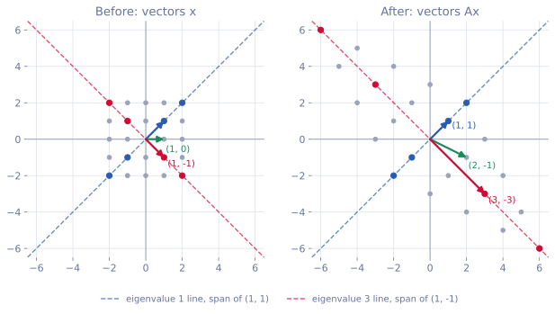
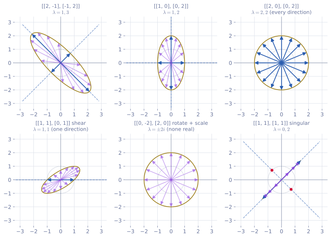
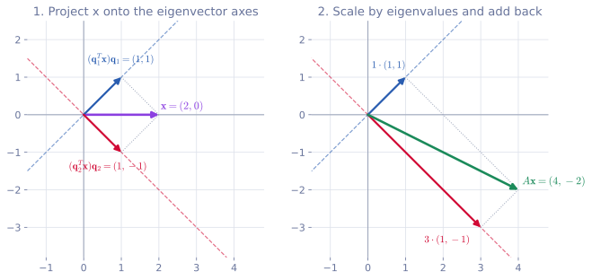

<ul class="post-sources">
<li markdown="span">[혁펜하임의 "보이는" 선형대수학](https://www.youtube.com/playlist?list=PL_iJu012NOxdZDxoGsYidMf2_bERIQaP0) 5-1–5-3강 정리</li>
</ul>

고윳값과 고유벡터는 선형대수학의 꽃이라 불린다. 다음 강의의 PCA, 그 뒤의 SVD가 모두 여기서 출발한다. 지금까지는 $$A\mathbf{x}$$를 "열들의 선형 결합"([강의 3](/blog/2026/11/05/hpla-03-matrix-product/))으로 봤다면, 이번에는 "$$\mathbf{x}$$를 $$A$$라는 함수에 통과시킨 결과"로 본다. 그 관점에서 특별한 방향을 찾는 것이 고유벡터다. 계산 도구로는 [강의 4](/blog/2026/11/05/hpla-04-inverse-rank-null/)의 영공간과 [강의 5](/blog/2026/11/05/hpla-05-elimination-determinant/)의 행렬식이 쓰인다. 같은 주제를 더 증명 위주로 다룬 글로 [Linear Algebra 7](/blog/2026/10/22/la-07-eigendecomposition/)과 [Linear Algebra 8](/blog/2026/10/22/la-08-symmetric-spectral/)이 있다.

## 고윳값과 고유벡터

[▶ 5-1강](https://www.youtube.com/watch?v=xDARfmKauuA)

### 정의

정사각 행렬 $$A$$와 영벡터가 아닌 벡터 $$\mathbf{v}$$, 스칼라 $$\lambda$$가

$$
A\mathbf{v} = \lambda\mathbf{v}
$$

를 만족하면 $$\lambda$$를 $$A$$의 **고윳값(eigenvalue)**, $$\mathbf{v}$$를 $$\lambda$$에 대응하는 **고유벡터(eigenvector)**라 한다. 말로 하면 "$$A$$를 곱해도 **방향은 그대로**이고 **크기만 $$\lambda$$배**가 되는 벡터"다. ($$\lambda$$가 음수이면 정반대 방향이 되는데, 같은 직선 위에 있으므로 방향이 유지된 것으로 친다.)

$$A$$가 정사각이어야 하는 이유는 크기에서 나온다. $$A$$가 $$m \times n$$이면 $$\mathbf{v}$$는 $$n \times 1$$이고 $$A\mathbf{v}$$는 $$m \times 1$$이다. 이것이 $$\lambda\mathbf{v}$$($$n \times 1$$)와 같으려면 $$m = n$$이어야 한다.

### 행렬은 선형 변환이다

$$A\mathbf{v}$$를 "$$\mathbf{v}$$를 상자 $$A$$에 넣었더니 $$A\mathbf{v}$$가 나왔다"로 읽어 보자. 함수 $$f(x) = x^2$$이 1을 넣으면 1, 2를 넣으면 4를 내놓듯이, $$A$$는 벡터를 넣으면 벡터를 내놓는 함수다. 이 함수는 두 성질을 가진다.

- **스케일링(homogeneity)**: 입력을 $$\alpha$$배 하면 출력도 $$\alpha$$배다. $$A(\alpha\mathbf{v}) = \alpha A\mathbf{v}$$.
- **가산성(additivity)**: 입력을 더하면 출력도 더해진다. $$A(\mathbf{v}_1 + \mathbf{v}_2) = A\mathbf{v}_1 + A\mathbf{v}_2$$.

두 성질을 모두 만족하는 시스템을 **선형(linear)**이라 하고, 그래서 행렬을 곱하는 것을 **선형 변환(linear transformation)**이라 한다. 신호와 시스템의 LTI 시스템에서 말하는 "선형"과 같은 뜻이다.

### 직접 넣어 보기

$$
A = \begin{bmatrix} 2 & -1 \\ -1 & 2 \end{bmatrix}
$$

에 여러 벡터를 넣어 보자. [관점 3(열의 선형 결합)](/blog/2026/11/05/hpla-03-matrix-product/)으로 계산하면 금방이다.

| 입력 $$\mathbf{x}$$ | 출력 $$A\mathbf{x}$$ | 방향 |
|---|---|---|
| $$(1, 0)$$ | $$(2, -1)$$ | 바뀜 |
| $$(0, 1)$$ | $$(-1, 2)$$ | 바뀜 |
| $$(2, 1)$$ | $$(3, 0)$$ | 바뀜 |
| $$(1, -1)$$ | $$(3, -3)$$ | **그대로, 3배** |
| $$(1, 1)$$ | $$(1, 1)$$ | **그대로, 1배** |

대부분의 벡터는 방향이 돌아가지만, $$(1, -1)$$은 방향을 유지한 채 3배가 되었고 $$(1, 1)$$은 아예 그대로다. 그러므로 $$\lambda = 3$$에 대한 고유벡터가 $$(1, -1)$$, $$\lambda = 1$$에 대한 고유벡터가 $$(1, 1)$$이다.

하나씩 넣어 보는 대신 평면 위의 격자점을 한꺼번에 통과시키면 변환 전체가 보인다. 벡터를 원점에서 그린 화살표 대신 끝점만 찍으면 점 하나가 벡터 하나다.

*왼쪽: 격자점(벡터) $$\mathbf{x}$$. 오른쪽: $$A\mathbf{x}$$. 회색 점은 원점을 기준으로 방향이 바뀌지만, 파란 직선 위의 점은 그 자리에 머물고 빨간 직선 위의 점은 같은 직선을 따라 3배 멀어진다.*

초록 화살표 $$(1, 0)$$은 $$(2, -1)$$로 꺾였다. 반면 파란 대각선 위의 점은 제자리에 있고(고윳값 1), 빨간 대각선 위의 점은 같은 선을 따라 원점에서 3배 멀어진다(고윳값 3). 평면 전체를 빨간 방향으로 3배 잡아 늘리는 변환인 셈이다. 이 그림에서 두 가지를 알 수 있다.

- **고유벡터는 무수히 많다.** $$(1, -1)$$이 고유벡터이면 $$(2, -2)$$, $$(-3, 3)$$처럼 그 직선 위의 모든 벡터(영벡터 제외)가 고유벡터다. $$A(\alpha\mathbf{v}) = \alpha A\mathbf{v} = \lambda(\alpha\mathbf{v})$$이기 때문이다. 그래서 고유벡터는 사실상 **방향**이다.
- **고유벡터가 없을 수도 있다.** 아래 예에서 본다.

### 가역성도 변환으로 보인다

$$A$$가 가역이라는 것은 출력을 보고 입력을 되돌릴 수 있다는 뜻이다. 그러려면 **다른 입력은 반드시 다른 출력**으로 가야 한다. 서로 다른 두 입력이 같은 출력으로 가면, 그 출력이 어디서 왔는지 알 수 없다.

[강의 5](/blog/2026/11/05/hpla-05-elimination-determinant/)의 특이 행렬 $$S = \begin{bmatrix} 1 & 2 \\ 2 & 4 \end{bmatrix}$$는 $$S(2, 0) = (2, 4)$$, $$S(0, 1) = (2, 4)$$로 서로 다른 입력을 같은 곳에 보낸다. 랭크가 1이라 열 공간이 직선이고, 평면 전체가 그 직선 위로 납작하게 눌린다. 눌린 것은 펼 수 없으므로 역행렬이 없다.

### 고윳값 구하기: 특성 방정식

격자를 다 그려 보는 것은 $$2 \times 2$$에서나 가능하다. 일반적인 방법은 정의를 변형하는 것이다. $$\lambda\mathbf{v}$$를 왼쪽으로 옮기면 $$A\mathbf{v} - \lambda\mathbf{v} = \mathbf{0}$$이다. $$\mathbf{v}$$로 묶고 싶지만 $$A - \lambda$$는 행렬에서 스칼라를 빼는 것이라 정의되지 않는다. 그래서 $$\lambda\mathbf{v} = \lambda I\mathbf{v}$$로 쓰고 묶는다.

$$
(A - \lambda I)\mathbf{v} = \mathbf{0}
$$

이 식은 $$\mathbf{v}$$가 $$A - \lambda I$$의 **영공간**에 있다는 뜻이다. $$\mathbf{v} = \mathbf{0}$$은 아무 $$\lambda$$에 대해서나 성립하는 뻔한 해(trivial solution)라서 고유벡터로 치지 않는다. 영이 아닌 $$\mathbf{v}$$가 있으려면 영공간이 $$\{\mathbf{0}\}$$보다 커야 하고, 이는 $$A - \lambda I$$가 특이 행렬이라는 것과 같다([강의 5](/blog/2026/11/05/hpla-05-elimination-determinant/)의 가역 조건). 따라서

$$
\det(A - \lambda I) = 0
$$

이다. 이를 **특성 방정식(characteristic equation)**이라 한다. 순서는 이렇다.

1. 특성 방정식을 풀어 고윳값 $$\lambda$$를 모두 구한다.
2. 각 $$\lambda$$에 대해 $$N(A - \lambda I)$$를 구한다. 그 안의 영이 아닌 벡터가 모두 고유벡터다.

영공간 전체가 고유벡터이므로 보통은 **영공간의 기저**를 대표로 골라 "고유벡터"라고 부른다. 이 영공간을 $$\lambda$$의 **고유 공간(eigenspace)**이라 한다.

**예.** $$A = \begin{bmatrix} 2 & -1 \\ -1 & 2 \end{bmatrix}$$이면

$$
\det\begin{bmatrix} 2 - \lambda & -1 \\ -1 & 2 - \lambda \end{bmatrix} = (2 - \lambda)^2 - 1 = (\lambda - 1)(\lambda - 3) = 0
$$

이라 $$\lambda = 1, 3$$이다.

- $$\lambda = 1$$: $$A - I = \begin{bmatrix} 1 & -1 \\ -1 & 1 \end{bmatrix}$$. 두 열을 상쇄하는 계수는 $$(1, 1)$$이다. 랭크가 1이라 영공간은 1차원이고, 기저 하나 $$\mathbf{v}_1 = (1, 1)$$로 충분하다.
- $$\lambda = 3$$: $$A - 3I = \begin{bmatrix} -1 & -1 \\ -1 & -1 \end{bmatrix}$$. 영공간은 $$\operatorname{Span}\{(1, -1)\}$$이고 $$\mathbf{v}_2 = (1, -1)$$이다.

그림으로 찾은 답과 같다.

### 여러 가지 경우

$$2 \times 2$$ 행렬 몇 개로 일어날 수 있는 일을 모두 보자. 각 칸은 단위 원 위의 벡터 16개를 행렬에 통과시킨 결과이고, 파란 화살표가 방향이 유지된 것(고유벡터 방향)이다.

*점선 원은 입력(단위 벡터), 갈색 곡선은 그 출력이다. 파란 화살표는 고유벡터 방향, 보라 화살표는 방향이 바뀐 벡터, 빨간 점은 영벡터로 보내진 입력이다.*

**(1) $$\begin{bmatrix} 1 & 0 \\ 0 & 2 \end{bmatrix}$$.** 특성 방정식이 $$(1 - \lambda)(2 - \lambda) = 0$$이라 $$\lambda = 1, 2$$이고, 고유벡터는 $$(1, 0)$$, $$(0, 1)$$이다. 가로 방향은 그대로, 세로 방향은 2배로 늘린다. 대각 행렬의 고윳값은 대각 성분이고 고유벡터는 표준 기저다.

**(2) $$\begin{bmatrix} 2 & 0 \\ 0 & 2 \end{bmatrix}$$.** $$(2 - \lambda)^2 = 0$$이라 $$\lambda = 2$$가 중근이다. $$A - 2I$$는 영행렬이고 영행렬의 영공간은 평면 전체다. **모든 벡터가 고유벡터**다. 평면을 균일하게 2배 확대하는 변환이라 당연하다. 대표로는 영공간의 기저인 $$(1, 0)$$, $$(0, 1)$$을 고른다. 기저이기만 하면 $$(1, 1)$$, $$(1, -1)$$을 골라도 된다.

**(3) $$\begin{bmatrix} 1 & 1 \\ 0 & 1 \end{bmatrix}$$.** $$(1 - \lambda)^2 = 0$$으로 역시 $$\lambda = 1$$이 중근이다. 그런데 $$A - I = \begin{bmatrix} 0 & 1 \\ 0 & 0 \end{bmatrix}$$의 랭크가 1이라 영공간은 1차원 $$\operatorname{Span}\{(1, 0)\}$$뿐이다. **중근이라고 독립인 고유벡터가 2개 나오는 것은 아니다.** 이 행렬은 평면을 옆으로 미는 **전단(shear)** 변환이고, 가로축 위의 벡터만 방향이 유지된다.

**(4) $$\begin{bmatrix} 0 & -2 \\ 2 & 0 \end{bmatrix}$$.** $$\lambda^2 + 4 = 0$$이라 $$\lambda = \pm 2i$$로 실수 고윳값이 없다. 이 행렬은 $$90^\circ$$ 회전한 뒤 2배 확대하는 변환이다. 모든 벡터가 돌아가므로 방향이 유지되는 실수 벡터가 하나도 없다. 그림에서 파란 화살표가 하나도 없는 것을 볼 수 있다.

**(5) $$\begin{bmatrix} 1 & 1 \\ 1 & 1 \end{bmatrix}$$.** $$(1 - \lambda)^2 - 1 = \lambda(\lambda - 2) = 0$$이라 $$\lambda = 0, 2$$다. $$\lambda = 0$$의 고유벡터 $$(1, -1)$$은 $$A(1, -1) = \mathbf{0} = 0 \cdot (1, -1)$$, 즉 영벡터로 보내진다(빨간 점). $$\lambda = 2$$의 고유벡터는 $$(1, 1)$$이다. 이 행렬은 랭크가 1인 특이 행렬인데도 독립인 고유벡터가 2개다.

(2)~(5)를 나란히 놓으면 교훈이 분명하다. **독립인 고유벡터의 개수는 중근 여부로도, 랭크로도 바로 정해지지 않는다.** (2)는 중근인데 2개, (3)은 중근인데 1개, (5)는 랭크 1인데 2개다. 다만 뒤에서 보듯 대칭 행렬이면 이야기가 깔끔해진다.

고윳값 0에 대응하는 고유벡터는 영공간의 벡터다. 그래서 **$$\lambda = 0$$이 고윳값이라는 것은 $$A$$가 특이 행렬이라는 것과 같다.**

### 신호와 시스템과의 연결

신호와 시스템을 배웠다면 같은 구조를 이미 봤다. 임펄스 응답이 $$h(t)$$인 LTI 시스템에 $$e^{st}$$를 넣으면 출력은 컨볼루션으로

$$
\int h(\tau)e^{s(t - \tau)}\,d\tau = \underbrace{\left(\int h(\tau)e^{-s\tau}\,d\tau\right)}_{H(s)} e^{st}
$$

이다. 입력 함수 $$e^{st}$$가 모양은 그대로이고 숫자 $$H(s)$$배만 되어 나온다. 그래서 $$e^{st}$$를 **고유함수(eigenfunction)**, $$H(s)$$를 고윳값이라 부른다. 행렬이 시스템, 벡터가 신호라는 점만 다를 뿐 $$A\mathbf{v} = \lambda\mathbf{v}$$와 같은 이야기다.

### 흔한 실수

- **영벡터를 고유벡터로 친다.** $$A\mathbf{0} = \lambda\mathbf{0}$$은 모든 $$\lambda$$에 성립하므로 아무 정보가 없다. 고유벡터는 정의상 영벡터가 아니다. 반면 고윳값 $$\lambda = 0$$은 허용된다.
- **고유벡터가 하나로 정해진다고 생각한다.** 고유 공간 전체가 고유벡터다. 책마다 고유벡터가 $$(1, 1)$$, $$(1/\sqrt{2}, 1/\sqrt{2})$$, $$(-2, -2)$$로 다르게 적혀 있어도 모두 맞는 답이다.
- **$$n \times n$$이면 독립인 고유벡터가 항상 $$n$$개라고 생각한다.** 전단 행렬 (3)이 반례다.

## 고윳값 분해

[▶ 5-2강](https://www.youtube.com/watch?v=PP9VQXKvSCY)

### 식 두 개를 행렬 하나로

$$2 \times 2$$ 행렬 $$A$$에 고윳값 $$\lambda_1, \lambda_2$$와 서로 독립인 고유벡터 $$\mathbf{v}_1, \mathbf{v}_2$$가 있다고 하자. 정의에 따라 $$A\mathbf{v}_1 = \lambda_1\mathbf{v}_1$$, $$A\mathbf{v}_2 = \lambda_2\mathbf{v}_2$$다. 두 식을 열로 나란히 쌓으면

$$
A\begin{bmatrix} \mathbf{v}_1 & \mathbf{v}_2 \end{bmatrix} = \begin{bmatrix} \lambda_1\mathbf{v}_1 & \lambda_2\mathbf{v}_2 \end{bmatrix}
$$

이다. 오른쪽은 각 열에 스칼라를 곱한 것이므로, [관점 3](/blog/2026/11/05/hpla-03-matrix-product/)에 따라 대각 행렬을 **오른쪽에** 곱한 것으로 쓸 수 있다.

$$
\begin{bmatrix} \lambda_1\mathbf{v}_1 & \lambda_2\mathbf{v}_2 \end{bmatrix} = \begin{bmatrix} \mathbf{v}_1 & \mathbf{v}_2 \end{bmatrix}\begin{bmatrix} \lambda_1 & 0 \\ 0 & \lambda_2 \end{bmatrix}
$$

고유벡터를 열로 모은 행렬을 $$V$$, 고윳값을 대각에 모은 행렬을 $$\Lambda$$(람다의 대문자)라 하면 $$AV = V\Lambda$$다. 고유벡터들이 독립이므로 $$V$$는 full rank, 즉 가역이다. 양변의 오른쪽에 $$V^{-1}$$을 곱하면

$$
A = V\Lambda V^{-1}
$$

이다. 이렇게 $$A$$를 세 행렬의 곱으로 쪼개는 것을 **고윳값 분해(eigendecomposition)**라 한다. $$n \times n$$에서도 똑같다.

반대로 $$V^{-1}AV = \Lambda$$로 쓰면 $$A$$를 양옆에서 감싸 대각 행렬로 만든 모양이다. 그래서 고윳값 분해가 가능한 행렬을 **대각화 가능(diagonalizable)** 행렬이라 한다. 다음은 모두 같은 말이다.

- $$n \times n$$ 행렬 $$A$$가 대각화 가능하다.
- $$A = V\Lambda V^{-1}$$로 고윳값 분해된다.
- $$A$$에 독립인 고유벡터가 $$n$$개 있다.

앞 절의 전단 행렬은 독립인 고유벡터가 1개라 대각화되지 않고, 회전 행렬 (4)는 실수 범위에서 대각화되지 않는다.

**예.** $$B = \begin{bmatrix} 1 & 1 \\ 0 & 2 \end{bmatrix}$$은 위 삼각 행렬이라 고윳값이 대각 성분 1, 2이고, 고유벡터는 $$(1, 0)$$과 $$(1, 1)$$이다.

$$
B = \underbrace{\begin{bmatrix} 1 & 1 \\ 0 & 1 \end{bmatrix}}_{V}\underbrace{\begin{bmatrix} 1 & 0 \\ 0 & 2 \end{bmatrix}}_{\Lambda}\underbrace{\begin{bmatrix} 1 & -1 \\ 0 & 1 \end{bmatrix}}_{V^{-1}}
$$

곱해 보면 $$V\Lambda = \begin{bmatrix} 1 & 2 \\ 0 & 2 \end{bmatrix}$$이고 여기에 $$V^{-1}$$을 곱하면 $$B$$가 나온다.

### 분해하면 좋은 점

**1. 거듭제곱이 쉬워진다.**

$$
A^k = (V\Lambda V^{-1})(V\Lambda V^{-1})\cdots(V\Lambda V^{-1}) = V\Lambda^k V^{-1}
$$

가운데의 $$V^{-1}V$$가 모두 $$I$$로 사라지기 때문이다. 대각 행렬의 거듭제곱은 대각 성분만 거듭제곱하면 된다. 위의 $$B$$라면 $$B^k = V\operatorname{diag}(1, 2^k)V^{-1} = \begin{bmatrix} 1 & 2^k - 1 \\ 0 & 2^k \end{bmatrix}$$이고, $$k = 5$$이면 $$\begin{bmatrix} 1 & 31 \\ 0 & 32 \end{bmatrix}$$이다. 행렬을 다섯 번 곱하지 않아도 된다.

**2. 역행렬이 쉬워진다.** [강의 5](/blog/2026/11/05/hpla-05-elimination-determinant/)의 $$(ABC)^{-1} = C^{-1}B^{-1}A^{-1}$$을 쓰면

$$
A^{-1} = (V\Lambda V^{-1})^{-1} = V\Lambda^{-1}V^{-1}, \qquad \Lambda^{-1} = \operatorname{diag}(1/\lambda_1, \dots, 1/\lambda_n)
$$

이다. 대각 행렬의 역행렬은 대각 성분의 역수만 취하면 된다. 실제로 $$A \cdot V\Lambda^{-1}V^{-1} = V\Lambda V^{-1}V\Lambda^{-1}V^{-1} = V\Lambda\Lambda^{-1}V^{-1} = VV^{-1} = I$$다.

**3. 행렬식은 고윳값의 곱이다.** $$\det(AB) = \det A\det B$$와 $$\det(V^{-1}) = 1/\det V$$를 쓰면

$$
\det A = \det V \cdot \det\Lambda \cdot \frac{1}{\det V} = \det\Lambda = \prod_{i=1}^{n}\lambda_i
$$

다.

**4. 트레이스는 고윳값의 합이다.** 트레이스의 순환 성질로 $$V$$를 뒤로 보내면

$$
\operatorname{tr} A = \operatorname{tr}(V\Lambda V^{-1}) = \operatorname{tr}(\Lambda V^{-1}V) = \operatorname{tr}\Lambda = \sum_{i=1}^{n}\lambda_i
$$

다. (3, 4번은 사실 대각화되지 않는 행렬에서도, 고윳값을 중복도와 복소수까지 세면 성립한다.)

**5. 특이 행렬인지 바로 보인다.** 행렬식이 고윳값의 곱이므로 $$A$$가 rank deficient인 것과 고윳값 중 0이 하나 이상 있는 것은 같은 말이다.

$$A = \begin{bmatrix} 2 & -1 \\ -1 & 2 \end{bmatrix}$$로 확인하면 고윳값이 1, 3이므로 $$\det A = 3$$($$= 4 - 1$$), $$\operatorname{tr} A = 4$$($$= 2 + 2$$)이고, 0이 없으니 가역이다.

### 알아 두면 유용한 사실

1. **$$A^T$$의 고윳값은 $$A$$의 고윳값과 같다.** $$\det M^T = \det M$$이므로 $$\det(A^T - \lambda I) = \det\big((A - \lambda I)^T\big) = \det(A - \lambda I)$$이고, 두 특성 방정식이 같다. (고유벡터는 일반적으로 다르다.)
2. **직교 행렬의 고윳값은 크기가 1이다.** 직교 행렬 $$Q$$는 길이를 보존하므로([강의 4](/blog/2026/11/05/hpla-04-inverse-rank-null/)) $$Q\mathbf{v} = \lambda\mathbf{v}$$이면 $$\lVert \mathbf{v} \rVert = \lVert Q\mathbf{v} \rVert = \lvert \lambda \rvert\lVert \mathbf{v} \rVert$$, 따라서 $$\lvert \lambda \rvert = 1$$이다. 실수 고윳값이라면 $$+1$$ 또는 $$-1$$뿐이다. 회전 행렬처럼 복소수 고윳값을 가질 수도 있는데, 그때도 절댓값은 1이다.
3. **양의 준정부호 행렬의 고윳값은 0 이상이다.** 대칭 행렬 $$A$$가 모든 $$\mathbf{x}$$에 대해 $$\mathbf{x}^TA\mathbf{x} \ge 0$$을 만족하면 **양의 준정부호(positive semidefinite, PSD)**라 한다. $$\mathbf{x}^T(A\mathbf{x})$$는 $$\mathbf{x}$$와 $$A\mathbf{x}$$의 내적이므로, 어떤 벡터를 넣어도 출력이 입력과 $$90^\circ$$ 넘게 벌어지지 않는다는 뜻이다. $$A\mathbf{v} = \lambda\mathbf{v}$$를 넣으면 $$\mathbf{v}^TA\mathbf{v} = \lambda\lVert \mathbf{v} \rVert^2 \ge 0$$이라 $$\lambda \ge 0$$이다. 거꾸로 대칭 행렬의 고윳값이 모두 0 이상이면 PSD다(아래 대칭 행렬 분해로 $$\mathbf{x}^TA\mathbf{x} = \sum_i \lambda_i(\mathbf{q}_i^T\mathbf{x})^2 \ge 0$$).
4. **대각화 가능한 행렬의 랭크는 0이 아닌 고윳값의 개수다.** $$V$$와 $$V^{-1}$$은 가역이라 랭크를 바꾸지 않으므로 $$\operatorname{rank} A = \operatorname{rank}\Lambda$$이고, 대각 행렬의 랭크는 0이 아닌 대각 성분의 수다. 앞의 (5) $$\begin{bmatrix} 1 & 1 \\ 1 & 1 \end{bmatrix}$$은 고윳값이 0, 2라 랭크 1이다. 대각화 가능하다는 조건이 꼭 필요하다. $$\begin{bmatrix} 0 & 1 \\ 0 & 0 \end{bmatrix}$$은 랭크가 1인데 고윳값은 0, 0뿐이다.

### 대칭 행렬은 항상 대각화된다

여기서부터가 진짜 재미있는 부분이다. **대칭 행렬($$A^T = A$$)은 무조건 대각화 가능하다.** (역은 성립하지 않는다. 위의 $$B$$는 대각화되지만 대칭이 아니다.) 게다가 고유벡터를 **서로 수직인 단위 벡터**로 고를 수 있다. 이를 **스펙트럼 정리(spectral theorem)**라 한다. 증명은 [Linear Algebra 8](/blog/2026/10/22/la-08-symmetric-spectral/)에 있다.

왜 수직일까? 서로 다른 고윳값 $$\lambda_1 \neq \lambda_2$$의 고유벡터 $$\mathbf{v}_1, \mathbf{v}_2$$에 대해

$$
\lambda_1\mathbf{v}_1^T\mathbf{v}_2 = (A\mathbf{v}_1)^T\mathbf{v}_2 = \mathbf{v}_1^TA^T\mathbf{v}_2 = \mathbf{v}_1^TA\mathbf{v}_2 = \lambda_2\mathbf{v}_1^T\mathbf{v}_2
$$

이다. 세 번째 등호에서 $$A^T = A$$를 썼다. $$(\lambda_1 - \lambda_2)\mathbf{v}_1^T\mathbf{v}_2 = 0$$인데 $$\lambda_1 \neq \lambda_2$$이므로 $$\mathbf{v}_1^T\mathbf{v}_2 = 0$$이다.

고유벡터들을 정규 직교로 고르면 $$V$$는 직교 행렬이 되고, [강의 4](/blog/2026/11/05/hpla-04-inverse-rank-null/)에서 본 대로 역행렬이 전치다. 직교 행렬은 보통 $$Q$$로 쓰므로

$$
A = Q\Lambda Q^T
$$

이다. 이제는 $$V^{-1}$$을 계산할 필요조차 없다. 거듭제곱, 역행렬 등 앞의 장점을 전치만으로 다 누린다.

**예.** $$A = \begin{bmatrix} 2 & -1 \\ -1 & 2 \end{bmatrix}$$은 대칭이고 고유벡터 $$(1, 1)$$, $$(1, -1)$$은 실제로 수직이다. 길이를 1로 맞추면

$$
Q = \frac{1}{\sqrt{2}}\begin{bmatrix} 1 & 1 \\ 1 & -1 \end{bmatrix}, \qquad \Lambda = \begin{bmatrix} 1 & 0 \\ 0 & 3 \end{bmatrix}
$$

이다. 그러면 $$A^k = Q\Lambda^kQ^T = \frac{1}{2}\begin{bmatrix} 1 + 3^k & 1 - 3^k \\ 1 - 3^k & 1 + 3^k \end{bmatrix}$$이고, 예를 들어 $$A^{10} = \begin{bmatrix} 29525 & -29524 \\ -29524 & 29525 \end{bmatrix}$$이다. 역행렬은 $$k = -1$$을 넣어 $$A^{-1} = \frac{1}{3}\begin{bmatrix} 2 & 1 \\ 1 & 2 \end{bmatrix}$$이다.

### 해석 1: 랭크 1 행렬들의 합

$$Q\Lambda Q^T$$를 [관점 2(랭크 1 행렬의 합)](/blog/2026/11/05/hpla-03-matrix-product/)로 전개하면

$$
A = \lambda_1\mathbf{q}_1\mathbf{q}_1^T + \lambda_2\mathbf{q}_2\mathbf{q}_2^T + \cdots + \lambda_n\mathbf{q}_n\mathbf{q}_n^T
$$

이다. 각 $$\mathbf{q}_i\mathbf{q}_i^T$$는 열벡터 곱하기 행벡터라 **랭크 1 행렬**이다. 즉 고윳값 분해는 $$A$$를 서로 수직인 방향에서 나온 $$n$$장의 랭크 1 "조각"으로 썰어서, 각 조각에 $$\lambda_i$$만큼 가중치를 준 것이다. 위의 예라면

$$
\begin{bmatrix} 2 & -1 \\ -1 & 2 \end{bmatrix} = 1 \cdot \frac{1}{2}\begin{bmatrix} 1 & 1 \\ 1 & 1 \end{bmatrix} + 3 \cdot \frac{1}{2}\begin{bmatrix} 1 & -1 \\ -1 & 1 \end{bmatrix}
$$

이다.

여기서 응용이 바로 보인다. 고윳값을 크기순으로 정렬해서 **큰 것 몇 개만 남기고** 나머지 조각을 버리면 $$A$$를 근사할 수 있다. $$100 \times 100$$ 대칭 행렬은 숫자 10,000개가 필요하지만, 조각 5개만 남기면 고윳값 5개와 길이 100인 벡터 5개, 합해서 505개면 된다. 이것이 **데이터 압축**의 아이디어이고, 다음 강의의 PCA와 [강의 10](/blog/2026/11/05/hpla-10-svd/)의 SVD에서 본격적으로 쓴다. (일반적인 이미지 행렬은 대칭도 정사각도 아니라서 실제 압축에는 SVD를 쓴다.)

### 해석 2: 내리고, 늘리고, 다시 더하기

대칭 행렬에 벡터 $$\mathbf{x}$$를 통과시키는 것을 이 모양으로 쓰면

$$
A\mathbf{x} = \lambda_1\mathbf{q}_1(\mathbf{q}_1^T\mathbf{x}) + \lambda_2\mathbf{q}_2(\mathbf{q}_2^T\mathbf{x}) + \cdots + \lambda_n\mathbf{q}_n(\mathbf{q}_n^T\mathbf{x})
$$

이다. $$\mathbf{q}_i^T\mathbf{x}$$는 단위 벡터 $$\mathbf{q}_i$$와 $$\mathbf{x}$$의 내적, 즉 $$\mathbf{x}$$를 $$\mathbf{q}_i$$ 방향으로 내렸을 때의 길이이고, 거기에 $$\mathbf{q}_i$$를 곱한 $$\mathbf{q}_i(\mathbf{q}_i^T\mathbf{x})$$는 $$\mathbf{q}_i$$ 위로의 **정사영**([강의 2](/blog/2026/11/05/hpla-02-vectors/))이다. 그러니 대칭 행렬이 하는 일은 세 단계다.

1. $$\mathbf{x}$$를 서로 수직인 고유벡터 축들로 **내린다**(정사영).
2. 각 성분을 고윳값 $$\lambda_i$$배 **늘린다**(음수면 뒤집는다).
3. 다시 **더한다**.

*왼쪽: $$\mathbf{x} = (2, 0)$$을 두 고유벡터 축으로 내리면 $$(1, 1)$$과 $$(1, -1)$$이다. 오른쪽: 각각 고윳값 1, 3배 한 뒤 더하면 $$A\mathbf{x} = (4, -2)$$다.*

모든 $$\lambda_i$$가 1이면 내렸다가 그대로 더하는 것이라 $$\mathbf{x}$$가 그대로 나온다. 실제로 그때 $$A = QIQ^T = I$$다. 고윳값은 축마다 다른 배율을 주어 $$\mathbf{x}$$를 변형한다. 위 그림에서 $$(1, -1)$$ 축 성분만 3배가 되어, $$(2, 0)$$이 오른쪽 아래로 끌려가 $$(4, -2)$$가 되었다. 직접 계산한 $$A(2, 0) = (4, -2)$$와 같다.

"서로 수직인 축으로 쪼개서 축마다 다르게 늘린다"는 그림은 [보이는 행렬 2](/blog/2026/10/23/see-matrix-02-spectral/)의 스펙트럼 분해 그림과 같은 이야기다. 대칭이 아니거나 정사각이 아닌 행렬로 이 그림을 넓힌 것이 SVD다. SVD는 양쪽에 서로 다른 직교 행렬을 두어 $$A = U\Sigma V^T$$로 쓰며, 세상의 모든 행렬에 대해 가능하다.

### 흔한 실수

- **대각화 가능하면 대칭이라고 생각한다.** $$B = \begin{bmatrix} 1 & 1 \\ 0 & 2 \end{bmatrix}$$처럼 대칭이 아닌데 대각화되는 행렬이 많다. 대칭이면 대각화된다는 한쪽 방향만 성립한다.
- **아무 대각화 가능 행렬에나 $$A = Q\Lambda Q^T$$를 쓴다.** 고유벡터가 수직이라는 보장은 대칭 행렬에만 있다. $$B$$의 고유벡터 $$(1, 0)$$과 $$(1, 1)$$은 수직이 아니다.
- **고유벡터를 정규화하지 않은 채 $$Q^T$$를 역행렬로 쓴다.** $$(1, 1)$$, $$(1, -1)$$을 그대로 열로 쓰면 $$V^TV = 2I$$라 $$V^T \neq V^{-1}$$이다. 길이를 1로 맞춰야 한다.

## 연습 문제

[▶ 5-3강](https://www.youtube.com/watch?v=G9XTXqzALHg)

앞의 두 강의 내용을 문제로 점검한다. 문제는 강의의 주제에 맞춰 새로 구성했고, 숫자는 모두 직접 계산해 확인했다.

### 문제 1: 기본 계산과 검산

$$A = \begin{bmatrix} 4 & 1 \\ 2 & 3 \end{bmatrix}$$의 고윳값과 고유벡터를 구하고, 행렬식과 트레이스로 검산하라.

**풀이.** 특성 방정식은

$$
\det\begin{bmatrix} 4 - \lambda & 1 \\ 2 & 3 - \lambda \end{bmatrix} = (4 - \lambda)(3 - \lambda) - 2 = \lambda^2 - 7\lambda + 10 = (\lambda - 5)(\lambda - 2) = 0
$$

이라 $$\lambda = 5, 2$$다.

- $$\lambda = 5$$: $$A - 5I = \begin{bmatrix} -1 & 1 \\ 2 & -2 \end{bmatrix}$$. 두 열을 1:1로 더하면 상쇄되므로 $$\mathbf{v}_1 = (1, 1)$$. 확인: $$A(1, 1) = (5, 5)$$.
- $$\lambda = 2$$: $$A - 2I = \begin{bmatrix} 2 & 1 \\ 2 & 1 \end{bmatrix}$$. 첫째 열 1배와 둘째 열 $$-2$$배를 더하면 0이므로 $$\mathbf{v}_2 = (1, -2)$$. 확인: $$A(1, -2) = (2, -4)$$.

검산: 고윳값의 합 $$5 + 2 = 7 = \operatorname{tr} A$$, 곱 $$5 \cdot 2 = 10 = 4 \cdot 3 - 1 \cdot 2 = \det A$$다.

**배울 점.** $$2 \times 2$$의 특성 방정식은 항상 $$\lambda^2 - (\operatorname{tr} A)\lambda + \det A = 0$$이다. 트레이스와 행렬식만 알면 바로 세울 수 있고, 답을 구한 뒤에는 합과 곱으로 검산할 수 있다. 또 이 $$A$$는 대칭이 아니라서 두 고유벡터 $$(1, 1)$$, $$(1, -2)$$가 수직이 아니다($$1 - 2 = -1 \neq 0$$).

### 문제 2: 고윳값은 함수를 따라간다

$$A\mathbf{v} = \lambda\mathbf{v}$$일 때 $$A^2$$, $$A^{-1}$$($$A$$가 가역일 때), $$A + cI$$의 고윳값과 고유벡터는 무엇인가? 문제 1의 $$A$$에 적용하라.

**풀이.** 정의에 차례로 넣는다.

- $$A^2\mathbf{v} = A(\lambda\mathbf{v}) = \lambda A\mathbf{v} = \lambda^2\mathbf{v}$$. 고윳값은 $$\lambda^2$$.
- $$A\mathbf{v} = \lambda\mathbf{v}$$의 양변 왼쪽에 $$A^{-1}$$을 곱하면 $$\mathbf{v} = \lambda A^{-1}\mathbf{v}$$, 즉 $$A^{-1}\mathbf{v} = \frac{1}{\lambda}\mathbf{v}$$. 고윳값은 $$1/\lambda$$. (가역이면 $$\lambda \neq 0$$이라 나눌 수 있다.)
- $$(A + cI)\mathbf{v} = \lambda\mathbf{v} + c\mathbf{v} = (\lambda + c)\mathbf{v}$$. 고윳값은 $$\lambda + c$$.

세 경우 모두 **고유벡터는 그대로**다. 문제 1의 $$A$$라면 $$A^2$$의 고윳값은 25, 4, $$A^{-1}$$은 $$1/5$$, $$1/2$$, $$A + I$$는 6, 3이고, 고유벡터는 여전히 $$(1, 1)$$, $$(1, -2)$$다.

**배울 점.** 고윳값 분해 $$A = V\Lambda V^{-1}$$로 보면 당연하다. $$A^2 = V\Lambda^2V^{-1}$$, $$A^{-1} = V\Lambda^{-1}V^{-1}$$, $$A + cI = V(\Lambda + cI)V^{-1}$$로 $$V$$는 그대로이고 대각 성분만 바뀐다. 반면 $$A + B$$나 $$AB$$의 고윳값은 일반적으로 $$A$$, $$B$$의 고윳값으로 정해지지 않는다.

### 문제 3: 대각화되지 않는 $$3 \times 3$$

$$T = \begin{bmatrix} 2 & 1 & 0 \\ 0 & 3 & 4 \\ 0 & 0 & 2 \end{bmatrix}$$은 대각화 가능한가?

**풀이.** 위 삼각 행렬이므로 $$\det(T - \lambda I) = (2 - \lambda)(3 - \lambda)(2 - \lambda)$$이고, 고윳값은 대각 성분 2, 3, 2다. 2가 중근이다.

- $$\lambda = 3$$: $$T - 3I = \begin{bmatrix} -1 & 1 & 0 \\ 0 & 0 & 4 \\ 0 & 0 & -1 \end{bmatrix}$$의 랭크는 2, 영공간은 1차원이고 $$(1, 1, 0)$$이 기저다.
- $$\lambda = 2$$: $$T - 2I = \begin{bmatrix} 0 & 1 & 0 \\ 0 & 1 & 4 \\ 0 & 0 & 0 \end{bmatrix}$$의 둘째 열과 셋째 열은 독립이므로 랭크가 2이고, 영공간은 $$3 - 2 = 1$$차원이다. 기저는 $$(1, 0, 0)$$ 하나뿐이다.

독립인 고유벡터가 모두 2개라 3개에 못 미친다. **대각화되지 않는다.**

**배울 점.** 중근이 나오면 그 고윳값의 고유 공간 차원을 rank-nullity로 꼭 확인해야 한다. 중근의 중복도(여기서는 2)만큼 고유 공간의 차원이 나와야 대각화된다. 중근이 없으면, 즉 고윳값이 모두 다르면 고유벡터가 자동으로 $$n$$개 독립이라 항상 대각화된다.

### 문제 4: 대칭 행렬 분해

$$S = \begin{bmatrix} 3 & 1 \\ 1 & 3 \end{bmatrix}$$을 $$Q\Lambda Q^T$$로 분해하고, 랭크 1 행렬의 합으로 써라. $$S$$는 양의 준정부호인가? $$S^{-1}$$을 분해로 구하라.

**풀이.** $$\operatorname{tr} S = 6$$, $$\det S = 8$$이므로 $$\lambda^2 - 6\lambda + 8 = (\lambda - 4)(\lambda - 2) = 0$$이다.

- $$\lambda = 4$$: $$S - 4I = \begin{bmatrix} -1 & 1 \\ 1 & -1 \end{bmatrix}$$에서 $$(1, 1)$$, 정규화하면 $$\mathbf{q}_1 = \frac{1}{\sqrt{2}}(1, 1)$$.
- $$\lambda = 2$$: $$S - 2I = \begin{bmatrix} 1 & 1 \\ 1 & 1 \end{bmatrix}$$에서 $$(1, -1)$$, 정규화하면 $$\mathbf{q}_2 = \frac{1}{\sqrt{2}}(1, -1)$$.

대칭 행렬답게 두 고유벡터가 수직이다. 따라서

$$
S = \underbrace{\frac{1}{\sqrt{2}}\begin{bmatrix} 1 & 1 \\ 1 & -1 \end{bmatrix}}_{Q}\begin{bmatrix} 4 & 0 \\ 0 & 2 \end{bmatrix}\underbrace{\frac{1}{\sqrt{2}}\begin{bmatrix} 1 & 1 \\ 1 & -1 \end{bmatrix}}_{Q^T}
= 4 \cdot \frac{1}{2}\begin{bmatrix} 1 & 1 \\ 1 & 1 \end{bmatrix} + 2 \cdot \frac{1}{2}\begin{bmatrix} 1 & -1 \\ -1 & 1 \end{bmatrix}
$$

이다. (이 $$Q$$는 대칭이라 $$Q^T = Q$$다.) 오른쪽을 더하면 $$\begin{bmatrix} 2 + 1 & 2 - 1 \\ 2 - 1 & 2 + 1 \end{bmatrix} = S$$다.

고윳값이 4, 2로 모두 양수이므로 양의 준정부호다(사실 모두 0보다 크므로 **양의 정부호(positive definite)**다). 직접 보면 $$\mathbf{x}^TS\mathbf{x} = 3x_1^2 + 2x_1x_2 + 3x_2^2 = 2(x_1 + x_2)^2 + (x_1 - x_2)^2 \ge 0$$이다. 이 식의 계수 2와 1은 각각 $$\lambda_1 \cdot \frac{1}{2}$$, $$\lambda_2 \cdot \frac{1}{2}$$이고, $$x_1 + x_2$$와 $$x_1 - x_2$$는 $$\mathbf{x}$$를 고유벡터 방향으로 내린 성분($$\sqrt{2}$$배)이다.

역행렬은 고윳값만 역수로 바꾼다.

$$
S^{-1} = \frac{1}{4} \cdot \frac{1}{2}\begin{bmatrix} 1 & 1 \\ 1 & 1 \end{bmatrix} + \frac{1}{2} \cdot \frac{1}{2}\begin{bmatrix} 1 & -1 \\ -1 & 1 \end{bmatrix} = \frac{1}{8}\begin{bmatrix} 3 & -1 \\ -1 & 3 \end{bmatrix}
$$

$$2 \times 2$$ 공식 $$\frac{1}{8}\begin{bmatrix} 3 & -1 \\ -1 & 3 \end{bmatrix}$$과 같다.

**배울 점.** 대칭 행렬은 분해만 해 두면 거듭제곱, 역행렬, 양의 정부호 판정이 모두 고윳값만 보고 끝난다.

### 문제 5: 거듭제곱의 응용, 장기적인 상태

어떤 도시에서 매년 시내 인구의 10%가 교외로, 교외 인구의 20%가 시내로 이사한다. 처음에 모두 교외에 산다면 오랜 시간 뒤 인구 비율은 어떻게 되는가?

**풀이.** 시내와 교외의 인구 비율을 $$\mathbf{x}_k = (\text{시내}, \text{교외})$$라 하면

$$
\mathbf{x}_{k+1} = M\mathbf{x}_k, \qquad M = \begin{bmatrix} 0.9 & 0.2 \\ 0.1 & 0.8 \end{bmatrix}, \qquad \mathbf{x}_0 = \begin{bmatrix} 0 \\ 1 \end{bmatrix}
$$

이고 $$\mathbf{x}_k = M^k\mathbf{x}_0$$다. $$\operatorname{tr} M = 1.7$$, $$\det M = 0.72 - 0.02 = 0.7$$이므로 고윳값은 $$\lambda^2 - 1.7\lambda + 0.7 = (\lambda - 1)(\lambda - 0.7) = 0$$에서 1과 0.7이다. 고유벡터는 $$\lambda = 1$$에 $$(2, 1)$$, $$\lambda = 0.7$$에 $$(1, -1)$$이다.

$$\mathbf{x}_0$$을 고유벡터의 결합으로 쓰면 $$(0, 1) = \frac{1}{3}(2, 1) - \frac{2}{3}(1, -1)$$이다. $$M$$을 $$k$$번 곱하면 각 성분이 고윳값의 $$k$$제곱배가 되므로

$$
\mathbf{x}_k = \frac{1}{3}\begin{bmatrix} 2 \\ 1 \end{bmatrix} - \frac{2}{3}(0.7)^k\begin{bmatrix} 1 \\ -1 \end{bmatrix}
$$

이다. $$k = 1$$이면 $$(0.2, 0.8)$$, $$k = 10$$이면 약 $$(0.648, 0.352)$$이고, $$k \to \infty$$이면 $$(0.7)^k \to 0$$이라

$$
\mathbf{x}_\infty = \left(\frac{2}{3}, \frac{1}{3}\right)
$$

로 수렴한다. 결국 인구의 2/3가 시내에 산다.

**배울 점.** $$A^k\mathbf{x}$$의 장기적인 거동은 고윳값이 정한다. $$\lvert \lambda \rvert < 1$$인 성분은 사라지고, $$\lambda = 1$$인 성분만 남는다. 남는 고유벡터 $$(2, 1)$$을 **정상 상태(steady state)**라 한다. 실제로 $$M(2, 1) = (2, 1)$$이라 이 비율에서는 시내로 오는 사람과 떠나는 사람이 같다($$0.1 \cdot 2 = 0.2 \cdot 1$$). 구글의 페이지랭크도 같은 원리로 고윳값 1의 고유벡터를 찾는다.

## 정리

| 주제 | 핵심 |
|---|---|
| 정의 | $$A\mathbf{v} = \lambda\mathbf{v}$$, $$\mathbf{v} \neq \mathbf{0}$$. 행렬을 통과해도 방향이 유지되는 벡터와 그 배율 |
| 구하는 법 | $$\det(A - \lambda I) = 0$$으로 $$\lambda$$, $$N(A - \lambda I)$$의 기저로 $$\mathbf{v}$$ |
| 고유벡터의 개수 | 없을 수도(회전), 하나뿐일 수도(전단), 평면 전체일 수도($$2I$$) 있다 |
| 고윳값 분해 | 독립인 고유벡터가 $$n$$개이면 $$A = V\Lambda V^{-1}$$ (대각화 가능) |
| 좋은 점 | $$A^k = V\Lambda^kV^{-1}$$, $$A^{-1} = V\Lambda^{-1}V^{-1}$$, $$\det A = \prod\lambda_i$$, $$\operatorname{tr} A = \sum\lambda_i$$ |
| 대칭 행렬 | 항상 $$A = Q\Lambda Q^T$$ ($$Q$$는 직교 행렬). $$A = \sum\lambda_i\mathbf{q}_i\mathbf{q}_i^T$$ |
| 기하학적 의미 | 수직인 고유벡터 축으로 내리고, $$\lambda_i$$배 늘리고, 다시 더한다 |
