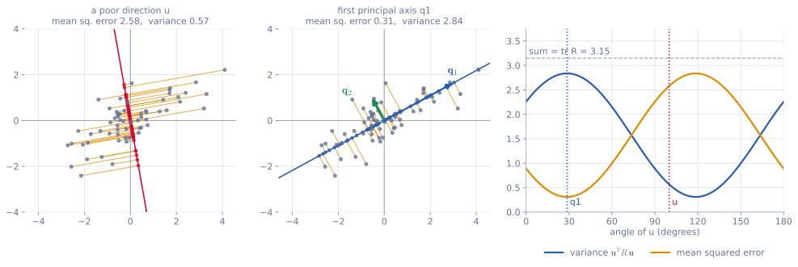

<ul class="post-sources">
<li markdown="span">[혁펜하임의 "보이는" 선형대수학](https://www.youtube.com/playlist?list=PL_iJu012NOxdZDxoGsYidMf2_bERIQaP0) 5-4–5-5강 정리</li>
</ul>

[강의 7](/blog/2026/11/05/hpla-07-eigen/)에서 고윳값과 고유벡터, 그리고 고윳값 분해를 배웠다. 이번에는 그 첫 번째 응용으로 **주성분 분석(principal component analysis, PCA)**을 다룬다. PCA의 결론은 흔히 "분산이 가장 큰 방향이 첫 번째 주성분이다"라는 한 줄로 외워지지만, 여기서는 그 결론을 받아들이는 대신 "데이터를 가장 잘 설명하는 방향"을 직접 식으로 세워서, 그 답이 저절로 공분산 행렬의 고유벡터가 되는 과정을 따라간다. 대칭 행렬의 고유벡터가 서로 수직이라는 사실은 [Linear Algebra 8](/blog/2026/10/22/la-08-symmetric-spectral/)에 증명이 있다.

## 주성분 분석

[▶ 5-4강](https://www.youtube.com/watch?v=C21GoH0Y9AE)

### 무엇을 하려는가

평면 위에 점이 여러 개 흩어져 있다고 하자. 점 하나는 $$(x, y)$$ 두 숫자로 된 **데이터(data)** 하나이고, 점들이 모여 어떤 **분포(distribution)**를 이룬다. 점들이 비스듬한 타원 모양으로 퍼져 있다면, 그 타원의 긴 축 방향이 이 분포를 가장 잘 요약하는 방향이라고 느껴진다. 이 방향을 **주성분(principal component)** 방향이라 하고, 그 방향의 단위 벡터를 찾는 것이 PCA의 목표다.

찾고 나면 **차원 축소(dimension reduction)**를 할 수 있다. 각 점을 주성분 축 위로 정사영하면, 축은 이미 알고 있으므로 점마다 "축 위의 좌표" 숫자 하나만 기억하면 된다. 2차원 데이터가 1차원 데이터가 된 것이다. 2차원에서 1차원으로는 별로 줄어든 느낌이 없지만, 100차원 데이터를 2차원으로 줄이면 효과가 확실하다.

PCA를 처음 배울 때 보통 두 가지가 의문으로 남는다.

1. 왜 **분산이 가장 큰 방향**이 분포를 가장 잘 설명하는 방향인가?
2. 왜 두 번째로 잘 설명하는 방향은 첫 번째 방향과 **수직**인가?

아래 유도 하나로 두 질문에 모두 답한다.

### 준비: 평균을 원점으로 옮기기

주성분 방향은 분포의 중심에서 출발해야 하므로, 먼저 데이터의 평균을 원점으로 옮긴다. $$i$$번째 원래 데이터를 $$\tilde{\mathbf{d}}_i \in \mathbb{R}^p$$($$p$$는 데이터의 차원, $$i = 1, \dots, n$$), 평균을

$$
\bar{\mathbf{d}} = \frac{1}{n}\sum_{i=1}^{n} \tilde{\mathbf{d}}_i
$$

라 하고, 평균을 뺀 데이터를 $$\mathbf{d}_i = \tilde{\mathbf{d}}_i - \bar{\mathbf{d}}$$라 쓴다. 2차원이라면 $$\bar{\mathbf{d}}$$는 $$x$$좌표들의 평균과 $$y$$좌표들의 평균을 담은 벡터다. 이제 $$\mathbf{d}_1, \dots, \mathbf{d}_n$$의 평균은 $$\mathbf{0}$$이다. 이 과정을 **중심화(centering)**라 한다.

### "가장 잘 설명한다"를 식으로

원점을 지나는 직선의 방향을 단위 벡터 $$\mathbf{u}$$($$\lVert\mathbf{u}\rVert = 1$$)로 나타낸다. 데이터 $$\mathbf{d}_i$$를 이 직선에 정사영하면 [강의 2](/blog/2026/11/05/hpla-02-vectors/)에서 본 대로 $$(\mathbf{d}_i^T\mathbf{u})\mathbf{u}$$가 된다. 내적 $$\mathbf{d}_i^T\mathbf{u}$$가 축 위의 좌표(길이)이고, 거기에 방향 $$\mathbf{u}$$를 곱해 벡터로 만든 것이다. 정사영하고 남은 부분

$$
\mathbf{e}_i = \mathbf{d}_i - (\mathbf{d}_i^T\mathbf{u})\mathbf{u}
$$

가 이 점을 직선으로 요약할 때 잃어버리는 **오차(error)**다. 어떤 방향이 분포를 잘 설명한다면, 점들을 그 방향으로 내렸을 때 잃는 것이 적어야 한다. 그래서 오차 제곱의 평균을 가장 작게 만드는 $$\mathbf{u}$$를 찾는 문제로 정의한다.

$$
\min_{\mathbf{u}} \ \frac{1}{n}\sum_{i=1}^{n} \bigl\lVert \mathbf{d}_i - (\mathbf{d}_i^T\mathbf{u})\mathbf{u} \bigr\rVert^2
\quad \text{subject to} \quad \mathbf{u}^T\mathbf{u} = 1
$$

제약 조건 $$\mathbf{u}^T\mathbf{u} = 1$$이 꼭 필요하다. 우리가 찾는 것은 방향이지 길이가 아니므로 길이를 1로 묶어 두고, 그 상태에서 $$\mathbf{u}$$를 돌려 가며 가장 좋은 방향을 고른다.

### 오차 최소화는 분산 최대화다

괄호 안을 전개한다. $$\mathbf{d}_i^T\mathbf{u}$$는 스칼라이고 $$\mathbf{u}^T\mathbf{u} = 1$$이므로

$$
\bigl\lVert \mathbf{d}_i - (\mathbf{d}_i^T\mathbf{u})\mathbf{u} \bigr\rVert^2
= \mathbf{d}_i^T\mathbf{d}_i - 2(\mathbf{d}_i^T\mathbf{u})^2 + (\mathbf{d}_i^T\mathbf{u})^2\,\mathbf{u}^T\mathbf{u}
= \lVert\mathbf{d}_i\rVert^2 - (\mathbf{d}_i^T\mathbf{u})^2
$$

이다. 이것은 피타고라스 정리 그 자체다. 원래 벡터의 길이 제곱 $$\lVert\mathbf{d}_i\rVert^2$$는 "축 방향 성분의 제곱"과 "오차의 제곱"으로 나뉘고, 그 합은 $$\mathbf{u}$$를 어떻게 잡든 변하지 않는다. 그러니 오차를 줄이는 것과 축 방향 성분을 키우는 것은 같은 일이다. 첫 항은 $$\mathbf{u}$$와 무관하므로 버리면, 문제는

$$
\max_{\mathbf{u}} \ \frac{1}{n}\sum_{i=1}^{n} (\mathbf{u}^T\mathbf{d}_i)(\mathbf{d}_i^T\mathbf{u})
= \max_{\mathbf{u}} \ \mathbf{u}^T \Bigl(\frac{1}{n}\sum_{i=1}^{n} \mathbf{d}_i\mathbf{d}_i^T\Bigr)\mathbf{u}
$$

가 된다. $$(\mathbf{d}_i^T\mathbf{u})^2$$을 $$(\mathbf{u}^T\mathbf{d}_i)(\mathbf{d}_i^T\mathbf{u})$$로 쓴 뒤 $$i$$와 무관한 $$\mathbf{u}$$를 합 밖으로 꺼냈다. 가운데 행렬

$$
R_d = \frac{1}{n}\sum_{i=1}^{n} \mathbf{d}_i\mathbf{d}_i^T = \frac{1}{n}\sum_{i=1}^{n} (\tilde{\mathbf{d}}_i - \bar{\mathbf{d}})(\tilde{\mathbf{d}}_i - \bar{\mathbf{d}})^T
$$

이 데이터의 **공분산 행렬(covariance matrix)**이다. $$p = 2$$이면 $$2 \times 2$$ 행렬로, 대각 성분은 $$x$$의 분산과 $$y$$의 분산, 비대각 성분은 $$x$$와 $$y$$의 **공분산(covariance)**이다. $$xy$$와 $$yx$$의 평균은 같으므로 $$R_d$$는 언제나 **대칭(symmetric)**이다. 이 사실이 뒤에서 결정적으로 쓰인다.

> 통계에서 쓰는 표본 공분산은 $$\frac{1}{n}$$ 대신 $$\frac{1}{n-1}$$을 곱한다(불편 추정량을 만들기 위해서다). 상수배는 최대화하는 $$\mathbf{u}$$를 바꾸지 않으므로 PCA에서는 어느 쪽을 써도 결과가 같다.

그런데 $$\mathbf{u}^T R_d\,\mathbf{u} = \frac{1}{n}\sum_i (\mathbf{d}_i^T\mathbf{u})^2$$은 축 위 좌표 $$\mathbf{d}_i^T\mathbf{u}$$들의 제곱 평균이고, 좌표들의 평균은 $$\mathbf{0}$$의 정사영인 0이므로 이것이 바로 **$$\mathbf{u}$$ 방향으로 본 데이터의 분산**이다. 따라서

> 정사영 오차를 가장 작게 만드는 방향 = 정사영한 좌표의 분산을 가장 크게 만드는 방향

이고, 이것으로 첫 번째 의문이 풀린다. "분산이 큰 방향"은 정의가 아니라 "오차가 작은 방향"을 계산한 결과다.

*점 60개를 중심화한 데이터. 왼쪽은 아무 방향 $$\mathbf{u}$$(100°)에, 가운데는 첫 번째 주축 $$\mathbf{q}_1$$에 정사영한 모습이다. 주황 선분이 오차다. 오른쪽은 $$\mathbf{u}$$의 각도를 0°에서 180°까지 돌릴 때 분산(파랑)과 평균 제곱 오차(주황)이다. 두 곡선의 합은 항상 $$\operatorname{tr} R_d = 3.15$$로 일정하다.*

오른쪽 그래프에서 분산이 최대(2.84)가 되는 각도와 오차가 최소(0.31)가 되는 각도가 정확히 같은 약 29°이고, 그 방향이 가운데 그림의 $$\mathbf{q}_1$$이다. 두 곡선의 합이 일정한 것이 위의 피타고라스 관계다. 이 데이터의 공분산 행렬은 $$R_d \approx \begin{bmatrix} 2.26 & 1.06 \\ 1.06 & 0.89 \end{bmatrix}$$이고 고윳값은 2.84와 0.31이다. 최대 분산과 최소 오차가 각각 두 고윳값과 일치하는 이유가 다음 절에서 나온다.

### 라그랑주 승수로 풀기: 고유벡터가 나온다

제약이 있는 최적화는 **라그랑주 승수(Lagrange multiplier)** $$\lambda$$를 도입해 푼다.

$$
L(\mathbf{u}, \lambda) = \mathbf{u}^T R_d\,\mathbf{u} + \lambda\,(1 - \mathbf{u}^T\mathbf{u})
$$

$$\mathbf{u}$$로 미분해 0으로 놓는다. $$\mathbf{u}$$가 $$d\mathbf{u}$$만큼 변할 때 $$L$$의 변화량은 곱의 미분 규칙으로

$$
dL = d\mathbf{u}^T R_d\,\mathbf{u} + \mathbf{u}^T R_d\,d\mathbf{u} - \lambda\,(d\mathbf{u}^T\mathbf{u} + \mathbf{u}^T d\mathbf{u})
= 2\,(\mathbf{u}^T R_d - \lambda\,\mathbf{u}^T)\,d\mathbf{u}
$$

이다. 스칼라는 전치해도 같고 $$R_d^T = R_d$$이므로 $$d\mathbf{u}^T R_d\,\mathbf{u} = \mathbf{u}^T R_d\,d\mathbf{u}$$이기 때문이다. 변화량 $$dL$$에서 $$d\mathbf{u}$$ 앞에 붙은 행벡터가 곧 기울기이므로, 기울기가 0이 될 조건은 $$\mathbf{u}^T R_d = \lambda\,\mathbf{u}^T$$이다. 양변을 전치하면

$$
R_d\,\mathbf{u} = \lambda\,\mathbf{u}
$$

이다. 최적의 $$\mathbf{u}$$는 **공분산 행렬의 고유벡터**여야 하고, 라그랑주 승수 $$\lambda$$는 그 고윳값이다. PCA가 고윳값과 고유벡터의 응용인 이유가 바로 여기다.

다만 이 문제는 볼록(convex) 최적화가 아니어서, 기울기가 0인 점이 여러 개(고유벡터마다 하나씩) 있고 그중 최대인 것을 골라야 한다. $$R_d$$는 대칭이므로 정규 직교 고유벡터로 분해된다.

$$
R_d = \lambda_1\mathbf{q}_1\mathbf{q}_1^T + \lambda_2\mathbf{q}_2\mathbf{q}_2^T + \cdots + \lambda_p\mathbf{q}_p\mathbf{q}_p^T,
\qquad \lambda_1 \ge \lambda_2 \ge \cdots \ge \lambda_p
$$

후보 $$\mathbf{u}$$는 $$\mathbf{q}_1, \dots, \mathbf{q}_p$$ 중 하나다. $$\mathbf{u} = \mathbf{q}_j$$를 넣으면 $$\mathbf{q}_j^T\mathbf{q}_k$$는 $$j = k$$일 때만 1이고 나머지는 0이므로

$$
\mathbf{q}_j^T R_d\,\mathbf{q}_j = \lambda_j
$$

만 남는다. 가장 큰 값은 $$\lambda_1$$이다. 따라서

- **첫 번째 주성분은 가장 큰 고윳값 $$\lambda_1$$의 고유벡터 $$\mathbf{q}_1$$**이고, 그 방향의 분산은 $$\lambda_1$$이다.
- 오차의 평균은 $$\frac{1}{n}\sum_i\lVert\mathbf{d}_i\rVert^2 - \lambda_1 = \operatorname{tr} R_d - \lambda_1 = \lambda_2 + \cdots + \lambda_p$$, 즉 버린 고윳값들의 합이다.

그다음으로 잘 설명하는 방향은 남은 후보 중 값이 가장 큰 $$\mathbf{q}_2$$이고, 그 분산은 $$\lambda_2$$이다. 대칭 행렬의 고유벡터는 서로 수직이므로 $$\mathbf{q}_2 \perp \mathbf{q}_1$$이다. 이것으로 **두 번째 의문**도 풀린다. 두 번째 주성분이 첫 번째와 수직인 것은 일부러 수직으로 고른 것이 아니라, 공분산 행렬이 대칭이라서 생기는 결과다. (엄밀히 말하면 두 번째 주성분은 "$$\mathbf{q}_1$$과 수직이라는 조건 아래 분산을 최대화하는 방향"으로 정의하고, 같은 계산을 하면 그 답이 $$\mathbf{q}_2$$로 나온다.)

공분산 행렬의 고윳값은 어떤 방향의 분산이므로 음수일 수 없다. 즉 $$R_d$$는 대칭이면서 $$\mathbf{u}^T R_d\,\mathbf{u} \ge 0$$인 **양의 준정부호(positive semidefinite)** 행렬이다.

### 작은 예제

네 점 $$(5, 3)$$, $$(1, 1)$$, $$(4, 4)$$, $$(2, 0)$$의 주성분을 구해 본다.

**1단계: 중심화.** 평균은 $$\bar{\mathbf{d}} = (3, 2)$$이고, 평균을 뺀 데이터는

$$
\mathbf{d}_1 = (2, 1), \quad \mathbf{d}_2 = (-2, -1), \quad \mathbf{d}_3 = (1, 2), \quad \mathbf{d}_4 = (-1, -2)
$$

이다.

**2단계: 공분산 행렬.**

$$
R_d = \frac{1}{4}\begin{bmatrix} 4 + 4 + 1 + 1 & 2 + 2 + 2 + 2 \\ 2 + 2 + 2 + 2 & 1 + 1 + 4 + 4 \end{bmatrix}
= \begin{bmatrix} 2.5 & 2 \\ 2 & 2.5 \end{bmatrix}
$$

**3단계: 고윳값 분해.** $$\det(R_d - \lambda I) = (2.5 - \lambda)^2 - 4 = 0$$에서 $$\lambda = 4.5,\ 0.5$$이다. 고유벡터는

$$
\lambda_1 = 4.5:\ \mathbf{q}_1 = \tfrac{1}{\sqrt{2}}(1, 1), \qquad
\lambda_2 = 0.5:\ \mathbf{q}_2 = \tfrac{1}{\sqrt{2}}(1, -1)
$$

로, 서로 수직이다. 첫 번째 주성분은 대각선 방향이다.

**4단계: 1차원으로 줄이기.** 축 위의 좌표 $$z_i = \mathbf{q}_1^T\mathbf{d}_i$$는 $$\frac{3}{\sqrt{2}}, -\frac{3}{\sqrt{2}}, \frac{3}{\sqrt{2}}, -\frac{3}{\sqrt{2}}$$이다. 이 좌표들의 분산은 $$\frac{1}{4}\cdot 4 \cdot \frac{9}{2} = 4.5 = \lambda_1$$이다. 원래 공간으로 되돌린 값 $$\bar{\mathbf{d}} + z_i\mathbf{q}_1$$은 $$(4.5, 3.5)$$, $$(1.5, 0.5)$$, $$(4.5, 3.5)$$, $$(1.5, 0.5)$$이다.

**5단계: 오차 확인.** 예를 들어 $$(5, 3)$$은 $$(4.5, 3.5)$$로 복원되어 오차가 $$(0.5, -0.5)$$, 제곱 길이 $$0.5$$이다. 네 점 모두 같으므로 평균 제곱 오차는 $$0.5 = \lambda_2$$로, 버린 고윳값과 같다. 비교로 $$x$$축 방향 $$\mathbf{u} = (1, 0)$$을 고르면 분산은 $$\mathbf{u}^T R_d\mathbf{u} = 2.5$$, 평균 제곱 오차도 $$2.5$$로 훨씬 크다. 어느 방향이든 분산과 오차의 합은 $$\operatorname{tr} R_d = 5$$이다.

### 차원 축소와 저장 공간

$$p$$차원 데이터를 $$k$$차원으로 줄일 때는 고윳값이 큰 순서로 $$\mathbf{q}_1, \dots, \mathbf{q}_k$$를 쓴다. 이 벡터들이 span하는 $$k$$차원 부분 공간에 데이터를 정사영하는 것이다. 정규 직교 기저 위의 좌표는 내적으로 바로 구해지므로

$$
z_{ik} = \mathbf{q}_k^T\mathbf{d}_i, \qquad
\hat{\mathbf{d}}_i = \bar{\mathbf{d}} + \sum_{k} z_{ik}\,\mathbf{q}_k
$$

이다. $$z_{i1}, \dots, z_{ik}$$가 줄어든 데이터이고, $$\hat{\mathbf{d}}_i$$는 그것으로 원래 공간에 **복원(reconstruction)**한 점이다. 표준 기저에서 점 $$(a, b)$$가 $$a\mathbf{e}_1 + b\mathbf{e}_2$$인 것과 똑같이, 주성분 기저에서는 좌표 $$(z_{i1}, z_{i2})$$가 $$z_{i1}\mathbf{q}_1 + z_{i2}\mathbf{q}_2$$를 뜻한다.

100차원 데이터 100개라면 원래는 숫자 $$100 \times 100 = 10000$$개가 필요하다. 2차원으로 줄이면 축 $$\mathbf{q}_1, \mathbf{q}_2$$에 200개, 데이터마다 좌표 2개씩 200개, 평균 벡터 100개로 모두 500개면 된다. 데이터가 많아질수록 차이는 더 커진다.

**고윳값 분해로 하는 압축과의 차이.** [강의 7](/blog/2026/11/05/hpla-07-eigen/)에서 본 고윳값 분해 압축은 행렬 **하나**를 랭크 1 행렬들의 합으로 쪼개고 고윳값이 큰 항만 남기는 것이었다. 데이터 하나(행렬 하나)를 개별적으로 줄인 것이다. PCA는 데이터 **여러 개의 분포** 전체를 보고, 그 분포를 가장 잘 설명하는 축을 찾아 모든 데이터를 그 위로 내린다. 같은 "압축"이지만 관점이 다르다.

### 응용: 얼굴 인식

$$100 \times 100$$ 흑백 사진은 열들을 위에서부터 차례로 이어 붙이면 $$10000 \times 1$$ 벡터, 즉 10000차원 공간의 점 하나가 된다($$3 \times 3$$ 행렬이면 세 열을 이어 $$9 \times 1$$ 벡터가 되는 것과 같다). 한 사람의 얼굴을 여러 각도에서 여러 장 찍으면 그 점들은 10000차원 공간 안에서 서로 가까운 곳에 모여 있을 것이다.

이 사진들로 공분산 행렬을 만들고 고윳값이 큰 고유벡터 10개를 고르면, 10000차원 공간 안의 10차원 부분 공간이 정해진다. 새 사진 $$\tilde{\mathbf{d}}$$가 들어오면 이 부분 공간에 정사영해 복원한 $$\hat{\mathbf{d}}$$와 원래 사진의 차이 $$\lVert\tilde{\mathbf{d}} - \hat{\mathbf{d}}\rVert$$, 즉 **복원 오차(reconstruction error)**를 잰다. 같은 사람의 얼굴이면 부분 공간 가까이 있어서 오차가 작고, 다른 사람이거나 엉뚱한 장면이면 오차가 크다. 이것으로 본인 여부를 판정할 수 있다.

### PCA와 오토인코더

$$k$$개의 주성분을 열로 쌓은 $$p \times k$$ 행렬 $$W = \begin{bmatrix} \mathbf{q}_1 & \cdots & \mathbf{q}_k \end{bmatrix}$$를 쓰면 좌표 계산과 복원이 행렬 곱 두 번이 된다.

$$
\mathbf{z}_i = W^T\mathbf{d}_i \quad(\text{encode}), \qquad
\hat{\mathbf{d}}_i = W\mathbf{z}_i = WW^T\mathbf{d}_i \quad(\text{decode})
$$

이것은 편향(bias)과 비선형 활성화 함수가 없는 2층 신경망과 같은 모양이다. 입력을 $$k$$개의 노드로 줄였다가 다시 $$p$$개로 복원하므로, 딥러닝의 **오토인코더(autoencoder)**의 가장 단순한 형태가 PCA라고 볼 수 있다. PCA는 가중치를 학습하지 않고 고유벡터로 정해 버린다는 점이 다르지만, 선형 오토인코더를 복원 오차가 작아지도록 학습시키면 역시 데이터를 어떤 $$k$$차원 평면에 내리는 일을 하게 된다.

층을 여러 개 쌓고 비선형 활성화 함수를 쓰면 이야기가 달라진다. PCA는 $$\mathbf{q}_1, \dots, \mathbf{q}_k$$의 선형 결합으로 표현되는 **평평한** 부분 공간(직선, 평면, 초평면)에만 데이터를 내릴 수 있다. 데이터가 휘어진 곡면 위에 분포하면 PCA는 어쩔 수 없이 그 곡면을 가장 잘 근사하는 평면을 찾는다. 비선형 오토인코더는 이런 제약이 없어서 데이터를 잘 감싸는 **휘어진** 곡면을 찾을 수 있고, 이런 곡면을 **매니폴드(manifold)**, 이를 찾는 일을 매니폴드 학습이라 한다. 이때 가운데 층의 두 값은 휘어진 좌표축 위의 좌표 역할을 한다.

### 흔한 실수

- **중심화를 빠뜨린다.** 평균을 빼지 않고 $$\frac{1}{n}\sum\tilde{\mathbf{d}}_i\tilde{\mathbf{d}}_i^T$$의 고유벡터를 구하면 첫 번째 축이 원점에서 데이터 중심을 향하는 방향으로 끌려간다.
- **단위가 다른 특성을 그대로 섞는다.** 키(cm)와 몸무게(kg)처럼 스케일이 다르면 숫자가 큰 특성의 분산이 주성분을 지배한다. 필요하면 각 특성을 표준편차로 나눈 뒤 PCA를 한다.
- **회귀 직선과 혼동한다.** 최소자승 회귀 직선은 $$y$$ 방향(세로) 오차를 줄이고, PCA의 첫 번째 축은 직선에 **수직인** 오차를 줄인다. 같은 데이터에서 두 직선은 일반적으로 다르다.
- **고유벡터의 부호에 의미를 둔다.** $$\mathbf{q}$$와 $$-\mathbf{q}$$는 같은 축이다. 프로그램마다 부호가 다르게 나올 수 있다.

## PCA 연습 문제

[▶ 5-5강](https://www.youtube.com/watch?v=optHJg50opo)

아래 문제는 PCA의 계산 과정과 자주 틀리는 지점을 확인하도록 직접 구성한 것이다.

### 문제 1: 공분산 행렬에서 주성분 읽기

2차원 데이터의 공분산 행렬이 $$R_d = \begin{bmatrix} 5 & 2 \\ 2 & 2 \end{bmatrix}$$이다. 두 주성분 방향과 각 방향의 분산을 구하고, 첫 번째 주성분 하나로 줄였을 때 전체 분산의 몇 %가 남는지 구하라.

**풀이.** $$\operatorname{tr} R_d = 7$$, $$\det R_d = 10 - 4 = 6$$이므로 특성 방정식은 $$\lambda^2 - 7\lambda + 6 = 0$$, 고윳값은 $$\lambda_1 = 6$$, $$\lambda_2 = 1$$이다.

- $$\lambda_1 = 6$$: $$(R_d - 6I)\mathbf{q} = \mathbf{0}$$의 첫 행 $$-q_1 + 2q_2 = 0$$에서 $$\mathbf{q}_1 = \frac{1}{\sqrt{5}}(2, 1)$$.
- $$\lambda_2 = 1$$: 첫 행 $$4q_1 + 2q_2 = 0$$에서 $$\mathbf{q}_2 = \frac{1}{\sqrt{5}}(1, -2)$$. $$\mathbf{q}_1^T\mathbf{q}_2 = 2 - 2 = 0$$으로 수직이다.

전체 분산은 $$\operatorname{tr} R_d = 5 + 2 = 7 = \lambda_1 + \lambda_2$$이다. 첫 번째 주성분이 설명하는 비율은 $$6/7 \approx 85.7\%$$이고, 버린 $$\lambda_2 = 1$$이 평균 제곱 복원 오차가 된다.

**배우는 점.** 전체 분산은 좌표축을 어떻게 돌려도 $$\operatorname{tr} R_d$$로 같고, 주성분은 그 총량을 고윳값 크기대로 나눠 가진다. 3차원에서 고윳값이 $$6, 3, 1$$이면 누적 비율이 $$60\%, 90\%, 100\%$$이므로 "90%를 남기려면 주성분 2개"처럼 $$k$$를 고른다.

### 문제 2: 한 직선 위에 있는 데이터

세 점 $$(1, 3)$$, $$(2, 5)$$, $$(3, 7)$$의 첫 번째 주성분과 각 점의 1차원 좌표를 구하라. 1차원으로 줄였을 때 오차는 얼마인가?

**풀이.** 평균은 $$(2, 5)$$이고, 중심화한 데이터는 $$(-1, -2)$$, $$(0, 0)$$, $$(1, 2)$$이다.

$$
R_d = \frac{1}{3}\left(\begin{bmatrix} 1 & 2 \\ 2 & 4 \end{bmatrix} + \begin{bmatrix} 0 & 0 \\ 0 & 0 \end{bmatrix} + \begin{bmatrix} 1 & 2 \\ 2 & 4 \end{bmatrix}\right) = \frac{1}{3}\begin{bmatrix} 2 & 4 \\ 4 & 8 \end{bmatrix}
$$

랭크 1 행렬이므로 고윳값은 $$\operatorname{tr} R_d = \frac{10}{3}$$과 $$0$$이고, $$\mathbf{q}_1 = \frac{1}{\sqrt{5}}(1, 2)$$이다. 좌표는 $$z_i = \mathbf{q}_1^T\mathbf{d}_i = -\sqrt{5},\ 0,\ \sqrt{5}$$이다. $$\lambda_2 = 0$$이므로 복원 오차는 0이다. 세 점이 모두 직선 $$y = 2x + 1$$ 위에 있으니, 그 직선 하나로 정보 손실 없이 표현된다.

**배우는 점.** 이 직선은 원점을 지나지 않는다. 평균을 빼지 않고 $$\frac{1}{3}\sum\tilde{\mathbf{d}}_i\tilde{\mathbf{d}}_i^T$$를 쓰면 원점을 지나는 직선만 후보가 되므로 오차가 0이 될 수 없다. 중심화는 "축이 데이터 중심을 지나게" 하는 단계다.

### 문제 3: 주성분 축과 회귀 직선은 다르다

중심이 원점인 다섯 점 $$(-2, -2)$$, $$(-1, 1)$$, $$(0, 0)$$, $$(1, -1)$$, $$(2, 2)$$가 있다. 첫 번째 주성분 축과 최소자승 회귀 직선 $$y = mx$$를 각각 구하고 비교하라.

**풀이.** 평균이 이미 $$(0, 0)$$이다. $$\sum x_i^2 = 10$$, $$\sum y_i^2 = 10$$, $$\sum x_iy_i = 4 - 1 + 0 - 1 + 4 = 6$$이므로

$$
R_d = \frac{1}{5}\begin{bmatrix} 10 & 6 \\ 6 & 10 \end{bmatrix} = \begin{bmatrix} 2 & 1.2 \\ 1.2 & 2 \end{bmatrix}
$$

이고 고윳값은 $$3.2$$, $$0.8$$, $$\mathbf{q}_1 = \frac{1}{\sqrt{2}}(1, 1)$$이다. 주성분 축은 기울기 1인 직선이다.

회귀 직선은 세로 오차 $$\sum(y_i - mx_i)^2$$을 최소화하므로 $$m = \frac{\sum x_iy_i}{\sum x_i^2} = \frac{6}{10} = 0.6$$이다.

두 직선을 같은 기준으로 비교하면 각자 자기 기준에서 이긴다.

| 직선 | 세로 오차 제곱 평균 | 수직 거리 제곱 평균 |
| --- | --- | --- |
| 회귀 $$y = 0.6x$$ | 1.28 | 0.94 |
| 주성분 $$y = x$$ | 1.60 | 0.80 |

주성분 축의 수직 거리 제곱 평균 $$0.80$$은 버린 고윳값 $$\lambda_2$$와 같다.

**배우는 점.** 회귀는 $$x$$로 $$y$$를 예측하는 문제라 $$y$$ 방향 오차만 보고, PCA는 두 좌표를 대등하게 보고 직선까지의 수직 거리를 본다. 목적이 다르니 답도 다르다.

## 정리

| 단계 | 내용 |
| --- | --- |
| 중심화 | $$\mathbf{d}_i = \tilde{\mathbf{d}}_i - \bar{\mathbf{d}}$$ |
| 목표 | 정사영 오차 $$\frac{1}{n}\sum\lVert\mathbf{d}_i - (\mathbf{d}_i^T\mathbf{u})\mathbf{u}\rVert^2$$ 최소화, $$\lVert\mathbf{u}\rVert = 1$$ |
| 바꿔 쓰기 | 분산 $$\mathbf{u}^T R_d\,\mathbf{u}$$ 최대화, $$R_d = \frac{1}{n}\sum\mathbf{d}_i\mathbf{d}_i^T$$ |
| 해 | $$R_d\mathbf{u} = \lambda\mathbf{u}$$, 가장 큰 고윳값의 고유벡터 $$\mathbf{q}_1$$ |
| 다음 축 | $$\mathbf{q}_2, \mathbf{q}_3, \dots$$, 대칭 행렬이라 서로 수직 |
| 분산과 오차 | $$k$$개 축의 분산 합 $$\lambda_1 + \cdots + \lambda_k$$, 평균 제곱 오차는 나머지 고윳값의 합 |
| 차원 축소 | $$\mathbf{z}_i = W^T\mathbf{d}_i$$, 복원 $$\hat{\mathbf{d}}_i = \bar{\mathbf{d}} + W\mathbf{z}_i$$ |

- "분산이 가장 큰 방향"은 "정사영 오차가 가장 작은 방향"을 계산한 결과다. 둘의 합은 $$\operatorname{tr} R_d$$로 고정되어 있다.
- 주성분끼리 수직인 것은 공분산 행렬이 대칭이기 때문이다.
- PCA는 선형 오토인코더와 같은 구조이고, 비선형 오토인코더는 평면 대신 휘어진 매니폴드를 찾는다.
- SVD를 쓰면 공분산 행렬을 만들지 않고도 같은 주성분을 얻는다. 이것은 [강의 10](/blog/2026/11/05/hpla-10-svd/)에서 다룬다.
