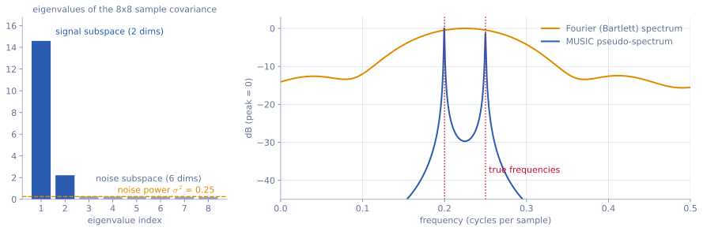
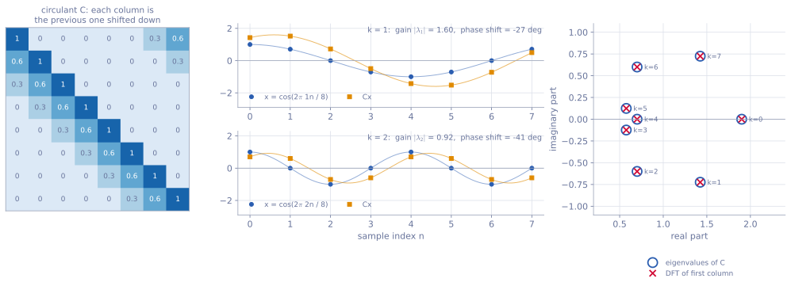

<ul class="post-sources">
<li markdown="span">[혁펜하임의 "보이는" 선형대수학](https://www.youtube.com/playlist?list=PL_iJu012NOxdZDxoGsYidMf2_bERIQaP0) 5-6–5-7강 정리</li>
</ul>

[강의 8](/blog/2026/11/05/hpla-08-pca/)에서 공분산 행렬의 고유벡터가 데이터의 주된 방향을 알려 준다는 것을 보았다. 이번에는 고윳값 분해의 응용 두 가지를 더 본다. 하나는 공분산 행렬의 고유벡터로 **신호와 잡음을 서로 수직인 두 공간으로 나누어** 주파수를 찾는 MUSIC 알고리즘이고, 다른 하나는 고윳값 분해 $$A = V\Lambda V^{-1}$$이 특정한 행렬에서는 **푸리에 변환 그 자체**가 된다는 사실이다. 두 주제 모두 복소수 벡터를 쓰므로, 전치 $$T$$ 대신 **켤레 전치(conjugate transpose)** $$H$$를 쓴다. $$\mathbf{x}^H$$는 $$\mathbf{x}$$를 전치하고 각 성분을 켤레 복소수로 바꾼 것이고, 복소 벡터의 내적은 $$\mathbf{x}^H\mathbf{y}$$, 길이 제곱은 $$\mathbf{x}^H\mathbf{x} = \sum\lvert x_i\rvert^2$$이다. 실수 대칭 행렬에 해당하는 것이 $$R^H = R$$인 **에르미트 행렬(Hermitian matrix)**이고, 대칭 행렬처럼 고윳값이 실수이며 서로 수직인 고유벡터로 분해된다.

## MUSIC 알고리즘

[▶ 5-6강](https://www.youtube.com/watch?v=tIVQiy42_vQ)

### 무엇을 하려는가

잡음이 섞인 신호에 어떤 주파수의 사인파가 들어 있는지 알고 싶다. 보통은 푸리에 변환을 해서 봉우리를 찾는다. 그런데 관측한 길이가 $$M$$개의 샘플로 짧으면 푸리에 스펙트럼의 봉우리 폭이 대략 $$1/M$$(한 샘플당 주기 수 단위)이 되어, 그보다 가까운 두 주파수는 봉우리 하나로 뭉개진다. 배열 안테나로 전파가 들어오는 **방향**을 찾는 문제도 수학적으로 같다(안테나 사이의 위상 차이가 시간 샘플 사이의 위상 차이 역할을 한다).

**MUSIC(MUltiple SIgnal Classification)**은 공분산 행렬을 고윳값 분해해서 이 한계를 넘는다. 핵심 아이디어는 한 문장이다. **잡음만 사는 부분 공간을 찾으면, 진짜 신호의 방향은 그 공간과 정확히 수직이다.**

### 신호 모델

복소 사인파 $$K$$개와 잡음이 섞인 신호

$$
x[n] = \sum_{k=1}^{K} s_k\,e^{j\omega_k n} + w[n]
$$

를 생각한다. $$\omega_k$$가 찾고 싶은 주파수, $$s_k$$는 진폭과 위상을 담은 복소수, $$w[n]$$은 분산 $$\sigma^2$$인 백색 잡음이다. 연속한 $$M$$개 샘플을 벡터 $$\mathbf{x} = (x[n], x[n+1], \dots, x[n+M-1])$$로 묶으면

$$
\mathbf{x} = A\mathbf{s} + \mathbf{w}, \qquad
A = \begin{bmatrix} \mathbf{a}(\omega_1) & \cdots & \mathbf{a}(\omega_K) \end{bmatrix}, \qquad
\mathbf{a}(\omega) = (1, e^{j\omega}, e^{j2\omega}, \dots, e^{j(M-1)\omega})
$$

이다. $$\mathbf{a}(\omega)$$는 주파수 $$\omega$$인 사인파가 $$M$$개 샘플에 남기는 모양으로, **조향 벡터(steering vector)**라 부른다. 시작 시점 $$n$$에 따른 위상 변화는 $$\mathbf{s}$$에 흡수된다. $$M > K$$이고 주파수가 서로 다르면 $$A$$의 열은 선형 독립이다.

### 공분산 행렬의 구조

신호들끼리, 그리고 신호와 잡음이 서로 상관이 없다고 하면 공분산 행렬은

$$
R = E[\mathbf{x}\mathbf{x}^H] = APA^H + \sigma^2 I
$$

이다. $$P$$는 각 신호의 전력 $$p_k = E[\lvert s_k\rvert^2] > 0$$을 대각에 둔 $$K \times K$$ 행렬이다. 여기서 두 가지를 관찰한다.

**1. $$APA^H$$는 랭크 $$K$$다.** $$M \times M$$ 행렬이지만 열 공간이 $$A$$의 열 공간($$K$$차원)이므로, 고윳값 중 $$K$$개만 양수 $$\mu_1, \dots, \mu_K$$이고 나머지 $$M - K$$개는 0이다.

**2. $$\sigma^2 I$$를 더해도 고유벡터는 그대로다.** $$APA^H\mathbf{e} = \mu\mathbf{e}$$이면 $$(APA^H + \sigma^2I)\mathbf{e} = (\mu + \sigma^2)\mathbf{e}$$이기 때문이다. 고윳값만 모두 $$\sigma^2$$씩 올라간다.

그래서 $$R$$의 고윳값은 큰 순서로

$$
\underbrace{\mu_1 + \sigma^2,\ \dots,\ \mu_K + \sigma^2}_{K\text{ signal}},\ \underbrace{\sigma^2,\ \dots,\ \sigma^2}_{M-K\text{ noise}}
$$

로 나뉜다. 큰 고윳값 $$K$$개의 고유벡터를 모은 $$E_s$$가 **신호 부분 공간(signal subspace)**, 나머지 $$M - K$$개를 모은 $$M \times (M - K)$$ 행렬 $$E_n$$이 **잡음 부분 공간(noise subspace)**이다. $$R$$이 에르미트 행렬이므로 두 공간은 서로 수직이다.

### 핵심: 조향 벡터는 잡음 공간과 수직이다

잡음 고유벡터 $$\mathbf{e}$$는 $$R\mathbf{e} = \sigma^2\mathbf{e}$$이므로 $$APA^H\mathbf{e} = \mathbf{0}$$이다. 왼쪽에 $$\mathbf{e}^H$$를 곱하면

$$
\mathbf{e}^HAPA^H\mathbf{e} = \sum_{k=1}^{K} p_k\,\lvert\mathbf{a}(\omega_k)^H\mathbf{e}\rvert^2 = 0
$$

이다. $$p_k > 0$$이므로 모든 항이 0이어야 하고, 따라서 **모든 $$k$$에 대해 $$\mathbf{a}(\omega_k)^H\mathbf{e} = 0$$**이다. 진짜 주파수의 조향 벡터는 잡음 고유벡터 모두와 수직이고, 신호 부분 공간은 정확히 $$A$$의 열 공간이다.

그러니 후보 주파수 $$\omega$$를 훑으면서 $$\mathbf{a}(\omega)$$가 잡음 공간에 얼마나 걸치는지, 즉 잡음 공간으로의 정사영 길이 제곱 $$\lVert E_n^H\mathbf{a}(\omega)\rVert^2$$을 재면 된다. 이 값이 0이 되는 곳이 답이다. 0을 찾는 것보다 봉우리를 찾는 것이 보기 편하므로 역수를 그린다.

$$
P_{\text{MUSIC}}(\omega) = \frac{1}{\lVert E_n^H\mathbf{a}(\omega)\rVert^2}
$$

이것을 **MUSIC 의사 스펙트럼(pseudo-spectrum)**이라 한다. 진짜 주파수에서 분모가 0에 가까워져 아주 날카로운 봉우리가 생긴다. "의사"라는 말이 붙은 것은 봉우리 높이가 신호 전력을 뜻하지 않기 때문이다.

실제로는 $$E[\cdot]$$를 모르므로 다음 순서로 계산한다.

1. 신호를 길이 $$M$$인 조각 $$\mathbf{x}_1, \dots, \mathbf{x}_N$$으로 잘라 표본 공분산 $$\hat{R} = \frac{1}{N}\sum_t\mathbf{x}_t\mathbf{x}_t^H$$를 만든다.
2. $$\hat{R}$$을 고윳값 분해한다.
3. 잡음 바닥보다 확연히 큰 고윳값의 개수로 $$K$$를 정하고, 나머지 고유벡터로 $$E_n$$을 만든다.
4. $$\omega$$를 촘촘히 바꾸며 $$P_{\text{MUSIC}}(\omega)$$를 계산하고 가장 큰 봉우리 $$K$$개를 고른다.

### 작은 예제

$$M = 3$$, 신호 하나($$K = 1$$)가 주파수 $$\omega_0 = \pi/2$$, 전력 1로 들어오고 잡음 분산이 $$\sigma^2 = 0.1$$이라 하자. 조향 벡터는 $$\mathbf{a}_0 = (1, e^{j\pi/2}, e^{j\pi}) = (1, j, -1)$$이고

$$
R = \mathbf{a}_0\mathbf{a}_0^H + 0.1I = \begin{bmatrix} 1.1 & -j & -1 \\ j & 1.1 & -j \\ -1 & j & 1.1 \end{bmatrix}
$$

이다. $$\mathbf{a}_0\mathbf{a}_0^H$$는 랭크 1이고 $$\mathbf{a}_0$$에 대한 고윳값이 $$\mathbf{a}_0^H\mathbf{a}_0 = 3$$이므로, $$R$$의 고윳값은 $$3.1, 0.1, 0.1$$이다. 잡음 공간은 $$\mathbf{a}_0$$에 수직인 2차원 평면이고, 그 평면으로의 정사영 행렬은 $$E_nE_n^H = I - \frac{1}{3}\mathbf{a}_0\mathbf{a}_0^H$$이다. 따라서

$$
\lVert E_n^H\mathbf{a}(\omega)\rVert^2 = \mathbf{a}(\omega)^HE_nE_n^H\mathbf{a}(\omega) = 3 - \frac{1}{3}\lvert\mathbf{a}_0^H\mathbf{a}(\omega)\rvert^2
$$

이다. 몇 군데 넣어 보면

| $$\omega$$ | $$0$$ | $$\pi/4$$ | $$\pi/2$$ | $$\pi$$ |
| --- | --- | --- | --- | --- |
| 잡음 공간 성분 | 2.667 | 1.057 | 0 | 2.667 |

로, $$\omega = \pi/2$$에서만 정확히 0이 된다. $$\omega = \pi/2$$에서는 $$\lvert\mathbf{a}_0^H\mathbf{a}_0\rvert^2 = 9$$이어서 $$3 - 3 = 0$$이다. 이론 공분산을 쓰면 봉우리가 무한대로 솟고, 표본 공분산을 쓰면 아주 높지만 유한한 봉우리가 된다.

### 가까운 두 주파수 구분하기

*주파수 0.20과 0.25(한 샘플당 주기 수)의 복소 사인파 두 개에 잡음($$\sigma^2 = 0.25$$)을 섞고, 길이 $$M = 8$$인 조각 400개로 표본 공분산을 만들었다. 왼쪽: 고윳값 8개 중 2개만 크고 6개는 잡음 수준에 모여 있다. 오른쪽: 같은 공분산으로 계산한 푸리에(바틀렛) 스펙트럼(주황)과 MUSIC 의사 스펙트럼(파랑).*

고윳값은 14.6과 2.2, 그리고 0.21에서 0.26 사이의 여섯 개다. 큰 고윳값 두 개가 신호 두 개를, 나머지가 $$\sigma^2 = 0.25$$ 근처의 잡음 바닥을 나타내므로 $$K = 2$$로 정할 수 있다. 오른쪽 그림에서 푸리에 스펙트럼 $$\mathbf{a}(\omega)^H\hat{R}\,\mathbf{a}(\omega)/M$$은 두 주파수 사이인 0.226 근처에 봉우리 하나만 보인다. 두 주파수의 간격 0.05가 해상도 $$1/M = 0.125$$보다 좁기 때문이다. MUSIC은 같은 데이터로 0.1995와 0.2498에 날카로운 봉우리 두 개를 세운다.

### 흔한 실수

- **$$K$$를 잘못 정한다.** 신호 개수를 너무 작게 잡으면 신호 방향 하나가 잡음 공간에 섞여 들어가 그 봉우리가 사라지고, 너무 크게 잡으면 가짜 봉우리가 생긴다. 고윳값이 잡음 바닥에서 뚜렷이 떨어지는 지점을 본다.
- **의사 스펙트럼의 높이를 전력으로 읽는다.** 높이는 수직에 얼마나 가까운지를 나타낼 뿐이다. 전력은 따로 추정해야 한다.
- **신호끼리 상관이 있으면 깨진다.** 같은 신호가 반사되어 두 번 들어오는 경우처럼 신호들이 완전히 상관되어 있으면 $$P$$가 대각이 아니고 랭크가 줄어들어, 신호 부분 공간이 $$K$$차원이 되지 못한다.
- **$$M \le K$$로 잡는다.** 잡음 공간이 남으려면 조각 길이 $$M$$이 신호 개수 $$K$$보다 커야 한다.

## 고윳값 분해는 역 푸리에 변환이다

[▶ 5-7강](https://www.youtube.com/watch?v=tqy0fus0-7c)

### 고윳값 분해를 세 단계로 읽기

$$A$$가 대각화 가능하면 $$A\mathbf{x} = V\Lambda V^{-1}\mathbf{x}$$를 오른쪽부터 읽을 수 있다([강의 7](/blog/2026/11/05/hpla-07-eigen/)).

1. $$\mathbf{c} = V^{-1}\mathbf{x}$$: $$\mathbf{x}$$를 고유벡터들의 조합 $$\mathbf{x} = c_1\mathbf{v}_1 + \cdots + c_n\mathbf{v}_n$$으로 쓸 때의 계수를 구한다. **분해(analysis)**다.
2. $$\Lambda\mathbf{c}$$: 계수마다 고윳값 $$\lambda_i$$를 곱한다. 고유벡터 방향은 서로 섞이지 않고 각자 늘거나 줄기만 한다.
3. $$V(\Lambda\mathbf{c})$$: 고유벡터들을 새 계수로 다시 더한다. **합성(synthesis)**이다.

신호 처리에서 이 구조는 낯익다. 신호를 사인파 성분으로 나누는 것이 **푸리에 변환(Fourier transform)**, 각 주파수 성분에 필터의 응답을 곱하는 것이 필터링, 사인파들을 다시 더해 신호를 만드는 것이 **역 푸리에 변환(inverse Fourier transform)**이다. 두 구조가 정확히 겹치는 행렬이 있는데, 바로 순환 행렬이다.

### 순환 행렬

첫 열이 $$\mathbf{c} = (c_0, c_1, \dots, c_{N-1})$$이고 다음 열마다 한 칸씩 아래로 밀고 넘친 성분은 맨 위로 돌려놓은 $$N \times N$$ 행렬을 **순환 행렬(circulant matrix)**이라 한다. $$N = 4$$이면

$$
C = \begin{bmatrix} c_0 & c_3 & c_2 & c_1 \\ c_1 & c_0 & c_3 & c_2 \\ c_2 & c_1 & c_0 & c_3 \\ c_3 & c_2 & c_1 & c_0 \end{bmatrix}
$$

이다. 성분으로 쓰면 $$C_{nm} = c_{(n-m) \bmod N}$$이고, $$C\mathbf{x}$$는

$$
(C\mathbf{x})_n = \sum_{m=0}^{N-1} c_{(n-m) \bmod N}\,x_m
$$

이다. 이것은 $$\mathbf{c}$$와 $$\mathbf{x}$$의 **순환 합성곱(circular convolution)**이다. 시간에 따라 성질이 변하지 않는 선형 필터(LTI 시스템)를 주기적인 신호에 적용하는 것이 바로 이 연산이다.

### 사인파가 고유벡터다

$$\zeta = e^{j2\pi/N}$$이라 하고, 주파수 $$k$$인 복소 사인파

$$
\mathbf{f}_k = (1, \zeta^{k}, \zeta^{2k}, \dots, \zeta^{(N-1)k}), \qquad k = 0, 1, \dots, N-1
$$

를 $$C$$에 곱해 본다. $$l = n - m$$으로 바꾸면($$\zeta^N = 1$$이므로 지수는 $$N$$으로 나눈 나머지로 생각해도 된다)

$$
(C\mathbf{f}_k)_n = \sum_{m} c_{n-m}\,\zeta^{km} = \zeta^{kn}\sum_{l} c_l\,\zeta^{-kl} = \lambda_k\,(\mathbf{f}_k)_n,
\qquad \lambda_k = \sum_{l=0}^{N-1} c_l\,e^{-j2\pi kl/N}
$$

이다. 즉 $$C\mathbf{f}_k = \lambda_k\mathbf{f}_k$$이고,

- **고유벡터 $$\mathbf{f}_k$$는 $$\mathbf{c}$$와 무관하게 언제나 이산 푸리에 기저(사인파)**이고,
- **고윳값 $$\lambda_k$$는 첫 열 $$\mathbf{c}$$의 이산 푸리에 변환(DFT)**이다.

사인파를 넣으면 같은 주파수의 사인파가 크기($$\lvert\lambda_k\rvert$$)와 위상($$\arg\lambda_k$$)만 바뀌어 나온다. 이것이 필터의 **주파수 응답(frequency response)**이다.

*첫 열이 $$(1, 0.6, 0.3, 0, 0, 0, 0, 0)$$인 $$8 \times 8$$ 순환 행렬. 가운데: 코사인(파랑)을 넣으면 같은 주파수의 코사인(주황)이 나온다. 크기와 위상만 바뀐다. 오른쪽: `numpy`로 구한 고윳값(원)과 첫 열의 DFT(가위표)가 8개 모두 겹친다.*

가운데 그림의 코사인은 실수지만, 코사인은 $$\mathbf{f}_k$$와 $$\mathbf{f}_{N-k}$$의 평균이고 $$\mathbf{c}$$가 실수이면 $$\lambda_{N-k} = \overline{\lambda_k}$$이므로, 나오는 신호는 $$\lvert\lambda_k\rvert\cos(2\pi kn/N + \arg\lambda_k)$$이다. $$k = 1$$에서는 크기가 1.60배, 위상이 $$-27°$$, $$k = 2$$에서는 0.92배, $$-41°$$ 바뀐다. 이 필터는 낮은 주파수를 키우고 높은 주파수를 줄이는 저역 통과 필터다.

### 행렬로 쓰면: $$C = F^{-1}\Lambda F$$

$$\mathbf{f}_k$$를 열로 모은 행렬의 역행렬이 **DFT 행렬** $$F$$($$F_{kn} = e^{-j2\pi kn/N}$$)이다. $$\mathbf{f}_k$$끼리는 서로 수직이고 길이 제곱이 $$N$$이므로 $$F^{-1} = \frac{1}{N}F^H$$이고, 고윳값 분해는

$$
C = F^{-1}\,\Lambda\,F, \qquad \Lambda = \operatorname{diag}(\lambda_0, \dots, \lambda_{N-1})
$$

이다. 세 단계로 읽으면 이렇다.

1. $$F\mathbf{x}$$: DFT. 계수 $$X_k$$를 구한다.
2. $$\Lambda F\mathbf{x}$$: 주파수마다 $$\lambda_k$$를 곱한다.
3. $$F^{-1}(\cdot)$$: 역 DFT. 사인파들을 다시 더한다.

고유벡터 행렬 $$V = F^{-1}$$이 역 DFT 행렬이다. $$\mathbf{x} = V\mathbf{c}$$, 즉 "벡터를 고유벡터의 선형 결합으로 쓴다"는 것이 순환 행렬에서는 $$\mathbf{x} = \frac{1}{N}\sum_k X_k\mathbf{f}_k$$, "신호를 사인파의 합으로 쓴다"는 역 푸리에 변환 공식과 같다. 이것이 **"고윳값 분해는 역 푸리에 변환"**이라는 말의 뜻이다. 신호 처리의 **합성곱 정리(convolution theorem)**, "시간 영역의 합성곱은 주파수 영역의 곱셈"도 이 식을 말로 옮긴 것이다.

### 계산 예

$$N = 4$$, $$\mathbf{c} = (3, 1, 0, 1)$$이면

$$
C = \begin{bmatrix} 3 & 1 & 0 & 1 \\ 1 & 3 & 1 & 0 \\ 0 & 1 & 3 & 1 \\ 1 & 0 & 1 & 3 \end{bmatrix}
$$

이다. $$e^{-j2\pi/4} = -j$$이므로 고윳값은 $$\lambda_k = 3 + (-j)^k + (-j)^{3k}$$에서

$$
\lambda_0 = 5, \quad \lambda_1 = 3 - j + j = 3, \quad \lambda_2 = 3 - 1 - 1 = 1, \quad \lambda_3 = 3
$$

이다. 확인으로 $$\mathbf{f}_1 = (1, j, -1, -j)$$를 곱하면 $$C\mathbf{f}_1$$의 첫 성분은 $$3 + j + 0 - j = 3$$, 둘째 성분은 $$1 + 3j - 1 + 0 = 3j$$이고, 나머지도 같은 식으로 $$C\mathbf{f}_1 = (3, 3j, -3, -3j) = 3\mathbf{f}_1$$이다.

이제 $$\mathbf{x} = (1, 2, 3, 4)$$에 대해 $$C\mathbf{x}$$를 두 가지로 계산한다.

- **직접:** $$C\mathbf{x} = (3 + 2 + 0 + 4,\ 1 + 6 + 3 + 0,\ 0 + 2 + 9 + 4,\ 1 + 0 + 3 + 12) = (9, 10, 15, 16)$$.
- **주파수 영역:** DFT는 $$F\mathbf{x} = (10,\ -2 + 2j,\ -2,\ -2 - 2j)$$이다. 고윳값을 곱하면 $$(50,\ -6 + 6j,\ -2,\ -6 - 6j)$$이고, 역 DFT를 하면 $$(9, 10, 15, 16)$$으로 같다.

### 왜 중요한가

- 모든 순환 행렬이 **같은** 고유벡터를 공유한다. 그래서 순환 행렬끼리는 곱하는 순서를 바꿔도 결과가 같고, 곱이나 역행렬도 고윳값끼리 곱하거나 나누면 된다.
- DFT는 고속 푸리에 변환(FFT)으로 $$O(N\log N)$$에 계산된다. 합성곱을 행렬 곱 $$O(N^2)$$ 대신 FFT, 곱셈, 역 FFT로 처리할 수 있다.
- 사인파가 LTI 시스템의 고유 함수라는 사실이 신호 처리에서 사인파와 푸리에 변환이 특별한 이유다.

### 흔한 실수

- **일반 합성곱과 순환 합성곱을 혼동한다.** 일반(선형) 합성곱 행렬은 대각선마다 값이 같은 토플리츠(Toeplitz) 행렬이지만, 끝에서 돌아 들어가지 않으므로 순환 행렬이 아니다. FFT로 선형 합성곱을 하려면 충분히 0을 덧붙여(zero padding) 순환이 일어나지 않게 해야 한다.
- **$$F^{-1} = F^T$$라고 생각한다.** DFT 행렬은 복소수 행렬이라 켤레 전치를 써야 하고, 크기 $$\frac{1}{N}$$도 붙는다. $$\frac{1}{\sqrt{N}}F$$가 유니터리 행렬(복소수판 직교 행렬)이다.
- **DFT의 부호와 정규화 관례를 섞는다.** 교재마다 $$e^{-j}$$와 $$e^{+j}$$, $$\frac{1}{N}$$의 위치가 다르다. 고윳값이 "첫 열의 DFT"로 나오는 것은 이 글의 관례 기준이다.

## 정리

| 주제 | 고윳값 분해에서 본 것 |
| --- | --- |
| MUSIC | $$R = APA^H + \sigma^2I$$의 고유벡터가 신호 공간 $$E_s$$와 잡음 공간 $$E_n$$으로 나뉜다 |
| MUSIC의 원리 | 진짜 주파수의 조향 벡터는 $$E_n$$과 수직이다. $$1/\lVert E_n^H\mathbf{a}(\omega)\rVert^2$$의 봉우리를 찾는다 |
| 순환 행렬 | 고유벡터는 언제나 사인파 $$\mathbf{f}_k$$, 고윳값은 첫 열의 DFT |
| 푸리에 해석 | $$C = F^{-1}\Lambda F$$: DFT, 주파수 응답 곱하기, 역 DFT |

- 두 주제 모두 "적절한 고유벡터 기저로 옮기면 문제가 쪼개진다"는 같은 생각이다. MUSIC은 신호와 잡음을 수직인 두 공간으로 쪼개고, 순환 행렬은 신호를 서로 섞이지 않는 주파수 성분으로 쪼갠다.
- 다음 [강의 10](/blog/2026/11/05/hpla-10-svd/)에서는 정사각 행렬이 아니어도 쓸 수 있는 분해, SVD를 다룬다.
