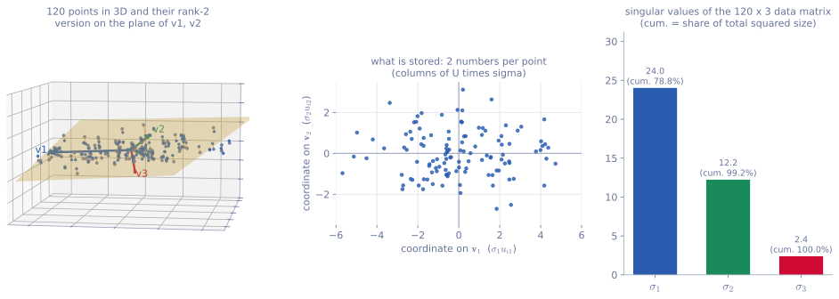
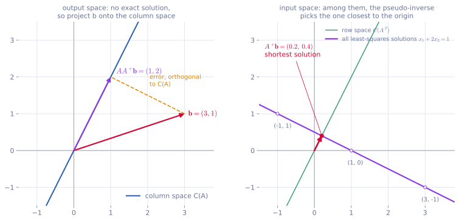

<ul class="post-sources">
<li markdown="span">[혁펜하임의 "보이는" 선형대수학](https://www.youtube.com/playlist?list=PL_iJu012NOxdZDxoGsYidMf2_bERIQaP0) 6-1–6-4강 정리</li>
</ul>

[강의 7](/blog/2026/11/05/hpla-07-eigen/)의 고윳값 분해는 정사각 행렬에서만, 그것도 독립인 고유벡터가 충분할 때만 가능했다. **특이값 분해(singular value decomposition, SVD)**는 그런 조건 없이 **모든** 행렬을 분해한다. 이번 글은 SVD가 무엇이고 왜 항상 존재하는지를 짧게 정리한 뒤, 그 쓰임새인 데이터 압축, PCA, 유사 역행렬에 집중한다. SVD를 세우는 과정의 자세한 증명은 [Linear Algebra 9](/blog/2026/10/22/la-09-svd/)에, 단위 원이 타원으로 바뀌는 단계별 그림은 [SEE Matrix 3](/blog/2026/10/23/see-matrix-03-svd/)에 있으니 함께 보면 좋다.

## 특이값 분해

[▶ 6-1강](https://www.youtube.com/watch?v=TxB96QVlgXk)

### 모양: 회전, 늘이기, 회전

$$m \times n$$ 행렬 $$A$$는 언제나

$$
A = U\Sigma V^T
$$

로 쓸 수 있다.

- $$U$$: $$m \times m$$ **직교 행렬(orthogonal matrix)**. 열 $$\mathbf{u}_1, \dots, \mathbf{u}_m$$을 **왼쪽 특이벡터(left singular vector)**라 한다.
- $$\Sigma$$: $$m \times n$$ 행렬로, 대각 위치에만 $$\sigma_1 \ge \sigma_2 \ge \cdots \ge 0$$이 있고 나머지는 0이다. $$\sigma_i$$를 **특이값(singular value)**이라 한다.
- $$V$$: $$n \times n$$ 직교 행렬. 열 $$\mathbf{v}_1, \dots, \mathbf{v}_n$$을 **오른쪽 특이벡터(right singular vector)**라 한다.

[강의 4](/blog/2026/11/05/hpla-04-inverse-rank-null/)에서 본 대로 직교 행렬은 길이를 보존하는 회전(또는 반사)이다. 그러니 $$A\mathbf{x} = U\Sigma V^T\mathbf{x}$$는 세 단계로 읽힌다. $$V^T$$로 입력 공간을 돌리고, $$\Sigma$$로 축마다 $$\sigma_i$$배 늘이고(차원이 다르면 축을 더하거나 지우고), $$U$$로 출력 공간에서 다시 돌린다. **어떤 선형 변환이든 회전, 축 방향 늘이기, 회전의 조합**이라는 것이 SVD의 그림이다.

### 핵심 식: $$A\mathbf{v}_i = \sigma_i\mathbf{u}_i$$

$$AV = U\Sigma$$의 열을 하나씩 보면

$$
A\mathbf{v}_i = \sigma_i\mathbf{u}_i
$$

이다. 고유벡터는 "$$A$$를 곱해도 방향이 그대로인 벡터"였다. 직사각 행렬에서는 입력과 출력이 다른 공간이라 그런 벡터를 기대할 수 없다. 대신 SVD는 입력 공간의 **서로 수직인** 벡터 $$\mathbf{v}_1, \mathbf{v}_2, \dots$$가 $$A$$를 거친 뒤에도 **서로 수직인** $$\sigma_1\mathbf{u}_1, \sigma_2\mathbf{u}_2, \dots$$로 가는 특별한 직교 기저를 찾는다. 보통의 직교 벡터 쌍은 $$A$$를 지나면 수직이 깨진다.

### 어떻게 찾는가: $$A^TA$$와 $$AA^T$$

$$A = U\Sigma V^T$$이면

$$
A^TA = V\Sigma^T U^T U\Sigma V^T = V(\Sigma^T\Sigma)V^T, \qquad
AA^T = U(\Sigma\Sigma^T)U^T
$$

이다. $$A^TA$$($$n \times n$$)와 $$AA^T$$($$m \times m$$)는 대칭 행렬이므로 직교 고유벡터로 분해되고, 위 식이 바로 그 분해다. 따라서

- $$V$$의 열은 $$A^TA$$의 고유벡터, $$U$$의 열은 $$AA^T$$의 고유벡터이고,
- 특이값은 $$A^TA$$(또는 $$AA^T$$)의 고윳값의 제곱근 $$\sigma_i = \sqrt{\lambda_i}$$이다.

$$\lambda_i = \mathbf{v}_i^TA^TA\mathbf{v}_i = \lVert A\mathbf{v}_i\rVert^2 \ge 0$$이므로 제곱근을 취할 수 있다. 실제 계산에서는 $$\mathbf{v}_i$$를 먼저 구하고 $$\mathbf{u}_i = A\mathbf{v}_i / \sigma_i$$($$\sigma_i > 0$$인 것)로 만든다. 그러면 $$\mathbf{u}_i$$끼리 수직인 것이 자동으로 보장된다.

$$
\mathbf{u}_i^T\mathbf{u}_j = \frac{\mathbf{v}_i^TA^TA\mathbf{v}_j}{\sigma_i\sigma_j} = \frac{\lambda_j\,\mathbf{v}_i^T\mathbf{v}_j}{\sigma_i\sigma_j} = 0 \quad (i \ne j)
$$

대칭 행렬은 항상 직교 대각화가 되므로 이 과정은 어떤 $$A$$에서도 막히지 않는다. 이것이 SVD가 언제나 존재하는 이유다.

### 랭크 1 행렬의 합

$$U\Sigma V^T$$를 [강의 3](/blog/2026/11/05/hpla-03-matrix-product/)의 "열 곱하기 행" 관점으로 펼치면

$$
A = \sigma_1\mathbf{u}_1\mathbf{v}_1^T + \sigma_2\mathbf{u}_2\mathbf{v}_2^T + \cdots + \sigma_r\mathbf{u}_r\mathbf{v}_r^T
$$

이다. $$r$$은 0이 아닌 특이값의 개수이고 $$\operatorname{rank} A$$와 같다. 각 항 $$\mathbf{u}_i\mathbf{v}_i^T$$는 랭크 1 행렬이고, $$\sigma_i$$가 그 항의 "크기"다. 특이값이 큰 순서로 정렬되어 있으므로 앞의 항일수록 $$A$$에서 차지하는 몫이 크다. 이 성질이 뒤의 데이터 압축의 출발점이다.

0인 특이값에 해당하는 부분을 버리면 **축약 SVD(reduced SVD)** $$A = U_r\Sigma_rV_r^T$$를 얻는다. $$U_r$$은 $$m \times r$$, $$\Sigma_r$$은 $$r \times r$$, $$V_r$$은 $$n \times r$$이다. 이때 $$\mathbf{u}_1, \dots, \mathbf{u}_r$$은 열 공간 $$C(A)$$의, $$\mathbf{v}_1, \dots, \mathbf{v}_r$$은 행 공간 $$C(A^T)$$의 정규 직교 기저이고, 버린 $$\mathbf{v}_{r+1}, \dots, \mathbf{v}_n$$은 영공간 $$N(A)$$의 기저다.

### 계산 예

$$
A = \begin{bmatrix} 1 & 1 \\ 0 & 1 \\ 1 & 0 \end{bmatrix}
$$

**1단계: $$A^TA$$의 고윳값 분해.** $$A^TA = \begin{bmatrix} 2 & 1 \\ 1 & 2 \end{bmatrix}$$이고 고윳값은 $$3$$, $$1$$, 고유벡터는 $$\mathbf{v}_1 = \frac{1}{\sqrt{2}}(1, 1)$$, $$\mathbf{v}_2 = \frac{1}{\sqrt{2}}(1, -1)$$이다. 특이값은 $$\sigma_1 = \sqrt{3}$$, $$\sigma_2 = 1$$이다.

**2단계: $$\mathbf{u}_i = A\mathbf{v}_i/\sigma_i$$.**

$$
\mathbf{u}_1 = \frac{1}{\sqrt{3}}\cdot\frac{1}{\sqrt{2}}(2, 1, 1) = \frac{1}{\sqrt{6}}(2, 1, 1), \qquad
\mathbf{u}_2 = \frac{1}{\sqrt{2}}(0, -1, 1)
$$

두 벡터의 내적은 $$0 - 1 + 1 = 0$$으로 수직이다.

**3단계: $$U$$ 채우기.** $$U$$는 $$3 \times 3$$이어야 하므로 $$\mathbf{u}_1, \mathbf{u}_2$$에 모두 수직인 단위 벡터 $$\mathbf{u}_3 = \frac{1}{\sqrt{3}}(1, -1, -1)$$을 더한다. 이것은 $$AA^T$$의 고윳값 0에 대한 고유벡터, 즉 왼쪽 영공간의 기저다. $$AA^T = \begin{bmatrix} 2 & 1 & 1 \\ 1 & 1 & 0 \\ 1 & 0 & 1 \end{bmatrix}$$의 고윳값은 $$3, 1, 0$$으로, $$A^TA$$의 고윳값에 0이 하나 붙은 것이다.

**결과.**

$$
A = \underbrace{\begin{bmatrix} \frac{2}{\sqrt{6}} & 0 & \frac{1}{\sqrt{3}} \\ \frac{1}{\sqrt{6}} & -\frac{1}{\sqrt{2}} & -\frac{1}{\sqrt{3}} \\ \frac{1}{\sqrt{6}} & \frac{1}{\sqrt{2}} & -\frac{1}{\sqrt{3}} \end{bmatrix}}_{U}
\underbrace{\begin{bmatrix} \sqrt{3} & 0 \\ 0 & 1 \\ 0 & 0 \end{bmatrix}}_{\Sigma}
\underbrace{\frac{1}{\sqrt{2}}\begin{bmatrix} 1 & 1 \\ 1 & -1 \end{bmatrix}}_{V^T}
$$

첫 번째 랭크 1 항만 남기면 $$\sqrt{3}\,\mathbf{u}_1\mathbf{v}_1^T = \begin{bmatrix} 1 & 1 \\ 0.5 & 0.5 \\ 0.5 & 0.5 \end{bmatrix}$$로, $$A$$를 랭크 1로 근사한 것이다.

### 흔한 실수

- **$$A$$의 고윳값과 특이값을 혼동한다.** 특이값은 $$A^TA$$의 고윳값의 제곱근이다. 대칭이고 양의 준정부호인 행렬일 때만 둘이 같다.
- **$$U$$와 $$V$$를 따로 구해 붙인다.** 고유벡터는 부호(그리고 중복 고윳값이면 기저 선택)가 자유롭기 때문에, $$A^TA$$와 $$AA^T$$를 각각 분해해서 붙이면 $$A\mathbf{v}_i = \sigma_i\mathbf{u}_i$$가 어긋날 수 있다. 한쪽을 구한 뒤 $$\mathbf{u}_i = A\mathbf{v}_i/\sigma_i$$로 짝을 맞춘다.
- **$$\Sigma$$를 정사각으로 쓴다.** 완전한 SVD에서 $$\Sigma$$는 $$A$$와 같은 $$m \times n$$이다.

## SVD 연습 문제

[▶ 6-2강](https://www.youtube.com/watch?v=lVHF1eOmOQQ)

아래 문제는 SVD의 계산과 성질을 확인하도록 직접 구성한 것이다.

### 문제 1: $$2 \times 2$$ 행렬의 SVD와 타원

$$A = \begin{bmatrix} 3 & 0 \\ 4 & 5 \end{bmatrix}$$의 SVD를 구하고, 단위 원이 $$A$$에 의해 어떤 타원으로 가는지 설명하라.

**풀이.** $$A^TA = \begin{bmatrix} 25 & 20 \\ 20 & 25 \end{bmatrix}$$의 고윳값은 $$25 \pm 20$$, 즉 $$45$$와 $$5$$이고 고유벡터는 $$\mathbf{v}_1 = \frac{1}{\sqrt{2}}(1, 1)$$, $$\mathbf{v}_2 = \frac{1}{\sqrt{2}}(1, -1)$$이다. 특이값은 $$\sigma_1 = \sqrt{45} = 3\sqrt{5} \approx 6.71$$, $$\sigma_2 = \sqrt{5} \approx 2.24$$이다.

$$
\mathbf{u}_1 = \frac{A\mathbf{v}_1}{\sigma_1} = \frac{(3, 9)/\sqrt{2}}{3\sqrt{5}} = \frac{1}{\sqrt{10}}(1, 3), \qquad
\mathbf{u}_2 = \frac{A\mathbf{v}_2}{\sigma_2} = \frac{(3, -1)/\sqrt{2}}{\sqrt{5}} = \frac{1}{\sqrt{10}}(3, -1)
$$

$$\mathbf{u}_1^T\mathbf{u}_2 = \frac{3 - 3}{10} = 0$$으로 수직이다. 단위 원 위의 $$\mathbf{v}_1$$은 길이 $$6.71$$인 $$\sigma_1\mathbf{u}_1$$로, $$\mathbf{v}_2$$는 길이 $$2.24$$인 $$\sigma_2\mathbf{u}_2$$로 간다. 그래서 상은 장축 방향이 $$(1, 3)$$, 반장축 $$3\sqrt{5}$$, 반단축 $$\sqrt{5}$$인 타원이다. 넓이 배율은 $$\sigma_1\sigma_2 = 15 = \lvert\det A\rvert$$로 맞는다.

**배우는 점.** $$\sigma_1$$은 단위 벡터를 $$A$$로 보냈을 때 가장 긴 길이, $$\sigma_2$$는 가장 짧은 길이다. 특이값의 곱은 $$\lvert\det A\rvert$$이다.

### 문제 2: 랭크 1 행렬은 눈으로 분해한다

$$B = \begin{bmatrix} 1 & 2 \\ 2 & 4 \\ 3 & 6 \end{bmatrix}$$의 축약 SVD를 구하라.

**풀이.** 모든 열이 $$(1, 2, 3)$$의 배수이므로 $$B = (1, 2, 3)(1, 2)^T$$, 즉 열 하나와 행 하나의 곱이다. 각 벡터를 단위 벡터로 만들면

$$
B = \sqrt{14}\sqrt{5}\;\mathbf{u}_1\mathbf{v}_1^T, \qquad \mathbf{u}_1 = \frac{1}{\sqrt{14}}(1, 2, 3), \quad \mathbf{v}_1 = \frac{1}{\sqrt{5}}(1, 2)
$$

이므로 $$\sigma_1 = \sqrt{70} \approx 8.37$$이고 나머지 특이값은 0이다. 영공간은 $$\mathbf{v}_1$$과 수직인 $$\frac{1}{\sqrt{5}}(2, -1)$$ 방향이다.

**배우는 점.** 랭크 1 행렬 $$\mathbf{a}\mathbf{b}^T$$의 유일한 특이값은 $$\lVert\mathbf{a}\rVert\lVert\mathbf{b}\rVert$$이다. 굳이 $$B^TB$$의 고윳값을 구하지 않아도 된다.

### 문제 3: 고윳값이 음수인 대칭 행렬

$$S = \begin{bmatrix} 1 & 2 \\ 2 & 1 \end{bmatrix}$$의 고윳값과 특이값을 비교하라.

**풀이.** 고윳값은 $$3$$(고유벡터 $$\frac{1}{\sqrt{2}}(1, 1)$$)과 $$-1$$(고유벡터 $$\frac{1}{\sqrt{2}}(1, -1)$$)이다. 특이값은 음수일 수 없으므로 $$\sigma_1 = 3$$, $$\sigma_2 = \lvert -1\rvert = 1$$이다. 부호는 특이벡터가 가져간다. $$\mathbf{v}_2 = \frac{1}{\sqrt{2}}(1, -1)$$로 두면 $$\mathbf{u}_2 = S\mathbf{v}_2/1 = \frac{1}{\sqrt{2}}(-1, 1) = -\mathbf{v}_2$$이다. 대칭 행렬의 특이값은 고윳값의 절댓값이고, 음의 고윳값이 있으면 $$U \ne V$$가 된다.

**배우는 점.** "대칭이면 SVD = 고윳값 분해"는 고윳값이 모두 0 이상일 때만 맞다. 또한 직교 행렬 $$Q$$는 $$Q^TQ = I$$이므로 특이값이 모두 1이다. 길이를 늘이지도 줄이지도 않는다는 뜻이다.

## 데이터 압축과 PCA

[▶ 6-3강](https://www.youtube.com/watch?v=u451a5F31og)

### 랭크 $$k$$ 근사로 압축하기

$$m \times n$$ 행렬을 그대로 저장하면 숫자 $$mn$$개가 필요하다. 랭크 1 항의 합에서 앞의 $$k$$개만 남긴

$$
A_k = \sigma_1\mathbf{u}_1\mathbf{v}_1^T + \cdots + \sigma_k\mathbf{u}_k\mathbf{v}_k^T
$$

는 $$\mathbf{u}_i$$($$m$$개), $$\mathbf{v}_i$$($$n$$개), $$\sigma_i$$(1개)를 $$k$$번, 즉 $$k(m + n + 1)$$개의 숫자로 저장된다. $$1000 \times 1000$$ 사진(100만 개)을 $$k = 50$$으로 줄이면 $$50 \times 2001 = 100050$$개로 약 10%다. 사진처럼 이웃한 행과 열이 비슷한 데이터는 특이값이 빠르게 작아지므로 적은 $$k$$로도 원본과 거의 구별되지 않는다. 사진에 적용한 예는 [Linear Algebra 9](/blog/2026/10/22/la-09-svd/)의 마지막 그림에 있다.

이 근사는 그럴듯한 정도가 아니라 **최선**이다. 이것이 **에카르트-영 정리(Eckart-Young theorem)**다. 랭크가 $$k$$ 이하인 모든 행렬 $$B$$ 중에서 $$\lVert A - B\rVert_F$$(성분 제곱합의 제곱근, **프로베니우스 노름(Frobenius norm)**)를 가장 작게 만드는 것이 $$A_k$$이고, 그 오차는

$$
\lVert A - A_k\rVert_F = \sqrt{\sigma_{k+1}^2 + \cdots + \sigma_r^2}
$$

이다. 직교 행렬은 길이를 바꾸지 않으므로 $$\lVert A\rVert_F^2 = \sigma_1^2 + \cdots + \sigma_r^2$$이고, 버린 특이값의 제곱만큼 잃는다. [강의 8](/blog/2026/11/05/hpla-08-pca/)의 PCA에서 평균 제곱 오차가 버린 고윳값의 합이었던 것과 같은 모양이다. 이것은 우연이 아니다.

### SVD로 하는 PCA

$$n$$개의 데이터 $$\mathbf{d}_i \in \mathbb{R}^p$$(평균을 뺀 것)를 **행**으로 쌓은 $$n \times p$$ 데이터 행렬을 $$X$$라 하자. 그러면

$$
\frac{1}{n}X^TX = \frac{1}{n}\sum_{i=1}^{n}\mathbf{d}_i\mathbf{d}_i^T = R_d
$$

로, 강의 8의 공분산 행렬이 된다. $$X = U\Sigma V^T$$이면 $$R_d = V\,\frac{\Sigma^T\Sigma}{n}\,V^T$$이므로

- **$$X$$의 오른쪽 특이벡터 $$\mathbf{v}_j$$가 주성분 방향**이고,
- 그 방향의 분산은 $$\lambda_j = \sigma_j^2/n$$이며,
- 데이터 $$i$$의 $$j$$번째 주성분 좌표는 $$\mathbf{d}_i^T\mathbf{v}_j = (X\mathbf{v}_j)_i = \sigma_j u_{ij}$$, 즉 $$U\Sigma$$의 성분이다.

공분산 행렬을 만들지 않고 데이터 행렬에 바로 SVD를 하면 PCA가 끝난다. 실제 라이브러리도 대부분 이렇게 계산한다. $$X^TX$$를 만들면 숫자의 크기 차이가 제곱으로 벌어져 수치 오차가 커지기 때문이다. 또 랭크 $$k$$ 근사 $$X_k = U_k\Sigma_kV_k^T$$의 각 행은 데이터 $$\mathbf{d}_i$$를 주성분 $$k$$개가 span하는 부분 공간에 정사영한 것이다. 즉 **데이터 행렬의 랭크 $$k$$ 근사가 곧 $$k$$차원 PCA 복원**이다.

*평균을 뺀 3차원 점 120개($$120 \times 3$$ 행렬 $$X$$). 왼쪽: 원래 점(회색)과 랭크 2 근사 $$X_2$$의 점(파랑), 그리고 $$\mathbf{v}_1, \mathbf{v}_2$$가 만드는 노란 평면. 가운데: 실제로 저장하는 좌표 $$(\sigma_1u_{i1}, \sigma_2u_{i2})$$. 오른쪽: 특이값과 누적 비율.*

특이값은 24.0, 12.2, 2.4이고, $$\sigma_1^2 + \sigma_2^2$$이 전체 $$\lVert X\rVert_F^2$$의 99.2%를 차지한다. 그래서 점들은 사실상 $$\mathbf{v}_1, \mathbf{v}_2$$의 평면 위에 놓여 있고, 세 번째 방향으로는 얇은 두께뿐이다. 랭크 2로 줄이면 숫자 360개 대신 좌표 240개, $$\mathbf{v}_1, \mathbf{v}_2$$의 성분 6개, 특이값 2개로 248개를 저장하고, 상대 오차는 $$\lVert X - X_2\rVert_F / \lVert X\rVert_F = \sigma_3/\sqrt{\sigma_1^2 + \sigma_2^2 + \sigma_3^2} \approx 8.8\%$$이다. 3차원에서 2차원으로는 절약이 크지 않지만, 차원이 높을수록 절약은 훨씬 커진다.

### 흔한 실수

- **데이터를 행으로 쌓았는지 열로 쌓았는지 헷갈린다.** 데이터를 열로 쌓은 $$p \times n$$ 행렬이면 주성분은 왼쪽 특이벡터 $$\mathbf{u}_j$$다.
- **PCA 전에 평균을 빼지 않는다.** 평균을 빼지 않은 행렬의 SVD는 원점을 지나는 최적 부분 공간을 찾을 뿐, 데이터 중심을 지나는 축을 찾지 못한다.
- **특이값을 분산으로 읽는다.** 분산은 $$\sigma_j^2/n$$이다. 설명된 분산의 비율도 $$\sigma_j$$가 아니라 $$\sigma_j^2$$의 비율이다.

## 유사 역행렬

[▶ 6-4강](https://www.youtube.com/watch?v=14oiGnaMoNo)

### 왜 필요한가

$$A\mathbf{x} = \mathbf{b}$$에서 $$A$$가 가역이면 $$\mathbf{x} = A^{-1}\mathbf{b}$$로 끝난다. 그러나 [강의 4](/blog/2026/11/05/hpla-04-inverse-rank-null/)에서 본 것처럼 해가 없거나(우변이 열 공간 밖) 무수히 많은(영공간이 있는) 경우가 많다. 그때도 "가장 그럴듯한 해 하나"를 돌려주는 행렬이 있으면 좋겠다. 기준은 두 가지다.

1. 해가 없으면 오차 $$\lVert A\mathbf{x} - \mathbf{b}\rVert$$가 가장 작은 $$\mathbf{x}$$(최소자승 해)를 고른다.
2. 그런 $$\mathbf{x}$$가 여럿이면 그중 길이 $$\lVert\mathbf{x}\rVert$$가 가장 짧은 것을 고른다.

이 두 기준을 한 번에 만족하는 해를 주는 행렬이 **유사 역행렬(pseudo-inverse, Moore-Penrose inverse)** $$A^{+}$$이다.

### SVD로 만들기

$$A = U\Sigma V^T$$에서 직교 행렬의 역행렬은 전치이므로, 거꾸로 가는 길은 $$U^T$$로 돌리고, $$\Sigma$$를 되돌리고, $$V$$로 돌리는 것이다. $$\Sigma$$는 0인 특이값 때문에 되돌릴 수 없을 수 있으니, **0이 아닌 특이값만 역수를 취하고 0은 0으로 둔다.**

$$
A^{+} = V\Sigma^{+}U^T, \qquad
\Sigma^{+} = \begin{bmatrix} 1/\sigma_1 & & & \\ & \ddots & & \\ & & 1/\sigma_r & \\ & & & 0 \end{bmatrix} \quad (n \times m)
$$

랭크 1 항의 합으로 쓰면

$$
A^{+} = \frac{1}{\sigma_1}\mathbf{v}_1\mathbf{u}_1^T + \cdots + \frac{1}{\sigma_r}\mathbf{v}_r\mathbf{u}_r^T
$$

이다. $$A$$가 $$\mathbf{v}_i$$를 $$\sigma_i\mathbf{u}_i$$로 보냈으니 $$A^{+}$$는 $$\mathbf{u}_i$$를 $$\mathbf{v}_i/\sigma_i$$로 되돌려 보낸다. 되돌릴 수 없는 방향(왼쪽 영공간의 $$\mathbf{u}_{r+1}, \dots$$)은 0으로 보낸다.

### 왜 두 기준을 만족하는가

$$\mathbf{x}^{+} = A^{+}\mathbf{b}$$라 하자.

- $$AA^{+} = U\Sigma\Sigma^{+}U^T = \mathbf{u}_1\mathbf{u}_1^T + \cdots + \mathbf{u}_r\mathbf{u}_r^T$$은 열 공간 $$C(A)$$로의 **정사영 행렬**이다. 그래서 $$A\mathbf{x}^{+}$$는 $$\mathbf{b}$$를 열 공간에 정사영한 점, 즉 $$\mathbf{b}$$에 가장 가까운 $$A\mathbf{x}$$다. 기준 1이 성립한다.
- $$\mathbf{x}^{+}$$는 $$\mathbf{v}_1, \dots, \mathbf{v}_r$$의 선형 결합이므로 행 공간에 있고, 영공간과 수직이다. 최소자승 해는 모두 $$\mathbf{x}^{+} + \mathbf{n}$$($$\mathbf{n} \in N(A)$$) 꼴이고, 피타고라스 정리로 $$\lVert\mathbf{x}^{+} + \mathbf{n}\rVert^2 = \lVert\mathbf{x}^{+}\rVert^2 + \lVert\mathbf{n}\rVert^2 \ge \lVert\mathbf{x}^{+}\rVert^2$$이다. 기준 2가 성립한다.

특별한 경우에는 익숙한 공식이 된다.

- 열이 독립(**열 풀 랭크(full column rank)**, 세로로 긴 행렬): $$A^{+} = (A^TA)^{-1}A^T$$. [강의 5](/blog/2026/11/05/hpla-05-elimination-determinant/)의 최소자승 해 그 자체다.
- 행이 독립(**행 풀 랭크(full row rank)**, 가로로 긴 행렬): $$A^{+} = A^T(AA^T)^{-1}$$. 해가 무수히 많을 때 길이가 가장 짧은 해를 준다.
- $$A$$가 가역이면 $$A^{+} = A^{-1}$$이다.

### 계산 예 1: 해가 없을 때

앞 절의 $$A = \begin{bmatrix} 1 & 1 \\ 0 & 1 \\ 1 & 0 \end{bmatrix}$$와 $$\mathbf{b} = (1, 2, 3)$$을 쓴다. 열이 독립이므로

$$
A^{+} = (A^TA)^{-1}A^T = \frac{1}{3}\begin{bmatrix} 2 & -1 \\ -1 & 2 \end{bmatrix}\begin{bmatrix} 1 & 0 & 1 \\ 1 & 1 & 0 \end{bmatrix}
= \frac{1}{3}\begin{bmatrix} 1 & -1 & 2 \\ 1 & 2 & -1 \end{bmatrix}
$$

이다. SVD 식 $$\frac{1}{\sqrt{3}}\mathbf{v}_1\mathbf{u}_1^T + \mathbf{v}_2\mathbf{u}_2^T$$로 계산해도 같은 행렬이 나온다. $$\mathbf{x}^{+} = A^{+}\mathbf{b} = \frac{1}{3}(1 - 2 + 6,\ 1 + 4 - 3) = (\tfrac{5}{3}, \tfrac{2}{3})$$이고, $$A\mathbf{x}^{+} = (\tfrac{7}{3}, \tfrac{2}{3}, \tfrac{5}{3})$$이 $$\mathbf{b}$$를 열 공간에 정사영한 점이다.

### 계산 예 2: 해가 없고, 최소자승 해도 무수히 많을 때

$$
A = \begin{bmatrix} 1 & 2 \\ 2 & 4 \end{bmatrix}, \qquad \mathbf{b} = (3, 1)
$$

$$A$$는 랭크 1이라 역행렬도, $$(A^TA)^{-1}$$도 없다. 두 열이 모두 $$(1, 2)$$ 방향이므로 SVD는 랭크 1 항 하나뿐이다. $$A = 5\,\mathbf{u}_1\mathbf{v}_1^T$$, $$\mathbf{u}_1 = \mathbf{v}_1 = \frac{1}{\sqrt{5}}(1, 2)$$이다(실제로 $$5 \cdot \frac{1}{5}\begin{bmatrix} 1 & 2 \\ 2 & 4 \end{bmatrix} = A$$). 따라서

$$
A^{+} = \frac{1}{5}\mathbf{v}_1\mathbf{u}_1^T = \frac{1}{25}\begin{bmatrix} 1 & 2 \\ 2 & 4 \end{bmatrix}, \qquad
\mathbf{x}^{+} = A^{+}\mathbf{b} = \frac{1}{25}(5, 10) = (0.2, 0.4)
$$

이다. 확인해 보자. $$A\mathbf{x}^{+} = (1, 2)$$는 $$\mathbf{b} = (3, 1)$$을 직선 $$\operatorname{Span}\{(1, 2)\}$$에 정사영한 점이다($$\frac{3 + 2}{5}(1, 2)$$). $$A\mathbf{x} = (x_1 + 2x_2)(1, 2)$$이므로 같은 점에 도달하는 최소자승 해는 직선 $$x_1 + 2x_2 = 1$$ 위의 모든 점, 예를 들어 $$(1, 0)$$, $$(-1, 1)$$, $$(3, -1)$$이다. 그중 원점에서 가장 가까운 점은 직선의 법선 방향 $$(1, 2)$$ 위에 있는 $$\frac{1}{5}(1, 2) = (0.2, 0.4)$$로, $$\mathbf{x}^{+}$$와 같다.

*왼쪽(출력 공간): $$\mathbf{b} = (3, 1)$$은 열 공간 밖에 있으므로 $$AA^{+}\mathbf{b} = (1, 2)$$로 정사영된다. 오른쪽(입력 공간): 그 점에 도달하는 해는 보라 직선 전체이고, $$A^{+}\mathbf{b} = (0.2, 0.4)$$는 그중 행 공간(초록) 위에 있는 가장 짧은 해다.*

### 흔한 실수

- **작은 특이값을 그대로 뒤집는다.** 이론상 0이 아니어도 $$10^{-12}$$ 같은 특이값의 역수는 잡음을 엄청나게 키운다. 수치 계산에서는 기준값보다 작은 특이값을 0으로 취급한다(`numpy.linalg.pinv`의 `rcond`가 이 기준이다).
- **$$(A^TA)^{-1}A^T$$를 아무 때나 쓴다.** 이 공식은 열이 독립일 때만 성립한다. 예 2처럼 랭크가 부족하면 $$A^TA$$가 가역이 아니다.
- **$$A^{+}A = I$$라고 생각한다.** $$A^{+}A = V\Sigma^{+}\Sigma V^T$$는 행 공간으로의 정사영이고, 열이 독립일 때만 $$I$$이다. 마찬가지로 $$AA^{+}$$는 행이 독립일 때만 $$I$$이다.

## 정리

| 개념 | 식 | 의미 |
| --- | --- | --- |
| SVD | $$A = U\Sigma V^T$$ | 회전, 축 방향 늘이기, 회전 |
| 핵심 관계 | $$A\mathbf{v}_i = \sigma_i\mathbf{u}_i$$ | 수직인 입력이 수직인 출력으로 |
| 계산 | $$A^TA = V\Sigma^T\Sigma V^T$$ | $$\sigma_i = \sqrt{\lambda_i(A^TA)}$$, $$\mathbf{u}_i = A\mathbf{v}_i/\sigma_i$$ |
| 랭크 $$k$$ 근사 | $$A_k = \sum_{i \le k}\sigma_i\mathbf{u}_i\mathbf{v}_i^T$$ | 저장량 $$k(m + n + 1)$$, 오차 $$\sqrt{\sum_{i > k}\sigma_i^2}$$ |
| PCA | 평균 뺀 $$X$$의 SVD | 주성분 $$\mathbf{v}_j$$, 분산 $$\sigma_j^2/n$$, 좌표 $$U\Sigma$$ |
| 유사 역행렬 | $$A^{+} = V\Sigma^{+}U^T$$ | 최소자승 해 중 가장 짧은 해 |
