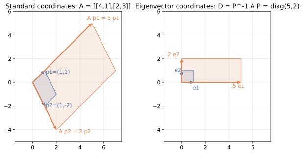

<ul class="post-sources">
<li markdown="span">[혁펜하임의 "보이는" 선형대수학](https://www.youtube.com/playlist?list=PL_iJu012NOxdZDxoGsYidMf2_bERIQaP0) 7–8강 정리</li>
</ul>

## LU 분해, PLU 분해, LDU 분해

[▶ 7강](https://www.youtube.com/watch?v=z66pF_yiGVQ)

### 왜 분해를 하나

[보이는 선형대수학 5](/blog/2026/11/05/hpla-05-elimination-determinant/)에서 본 가우스 소거(Gaussian elimination)는 $$A\mathbf{x} = \mathbf{b}$$를 풀 때마다 처음부터 다시 한다. 그런데 공학에서는 행렬 $$A$$는 그대로이고 우변 $$\mathbf{b}$$만 바뀌는 경우가 아주 많다. 같은 회로에 입력 전압만 바꾸어 넣거나, 같은 구조물에 하중만 바꾸어 거는 경우다.

이럴 때 소거 과정을 **한 번만** 하고 그 결과를 저장해 두면 좋다. 그 저장 방법이 **LU 분해(LU decomposition)**이다.

$$
A = LU
$$

여기서 $$L$$은 **하삼각 행렬(lower triangular matrix)**, $$U$$는 **상삼각 행렬(upper triangular matrix)**이다. $$U$$는 소거가 끝난 결과이고, $$L$$은 소거하는 동안 사용한 배수들의 기록이다.

### 소거는 행렬 곱셈이다

"2행에서 1행의 2배를 뺀다" 같은 행 연산은 왼쪽에 **기본 행렬(elementary matrix)**을 곱하는 것과 같다. 단위 행렬에서 같은 행 연산을 한 행렬이 그 기본 행렬이다. 예를 들어 $$3 \times 3$$에서 "2행 $$-$$ 2 $$\times$$ 1행"은

$$
E_{21} = \begin{bmatrix} 1 & 0 & 0 \\ -2 & 1 & 0 \\ 0 & 0 & 1 \end{bmatrix}
$$

이다. $$E_{21}A$$를 행 관점으로 계산하면 2행만 "$$-2 \times (1\text{행}) + 1 \times (2\text{행})$$"이 되고 나머지 행은 그대로다.

다음 행렬로 해 보자.

$$
A = \begin{bmatrix} 2 & 1 & 1 \\ 4 & -6 & 0 \\ -2 & 7 & 2 \end{bmatrix}
$$

1. 2행 $$-$$ 2 $$\times$$ 1행 ($$E_{21}$$, 배수 $$\ell_{21} = 2$$): 2행이 $$(0, -8, -2)$$가 된다.
2. 3행 $$-$$ $$(-1)$$ $$\times$$ 1행 ($$E_{31}$$, 배수 $$\ell_{31} = -1$$): 3행이 $$(0, 8, 3)$$이 된다.
3. 3행 $$-$$ $$(-1)$$ $$\times$$ 2행 ($$E_{32}$$, 배수 $$\ell_{32} = -1$$): 3행이 $$(0, 0, 1)$$이 된다.

결과는

$$
E_{32}E_{31}E_{21}A = U = \begin{bmatrix} 2 & 1 & 1 \\ 0 & -8 & -2 \\ 0 & 0 & 1 \end{bmatrix}
$$

이다. 배수 $$\ell_{ij}$$는 "$$i$$행에서 $$j$$행의 몇 배를 뺐는가"이고, 그 값은 (현재 $$i$$행의 $$j$$열 성분) $$/$$ (피벗)이다.

### $$L$$은 배수를 그대로 받아 적은 행렬이다

양변 왼쪽에 기본 행렬의 역행렬을 차례로 곱하면

$$
A = E_{21}^{-1}E_{31}^{-1}E_{32}^{-1}\,U = LU
$$

이다. 기본 행렬의 역행렬은 쉽다. "1행의 2배를 뺀다"를 되돌리려면 "1행의 2배를 더한다"를 하면 된다. 그래서 $$E_{21}^{-1}$$은 $$-2$$ 자리에 $$+2$$가 들어간 행렬이다.

더 좋은 일은 이 역행렬들을 **이 순서로** 곱하면 배수들이 서로 섞이지 않고 제자리에 그대로 들어간다는 것이다.

$$
L = \begin{bmatrix} 1 & 0 & 0 \\ \ell_{21} & 1 & 0 \\ \ell_{31} & \ell_{32} & 1 \end{bmatrix}
= \begin{bmatrix} 1 & 0 & 0 \\ 2 & 1 & 0 \\ -1 & -1 & 1 \end{bmatrix}
$$

반대로 $$E = E_{32}E_{31}E_{21}$$ 자체를 계산하면

$$
E = \begin{bmatrix} 1 & 0 & 0 \\ -2 & 1 & 0 \\ -1 & 1 & 1 \end{bmatrix}
$$

이다. $$(3, 1)$$ 성분이 $$-\ell_{31} = 1$$이 아니라 $$-\ell_{31} + \ell_{21}\ell_{32} = 1 + 2 \cdot (-1) = -1$$로, 배수들이 섞여 있다. $$E$$는 지저분하고 $$L = E^{-1}$$은 깔끔하다. 그래서 $$E$$가 아니라 $$L$$을 저장한다. 직접 곱해 보면 $$LU = A$$이다.

정리하면 LU 분해는 새로운 계산이 아니다. **가우스 소거를 하면서 배수를 버리지 않고 적어 둔 것**이다. $$U$$의 대각 성분은 피벗(pivot)이고, $$L$$의 대각 성분은 모두 1이다.

### 분해를 써서 푸는 법

$$A\mathbf{x} = \mathbf{b}$$는 $$L(U\mathbf{x}) = \mathbf{b}$$이다. $$\mathbf{c} = U\mathbf{x}$$로 두고 두 번에 나누어 푼다.

1. **전진 대입(forward substitution)**: $$L\mathbf{c} = \mathbf{b}$$를 위에서부터 푼다.
2. **후진 대입(back substitution)**: $$U\mathbf{x} = \mathbf{c}$$를 아래에서부터 푼다.

삼각 행렬 시스템은 한 줄에 미지수가 하나씩 새로 나오므로 차례로 대입만 하면 된다. $$\mathbf{b} = (5, -2, 9)$$로 해 보자.

$$
\begin{aligned}
c_1 &= 5, \\
2c_1 + c_2 &= -2 \;\Rightarrow\; c_2 = -12, \\
-c_1 - c_2 + c_3 &= 9 \;\Rightarrow\; c_3 = 9 + 5 - 12 = 2.
\end{aligned}
$$

$$
\begin{aligned}
x_3 &= 2 / 1 = 2, \\
-8x_2 - 2x_3 &= -12 \;\Rightarrow\; x_2 = 1, \\
2x_1 + x_2 + x_3 &= 5 \;\Rightarrow\; x_1 = 1.
\end{aligned}
$$

$$\mathbf{x} = (1, 1, 2)$$이고, $$A\mathbf{x} = (2 + 1 + 2,\; 4 - 6 + 0,\; -2 + 7 + 4) = (5, -2, 9)$$로 맞다.

### 응용 예: 우변만 바꾸어 여러 번 풀기

분해의 진가는 우변이 여러 개일 때 드러난다. 같은 $$A$$에 대해 이번에는 $$\mathbf{b}' = (2, 4, -2)$$가 들어왔다고 하자. 소거를 다시 할 필요 없이 저장해 둔 $$L$$, $$U$$로 대입만 한다.

$$
L\mathbf{c} = \mathbf{b}' \;\Rightarrow\; \mathbf{c} = (2,\; 4 - 4,\; -2 + 2 + 0) = (2, 0, 0), \qquad
U\mathbf{x} = \mathbf{c} \;\Rightarrow\; \mathbf{x} = (1, 0, 0)
$$

$$\mathbf{b}'$$이 마침 $$A$$의 1열이므로 $$\mathbf{x} = (1, 0, 0)$$은 당연한 답이다.

같은 생각으로 **역행렬**도 구할 수 있다. $$AX = I$$는 우변이 $$\mathbf{e}_1, \mathbf{e}_2, \mathbf{e}_3$$인 연립방정식 세 개다. 전진 대입 결과 $$\mathbf{c}$$는 차례로 $$(1, -2, -1)$$, $$(0, 1, 1)$$, $$(0, 0, 1)$$로, 앞에서 계산한 $$E = L^{-1}$$의 열과 같다($$L\mathbf{c} = \mathbf{e}_i$$의 해가 $$L^{-1}$$의 $$i$$번째 열이니 당연하다). 각각 후진 대입하면

$$
A^{-1} = \frac{1}{16}\begin{bmatrix} 12 & -5 & -6 \\ 8 & -6 & -4 \\ -16 & 16 & 16 \end{bmatrix}
$$

이다. 행렬식도 덤으로 나온다. $$L$$의 대각이 모두 1이므로 $$\det A = \det U = 2 \cdot (-8) \cdot 1 = -16$$이다. 분해 한 번으로 해, 역행렬, 행렬식이 모두 대입 몇 번으로 해결된다.

공학 문제에서 이런 상황은 흔하다. 회로의 저항 값($$A$$)은 고정이고 전원($$\mathbf{b}$$)만 바꾸어 가며 전류를 구하는 경우, 구조물의 강성 행렬($$A$$)은 고정이고 하중 조건($$\mathbf{b}$$)을 수십 가지로 바꾸어 변위를 구하는 경우, 시간 단계마다 같은 행렬로 열 방정식을 푸는 시뮬레이션이 모두 "한 번 분해, 여러 번 대입"이다.

계산량으로 보면 $$n \times n$$ 행렬의 소거(분해)는 약 $$\frac{2}{3}n^3$$번의 곱셈·덧셈이 들고, 삼각 시스템 두 개를 푸는 데는 약 $$2n^2$$번이 든다. $$n = 1000$$이면 분해는 약 $$6.7 \times 10^8$$, 대입은 $$2 \times 10^6$$이다. 우변이 바뀔 때마다 대입만 다시 하면 되므로 큰 이득이다. 역행렬 $$A^{-1}$$을 구해 두는 것보다도 빠르고 수치적으로 안정하다.

### PLU 분해: 피벗 자리에 0이 오면

소거 도중 피벗 자리에 0이 오면 그 행으로 아래를 지울 수 없다. 이때는 아래의 행과 **행 교환(row exchange)**을 한다. 예를 들어

$$
A = \begin{bmatrix} 1 & 2 & 1 \\ 2 & 4 & 3 \\ 1 & 3 & 2 \end{bmatrix}
$$

에서 1열을 지우면 2행이 $$(0, 0, 1)$$, 3행이 $$(0, 1, 1)$$이 되어 2번째 피벗 자리가 0이다. 2행과 3행을 바꾸면 소거를 계속할 수 있다.

행 교환은 **치환 행렬(permutation matrix)** $$P$$로 쓴다. 단위 행렬의 행 순서를 바꾼 행렬이다. 교환을 미리 해 두었다고 생각하면

$$
PA = LU, \qquad
P = \begin{bmatrix} 1 & 0 & 0 \\ 0 & 0 & 1 \\ 0 & 1 & 0 \end{bmatrix}, \quad
L = \begin{bmatrix} 1 & 0 & 0 \\ 1 & 1 & 0 \\ 2 & 0 & 1 \end{bmatrix}, \quad
U = \begin{bmatrix} 1 & 2 & 1 \\ 0 & 1 & 1 \\ 0 & 0 & 1 \end{bmatrix}
$$

이다. 치환 행렬은 직교 행렬이라 $$P^{-1} = P^T$$이므로 $$A = P^TLU$$로도 쓴다. 이것이 **PLU 분해**다. (교재와 라이브러리에 따라 $$A = PLU$$로 쓰고 $$P$$를 그 전치로 정의하기도 한다.) 가역 행렬은 행 교환만 허용하면 항상 PLU 분해를 갖는다.

실제 프로그램은 피벗이 정확히 0일 때만이 아니라, 그 열에서 **절댓값이 가장 큰 성분**이 피벗이 되도록 매번 행을 교환한다. 이것을 **부분 피벗팅(partial pivoting)**이라 한다. 아주 작은 피벗으로 나누면 반올림 오차가 크게 불어나기 때문이다. `scipy.linalg.lu`가 돌려주는 분해가 이것이다.

### LDU 분해: 대각을 따로 빼기

$$L$$은 대각이 모두 1인데 $$U$$는 대각에 피벗이 있어 모양이 비대칭이다. $$U$$의 각 행을 그 피벗으로 나누어 대각을 1로 만들고, 피벗을 **대각 행렬(diagonal matrix)** $$D$$로 빼낸다.

$$
U = \begin{bmatrix} 2 & 1 & 1 \\ 0 & -8 & -2 \\ 0 & 0 & 1 \end{bmatrix}
= \underbrace{\begin{bmatrix} 2 & 0 & 0 \\ 0 & -8 & 0 \\ 0 & 0 & 1 \end{bmatrix}}_{D}
\underbrace{\begin{bmatrix} 1 & 1/2 & 1/2 \\ 0 & 1 & 1/4 \\ 0 & 0 & 1 \end{bmatrix}}_{U'}
$$

그러면 $$A = LDU'$$이다. 이것이 **LDU 분해**다. 이제 $$L$$과 $$U'$$ 둘 다 대각이 1이고, 피벗은 모두 $$D$$에 있다. 이 형태에서는 분해가 **유일**하다. 또 $$\det A = \det D = 2 \cdot (-8) \cdot 1 = -16$$처럼 행렬식도 피벗의 곱으로 바로 나온다.

$$A$$가 대칭이면 $$U' = L^T$$가 되어 $$A = LDL^T$$이다. 여기서 피벗이 모두 양수이면 $$D$$의 제곱근을 양쪽에 나누어 줄 수 있고, 그것이 [보이는 선형대수학 12](/blog/2026/11/05/hpla-12-gram-schmidt-qr-cholesky/)의 촐레스키 분해다.

### 흔한 실수

- $$L$$에 배수의 **부호를 바꾸어** 넣는 실수. "$$i$$행에서 $$\ell$$배를 **뺐으면**" $$L$$에는 $$+\ell$$이 들어간다.
- $$L = E_{32}E_{31}E_{21}$$로 착각하는 것. 그것은 $$L^{-1}$$이다.
- LU 분해가 항상 있다고 생각하는 것. $$\begin{bmatrix} 0 & 1 \\ 1 & 0 \end{bmatrix}$$은 가역이지만 첫 피벗이 0이라 행 교환 없이는 분해되지 않는다. 행 교환까지 허용한 PLU는 항상 존재한다.

## 닮은 행렬

[▶ 8강](https://www.youtube.com/watch?v=MfS2VO704to)

### 같은 변환, 다른 좌표

행렬 $$A$$는 벡터를 받아 벡터를 내놓는 선형 변환이다. 그런데 행렬의 숫자는 **어떤 좌표계(기저)로 벡터를 적었는가**에 달려 있다. 같은 변환이라도 다른 기저로 적으면 다른 숫자의 행렬이 된다. 이 두 행렬을 서로 **닮았다(similar)**고 한다.

정의는 다음과 같다. 가역 행렬 $$P$$가 있어서

$$
B = P^{-1}AP
$$

이면 $$A$$와 $$B$$는 **닮은 행렬(similar matrix)**이다.

### $$P^{-1}AP$$를 오른쪽부터 읽기

$$P$$의 열 $$\mathbf{p}_1, \dots, \mathbf{p}_n$$을 새 기저로 생각한다. 새 기저에서의 좌표가 $$\mathbf{y}$$인 벡터는 표준 좌표로 $$\mathbf{x} = P\mathbf{y} = y_1\mathbf{p}_1 + \cdots + y_n\mathbf{p}_n$$이다. 그러면 $$B\mathbf{y} = P^{-1}AP\mathbf{y}$$는 오른쪽부터 세 단계다.

1. $$P\mathbf{y}$$: 새 좌표 $$\mathbf{y}$$를 표준 좌표 $$\mathbf{x}$$로 바꾼다.
2. $$A(P\mathbf{y})$$: 표준 좌표에서 변환 $$A$$를 한다.
3. $$P^{-1}(\cdot)$$: 결과를 다시 새 좌표로 바꾼다.

즉 $$B$$는 "**$$A$$와 똑같은 일을, $$P$$의 열을 기저로 한 좌표로 적은 행렬**"이다. 사람이 쓰는 언어(좌표계)만 바뀌었고 하는 일은 같다.

### 가장 좋은 좌표: 고유벡터

$$P$$의 열로 $$A$$의 고유벡터를 고르면 $$B$$가 대각 행렬이 된다. [보이는 선형대수학 7](/blog/2026/11/05/hpla-07-eigen/)의 고윳값 분해 $$A = V\Lambda V^{-1}$$이 바로 "$$A$$는 대각 행렬 $$\Lambda$$와 닮았다"는 말이다.

예를 들어

$$
A = \begin{bmatrix} 4 & 1 \\ 2 & 3 \end{bmatrix}, \qquad
P = \begin{bmatrix} 1 & 1 \\ 1 & -2 \end{bmatrix}
$$

이라 하자. $$A(1, 1) = (5, 5) = 5(1, 1)$$이고 $$A(1, -2) = (2, -4) = 2(1, -2)$$이므로 $$P$$의 열은 고윳값 5, 2의 고유벡터다. $$P^{-1} = \frac{1}{3}\begin{bmatrix} 2 & 1 \\ 1 & -1 \end{bmatrix}$$이고

$$
P^{-1}AP = \begin{bmatrix} 5 & 0 \\ 0 & 2 \end{bmatrix}
$$

이다.

*같은 변환을 두 좌표계로 본 모습. 왼쪽은 표준 좌표에서의 $$A$$이고, 파란 평행사변형(고유벡터 $$\mathbf{p}_1$$, $$\mathbf{p}_2$$가 만드는 칸)이 주황색으로 옮겨진다. 오른쪽은 고유벡터를 축으로 한 좌표에서 본 같은 변환으로, 단위 정사각형이 가로 5배, 세로 2배로 늘어날 뿐이다.*

왼쪽 그림에서 $$A$$는 정사각형을 비스듬히 찌그러뜨리는 복잡한 변환처럼 보인다. 하지만 $$\mathbf{p}_1$$, $$\mathbf{p}_2$$가 만드는 평행사변형만 보면 $$\mathbf{p}_1$$ 방향으로 5배, $$\mathbf{p}_2$$ 방향으로 2배 늘어날 뿐이다. 이 평행사변형을 단위 정사각형으로 보는 좌표계가 오른쪽이고, 거기서 변환은 대각 행렬 $$\operatorname{diag}(5, 2)$$이다. 두 그림은 같은 변환이다.

### 닮은 행렬이 공유하는 것

좌표만 바꿨을 뿐 변환 자체는 같으므로, 좌표와 무관한 성질은 모두 같다.

| 성질 | 이유 |
|---|---|
| 고윳값(중복도 포함) | $$\det(B - \lambda I) = \det(P^{-1}(A - \lambda I)P) = \det(A - \lambda I)$$ |
| 행렬식 | $$\det B = \det P^{-1}\det A \det P = \det A$$ (고윳값의 곱) |
| 대각합(trace) | $$\operatorname{tr}(P^{-1}AP) = \operatorname{tr}(APP^{-1}) = \operatorname{tr}A$$ (고윳값의 합) |
| 랭크 | 가역 행렬을 곱해도 랭크는 그대로다 |
| 가역성 | 행렬식이 같으므로 |

고유벡터는 같지 **않다**. $$B$$의 고유벡터는 $$A$$의 고유벡터를 새 좌표로 적은 $$P^{-1}\mathbf{v}$$이다. 같은 화살표를 다른 좌표로 적었으니 숫자가 다를 뿐이다.

**확인 예.** 같은 $$A$$에 고유벡터가 아닌 $$S = \begin{bmatrix} 1 & 1 \\ 0 & 1 \end{bmatrix}$$을 쓰면

$$
S^{-1}AS = \begin{bmatrix} 1 & -1 \\ 0 & 1 \end{bmatrix}\begin{bmatrix} 4 & 1 \\ 2 & 3 \end{bmatrix}\begin{bmatrix} 1 & 1 \\ 0 & 1 \end{bmatrix}
= \begin{bmatrix} 2 & 0 \\ 2 & 5 \end{bmatrix}
$$

이다. 대각 행렬은 아니지만 대각합은 $$7 = 4 + 3$$, 행렬식은 $$10 = 12 - 2$$로 $$A$$와 같고, 하삼각이므로 고윳값이 대각 성분 2, 5로 바로 읽힌다. $$A$$의 고윳값과 같다. 더 자세한 계산 예는 [Linear Algebra 8](/blog/2026/10/22/la-08-symmetric-spectral/)의 닮음 변환 절에 있다.

### 흔한 실수

- 고윳값이 같으면 닮았다고 생각하는 것. $$\begin{bmatrix} 1 & 1 \\ 0 & 1 \end{bmatrix}$$과 $$I$$는 고윳값이 둘 다 $$1, 1$$이지만 닮지 않았다. $$I$$와 닮은 행렬은 $$P^{-1}IP = I$$ 하나뿐이기 때문이다.
- $$P^{-1}AP$$와 $$PAP^{-1}$$을 헷갈리는 것. 둘 다 닮음 관계이지만 "$$P$$의 열이 새 기저"라는 해석은 $$P^{-1}AP$$에 해당한다.
- 행 연산으로 얻은 행렬(예: LU의 $$U$$)이 $$A$$와 닮았다고 생각하는 것. 소거는 왼쪽에만 $$E$$를 곱하므로($$EA$$) 고윳값을 보존하지 않는다.

## 정리

| | 형태 | 뜻 |
|---|---|---|
| LU | $$A = LU$$ | 소거 결과 $$U$$와 배수 기록 $$L$$. 우변이 바뀔 때마다 전진·후진 대입만 한다 |
| PLU | $$PA = LU$$ | 피벗이 0이거나 작으면 행 교환 $$P$$를 함께 기록한다 |
| LDU | $$A = LDU'$$ | 피벗을 대각 행렬 $$D$$로 빼낸 유일한 형태. 대칭이면 $$LDL^T$$ |
| 닮음 | $$B = P^{-1}AP$$ | 같은 변환을 $$P$$의 열을 기저로 적은 것. 고윳값, 행렬식, 대각합, 랭크가 같다 |
| 대각화 | $$P^{-1}AP = \Lambda$$ | 고유벡터를 기저로 고르면 변환이 축 방향 늘이기가 된다 |
