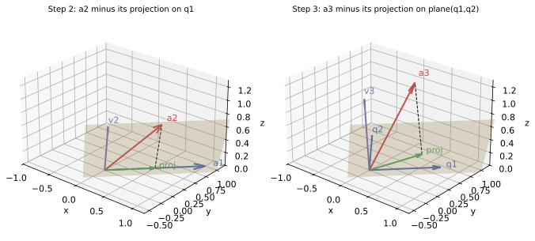
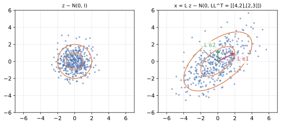

<ul class="post-sources">
<li markdown="span">[혁펜하임의 "보이는" 선형대수학](https://www.youtube.com/playlist?list=PL_iJu012NOxdZDxoGsYidMf2_bERIQaP0) 9-1–9-3강 정리</li>
</ul>

## 그람-슈미트 과정

[▶ 9-1강](https://www.youtube.com/watch?v=D7koMV2AeLE)

### 왜 직교 기저가 좋은가

평면을 span하는 기저는 무수히 많다. 그중 서로 수직이고 길이가 1인 기저, 즉 **정규직교 기저(orthonormal basis)**는 특별히 다루기 쉽다. 벡터 $$\mathbf{x}$$를 정규직교 기저 $$\mathbf{q}_1, \dots, \mathbf{q}_n$$으로 표현할 때 계수를 구하려면 연립방정식을 풀 필요가 없다. 각 기저와 내적만 하면 된다.

$$
\mathbf{x} = (\mathbf{q}_1^T\mathbf{x})\,\mathbf{q}_1 + \cdots + (\mathbf{q}_n^T\mathbf{x})\,\mathbf{q}_n
$$

직교하지 않는 기저에서는 한 방향의 성분을 바꾸면 다른 방향의 계수까지 바뀌지만, 직교 기저에서는 각 방향이 서로 간섭하지 않는다. 그래서 주어진 기저를 **같은 공간을 span하는 정규직교 기저로 바꾸는 방법**이 필요하고, 그것이 **그람-슈미트 과정(Gram-Schmidt process)**이다.

### 아이디어: 이미 있는 방향의 성분을 뺀다

선형 독립인 $$\mathbf{a}_1, \mathbf{a}_2, \mathbf{a}_3$$가 있다. 하나씩 처리한다.

1. $$\mathbf{a}_1$$은 그대로 방향으로 쓰고 길이만 1로 맞춘다: $$\mathbf{q}_1 = \mathbf{a}_1 / \lVert\mathbf{a}_1\rVert$$.
2. $$\mathbf{a}_2$$에는 $$\mathbf{q}_1$$ 방향 성분이 섞여 있다. 그 성분, 즉 $$\mathbf{q}_1$$ 위로의 **정사영(projection)** $$(\mathbf{q}_1^T\mathbf{a}_2)\mathbf{q}_1$$을 빼면 $$\mathbf{q}_1$$에 수직인 부분만 남는다.

   $$
   \mathbf{v}_2 = \mathbf{a}_2 - (\mathbf{q}_1^T\mathbf{a}_2)\,\mathbf{q}_1, \qquad \mathbf{q}_2 = \mathbf{v}_2 / \lVert\mathbf{v}_2\rVert
   $$

3. $$\mathbf{a}_3$$에서는 $$\mathbf{q}_1$$, $$\mathbf{q}_2$$ 방향 성분을 모두 뺀다. $$\mathbf{q}_1$$, $$\mathbf{q}_2$$가 서로 수직이므로, $$\mathbf{q}_1$$, $$\mathbf{q}_2$$가 만드는 평면 위로의 정사영은 두 직선 위 정사영의 합이다.

   $$
   \mathbf{v}_3 = \mathbf{a}_3 - (\mathbf{q}_1^T\mathbf{a}_3)\,\mathbf{q}_1 - (\mathbf{q}_2^T\mathbf{a}_3)\,\mathbf{q}_2, \qquad \mathbf{q}_3 = \mathbf{v}_3 / \lVert\mathbf{v}_3\rVert
   $$

일반적으로 $$\mathbf{v}_k = \mathbf{a}_k - \sum_{i<k}(\mathbf{q}_i^T\mathbf{a}_k)\mathbf{q}_i$$이다. 빼는 것은 모두 앞선 벡터들의 선형 결합이므로 span은 변하지 않는다. 각 단계에서 $$\operatorname{Span}\{\mathbf{q}_1, \dots, \mathbf{q}_k\} = \operatorname{Span}\{\mathbf{a}_1, \dots, \mathbf{a}_k\}$$이다. 정사영 자체는 [보이는 선형대수학 2](/blog/2026/11/05/hpla-02-vectors/)의 내적과 정사영에서 다루었다.

$$\mathbf{a}_k$$가 앞선 벡터들의 span 안에 있으면(선형 종속이면) 정사영이 $$\mathbf{a}_k$$ 전체이므로 $$\mathbf{v}_k = \mathbf{0}$$이 되고 정규화할 수 없다. 그래서 그람-슈미트는 선형 독립인 입력을 전제로 한다.

### 계산 예

$$
\mathbf{a}_1 = \begin{bmatrix} 1 \\ 1 \\ 0 \end{bmatrix}, \quad
\mathbf{a}_2 = \begin{bmatrix} 1 \\ 0 \\ 1 \end{bmatrix}, \quad
\mathbf{a}_3 = \begin{bmatrix} 0 \\ 1 \\ 1 \end{bmatrix}
$$

**1단계.** $$\lVert\mathbf{a}_1\rVert = \sqrt{2}$$이므로 $$\mathbf{q}_1 = \frac{1}{\sqrt{2}}(1, 1, 0)$$.

**2단계.** $$\mathbf{q}_1^T\mathbf{a}_2 = \frac{1}{\sqrt{2}}$$이므로 정사영은 $$\frac{1}{\sqrt{2}}\mathbf{q}_1 = (\frac{1}{2}, \frac{1}{2}, 0)$$이다.

$$
\mathbf{v}_2 = (1, 0, 1) - (\tfrac{1}{2}, \tfrac{1}{2}, 0) = (\tfrac{1}{2}, -\tfrac{1}{2}, 1), \qquad
\lVert\mathbf{v}_2\rVert = \sqrt{\tfrac{1}{4} + \tfrac{1}{4} + 1} = \sqrt{\tfrac{3}{2}}
$$

이므로 $$\mathbf{q}_2 = \frac{1}{\sqrt{6}}(1, -1, 2)$$. 확인: $$\mathbf{q}_1^T\mathbf{q}_2 \propto 1 - 1 + 0 = 0$$.

**3단계.** $$\mathbf{q}_1^T\mathbf{a}_3 = \frac{1}{\sqrt{2}}$$, $$\mathbf{q}_2^T\mathbf{a}_3 = \frac{-1 + 2}{\sqrt{6}} = \frac{1}{\sqrt{6}}$$이다.

$$
\mathbf{v}_3 = (0, 1, 1) - (\tfrac{1}{2}, \tfrac{1}{2}, 0) - \tfrac{1}{6}(1, -1, 2) = (-\tfrac{2}{3}, \tfrac{2}{3}, \tfrac{2}{3}), \qquad
\lVert\mathbf{v}_3\rVert = \tfrac{2}{\sqrt{3}}
$$

이므로 $$\mathbf{q}_3 = \frac{1}{\sqrt{3}}(-1, 1, 1)$$. 확인: $$\mathbf{q}_1^T\mathbf{q}_3 \propto -1 + 1 + 0 = 0$$, $$\mathbf{q}_2^T\mathbf{q}_3 \propto -1 - 1 + 2 = 0$$.

*위 계산 예의 2단계와 3단계. 색칠한 평면은 $$\operatorname{Span}\{\mathbf{a}_1, \mathbf{a}_2\} = \operatorname{Span}\{\mathbf{q}_1, \mathbf{q}_2\}$$이다. 초록 화살표가 빼는 정사영, 점선이 남은 수직 성분이다.*

왼쪽에서 $$\mathbf{a}_2$$(빨강)를 $$\mathbf{a}_1$$(파랑) 방향으로 정사영하면 초록 화살표가 된다. 그 끝에서 $$\mathbf{a}_2$$까지의 점선을 원점으로 옮긴 것이 $$\mathbf{v}_2$$(보라)이고, $$\mathbf{a}_1$$에 수직이면서 같은 평면 안에 있다. 오른쪽에서는 $$\mathbf{a}_3$$를 평면 위로 정사영한 초록 화살표 $$(\frac{2}{3}, \frac{1}{3}, \frac{1}{3})$$을 빼서 평면에 수직인 $$\mathbf{v}_3$$만 남긴다. 단계마다 하는 일은 같다. 이미 만든 방향들이 span하는 공간에 정사영하고 그 나머지를 취한다. 4차원 예와 2차원 그림은 [Linear Algebra 6](/blog/2026/10/22/la-06-gram-schmidt-qr/)에 있다.

### 흔한 실수

- 정사영 계수를 원래 벡터 $$\mathbf{a}_i$$로 계산하는 것. 빼야 하는 것은 **이미 직교화된** $$\mathbf{q}_i$$ 방향 성분이다. $$\mathbf{a}_1$$, $$\mathbf{a}_2$$는 서로 수직이 아니므로 두 정사영을 더해도 평면 위 정사영이 되지 않는다.
- 정규화를 하지 않고 $$(\mathbf{q}_i^T\mathbf{a}_k)\mathbf{q}_i$$ 공식을 쓰는 것. 정규화하지 않은 $$\mathbf{v}_i$$를 쓰려면 $$\frac{\mathbf{v}_i^T\mathbf{a}_k}{\mathbf{v}_i^T\mathbf{v}_i}\mathbf{v}_i$$로 나누어 주어야 한다.
- 순서가 상관없다고 생각하는 것. 처리 순서를 바꾸면 다른 정규직교 기저가 나온다. 둘 다 같은 공간의 정규직교 기저이지만 같은 벡터는 아니다.

## QR 분해

[▶ 9-2강](https://www.youtube.com/watch?v=KxAX_evOMtw)

### 그람-슈미트를 행렬로 기록하기

LU 분해가 가우스 소거의 기록이었듯, **QR 분해(QR decomposition)**는 그람-슈미트의 기록이다. 그람-슈미트의 식을 $$\mathbf{a}_k$$에 대해 다시 쓰면

$$
\begin{aligned}
\mathbf{a}_1 &= \lVert\mathbf{v}_1\rVert\,\mathbf{q}_1, \\
\mathbf{a}_2 &= (\mathbf{q}_1^T\mathbf{a}_2)\,\mathbf{q}_1 + \lVert\mathbf{v}_2\rVert\,\mathbf{q}_2, \\
\mathbf{a}_3 &= (\mathbf{q}_1^T\mathbf{a}_3)\,\mathbf{q}_1 + (\mathbf{q}_2^T\mathbf{a}_3)\,\mathbf{q}_2 + \lVert\mathbf{v}_3\rVert\,\mathbf{q}_3
\end{aligned}
$$

이다($$\mathbf{v}_1 = \mathbf{a}_1$$). 각 $$\mathbf{a}_k$$는 $$\mathbf{q}_1, \dots, \mathbf{q}_k$$만 쓴다. [보이는 선형대수학 3](/blog/2026/11/05/hpla-03-matrix-product/)의 열 관점 행렬 곱셈으로 묶으면

$$
\underbrace{\begin{bmatrix} \mathbf{a}_1 & \mathbf{a}_2 & \mathbf{a}_3 \end{bmatrix}}_{A}
= \underbrace{\begin{bmatrix} \mathbf{q}_1 & \mathbf{q}_2 & \mathbf{q}_3 \end{bmatrix}}_{Q}
\underbrace{\begin{bmatrix}
\lVert\mathbf{v}_1\rVert & \mathbf{q}_1^T\mathbf{a}_2 & \mathbf{q}_1^T\mathbf{a}_3 \\
0 & \lVert\mathbf{v}_2\rVert & \mathbf{q}_2^T\mathbf{a}_3 \\
0 & 0 & \lVert\mathbf{v}_3\rVert
\end{bmatrix}}_{R}
$$

이다. $$Q$$는 정규직교 열을 가진 행렬이고, $$R$$은 대각 성분이 양수인 상삼각 행렬이다. $$R$$이 상삼각인 이유는 "$$k$$번째 열은 처음 $$k$$개의 방향만 쓴다"는 그람-슈미트의 구조 그 자체다. $$Q^TQ = I$$이므로 $$R = Q^TA$$로 구할 수도 있다.

$$A$$가 $$m \times n$$이고 열이 선형 독립이면 $$Q$$는 $$m \times n$$, $$R$$은 $$n \times n$$ 가역 행렬이다. $$m > n$$이면 $$Q$$는 정사각이 아니므로 $$Q^TQ = I$$이지만 $$QQ^T \neq I$$이다. $$QQ^T$$는 $$\operatorname{Col}A$$ 위로의 정사영 행렬이다.

### 계산 예

앞의 예에서는

$$
\begin{bmatrix} 1 & 1 & 0 \\ 1 & 0 & 1 \\ 0 & 1 & 1 \end{bmatrix}
= \begin{bmatrix}
1/\sqrt{2} & 1/\sqrt{6} & -1/\sqrt{3} \\
1/\sqrt{2} & -1/\sqrt{6} & 1/\sqrt{3} \\
0 & 2/\sqrt{6} & 1/\sqrt{3}
\end{bmatrix}
\begin{bmatrix}
\sqrt{2} & 1/\sqrt{2} & 1/\sqrt{2} \\
0 & \sqrt{3/2} & 1/\sqrt{6} \\
0 & 0 & 2/\sqrt{3}
\end{bmatrix}
$$

이다. 예컨대 2열은 $$\frac{1}{\sqrt{2}}\mathbf{q}_1 + \sqrt{\frac{3}{2}}\,\mathbf{q}_2 = (\frac{1}{2}, \frac{1}{2}, 0) + (\frac{1}{2}, -\frac{1}{2}, 1) = (1, 0, 1) = \mathbf{a}_2$$이다. (`numpy.linalg.qr`은 $$\mathbf{q}_1$$, $$\mathbf{q}_2$$의 부호를 반대로 돌려줄 수 있다. 열 하나와 $$R$$의 대응하는 행의 부호를 함께 바꿔도 곱은 같기 때문이다.)

### QR로 최소자승 문제 풀기

QR의 가장 큰 쓰임은 [보이는 선형대수학 5](/blog/2026/11/05/hpla-05-elimination-determinant/)의 **최소자승법(least squares)**이다. 정규 방정식 $$A^TA\hat{\mathbf{x}} = A^T\mathbf{b}$$에 $$A = QR$$을 넣으면 $$A^TA = R^TQ^TQR = R^TR$$이므로

$$
R^TR\,\hat{\mathbf{x}} = R^TQ^T\mathbf{b} \quad\Longrightarrow\quad R\,\hat{\mathbf{x}} = Q^T\mathbf{b}
$$

이다. $$R^T$$가 가역이라 양변에서 지울 수 있다. 남은 식은 상삼각 시스템이므로 후진 대입으로 푼다. $$A^TA$$를 만들지 않으므로 계산이 안정적이다. $$A^TA$$를 만들면 조건수(condition number)가 제곱으로 커져서, 열들이 거의 평행할 때 반올림 오차가 크게 불어난다.

**작은 예.** $$A = \begin{bmatrix} 1 & 0 \\ 1 & 1 \\ 1 & 2 \end{bmatrix}$$, $$\mathbf{b} = (1, 2, 4)$$로 직선 $$y = c + dx$$를 점 $$(0, 1)$$, $$(1, 2)$$, $$(2, 4)$$에 맞춘다. 그람-슈미트로 $$\mathbf{q}_1 = \frac{1}{\sqrt{3}}(1, 1, 1)$$, $$\mathbf{v}_2 = (0, 1, 2) - 1 \cdot (1, 1, 1) = (-1, 0, 1)$$, $$\mathbf{q}_2 = \frac{1}{\sqrt{2}}(-1, 0, 1)$$이고

$$
R = \begin{bmatrix} \sqrt{3} & \sqrt{3} \\ 0 & \sqrt{2} \end{bmatrix}, \qquad
Q^T\mathbf{b} = \begin{bmatrix} 7/\sqrt{3} \\ 3/\sqrt{2} \end{bmatrix}
$$

이다. 후진 대입으로 $$\sqrt{2}\,d = 3/\sqrt{2}$$에서 $$d = \frac{3}{2}$$, $$\sqrt{3}\,c + \sqrt{3}\,d = 7/\sqrt{3}$$에서 $$c = \frac{7}{3} - \frac{3}{2} = \frac{5}{6}$$이다. 정규 방정식으로 풀어도 같은 $$y = \frac{5}{6} + \frac{3}{2}x$$가 나온다.

### 흔한 실수

- 직사각 $$Q$$에 대해 $$QQ^T = I$$라고 쓰는 것. $$Q^TQ = I$$만 성립한다.
- $$R$$을 따로 계산해야 한다고 생각하는 것. $$R$$의 성분은 그람-슈미트 도중 이미 계산한 내적과 길이다. 대각 성분도 $$\lVert\mathbf{v}_k\rVert = \mathbf{q}_k^T\mathbf{a}_k$$로, 같은 공식 $$r_{ik} = \mathbf{q}_i^T\mathbf{a}_k$$ ($$i \le k$$)에 들어 있다. $$\mathbf{a}_k$$에서 앞선 방향을 뺀 나머지가 $$\mathbf{v}_k$$이므로 $$\mathbf{q}_k^T\mathbf{a}_k = \mathbf{q}_k^T\mathbf{v}_k = \lVert\mathbf{v}_k\rVert$$이다.

## 촐레스키 분해

[▶ 9-3강](https://www.youtube.com/watch?v=Xfhe391LrvA)

### 행렬의 제곱근

양수 $$a$$는 $$a = (\sqrt{a})^2$$으로 쓸 수 있다. 행렬에서도 비슷한 일을 하고 싶다. **양의 정부호(positive definite)** 대칭 행렬 $$A$$, 즉 모든 $$\mathbf{x} \neq \mathbf{0}$$에 대해 $$\mathbf{x}^TA\mathbf{x} > 0$$인 대칭 행렬은

$$
A = LL^T
$$

로 쓸 수 있다. $$L$$은 대각 성분이 양수인 하삼각 행렬이고 유일하다. 이것이 **촐레스키 분해(Cholesky decomposition)**이다. $$L$$은 $$A$$의 일종의 "제곱근"이다.

### LDU에서 촐레스키로

[보이는 선형대수학 11](/blog/2026/11/05/hpla-11-lu-similar/)의 LDU 분해에서 출발하면 존재 이유가 보인다. 대칭 행렬은 $$A = LDL^T$$로 분해되고, 양의 정부호 행렬의 피벗은 모두 양수다. 그러면 $$D = D^{1/2}D^{1/2}$$로 나눌 수 있고

$$
A = LD^{1/2}D^{1/2}L^T = (LD^{1/2})(LD^{1/2})^T
$$

이다. $$LD^{1/2}$$를 새로 $$L$$이라 부르면 촐레스키 분해다.

QR과도 연결된다. $$A = QR$$이면 $$A^TA = R^TR$$이었다. $$R^T$$은 대각이 양수인 하삼각 행렬이므로, **$$A^TA$$의 촐레스키 인수는 $$A$$의 QR에서 나온 $$R^T$$**이다. 앞 절의 예에서 $$A^TA = \begin{bmatrix} 2 & 1 & 1 \\ 1 & 2 & 1 \\ 1 & 1 & 2 \end{bmatrix}$$이고, 위의 $$R$$로 $$R^TR$$을 계산하면 정말 이 행렬이 나온다.

### 직접 구하기: 한 성분씩

$$A = LL^T$$를 성분별로 맞추면 위에서부터 차례로 풀린다.

$$
A = \begin{bmatrix} 4 & 2 & 2 \\ 2 & 5 & 3 \\ 2 & 3 & 6 \end{bmatrix}
= \begin{bmatrix} \ell_{11} & 0 & 0 \\ \ell_{21} & \ell_{22} & 0 \\ \ell_{31} & \ell_{32} & \ell_{33} \end{bmatrix}
\begin{bmatrix} \ell_{11} & \ell_{21} & \ell_{31} \\ 0 & \ell_{22} & \ell_{32} \\ 0 & 0 & \ell_{33} \end{bmatrix}
$$

- 1열: $$\ell_{11}^2 = 4$$에서 $$\ell_{11} = 2$$. $$\ell_{21}\ell_{11} = 2$$에서 $$\ell_{21} = 1$$. $$\ell_{31}\ell_{11} = 2$$에서 $$\ell_{31} = 1$$.
- 2열: $$\ell_{21}^2 + \ell_{22}^2 = 5$$에서 $$\ell_{22} = \sqrt{5 - 1} = 2$$. $$\ell_{31}\ell_{21} + \ell_{32}\ell_{22} = 3$$에서 $$\ell_{32} = (3 - 1)/2 = 1$$.
- 3열: $$\ell_{31}^2 + \ell_{32}^2 + \ell_{33}^2 = 6$$에서 $$\ell_{33} = \sqrt{6 - 1 - 1} = 2$$.

$$
L = \begin{bmatrix} 2 & 0 & 0 \\ 1 & 2 & 0 \\ 1 & 1 & 2 \end{bmatrix}
$$

일반식은 $$\ell_{jj} = \sqrt{a_{jj} - \sum_{k<j}\ell_{jk}^2}$$, $$\ell_{ij} = \bigl(a_{ij} - \sum_{k<j}\ell_{ik}\ell_{jk}\bigr)/\ell_{jj}$$ ($$i > j$$)이다. 루트 안이 음수나 0이 되면 $$A$$는 양의 정부호가 아니다. 그래서 촐레스키 분해는 **양의 정부호 판정법**으로도 쓰인다. 실제로 `numpy.linalg.cholesky`에 양의 정부호가 아닌 행렬을 넣으면 오류가 난다.

### 어디에 쓰나

- **연립방정식.** 대칭 양의 정부호 시스템 $$A\mathbf{x} = \mathbf{b}$$를 $$L\mathbf{c} = \mathbf{b}$$, $$L^T\mathbf{x} = \mathbf{c}$$로 푼다. 대칭성 덕분에 절반만 계산하므로 LU보다 약 두 배 빠르고($$\approx \frac{1}{3}n^3$$), 행 교환도 필요 없다. 최소자승의 정규 방정식, 칼만 필터의 공분산 갱신 등이 이런 시스템이다.
- **상관된 가우시안 샘플 만들기.** $$\mathbf{z}$$가 서로 독립인 표준정규분포 벡터($$\operatorname{Cov}\mathbf{z} = I$$)이면 $$\mathbf{x} = L\mathbf{z}$$의 공분산은

  $$
  \operatorname{Cov}(L\mathbf{z}) = L\,\operatorname{Cov}(\mathbf{z})\,L^T = LL^T = \Sigma
  $$

  이다. 원하는 공분산 $$\Sigma$$를 촐레스키 분해하기만 하면 된다.

*왼쪽은 표준정규분포 샘플 400개, 오른쪽은 같은 샘플에 $$L = \begin{bmatrix} 2 & 0 \\ 1 & \sqrt{2} \end{bmatrix}$$를 곱한 결과다. 주황 원(반지름 1, 2)은 타원으로 바뀌고, 샘플의 공분산은 $$\Sigma = LL^T = \begin{bmatrix} 4 & 2 \\ 2 & 3 \end{bmatrix}$$에 가까워진다.*

$$\Sigma = \begin{bmatrix} 4 & 2 \\ 2 & 3 \end{bmatrix}$$이면 $$\ell_{11} = 2$$, $$\ell_{21} = 1$$, $$\ell_{22} = \sqrt{3 - 1} = \sqrt{2}$$이다. 그림의 400개 샘플로 계산한 표본 공분산은 $$\begin{bmatrix} 4.07 & 2.06 \\ 2.06 & 3.06 \end{bmatrix}$$로 $$\Sigma$$에 가깝다. 원이 기울어진 타원이 되는 것은 $$L$$이 두 좌표를 섞기 때문이다. $$x_2 = z_1 + \sqrt{2}z_2$$가 $$x_1 = 2z_1$$과 같은 $$z_1$$을 공유하므로 둘이 양의 상관을 갖는다.

### 흔한 실수

- 대칭이 아니거나 양의 정부호가 아닌 행렬에 촐레스키를 쓰는 것. 대칭이지만 고윳값에 음수가 있는 $$\begin{bmatrix} 1 & 2 \\ 2 & 1 \end{bmatrix}$$은 $$\ell_{22} = \sqrt{1 - 4}$$에서 막힌다.
- $$L$$의 고윳값이 $$A$$의 고윳값의 제곱근이라고 생각하는 것. 촐레스키의 $$L$$은 삼각 행렬일 뿐 고유벡터와는 무관하다. 위 예에서 $$L$$의 대각은 $$2, 2, 2$$이지만 $$A$$의 고윳값은 약 $$2.32, 2.79, 9.89$$이다. 고윳값의 제곱근을 갖는 "제곱근"은 고윳값 분해로 만든 대칭 행렬 $$A^{1/2} = Q\Lambda^{1/2}Q^T$$이다.

## 정리

| | 형태 | 조건 | 쓰임 |
|---|---|---|---|
| 그람-슈미트 | $$\mathbf{v}_k = \mathbf{a}_k - \sum_{i<k}(\mathbf{q}_i^T\mathbf{a}_k)\mathbf{q}_i$$ | 열이 선형 독립 | 같은 공간의 정규직교 기저 |
| QR | $$A = QR$$ | 열이 선형 독립 | 최소자승 $$R\hat{\mathbf{x}} = Q^T\mathbf{b}$$, 정사영 $$QQ^T$$ |
| 촐레스키 | $$A = LL^T$$ | 대칭, 양의 정부호 | 빠른 연립방정식 풀이, 양의 정부호 판정, 상관된 샘플 생성 |

세 분해의 관계도 기억해 두자. QR의 $$R$$은 그람-슈미트의 계수이고, $$A^TA$$의 촐레스키 인수는 $$R^T$$이며, 촐레스키는 대칭 양의 정부호 행렬의 $$LDL^T$$에서 $$D$$를 반씩 나눈 것이다.
