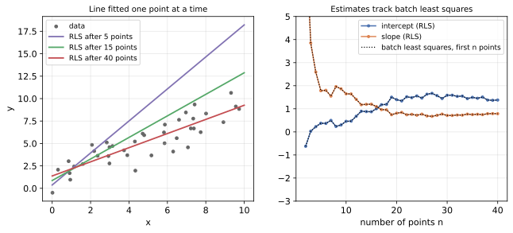

<ul class="post-sources">
<li markdown="span">[혁펜하임의 "보이는" 선형대수학](https://www.youtube.com/playlist?list=PL_iJu012NOxdZDxoGsYidMf2_bERIQaP0) 10-1–10-2강 정리</li>
</ul>

## 셔먼-모리슨 공식과 RLS

[▶ 10-1강](https://www.youtube.com/watch?v=oaNKZgXum3I)

### 문제: 행렬이 조금 바뀌었을 때 역행렬

$$n \times n$$ 행렬 $$A$$의 역행렬 $$A^{-1}$$을 이미 알고 있다. 그런데 $$A$$가 조금 바뀌었다. 정확히는 **랭크 1(rank-1)** 행렬 $$\mathbf{u}\mathbf{v}^T$$가 더해졌다.

$$
A \;\longrightarrow\; A + \mathbf{u}\mathbf{v}^T
$$

[보이는 선형대수학 3](/blog/2026/11/05/hpla-03-matrix-product/)에서 보았듯 $$\mathbf{u}\mathbf{v}^T$$는 모든 열이 $$\mathbf{u}$$의 배수인 행렬이다. 행 하나나 열 하나만 바꾸는 것, 성분 하나만 바꾸는 것, 데이터 행렬에 샘플 하나를 추가하는 것이 모두 이런 변화다.

역행렬을 처음부터 다시 구하면 $$O(n^3)$$이 든다. 하지만 변화가 랭크 1밖에 안 되니, 역행렬의 변화도 랭크 1일 것이라고 기대할 수 있다. 실제로 그렇고, 그 변화를 정확히 적은 것이 **셔먼-모리슨 공식(Sherman-Morrison formula)**이다.

### 공식

$$A$$가 가역이고 $$1 + \mathbf{v}^TA^{-1}\mathbf{u} \neq 0$$이면

$$
(A + \mathbf{u}\mathbf{v}^T)^{-1} = A^{-1} - \frac{A^{-1}\mathbf{u}\,\mathbf{v}^TA^{-1}}{1 + \mathbf{v}^TA^{-1}\mathbf{u}}
$$

이다. 분자 $$(A^{-1}\mathbf{u})(\mathbf{v}^TA^{-1})$$은 열벡터와 행벡터의 곱, 즉 랭크 1 행렬이고, 분모는 스칼라다. 계산은 $$A^{-1}\mathbf{u}$$와 $$\mathbf{v}^TA^{-1}$$ 두 번의 행렬-벡터 곱과 외적 하나로 끝나서 $$O(n^2)$$이다.

### 증명: 곱해서 $$I$$가 나오는지 본다

역행렬 후보가 맞는지는 곱해 보면 된다. $$\alpha = \mathbf{v}^TA^{-1}\mathbf{u}$$(스칼라)로 두면

$$
\begin{aligned}
(A + \mathbf{u}\mathbf{v}^T)\left(A^{-1} - \frac{A^{-1}\mathbf{u}\mathbf{v}^TA^{-1}}{1 + \alpha}\right)
&= I + \mathbf{u}\mathbf{v}^TA^{-1} - \frac{\mathbf{u}\mathbf{v}^TA^{-1} + \mathbf{u}(\mathbf{v}^TA^{-1}\mathbf{u})\mathbf{v}^TA^{-1}}{1 + \alpha} \\
&= I + \mathbf{u}\mathbf{v}^TA^{-1} - \frac{(1 + \alpha)\,\mathbf{u}\mathbf{v}^TA^{-1}}{1 + \alpha} = I
\end{aligned}
$$

이다. 핵심은 가운데의 $$\mathbf{v}^TA^{-1}\mathbf{u}$$가 스칼라라서 앞으로 빼낼 수 있다는 점이다. 그래서 모든 항이 같은 랭크 1 행렬 $$\mathbf{u}\mathbf{v}^TA^{-1}$$의 배수로 정리된다.

분모가 0이면, 즉 $$1 + \mathbf{v}^TA^{-1}\mathbf{u} = 0$$이면 $$A + \mathbf{u}\mathbf{v}^T$$는 가역이 아니다. 행렬식 보조정리 $$\det(A + \mathbf{u}\mathbf{v}^T) = (1 + \mathbf{v}^TA^{-1}\mathbf{u})\det A$$가 이를 말해 준다.

### 계산 예

$$
A = \begin{bmatrix} 2 & 0 \\ 0 & 4 \end{bmatrix}, \quad
\mathbf{u} = \mathbf{v} = \begin{bmatrix} 1 \\ 1 \end{bmatrix}, \quad
A + \mathbf{u}\mathbf{v}^T = \begin{bmatrix} 3 & 1 \\ 1 & 5 \end{bmatrix}
$$

$$A^{-1} = \operatorname{diag}(\frac{1}{2}, \frac{1}{4})$$이고 $$A^{-1}\mathbf{u} = (\frac{1}{2}, \frac{1}{4})$$, $$\mathbf{v}^TA^{-1}\mathbf{u} = \frac{3}{4}$$이다. 따라서

$$
(A + \mathbf{u}\mathbf{v}^T)^{-1}
= \begin{bmatrix} 1/2 & 0 \\ 0 & 1/4 \end{bmatrix} - \frac{1}{7/4}\begin{bmatrix} 1/4 & 1/8 \\ 1/8 & 1/16 \end{bmatrix}
= \begin{bmatrix} 5/14 & -1/14 \\ -1/14 & 3/14 \end{bmatrix}
$$

이다. $$2 \times 2$$ 역행렬 공식으로 직접 구하면 $$\frac{1}{14}\begin{bmatrix} 5 & -1 \\ -1 & 3 \end{bmatrix}$$로 같다.

### 응용: 재귀 최소자승법(RLS)

[보이는 선형대수학 5](/blog/2026/11/05/hpla-05-elimination-determinant/)의 최소자승법은 데이터를 한꺼번에 모아 놓고 $$\hat{\boldsymbol\theta} = (X^TX)^{-1}X^T\mathbf{y}$$를 계산한다. 그런데 센서 데이터처럼 샘플이 하나씩 계속 들어오면, 샘플이 올 때마다 $$X^TX$$의 역행렬을 새로 구하기는 부담스럽다. 샘플 하나가 들어올 때 $$X^TX$$가 어떻게 바뀌는지 보자.

$$n$$번째 샘플의 입력 벡터를 $$\mathbf{h}_n$$(데이터 행렬 $$X$$의 새 행을 세운 것), 출력을 $$y_n$$이라 하자. $$X_n$$은 처음 $$n$$개 샘플의 데이터 행렬이다. 행 하나가 추가되면

$$
X_n^TX_n = X_{n-1}^TX_{n-1} + \mathbf{h}_n\mathbf{h}_n^T, \qquad
X_n^T\mathbf{y}_n = X_{n-1}^T\mathbf{y}_{n-1} + \mathbf{h}_ny_n
$$

이다. 행 관점에서 $$X^TX = \sum_i \mathbf{h}_i\mathbf{h}_i^T$$이기 때문이다. 정확히 랭크 1 변화다. $$P_n = (X_n^TX_n)^{-1}$$로 두고 셔먼-모리슨을 $$\mathbf{u} = \mathbf{v} = \mathbf{h}_n$$으로 적용하면

$$
P_n = P_{n-1} - \frac{P_{n-1}\mathbf{h}_n\mathbf{h}_n^TP_{n-1}}{1 + \mathbf{h}_n^TP_{n-1}\mathbf{h}_n}
$$

이다. 여기에 **이득(gain)** 벡터

$$
\mathbf{g}_n = \frac{P_{n-1}\mathbf{h}_n}{1 + \mathbf{h}_n^TP_{n-1}\mathbf{h}_n}
$$

를 정의하면 $$P_n = P_{n-1} - \mathbf{g}_n\mathbf{h}_n^TP_{n-1}$$이고, $$P_n\mathbf{h}_n = \mathbf{g}_n$$임을 바로 확인할 수 있다. 추정값은

$$
\begin{aligned}
\hat{\boldsymbol\theta}_n &= P_n\bigl(X_{n-1}^T\mathbf{y}_{n-1} + \mathbf{h}_ny_n\bigr)
= P_n\bigl((P_n^{-1} - \mathbf{h}_n\mathbf{h}_n^T)\hat{\boldsymbol\theta}_{n-1} + \mathbf{h}_ny_n\bigr) \\
&= \hat{\boldsymbol\theta}_{n-1} + \mathbf{g}_n\bigl(y_n - \mathbf{h}_n^T\hat{\boldsymbol\theta}_{n-1}\bigr)
\end{aligned}
$$

이다. 첫 줄에서 $$X_{n-1}^T\mathbf{y}_{n-1} = P_{n-1}^{-1}\hat{\boldsymbol\theta}_{n-1}$$과 $$P_{n-1}^{-1} = P_n^{-1} - \mathbf{h}_n\mathbf{h}_n^T$$를 썼다.

마지막 식이 **재귀 최소자승법(recursive least squares, RLS)**이다. 읽는 법이 직관적이다.

- $$\mathbf{h}_n^T\hat{\boldsymbol\theta}_{n-1}$$은 지금까지의 추정으로 한 **예측**이다.
- $$y_n - \mathbf{h}_n^T\hat{\boldsymbol\theta}_{n-1}$$은 예측이 틀린 정도, 즉 **예측 오차**다.
- 추정값은 예측 오차에 이득 $$\mathbf{g}_n$$을 곱한 만큼만 고친다. 예측이 맞았으면 고칠 것이 없다.

역행렬은 한 번도 다시 구하지 않는다. 매 단계에 $$p \times p$$ 행렬-벡터 곱 몇 번($$O(p^2)$$, $$p$$는 파라미터 수)만 하면 되고, 지난 데이터를 저장할 필요도 없다. 그런데도 결과는 **지금까지의 데이터 전체로 푼 최소자승해와 정확히 같다**. 근사가 아니라 대수적으로 같은 식이다.

**작은 예.** 직선 $$y = c + dx$$를 맞춘다. 점 $$(0, 1)$$, $$(1, 2)$$ 두 개로 시작하면 $$\hat{\boldsymbol\theta}_2 = (1, 1)$$이고

$$
P_2 = \left(\begin{bmatrix} 2 & 1 \\ 1 & 1 \end{bmatrix}\right)^{-1} = \begin{bmatrix} 1 & -1 \\ -1 & 2 \end{bmatrix}
$$

이다. 새 점 $$(2, 4)$$가 들어오면 $$\mathbf{h}_3 = (1, 2)$$이다.

- $$P_2\mathbf{h}_3 = (-1, 3)$$, $$\mathbf{h}_3^TP_2\mathbf{h}_3 = -1 + 6 = 5$$이므로 $$\mathbf{g}_3 = \frac{1}{6}(-1, 3)$$.
- 예측은 $$\mathbf{h}_3^T\hat{\boldsymbol\theta}_2 = 1 + 2 = 3$$, 예측 오차는 $$4 - 3 = 1$$.
- $$\hat{\boldsymbol\theta}_3 = (1, 1) + \frac{1}{6}(-1, 3) = (\frac{5}{6}, \frac{3}{2})$$.

세 점 전체로 푼 최소자승해 $$y = \frac{5}{6} + \frac{3}{2}x$$([보이는 선형대수학 12](/blog/2026/11/05/hpla-12-gram-schmidt-qr-cholesky/)의 QR 예와 같은 데이터)와 정확히 같다. 갱신된 $$P_3 = \begin{bmatrix} 5/6 & -1/2 \\ -1/2 & 1/2 \end{bmatrix}$$도 $$\begin{bmatrix} 3 & 3 \\ 3 & 5 \end{bmatrix}^{-1}$$과 같다.

*잡음이 있는 직선 데이터 40개에 RLS를 적용한 결과. 왼쪽은 5개, 15개, 40개를 본 뒤의 직선이고, 오른쪽은 절편과 기울기 추정값이 점 하나씩 갱신되는 모습이다. 검은 점선은 매 시점까지의 데이터로 따로 푼 최소자승해로, RLS와 완전히 겹친다.*

처음 두 점으로 초기화한 뒤 셔먼-모리슨 갱신만으로 40번째 점까지 진행했다. 오른쪽 그림에서 RLS 추정값과 배치(batch) 최소자승해의 차이는 반올림 오차 수준($$10^{-14}$$)이다. 데이터가 적을 때는 추정이 크게 흔들리다가, 점이 쌓일수록 $$P_n$$이 작아져서 이득도 작아지고 추정이 안정된다. 새 샘플 하나가 이미 쌓인 증거를 크게 흔들지 못하기 때문이다.

실제 RLS에서는 초기 데이터 없이 $$\hat{\boldsymbol\theta}_0 = \mathbf{0}$$, $$P_0 = \delta I$$($$\delta$$는 큰 수)로 시작하기도 한다. 이것은 아주 약한 릿지 정규화를 건 것과 같아서 처음 몇 단계는 배치 해와 약간 다르지만, 데이터가 쌓이면 차이가 사라진다. 또 오래된 데이터를 덜 믿고 싶으면 망각 인자(forgetting factor) $$0 < \lambda \le 1$$을 넣어 $$X_n^TX_n = \lambda X_{n-1}^TX_{n-1} + \mathbf{h}_n\mathbf{h}_n^T$$로 갱신한다. 적응 필터와 칼만 필터가 이 구조를 쓴다.

### 흔한 실수

- 분모의 부호. $$+\mathbf{u}\mathbf{v}^T$$를 더하면 분모는 $$1 + \mathbf{v}^TA^{-1}\mathbf{u}$$이고 앞에는 마이너스가 붙는다. 랭크 1을 **빼는** 경우($$A - \mathbf{u}\mathbf{v}^T$$)는 $$\mathbf{u}$$를 $$-\mathbf{u}$$로 바꾸어 대입하면 된다.
- $$A^{-1}\mathbf{u}\mathbf{v}^TA^{-1}$$을 $$A^{-1}A^{-1}\mathbf{u}\mathbf{v}^T$$처럼 순서를 바꾸는 것. 행렬 곱은 교환되지 않는다. 앞의 $$A^{-1}$$은 $$\mathbf{u}$$에, 뒤의 $$A^{-1}$$은 $$\mathbf{v}^T$$에 붙는다.
- RLS가 근사라고 생각하는 것. 초기값을 정확히 주면 매 시점의 배치 최소자승해와 같다.

## 우드버리 항등식

[▶ 10-2강](https://www.youtube.com/watch?v=lQbRrxaMBL4)

### 랭크 $$k$$ 변화로 일반화

이번에는 변화가 랭크 $$k$$다. $$U$$는 $$n \times k$$, $$C$$는 $$k \times k$$ 가역 행렬, $$V$$는 $$k \times n$$이고 $$UCV$$를 더한다. 열 관점에서 $$UCV$$는 랭크 1 행렬 최대 $$k$$개의 합이다. $$A$$와 $$C^{-1} + VA^{-1}U$$가 가역이면

$$
(A + UCV)^{-1} = A^{-1} - A^{-1}U\bigl(C^{-1} + VA^{-1}U\bigr)^{-1}VA^{-1}
$$

이다. 이것이 **우드버리 항등식(Woodbury matrix identity)**이다. $$k = 1$$, $$C = 1$$, $$U = \mathbf{u}$$, $$V = \mathbf{v}^T$$로 두면 가운데 $$(1 + \mathbf{v}^TA^{-1}\mathbf{u})^{-1}$$이 스칼라가 되어 셔먼-모리슨 공식이 된다.

모양을 보면 셔먼-모리슨과 같다. 셔먼-모리슨에서 스칼라로 나누던 자리에 이제 $$k \times k$$ 행렬의 역행렬이 들어간다. 이 공식의 가치는 **$$n \times n$$ 역행렬을 $$k \times k$$ 역행렬로 바꾼다**는 데 있다. $$A^{-1}$$이 쉬울 때(대각 행렬, 단위 행렬, 이미 알고 있는 역행렬) $$k \ll n$$이면 계산량이 크게 준다.

### 증명

셔먼-모리슨과 똑같이 곱해 본다. $$S = C^{-1} + VA^{-1}U$$($$k \times k$$)로 두면

$$
\begin{aligned}
(A + UCV)\bigl(A^{-1} - A^{-1}US^{-1}VA^{-1}\bigr)
&= I + UCVA^{-1} - US^{-1}VA^{-1} - UCVA^{-1}US^{-1}VA^{-1} \\
&= I + UCVA^{-1} - UC\bigl(C^{-1} + VA^{-1}U\bigr)S^{-1}VA^{-1} \\
&= I + UCVA^{-1} - UCVA^{-1} = I
\end{aligned}
$$

이다. 둘째 줄에서 셋째, 넷째 항을 $$UC(\cdot)S^{-1}VA^{-1}$$로 묶었다($$US^{-1} = UCC^{-1}S^{-1}$$). 괄호 안이 정확히 $$S$$라서 $$S^{-1}$$과 지워진다. 셔먼-모리슨에서 $$(1 + \alpha)$$가 지워지던 것과 같은 구조다.

### 계산 예

$$
A = I_3, \quad C = I_2, \quad U = \begin{bmatrix} 1 & 0 \\ 0 & 1 \\ 1 & 1 \end{bmatrix}, \quad V = U^T, \quad
I + UU^T = \begin{bmatrix} 2 & 0 & 1 \\ 0 & 2 & 1 \\ 1 & 1 & 3 \end{bmatrix}
$$

$$3 \times 3$$ 역행렬을 직접 구하는 대신 $$2 \times 2$$만 뒤집는다. $$U^TU = \begin{bmatrix} 2 & 1 \\ 1 & 2 \end{bmatrix}$$이므로

$$
S = I + U^TU = \begin{bmatrix} 3 & 1 \\ 1 & 3 \end{bmatrix}, \qquad
S^{-1} = \frac{1}{8}\begin{bmatrix} 3 & -1 \\ -1 & 3 \end{bmatrix}
$$

이고

$$
(I + UU^T)^{-1} = I - US^{-1}U^T
= I - \frac{1}{8}\begin{bmatrix} 3 & -1 & 2 \\ -1 & 3 & 2 \\ 2 & 2 & 4 \end{bmatrix}
= \frac{1}{8}\begin{bmatrix} 5 & 1 & -2 \\ 1 & 5 & -2 \\ -2 & -2 & 4 \end{bmatrix}
$$

이다. 원래 행렬과 곱하면 $$I$$가 나온다. 예를 들어 1행과 1열: $$\frac{1}{8}(2 \cdot 5 + 0 \cdot 1 + 1 \cdot (-2)) = 1$$.

### 어디에 쓰나

- **샘플보다 특성이 많을 때.** 릿지 회귀(ridge regression)의 해 $$(X^TX + \lambda I_p)^{-1}X^T\mathbf{y}$$에서 $$X$$가 $$N \times p$$이고 $$p \gg N$$이면, 우드버리로 정리한 $$X^T(XX^T + \lambda I_N)^{-1}\mathbf{y}$$가 같은 값을 주면서 $$N \times N$$만 뒤집는다. 가우시안 프로세스와 커널 방법이 이 형태를 쓴다.
- **저랭크 더하기 대각 구조.** 공분산을 "대각 + 저랭크"($$D + WW^T$$)로 모델링하는 요인 분석에서, $$D$$의 역은 성분별 나눗셈이고 저랭크 부분만 작은 역행렬로 처리한다.
- **여러 샘플을 한꺼번에 갱신.** RLS에서 샘플 $$k$$개가 한 번에 들어오면 $$X^TX$$에 $$H^TH$$($$H$$는 $$k \times p$$)가 더해진다. 셔먼-모리슨을 $$k$$번 하는 대신 우드버리를 한 번 쓴다. 칼만 필터의 공분산 갱신식도 이 꼴이다.

### 흔한 실수

- 가운데를 $$(C + VA^{-1}U)^{-1}$$로 쓰는 것. 들어가는 것은 $$C$$가 아니라 $$C^{-1}$$이다. $$C = I$$인 예제로 외우면 이 차이가 보이지 않으니 주의한다.
- 크기를 확인하지 않는 것. $$A^{-1}U$$는 $$n \times k$$, 가운데는 $$k \times k$$, $$VA^{-1}$$은 $$k \times n$$이다. 크기가 맞지 않으면 순서가 틀린 것이다.
- $$A$$의 역행렬이 쉽지 않은데 우드버리를 쓰는 것. 이득은 $$A^{-1}$$을 이미 알거나 쉽게 구할 때 생긴다.

## 정리

| | 공식 | 바꾸는 역행렬 |
|---|---|---|
| 셔먼-모리슨 | $$(A + \mathbf{u}\mathbf{v}^T)^{-1} = A^{-1} - \dfrac{A^{-1}\mathbf{u}\mathbf{v}^TA^{-1}}{1 + \mathbf{v}^TA^{-1}\mathbf{u}}$$ | $$n \times n$$ 역행렬을 스칼라 나눗셈으로, $$O(n^3) \to O(n^2)$$ |
| RLS | $$\hat{\boldsymbol\theta}_n = \hat{\boldsymbol\theta}_{n-1} + \mathbf{g}_n(y_n - \mathbf{h}_n^T\hat{\boldsymbol\theta}_{n-1})$$ | 샘플마다 $$P_n$$을 셔먼-모리슨으로 갱신, 배치 해와 같다 |
| 우드버리 | $$(A + UCV)^{-1} = A^{-1} - A^{-1}U(C^{-1} + VA^{-1}U)^{-1}VA^{-1}$$ | $$n \times n$$ 역행렬을 $$k \times k$$ 역행렬로 |

두 공식 모두 "역행렬 후보를 곱해서 $$I$$가 나오는지 확인"하는 방식으로 증명된다. 가운데 $$\mathbf{v}^TA^{-1}\mathbf{u}$$ 또는 $$VA^{-1}U$$가 작은 크기로 묶이는 것이 계산을 줄이는 원리다.
