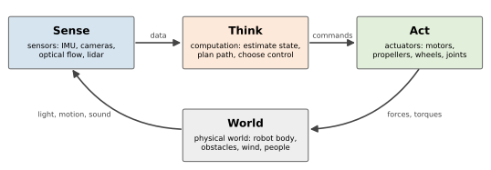
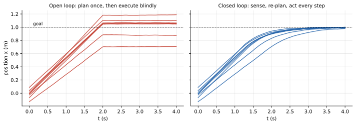

<ul class="post-sources">
<li markdown="span">[Princeton ROB 345 Introduction to Robotics](https://irom-lab.princeton.edu/intro-to-robotics/) Lecture 1 ([video](https://youtu.be/cMhFAq53v1c))</li>
</ul>

첫 강의는 기술적인 내용보다 "로봇 공학이 무엇을 다루는가"에 대한 큰 그림이다. 로봇이 무엇인지 정의해 보고, 로봇 하나를 감지-판단-행동의 세 부분으로 나눈 뒤, 이 강의 전체가 그중 어디를 어떤 순서로 다루는지 지도를 그린다. 마지막으로 로봇 공학이 왜 어려운지를 **불확실성(uncertainty)**이라는 한 단어로 정리한다.

## 로봇 공학의 현재

최근 로봇 공학은 두 방향에서 빠르게 변하고 있다.

- **범용 로봇(generalist robot).** 예전의 산업용 로봇은 공장에서 한 가지 동작을 수만 번 반복하도록 프로그래밍되었다. 지금 연구의 큰 흐름은 언어 지시를 이해하고, 처음 보는 물체를 집고, 여러 종류의 작업을 하나의 모델로 처리하는 로봇이다. 대규모 데이터로 학습한 비전-언어 모델을 로봇 제어에 붙이는 시도가 대표적이다.
- **실험실에서 현실로.** 자율 주행 택시, 물류 창고의 이동 로봇, 배달 로봇, 수술 보조 로봇처럼 통제된 실험실이 아닌 실제 환경에서 사람 곁에서 동작하는 로봇이 늘고 있다.

현실로 나온 로봇에게 요구되는 것은 단순히 "작업을 해낸다"가 아니라 **도움이 되고(helpful), 안전하고(safe), 믿을 수 있는(trustworthy)** 것이다. 그래서 이 강의의 목표는 특정 로봇 하나를 다루는 법이 아니라, **현대 로봇 시스템을 떠받치는 기술적 기반**을 이해하는 것이다. 그 기반은 머신러닝, 제어, 최적화, 컴퓨터 비전 등 여러 분야와 맞닿아 있고, 로봇이 사회에 들어오면서 생기는 프라이버시, 윤리, 인간의 가치와의 정렬(alignment) 같은 문제와도 연결된다.

## 로봇이란 무엇인가

### 하나의 정의

이 강의는 로봇을 다음과 같이 정의한다.

> **로봇(robot)**은 물리적인 작업을 수행하도록 프로그래밍할 수 있는, **몸을 가진 행위자(embodied agent)**다.

이 정의에는 세 요소가 있다.

- **몸을 가진(embodied).** 소프트웨어만으로 된 챗봇이나 추천 시스템은 로봇이 아니다. 로봇은 물리 세계 안에 몸이 있고, 그 몸이 세상과 부딪친다.
- **행위자(agent).** 스스로 무언가를 결정하고 행동한다.
- **프로그래밍 가능(programmable).** 한 가지 동작만 하도록 기계적으로 고정된 장치가 아니라, 소프트웨어를 바꾸면 다른 일을 시킬 수 있다.

### 다른 정의들과 그 한계

다른 곳에서 쓰는 정의도 있다.

| 출처 | 정의의 핵심 |
|---|---|
| 사전적 정의 | 컴퓨터로 프로그래밍할 수 있고, 복잡한 일련의 동작을 자동으로 수행하는 기계 |
| 로봇 산업 협회 | 다양한 작업을 위해 재료, 부품, 도구를 프로그래밍된 동작으로 옮기는, 재프로그래밍 가능한 다기능 매니퓰레이터 |
| IEEE | 환경을 감지하고, 계산으로 결정을 내리고, 현실 세계에서 행동하는 자율 기계 |

어느 정의든 경계 사례에서 삐걱거린다. 몇 가지를 생각해 보자.

- **휴머노이드(humanoid).** 사람처럼 걷고 뛰는 로봇은 누구나 로봇이라고 부른다. 하지만 미리 짜인 춤 동작을 재생할 뿐이라면 "환경을 감지하고 결정을 내린다"는 IEEE 정의를 만족하는가?
- **원격 조종 수술 로봇.** 의사가 콘솔에서 조종하는 수술 로봇은 스스로 결정하지 않는다. 자율성을 요구하는 정의로는 로봇이 아니지만, 보통은 로봇이라고 부른다.
- **식기세척기.** 몸이 있고, 프로그램에 따라 물리적인 일(설거지)을 한다. 정의를 그대로 적용하면 로봇이다. 반대쪽 논리도 있다. 그릇을 넣고 문을 닫는 일은 사람이 해야 하니 자율성이 부족하고, 할 줄 아는 일이 하나뿐이라 작업의 다양성도 없다.
- **자동문.** 센서로 사람을 감지하고 스스로 열린다. 지금은 아무도 로봇이라 부르지 않지만, 처음 나왔을 때는 "문이 저절로 열린다"는 것 자체가 놀라운 일이었다. 사람이 운전하던 엘리베이터가 자동화된 것도 비슷하다. 무엇을 로봇이라 부르는지는 시대에 따라 변한다.
- **스마트 스피커.** 말을 알아듣고 결정을 내리지만 그 자체로는 물리적인 작업을 하지 않는다. 다만 에어컨이나 조명을 켜는 집 전체를 하나의 시스템으로 보면 이야기가 달라진다.
- **산업 정의의 매니퓰레이터.** 로봇 팔만 로봇이라면 드론이나 자율 주행차는 빠진다.

결론은 **완벽한 정의는 없다**는 것이다. 정의는 "무엇에 관심을 두는가"를 드러내는 도구로 받아들이면 된다. 이 강의의 관심은 몸을 가지고 물리 세계에서 작업하는 시스템, 그리고 그 시스템이 감지하고 판단하고 행동하는 방식이다.

### 짧은 역사

스스로 움직이는 기계에 대한 상상은 아주 오래되었다.

| 시기 | 사례 |
|---|---|
| 기원전 ~1000년경 | 그리스 신화의 청동 거인 탈로스(Talos), 섬을 지키는 자동 경비병 |
| 기원전 300년 ~ 기원후 100년 | 고대 그리스의 물, 공기 압력으로 움직이는 자동 인형(automata) |
| ~800년대 | 바누 무사(Banu Musa) 형제의 기계 장치 책 |
| 1100~1200년대 | 알자자리(Ismail al-Jazari)의 자동 악단, 자동 기계 설계 |
| 1500년대 | 레오나르도 다빈치의 기계 기사 설계 |
| 1600년대 | 데카르트, 동물의 몸을 일종의 기계로 보는 관점 |
| 1700년대 | 글씨를 쓰고 그림을 그리는 정교한 자동 인형, 체스 두는 기계 "메커니컬 터크(Mechanical Turk)" |
| 1800년대 | 배비지(Charles Babbage)의 기계식 계산기 구상 |
| 1920년 | 차페크(Karel Čapek)의 희곡 *R.U.R.(Rossum's Universal Robots)* |
| 1950~60년대 | 최초의 산업용 로봇 Unimate (George Devol, Joseph Engelberger) |

메커니컬 터크는 스스로 체스를 둔다고 알려져 유럽 각지를 돌았지만, 실제로는 상자 안에 숨은 사람이 팔을 조종했다. 자율 기계는 아니었지만, 사람이 기계를 원격으로 움직이는 **원격 조작(teleoperation)**의 초기 사례로 볼 수 있다. 원격 조작은 지금도 로봇 공학에서 중요한 방식이다.

"로봇"이라는 단어 자체는 차페크의 희곡에서 왔다. 체코어 *robota*는 노동, 특히 고된 강제 노동을 뜻한다. 그리고 Unimate는 자동차 공장에서 뜨거운 금속 부품을 옮기는 일을 맡으면서 산업용 로봇의 시대를 열었다.

## 로봇 시스템의 해부: 감지-판단-행동

로봇 하나를 분해하면 세 부분이 나온다. 이 강의에서 실습에 쓰는 소형 쿼드로터(quadrotor, 프로펠러 넷 달린 드론)를 예로 들면 다음과 같다.

| 구성 요소 | 하는 일 | 소형 드론의 예 |
|---|---|---|
| **센서(sensor)** | 자신과 주변의 상태를 측정한다 | 관성 측정 장치(IMU: 가속도계와 자이로스코프), 바닥을 내려다보는 광학 흐름(optical flow) 카메라 |
| **계산(computation)** | 측정값으로 상태를 추정하고, 다음 행동을 결정한다 | 기체에 실린 마이크로컨트롤러, 또는 무선으로 연결된 컴퓨터 |
| **액추에이터(actuator)** | 결정을 물리적인 힘으로 바꾼다 | 모터와 프로펠러 |

이 셋이 순환하는 구조를 **감지-판단-행동(sense-think-act)** 또는 **감지-계획-행동(sense-plan-act)** 루프라 부른다.

*감지-판단-행동 루프. 로봇은 세상을 측정하고, 계산으로 행동을 고르고, 액추에이터로 세상에 힘을 가한다. 그 결과 바뀐 세상을 다시 측정한다.*

중요한 것은 이것이 **한 번 지나가는 직선이 아니라 고리**라는 점이다. 드론이 모터 속도를 바꾸면 기체가 움직이고, 움직인 결과가 다시 IMU와 카메라에 잡히고, 그 측정값이 다음 명령을 바꾼다. 이 고리가 1초에 수백 번 돈다.

## 강의 지도

이 강의는 세 덩어리로 이루어진다. 각 덩어리는 감지-판단-행동 루프의 서로 다른 부분에 초점을 둔다.

| 덩어리 | 주제 | 루프에서의 역할 |
|---|---|---|
| **계획과 제어(planning and control)** | 기하학적 경로 계획, 로봇 동역학, 동역학을 고려한 계획, 피드백 제어 | 판단, 행동 |
| **위치 추정과 지도 작성(localization, mapping)** | Bayes 필터, Kalman filter, particle filter, SLAM | 감지, 판단 |
| **로봇 학습(robot learning)** | 모방 학습, 생성 모델 구조(flow matching 등), 강화학습, 월드 모델 | 루프 전체를 데이터로 학습 |

강의 순서대로 따라가면 다음과 같다.

1. **기하학적 경로 계획.** 장애물을 피해 A에서 B로 가는 경로를 찾는다. 격자 위의 그래프 탐색([강의 2](/blog/2026/11/10/rob-02-graph-search/))과 연속 공간의 샘플링 기반 계획 RRT([강의 3](/blog/2026/11/10/rob-03-rrt/)).
2. **로봇 동역학.** 기하학적으로 가능한 경로라도 로봇이 물리적으로 따라갈 수 없을 수 있다. 쿼드로터의 운동 방정식([강의 4](/blog/2026/11/10/rob-04-quadrotor-dynamics/)).
3. **동역학을 고려한 계획.** 미분 평탄성([강의 5](/blog/2026/11/10/rob-05-differential-flatness/))과 궤적 최적화([강의 6](/blog/2026/11/10/rob-06-trajectory-optimization/)).
4. **피드백 제어.** 계획에서 벗어났을 때 되돌아오기. 안정성과 PD 제어([강의 7](/blog/2026/11/10/rob-07-stability-pd/)), LQR([강의 8](/blog/2026/11/10/rob-08-lqr/)).
5. **감지와 상태 추정.** 광학 흐름([강의 9](/blog/2026/11/10/rob-09-optical-flow/)), 비결정적 필터([강의 10](/blog/2026/11/10/rob-10-nondeterministic-filter/)), Bayes 필터([강의 11](/blog/2026/11/10/rob-11-bayes-filter/)), Kalman filter와 particle filter([강의 12](/blog/2026/11/10/rob-12-kalman-particle-filter/)).

로봇 학습 부분은 [Deep Learning 14: 모방 학습](/blog/2026/10/22/dl-14-imitation-learning/)과 [Deep Learning 15: 정책 경사](/blog/2026/10/22/dl-15-policy-gradients/)에서 다룬 내용과 많이 겹친다.

이 모든 것을 하나로 묶는 목표는 **비전 기반 자율 비행**이다. 드론이 카메라와 IMU로 자기 위치를 추정하고, 장애물 지도를 바탕으로 경로를 계획하고, 바람 같은 외란 속에서도 그 경로를 따라 목표까지 스스로 날아가게 만드는 것이다. 각 강의는 이 목표의 한 조각을 채운다.

### 필요한 수학

강의는 다변수 미적분, 선형대수, 기초 확률, 기초 미분방정식, 그리고 Python 프로그래밍을 가정한다. 선형대수는 [보이는 선형대수학](/blog/2026/11/05/hpla-01-intro/)이나 [Linear Algebra](/blog/2026/10/22/la-01-linear-systems/) 시리즈, 확률은 [Bayes 정리](/blog/2026/11/02/knowledge-34-bayes-theorem/) 글로 복습할 수 있다.

## 로봇 공학은 왜 어려운가

### 모라벡의 역설

물건을 집고, 뛰고, 운전하는 일은 사람에게 너무 자연스러워서 어렵다는 느낌조차 없다. 그런데 바로 이런 일을 로봇에게 시키는 것이 가장 어렵다. 반대로 체스나 복잡한 계산처럼 사람에게 어려운 일은 컴퓨터가 비교적 쉽게 해낸다. 이 관찰을 **모라벡의 역설(Moravec's paradox)**이라 한다. 그래서 사람의 직관으로는 로봇에게 무엇이 어려운지 짐작하기 힘들고, 실패 사례를 뜯어보는 것이 좋은 출발점이 된다.

### 실패 사례에서 불확실성 찾기

실제로 일어난 세 가지 실패를 생각해 보자. 정확한 원인은 공식 보고서가 나와야 알 수 있지만, 가능한 원인을 추측해 보는 것만으로도 각 강의 주제가 왜 필요한지 보인다.

| 실패 | 가능한 원인 | 어떤 불확실성인가 |
|---|---|---|
| 배송 드론이 소포를 마당 대신 수영장에 떨어뜨렸다 | 자기 위치를 잘못 알았다. 또는 카메라로 본 수면을 땅으로 오인했다 | 로봇의 상태, 환경의 의미 |
| 물건을 들던 휴머노이드가 균형을 잃고 넘어졌다 | 들기 동작이 끝나지 않았는데 끝났다고 판단했다. 자기 자세 추정이 틀렸다. 시뮬레이션에서 학습한 제어기가 실제 물리와 맞지 않았다 | 로봇의 상태, 로봇의 동역학 |
| 자율 주행차가 교차로에서 사람이 운전하는 차와 부딪혔다 | 중간에 선 다른 차에 가려 다가오는 차를 보지 못했다. 상대 운전자가 양보할 것이라 예측했다 | 부분적으로만 보이는 세상, 사람의 의도 |

두 번째 사례의 마지막 원인은 요즘 로봇 학습의 중요한 주제와 닿아 있다. 걷는 로봇의 제어기는 대개 시뮬레이터 안에서 강화학습으로 훈련한다. 시뮬레이터의 질량, 마찰, 관성 같은 값은 실제와 조금씩 다르기 때문에, 훈련할 때 이 값들을 일부러 무작위로 바꿔 가며(**도메인 무작위화, domain randomization**) 실제 세계가 그 범위 어딘가에 들어 있기를 기대한다. 그래도 남는 시뮬레이션과 현실의 차이를 **sim-to-real gap**이라 부른다.

### 세 덩어리와 불확실성

위 표의 원인들을 모아 보면 공통된 단어가 **불확실성**이다. 로봇 공학의 거의 모든 알고리즘은 어떤 형태의 불확실성을 다루기 위해 만들어졌다고 해도 과장이 아니다. 강의의 세 덩어리는 각각 다른 종류의 불확실성과 싸운다.

| 덩어리 | 무엇이 불확실한가 |
|---|---|
| 계획과 제어 | 로봇 자신의 동역학(질량, 모터 특성의 오차), 세상의 동역학(바람, 미끄러짐), 로봇의 초기 상태 |
| 위치 추정과 지도 작성 | 로봇의 현재 상태(위치, 자세), 세상의 기하(장애물이 정확히 어디 있는가), 환경의 의미(저것이 문인가 벽인가) |
| 로봇 학습 | 데이터의 품질, 사람의 의도, 세상이 주는 보상 |

### 작은 예: 눈을 감고 걷기 vs 보면서 걷기

불확실성이 왜 중요한지, 그리고 감지-판단-행동 루프가 왜 고리여야 하는지를 간단한 시뮬레이션으로 보자. 직선 위의 로봇이 위치 $$x = 0$$ 근처에서 출발해 $$x = 1$$ m인 목표로 가려 한다.

- 로봇은 속도 명령 $$u$$를 보내지만, 실제 속도는 $$k u$$다. 모터 이득 $$k$$는 0.8과 1.2 사이의 어떤 값인데 로봇은 그 값을 모른다.
- 출발 위치도 정확히 0이 아니라 표준편차 5 cm 정도의 오차가 있다.
- 매 순간 작은 외란이 더해진다.

두 가지 전략을 비교한다.

1. **개루프(open loop).** "0.5 m/s로 2초 가면 1 m"라고 한 번 계산하고, 그대로 실행한다. 센서는 보지 않는다.
2. **폐루프(closed loop).** 0.05초마다 위치를 측정하고(측정 잡음 1 cm), 남은 거리에 비례하는 속도 $$u = 1.5\,(1 - z)$$를 보낸다($$z$$는 측정한 위치, 속도는 최대 0.5 m/s로 제한).

*같은 8개의 불확실한 상황(모터 이득과 출발 위치가 다름)에서 개루프(왼쪽)와 폐루프(오른쪽). 점선이 목표 위치 1 m다.*

개루프는 8번의 시도 중 최종 위치가 0.71 m에서 1.19 m까지 퍼지고, 최대 오차가 29 cm다. 이득이 0.8이면 2초 동안 0.8 m밖에 못 가는데, 로봇은 그 사실을 알 방법이 없다. 폐루프는 모든 시도가 목표에서 2 cm 안으로 들어온다. 이득이 작으면 남은 거리가 줄지 않으니 명령이 저절로 계속 나가고, 초과하면 반대 방향 명령이 나간다. **측정해서 고친다**는 단순한 구조가 모르는 이득, 초기 오차, 외란을 한꺼번에 흡수한 것이다.

이 예는 앞으로의 강의를 미리 보여 준다. 무엇을 할지 정하는 것이 계획([강의 2](/blog/2026/11/10/rob-02-graph-search/)–[강의 6](/blog/2026/11/10/rob-06-trajectory-optimization/)), 측정해서 고치는 것이 피드백 제어([강의 7](/blog/2026/11/10/rob-07-stability-pd/)), 측정 잡음 속에서 "지금 어디 있는가"를 잘 추정하는 것이 필터링([강의 11](/blog/2026/11/10/rob-11-bayes-filter/))이다.

### 하드웨어에서 배우기

이 강의는 이론과 시뮬레이션에 그치지 않고 실제 소형 드론(Crazyflie 2.1 brushless, 오픈소스 플랫폼)으로 알고리즘을 시험한다. 하드웨어 실습의 최종 목표는 미리 알려 주지 않은 위치에 세운 장애물들 사이를, 드론이 카메라 영상만 보고 스스로 빠져나가는 것이다. 카메라 영상은 노트북으로 전송되어 처리되고, 예를 들어 모방 학습으로 훈련한 신경망 정책이 비행 명령을 낸다. 실제 하드웨어는 위에서 말한 불확실성을 피할 수 없게 드러낸다. 시뮬레이션에서는 보이지 않던 모터 편차, 배터리 전압 저하, 센서 잡음이 모두 나타나고, "수식으로는 맞는데 왜 안 날지?"라는 경험이 각 알고리즘이 왜 그렇게 설계되었는지를 가장 잘 알려 준다.

### 흔한 오해

- **로봇 공학은 기계를 만드는 분야다.** 하드웨어는 중요하지만, 이 강의의 대부분은 알고리즘이다. 같은 드론이라도 어떤 계획, 제어, 추정 알고리즘을 쓰느냐에 따라 전혀 다르게 난다.
- **계획만 잘 세우면 된다.** 위의 개루프 예처럼, 완벽한 계획도 모르는 오차 앞에서는 틀어진다. 계획과 피드백, 추정은 함께 있어야 한다.
- **학습이 나머지를 대체한다.** 학습 기반 방법은 강력하지만, 그 안에서도 동역학, 제어, 추정의 개념이 그대로 쓰인다. 고전적인 기법을 이해해야 학습된 로봇이 왜 실패하는지도 이해할 수 있다.

## 정리

- 이 강의는 로봇을 **물리적인 작업을 수행하도록 프로그래밍할 수 있는, 몸을 가진 행위자**로 정의한다. 모든 정의는 경계 사례에서 한계가 있다.
- "로봇"이라는 말은 1920년 차페크의 희곡에서 왔고(체코어 *robota*, 노동), 산업용 로봇은 1950~60년대 Unimate에서 시작했다.
- 로봇은 **센서, 계산, 액추에이터**로 이루어지고, 이들이 감지-판단-행동 루프를 이룬다.
- 강의는 **계획과 제어 → 위치 추정과 지도 작성 → 로봇 학습** 순서로 진행하며, 최종 목표는 드론의 비전 기반 자율 비행이다.
- 로봇 공학을 어렵게 만드는 핵심은 동역학, 상태, 환경, 데이터에 대한 **불확실성**이고, 측정해서 고치는 폐루프 구조가 그 첫 번째 해답이다.
