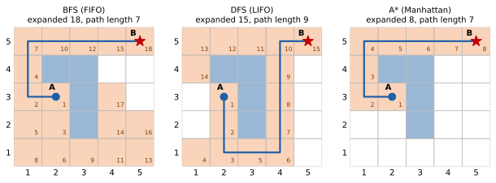
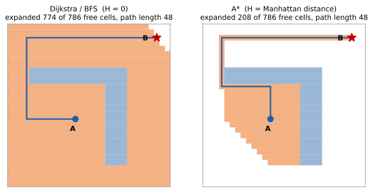

<ul class="post-sources">
<li markdown="span">[Princeton ROB 345 Introduction to Robotics](https://irom-lab.princeton.edu/intro-to-robotics/) Lecture 2 ([video](https://youtu.be/LhLd8Kon1GY))</li>
</ul>

[강의 1](/blog/2026/11/10/rob-01-intro/)의 강의 지도에서 첫 주제는 **기하학적 경로 계획(geometric motion planning)**이다. 환경의 지도가 주어졌을 때, 로봇을 출발점 A에서 목표점 B까지 **장애물에 부딪히지 않고** 옮기는 경로를 찾는 문제다. 이번 강의는 연속적인 공간을 격자로 잘게 나눠 그래프로 바꾼 다음, 그래프 탐색 알고리즘으로 경로를 찾는다.

## 기하학적 경로 계획

### 피아노 운반 문제

좁은 계단과 문을 지나 피아노를 2층 방까지 옮긴다고 하자. 피아노를 어느 순간에 얼마나 기울이고 돌려야 벽에 걸리지 않는지 정하는 문제를 **피아노 운반 문제(piano mover's problem)**라 한다. 1980년 전후부터 로봇 공학에서 연구되었고, 일반적인 형태는 계산 복잡도가 매우 높다(PSPACE-complete)는 것이 알려져 있다. 오늘날 "피아노 운반 문제"는 경로 계획과 같은 뜻으로 쓰인다.

같은 구조의 문제가 여러 곳에 있다.

- **자율 주행차**: 다른 차와 보행자를 피해 차선을 바꾸고 교차로를 지난다.
- **로봇 팔**: 선반 사이로 팔을 넣어 물건을 집는다.
- **단백질 접힘(protein folding)**: 분자의 각 결합 각도를 "관절"로 보면, 분자가 펼쳐진 상태에서 접힌 상태로 가는 경로를 찾는 문제가 된다.

### 세 가지 가정

이번 강의와 다음 강의에서는 문제를 단순하게 만들기 위해 다음을 가정한다.

1. **어떤 경로든 따라갈 수 있다.** 로봇의 동역학(속도, 가속도의 한계)을 무시한다. 이 가정은 [강의 4](/blog/2026/11/10/rob-04-quadrotor-dynamics/)부터 걷어낸다.
2. **로봇의 상태를 정확히 안다.** 위치 추정의 오차는 없다.
3. **환경의 지도가 주어진다.** 장애물이 어디에 있는지 안다.

그러면 문제는 이렇게 쓸 수 있다. **구성 A에서 구성 B로 가는, 충돌 없는 경로를 찾아라.** 여기서 "구성"이라는 말을 정확히 하려면 구성 공간이 필요하다.

## 구성 공간

### 자유도

**자유도(degrees of freedom, DoF)**는 시스템이 움직일 수 있는 독립적인 방법의 수다.

| 시스템 | 자유도 |
|---|---|
| $$d$$차원 공간의 점 하나 | $$d$$ |
| $$d$$차원 공간의 점 $$N$$개 | $$N d$$ |
| 진자(pendulum) | 1 (흔들리는 각도) |
| 평면 쿼드로터(planar quadrotor) | 3 (위치 $$x, y$$와 기울기 $$\theta$$) |
| 평면 위의 링크 $$n$$개짜리 뱀 로봇 (바닥에 고정 안 됨) | $$n + 2$$ |

자유도는 "시스템의 구성을 나타내는 데 필요한 최소 좌표 수"라고 생각해도 된다. 진자의 끝점은 평면 위에 있으니 $$(x, y)$$ 두 좌표로 쓸 수 있지만, $$\sqrt{x^2 + y^2} = (\text{진자 길이})$$라는 제약 때문에 두 좌표가 독립이 아니다. 각도 $$\theta$$ 하나면 충분하므로 자유도는 1이다.

평면 쿼드로터는 2차원 평면에서만 움직이는 드론 모델이다. 무게 중심의 위치 $$(x, y)$$와 기체가 기운 각도 $$\theta$$, 이 세 값은 서로 독립적으로 바꿀 수 있고, 셋을 정하면 드론이 어디에 어떤 자세로 있는지 완전히 정해진다.

뱀 로봇은 이렇게 세면 된다. 한쪽 끝점의 위치 $$(x, y)$$에 2개, 그리고 링크마다 방향을 나타내는 각도가 하나씩 $$n$$개가 필요하다. 링크가 하나뿐이면 $$1 + 2 = 3$$으로 평면 쿼드로터와 같아지는데, 막대 하나가 평면에서 움직이는 것과 같으니 당연하다.

### 구성 공간, 자유 공간, 장애물 공간

**구성(configuration)** $$q$$는 시스템의 모든 점이 어디에 있는지를 완전히 정하는 값의 묶음이고, 가능한 모든 구성의 집합을 **구성 공간(configuration space)** $$\mathcal{C}$$라 한다.

| 시스템 | 구성 공간 |
|---|---|
| $$d$$차원 공간의 점 | $$\mathcal{C} = \mathbb{R}^d$$ |
| $$d$$차원 공간의 점 $$N$$개 | $$\mathcal{C} = \mathbb{R}^{N d}$$ |
| 진자 | $$\mathcal{C} = S^1$$ (원) |
| 평면 쿼드로터 | $$\mathcal{C} = \mathbb{R}^2 \times S^1$$ (흔히 $$SE(2)$$라고도 쓴다) |
| 링크 $$n$$개 뱀 로봇 | $$\mathcal{C} = \mathbb{R}^2 \times S^1 \times \cdots \times S^1$$ ($$S^1$$이 $$n$$개) |

진자의 구성 공간이 실수 직선 $$\mathbb{R}$$이 아니라 원 $$S^1$$인 이유는 각도 $$0$$과 $$2\pi$$가 같은 자세이기 때문이다. 각도는 한 바퀴 돌면 제자리로 온다. 평면 쿼드로터의 구성 공간을 $$(x, y, \theta)$$ 축의 3차원 상자로 그리면, $$\theta = 0$$인 바닥면과 $$\theta = 2\pi$$인 윗면이 같은 면이다.

구성 공간은 두 부분으로 나뉜다.

- **자유 공간(free space)** $$\mathcal{C}_{free} \subseteq \mathcal{C}$$: 로봇이 어떤 장애물과도 겹치지 않는 구성들.
- **장애물 공간(obstacle space)** $$\mathcal{C}_{obs} = \mathcal{C} \setminus \mathcal{C}_{free}$$: 로봇이 장애물과 겹치는 구성들.

이제 기하학적 경로 계획은 이렇게 정식화된다.

> 연속 함수 $$\tau : [0, 1] \to \mathcal{C}_{free}$$로서 $$\tau(0) = q_A$$, $$\tau(1) = q_B$$인 것을 찾아라.

$$\tau$$는 시간 0에서 1까지 구성을 하나씩 정해 주는 곡선이고, 그 곡선 전체가 자유 공간 안에 있어야 한다. 구성 공간에서는 크기와 모양이 있는 로봇이 **점 하나**가 되므로, 문제는 "점을 자유 공간 안에서 A에서 B로 옮기기"가 된다. 로봇 팔 같은 경우 구성 공간 장애물이 어떻게 생기는지는 [강의 3](/blog/2026/11/10/rob-03-rrt/)에서 그림으로 본다.

### 이산 계획

구성의 개수가 유한한 계획 문제를 **이산 계획(discrete planning)**이라 한다. 루빅스 큐브가 좋은 예다. 큐브가 가질 수 있는 상태의 수는 엄청나게 많지만 유한하고, 한 번 돌리기가 상태 사이의 이동이다. 목표는 하나의 상태가 아니라 "모든 면의 색이 맞는 상태들"이라는 **목표 집합(goal set)**이다. 구성 공간이 연속적이면 잘게 쪼개서 이산 문제로 바꿀 수 있다. 이번 강의에서는 가장 단순한 경우, **평면 위의 점 로봇**($$\mathcal{C} = \mathbb{R}^2$$)을 이렇게 이산화해서 푼다.

## 이산화: 연속 공간을 그래프로

### 격자 만들기

연속 공간에는 점이 무한히 많아서 바로 탐색할 수 없다. 그래서 공간을 **균일한 격자(uniform grid)**로 나누고, 각 칸을 하나의 위치로 취급한다. 이때 세 가지를 선택해야 한다.

- **격자 모양**: 여기서는 모든 칸의 크기가 같은 균일 격자를 쓴다. 필수는 아니다. 장애물 근처나 좁은 통로는 잘게, 넓은 빈 공간은 크게 나누는 **적응형 해상도(adaptive resolution)**도 가능하다.
- **연결성**: 한 칸에서 상하좌우 네 칸으로만 갈 수 있으면 **4-연결(4-connected)**, 대각선 네 칸까지 여덟 칸으로 갈 수 있으면 **8-연결(8-connected)**이다. 여기서는 4-연결을 쓴다.
- **해상도**: 칸이 작을수록 실제 공간을 잘 근사하지만, 칸 수가 늘어나 탐색이 오래 걸린다. 칸이 너무 크면 좁은 통로가 장애물 칸에 묻혀 사라질 수 있다.

### 그래프로 바꾸기

**그래프(graph)**는 **정점(vertex)**과 정점을 잇는 **간선(edge)**의 모음이다. 간선은 어떤 정점에서 어떤 정점으로 한 번에 갈 수 있는지를 나타낸다. 격자를 그래프로 바꾸는 방법은 세 단계다.

1. 각 칸에 정점 하나를 대응시킨다. 정점은 칸의 모서리가 아니라 **칸의 중심**에 둔다.
2. 한 걸음에 오갈 수 있는 칸(4-연결이면 상하좌우)의 정점끼리 간선으로 잇는다.
3. 장애물이 있는 칸의 정점과, 그 정점에 붙은 간선을 지운다.

이렇게 하면 경로 계획은 **그래프에서 A의 정점에서 B의 정점으로 가는 경로 찾기**, 즉 그래프 탐색 문제가 된다. 그래프 탐색에는 강력하고 잘 연구된 알고리즘이 많다.

### 예제 격자

이번 강의 내내 쓸 예제는 $$5 \times 5$$ 격자다. 칸은 $$(i, j) = (x, y) = (\text{열}, \text{행})$$으로 부르고, 왼쪽 아래가 $$(1, 1)$$, 오른쪽 위가 $$(5, 5)$$다.

- 출발점 $$A = (2, 3)$$, 목표점 $$B = (5, 5)$$.
- 장애물 칸: $$(2, 4), (3, 4), (3, 3), (3, 2)$$. A의 위와 오른쪽을 막는 ㄱ자 모양 벽이다.

A에서 B로 가려면 벽을 왼쪽 위로 돌아가거나(7걸음), 아래로 돌아가야(9걸음) 한다. 아래 그림의 파란 칸이 장애물이다.

## 전진 탐색: 모든 탐색의 뼈대

### 알고리즘

BFS, DFS, Dijkstra, A*는 모두 같은 뼈대를 공유한다. 이 뼈대를 **전진 탐색(forward search)**이라 한다.

```python
def forward_search(A, goal_set):
    Q = Container([A])          # 아직 탐색 중인 정점들
    visited = {A}
    parent = {A: None}
    while Q:                    # Q가 비어 있지 않은 동안
        x = Q.get_vertex()      # 다음에 살펴볼 정점을 하나 꺼낸다
        if x in goal_set:
            return SUCCESS, parent
        for x2 in neighbors(x):
            if x2 not in visited:
                parent[x2] = x  # x를 거쳐 x2에 처음 도착했다
                visited.add(x2)
                Q.insert(x2)
    return FAILURE
```

세 부분으로 읽으면 된다.

- **자료 구조 $$Q$$**: "발견은 했지만 아직 이웃을 다 살펴보지 않은" 정점들의 대기열이다.
- **`get_vertex`**: $$Q$$에서 다음에 살펴볼 정점을 하나 꺼낸다. **어떤 순서로 꺼내느냐가 알고리즘의 정체를 결정한다.**
- **이웃 방문**: 꺼낸 정점의 이웃 중 처음 보는 것을 방문 표시하고 $$Q$$에 넣는다. 이렇게 그래프를 조금씩 넓혀 간다.

목표에 도착한 뒤 실제 경로는 `parent`를 목표에서 출발점까지 거꾸로 따라가서 얻는다. 각 정점에 "어디서 왔는가"만 기록해 두면 경로 전체를 저장할 필요가 없다.

아래 예제에서 이웃은 **오른쪽, 위, 왼쪽, 아래** 순서로 살펴본다. 이 순서는 임의로 정한 것이고, 순서가 바뀌면 탐색 과정의 세부와 (BFS, DFS에서는) 찾은 경로가 달라질 수 있다.

## 너비 우선 탐색 (BFS)

### 선입선출

`get_vertex`를 **선입선출(first-in-first-out, FIFO)**로 구현하면, 즉 $$Q$$를 줄 서기처럼 먼저 들어온 것부터 꺼내면 **너비 우선 탐색(breadth-first search, BFS)**이 된다.

예제에서 처음 몇 단계를 따라가 보자. 처음에 $$Q = \{(2, 3)\}$$이고 A만 방문했다.

| 반복 | 꺼낸 정점 $$x$$ | 이웃 | 새로 넣는 정점 | 반복 후 $$Q$$ |
|---|---|---|---|---|
| 1 | $$(2, 3)$$ | $$(1, 3), (2, 2)$$ | $$(1, 3), (2, 2)$$ | $$(1, 3), (2, 2)$$ |
| 2 | $$(1, 3)$$ | $$(2, 3), (1, 4), (1, 2)$$ | $$(1, 4), (1, 2)$$ | $$(2, 2), (1, 4), (1, 2)$$ |
| 3 | $$(2, 2)$$ | $$(2, 3), (1, 2), (2, 1)$$ | $$(2, 1)$$ | $$(1, 4), (1, 2), (2, 1)$$ |
| 4 | $$(1, 4)$$ | $$(1, 5), (1, 3)$$ | $$(1, 5)$$ | $$(1, 2), (2, 1), (1, 5)$$ |

반복 3에서 $$(1, 2)$$는 이미 반복 2에서 방문했으므로 다시 넣지 않는다. 이렇게 계속하면 18번째로 꺼낸 정점이 B이고, 부모를 거꾸로 따라가면 $$(2,3) \to (1,3) \to (1,4) \to (1,5) \to (2,5) \to (3,5) \to (4,5) \to (5,5)$$, 7걸음짜리 경로가 나온다.


*5×5 예제에서 세 알고리즘. 주황 칸은 $$Q$$에서 꺼낸(확장한) 칸이고 숫자는 꺼낸 순서, 파란 선은 찾은 경로다.*

### BFS의 성질

FIFO는 먼저 발견한 것부터 처리하므로, BFS는 **A에서 $$k$$걸음 떨어진 정점을 모두 처리한 뒤에야 $$k+1$$걸음 떨어진 정점을 처리한다.** 그림의 왼쪽에서 번호가 A로부터 물결처럼 퍼져 나가는 것이 이 성질이다. 그래서 BFS가 찾은 경로는 **간선 수가 가장 적은 경로**다. 실행 시간은 정점 수 $$\lvert V \rvert$$와 간선 수 $$\lvert E \rvert$$에 대해 $$O(\lvert V \rvert + \lvert E \rvert)$$다. 증명과 자세한 분석은 [Algorithms 9: BFS](/blog/2026/10/22/algo-09-bfs/)에 정리되어 있다.

## 깊이 우선 탐색 (DFS)

### 후입선출

`get_vertex`를 **후입선출(last-in-first-out, LIFO)**로, 즉 $$Q$$를 접시 쌓기처럼 가장 나중에 들어온 것부터 꺼내면 **깊이 우선 탐색(depth-first search, DFS)**이 된다.

| 반복 | 꺼낸 정점 $$x$$ | 새로 넣는 정점 | 반복 후 $$Q$$ (오른쪽이 맨 위) |
|---|---|---|---|
| 1 | $$(2, 3)$$ | $$(1, 3), (2, 2)$$ | $$(1, 3), (2, 2)$$ |
| 2 | $$(2, 2)$$ | $$(1, 2), (2, 1)$$ | $$(1, 3), (1, 2), (2, 1)$$ |
| 3 | $$(2, 1)$$ | $$(3, 1), (1, 1)$$ | $$(1, 3), (1, 2), (3, 1), (1, 1)$$ |
| 4 | $$(1, 1)$$ | 없음 | $$(1, 3), (1, 2), (3, 1)$$ |
| 5 | $$(3, 1)$$ | $$(4, 1)$$ | $$(1, 3), (1, 2), (4, 1)$$ |

반복 4에서 $$(1, 1)$$은 막다른 곳이다. 그러면 쌓여 있던 것 중 가장 최근 것인 $$(3, 1)$$로 돌아가 다른 방향으로 다시 파고든다. 계속하면 $$(4, 1)$$부터 오른쪽 열을 타고 올라가 15번째로 B를 꺼내고, 경로는 **9걸음**이다(그림 가운데). 벽 아래로 돌아가는 길을 먼저 깊이 파고들었기 때문에 최단 경로를 놓쳤다.

### DFS의 성질

- DFS는 한 길을 막다른 곳이나 목표에 닿을 때까지 깊게 판다. 막히면 다른 갈래로 돌아가 다시 끝까지 판다.
- **최단 경로를 보장하지 않는다.** 위 예에서 9걸음 경로를 반환했다.
- 그래도 쓸모가 있다. 경로가 길고 목표로 가는 길이 몇 개 없는 미로 같은 환경에서는, 넓게 퍼지는 BFS보다 한 길을 끝까지 따라가는 DFS가 더 빨리 목표에 닿을 수 있다.

(이 강의의 DFS는 정점을 $$Q$$에 넣을 때 방문 표시를 하는 전진 탐색의 한 변형이다. 재귀로 구현하는 교과서적 DFS와 방문 순서가 조금 다를 수 있다. 일반적인 DFS는 [Algorithms 10: DFS](/blog/2026/10/22/algo-10-dfs/)를 참고.)

## 비용과 Dijkstra

### BFS의 두 가지 한계

1. **경로 길이(간선 수)에 대해서만 최적이다.** 이동 방향이나 장소마다 비용이 다르면 어떨까? 예를 들어 바람이 한쪽으로 불면 드론은 바람을 등지고 가는 쪽이 에너지가 덜 든다. 바퀴 달린 로봇은 앞으로 가기는 쉬워도 옆으로 가기는 어렵다. BFS는 이런 차이를 반영하지 못한다.
2. **탐색이 느리다.** 목표가 어느 쪽에 있는지 전혀 고려하지 않고 모든 방향으로 똑같이 퍼진다. 위 그림에서 BFS는 목표와 반대쪽인 아래 칸들까지 모두 꺼냈다.

### 경로의 비용

첫 번째 한계를 풀기 위해 각 간선 $$e$$에 **비용(cost, loss)** $$l(e) \ge 0$$을 붙인다. 경로의 총비용은 경로를 이루는 간선 비용의 합이고, 목표는 **총비용이 가장 작은 경로**를 찾는 것이다. 모든 간선의 비용이 1이면 총비용은 간선 수가 되어 BFS의 문제로 돌아간다.

비용이 음수가 되면 안 되는 이유는 간단하다. 비용이 $$-1$$인 간선이 하나 있으면, 그 간선을 앞뒤로 계속 오가는 것만으로 총비용을 한없이 줄일 수 있다. "최소 비용 경로"가 $$-\infty$$가 되어 문제 자체가 의미를 잃는다.

### Dijkstra 알고리즘

정점 $$x$$마다 **도착 비용(cost-to-come)** $$C(x)$$, 즉 지금까지 찾은 A에서 $$x$$까지의 가장 싼 경로 비용을 기록한다. 그리고 `get_vertex`가 **$$C(x)$$가 가장 작은 정점**을 꺼내게 한다. 이것이 **Dijkstra 알고리즘**이다. $$Q$$는 우선순위 큐(priority queue)로 구현한다.

출발점에서 가까운(싼) 정점부터 차례로 확정해 나가므로, 비용이 0 이상이기만 하면 최소 비용 경로를 찾는다. 지도 앱의 길 찾기가 이 알고리즘에서 출발했다. 정확성 증명과 힙에 따른 실행 시간은 [Algorithms 13: Dijkstra](/blog/2026/10/22/algo-13-dijkstra/)에 있다.

하지만 Dijkstra도 두 번째 한계, **목표 방향을 모른다**는 문제는 그대로다. 모든 비용이 1이면 BFS와 거의 같은 순서로 정점을 꺼낸다.

## A* 탐색

### 핵심 아이디어: 남은 거리를 어림한다

사람이 지도에서 길을 찾을 때는 목표 쪽으로 향하는 길을 먼저 살펴본다. A*는 이 직관을 수식으로 만든다. 정점 $$x$$의 우선순위를

$$
F(x) \triangleq C(x) + H(x)
$$

로 두고, `get_vertex`가 $$F$$가 가장 작은 정점을 꺼낸다.

- $$C(x)$$: **도착 비용**. A에서 $$x$$까지 지금까지 찾은 가장 싼 비용.
- $$H(x)$$: **남은 비용 추정(estimated cost-to-go)**. $$x$$에서 B까지 남은 비용의 어림값. 이것을 **휴리스틱(heuristic)**이라 한다.

$$F(x)$$는 "$$x$$를 거쳐 B까지 가는 경로의 총비용이 대략 얼마일까"에 대한 추정이다. 이미 들인 비용과 앞으로 들 비용을 함께 보니, 목표에서 멀어지는 방향의 정점은 $$H$$가 커서 뒤로 밀린다.

### 휴리스틱은 과소 추정이어야 한다

A*가 올바로 동작하려면 **$$H(x)$$가 $$x$$에서 목표까지의 실제 최소 비용을 넘지 않아야** 한다. 즉 하한(lower bound)이어야 한다.

$$
H(x) \le h^*(x) \quad \text{for all } x
$$

여기서 $$h^*(x)$$는 $$x$$에서 B까지 가는 실제 최소 비용이다. 이런 휴리스틱을 **허용 가능한(admissible)** 휴리스틱이라 한다. 좋은 하한은 대개 쉽게 구할 수 있다.

- 거리를 최소화하는 문제라면, 장애물을 무시한 **유클리드 거리** $$\lVert x - B \rVert$$는 실제 경로 길이보다 길 수 없다. 장애물이 있으면 돌아가야 하니 실제 경로는 더 길거나 같다.
- 4-연결 격자에서 간선 비용이 모두 1이면, **맨해튼 거리(Manhattan distance)** $$\lvert x_1 - B_1 \rvert + \lvert x_2 - B_2 \rvert$$가 하한이다. 한 걸음에 한 좌표가 1씩만 변하므로 적어도 이만큼은 걸어야 한다.

두 휴리스틱 모두 **장애물을 무시한다**는 점이 핵심이다. 장애물까지 고려해 남은 비용을 정확히 계산하려면 원래 경로 계획 문제를 푸는 것만큼 어렵다. 장애물을 무시하면 $$H$$를 공식 하나로 즉시 계산할 수 있고, 그래도 하한이라는 성질은 유지된다.

특수한 경우로 **모든 $$x$$에 $$H(x) = 0$$**을 쓰면 $$F = C$$가 되어 A*는 Dijkstra와 같아진다. 0은 언제나 하한이므로 허용 가능하지만, 아무 정보도 주지 않는다.

### 과대 추정하면 왜 틀리는가

작은 예로 확인하자. 정점이 S(출발), X, G(목표) 셋이고 간선은 S-X 비용 1, X-G 비용 1, S-G 비용 3이다. 최적 경로는 S→X→G로 비용 2다. $$H(S) = H(G) = 0$$으로 둔다.

- **과대 추정** $$H(X) = 5$$ (실제 남은 비용은 1): S를 꺼낸 뒤 $$F(X) = 1 + 5 = 6$$, $$F(G) = 3 + 0 = 3$$이다. G가 먼저 꺼내지고 비용 3인 경로 S→G를 반환한다. **틀렸다.**
- **허용 가능** $$H(X) = 1$$: $$F(X) = 1 + 1 = 2 < F(G) = 3$$이라 X를 먼저 꺼낸다. X를 거치면 $$C(G) = 2$$로 갱신되고 $$F(G) = 2$$다. G를 꺼내 비용 2인 최적 경로를 반환한다.

과대 추정은 좋은 길을 "멀어 보인다"고 착각해 미뤄 두게 만들고, 그 사이 나쁜 경로로 목표에 먼저 도착해 버린다.

### 예제 따라가기

5×5 예제에서 간선 비용은 모두 1, 휴리스틱은 B까지의 맨해튼 거리 $$H(x) = \lvert x_1 - 5 \rvert + \lvert x_2 - 5 \rvert$$다. $$F$$가 같으면 $$H$$가 작은 쪽(목표에 더 가까운 쪽)을 먼저 꺼낸다.

정점을 세 종류로 나눠 생각하면 편하다.

- **미방문(unvisited)**: 아직 만나지 않은 정점.
- **살아 있음(alive)**: 만났지만 아직 $$Q$$에서 꺼내지 않은 정점.
- **죽음(dead)**: $$Q$$에서 꺼내 이웃까지 처리를 끝낸 정점. 다시 볼 필요가 없다.

처음에 $$C(A) = 0$$, $$H(A) = 3 + 2 = 5$$, $$F(A) = 5$$다.

| 반복 | 꺼낸 정점 | 이웃의 $$C$$, $$H$$, $$F$$ | 반복 후 $$Q$$ ($$F$$) |
|---|---|---|---|
| 1 | $$(2, 3)$$, $$F = 5$$ | $$(1, 3)$$: $$1 + 6 = 7$$, $$(2, 2)$$: $$1 + 6 = 7$$ | $$(1, 3)$$: 7, $$(2, 2)$$: 7 |
| 2 | $$(1, 3)$$, $$F = 7$$ | $$(1, 4)$$: $$2 + 5 = 7$$, $$(1, 2)$$: $$2 + 7 = 9$$, $$(2, 3)$$: 죽음 | $$(1, 4)$$: 7, $$(2, 2)$$: 7, $$(1, 2)$$: 9 |
| 3 | $$(1, 4)$$, $$F = 7$$ | $$(1, 5)$$: $$3 + 4 = 7$$ | $$(1, 5)$$: 7, $$(2, 2)$$: 7, $$(1, 2)$$: 9 |
| 4 | $$(1, 5)$$, $$F = 7$$ | $$(2, 5)$$: $$4 + 3 = 7$$ | $$(2, 5)$$: 7, $$(2, 2)$$: 7, $$(1, 2)$$: 9 |

반복 2에서 $$(1, 3)$$과 $$(2, 2)$$는 $$F$$도 $$H$$도 같아서 아무것이나 꺼내도 된다(여기서는 $$(1, 3)$$). 반복 3부터는 $$(1, 4)$$의 $$H = 5$$가 $$(2, 2)$$의 $$H = 6$$보다 작아서 목표 쪽 정점이 계속 먼저 나온다. 이렇게 경로 위의 정점만 차례로 꺼내다가 8번째에 B를 꺼낸다. BFS는 18개, A*는 8개를 꺼냈다(그림 오른쪽). 찾은 경로는 둘 다 7걸음짜리 최단 경로다.

$$F$$ 값이 A 다음부터 7로 일정한 것도 눈여겨볼 만하다. 최적 경로 위에서는 $$C$$가 1 늘 때마다 $$H$$가 1 줄어든다. $$(1, 3)$$부터는 맨해튼 거리가 실제 남은 거리와 정확히 같기 때문이다. (A에서는 $$H = 5$$지만 벽 때문에 실제로는 7걸음이 남아 있다.)

### 전체 알고리즘

```python
def a_star(A, B, neighbors, l, H):
    C = defaultdict(lambda: inf); C[A] = 0     # 도착 비용
    F = defaultdict(lambda: inf); F[A] = H(A)  # 우선순위
    parent = {A: None}
    Q = {A}            # 살아 있는 정점
    dead = set()       # 죽은 정점
    while Q:
        x = min(Q, key=lambda v: F[v])         # F가 가장 작은 정점
        if x == B:
            return SUCCESS, parent
        Q.remove(x); dead.add(x)
        for x2 in neighbors(x):
            if x2 in dead:
                continue
            tentative = C[x] + l(x, x2)        # x를 거쳐 x2로 가는 비용
            if tentative < C[x2]:              # 지금까지보다 싸면 기록
                parent[x2] = x
                C[x2] = tentative
                F[x2] = C[x2] + H(x2)
                Q.add(x2)
    return FAILURE
```

BFS와 달라진 점은 두 가지다.

- **꺼내는 순서**: $$F$$가 가장 작은 정점. 실제로는 `min`을 매번 계산하지 않고 이진 힙으로 된 우선순위 큐를 쓴다([Algorithms 8: 이진 힙](/blog/2026/10/22/algo-08-heaps/)).
- **비용 갱신(relaxation)**: 이미 살아 있는 정점이라도 더 싼 길을 찾으면 $$C$$, $$F$$, 부모를 고친다. BFS는 처음 발견한 길을 그대로 썼다.

이 구현은 죽은 정점을 다시 열지 않는다. 그래서 엄밀히는 허용 가능성보다 조금 강한 조건, **일관성(consistency)** $$H(x) \le l(x, x') + H(x')$$ (모든 간선 $$(x, x')$$에 대해)이 성립해야 최적성이 보장된다. "한 걸음 가서 어림한 값이 지금 어림한 값보다 크게 줄지 않는다"는 삼각 부등식이다. 유클리드 거리와 (4-연결 격자의) 맨해튼 거리는 모두 일관적이다.

### 더 큰 예


*30×30 격자에서 A가 ㄱ자 벽 안쪽에 갇혀 있다. 왼쪽은 $$H = 0$$(Dijkstra, 단위 비용이라 BFS와 같은 결과), 오른쪽은 맨해튼 휴리스틱 A*. 둘 다 48걸음의 최단 경로를 찾지만 꺼낸 칸 수는 774 대 208이다.*

A*도 벽 안쪽의 칸을 꽤 많이 꺼냈다. 맨해튼 거리는 벽을 모르기 때문에, 처음에는 목표 쪽(오른쪽 위)으로 가다가 벽에 막히고, 벽 안쪽에서 $$F$$가 작은 칸을 다 소진한 뒤에야 벽을 돌아 나간다. 그래도 목표 반대쪽의 넓은 영역은 건드리지 않는다. 벽을 더 교묘하게 배치하면 휴리스틱을 계속 속여 A*가 거의 모든 칸을 꺼내게 만들 수도 있다. 최악의 경우 A*는 Dijkstra보다 나을 게 없지만, 실제 로봇이 마주치는 환경은 대개 이런 적대적인 모양이 아니어서 휴리스틱이 큰 도움이 된다. **휴리스틱이 실제 남은 비용에 가까울수록 A*가 꺼내는 정점이 줄어든다.** 실제 남은 비용과 정확히 같다면 최적 경로 위의 정점만 꺼낸다.

### 학습된 휴리스틱

좋은 휴리스틱을 손으로 설계하기 어려운 문제도 많다. 테슬라가 2021년 발표에서 보여 준 주차장 경로 탐색이 좋은 예다. 유클리드 거리를 휴리스틱으로 쓴 격자 A*는 목표 쪽으로 곧장 가다가 주차된 차에 막혀 되돌아오기를 반복했고, 목표에 도달하기까지 약 40만 개의 노드를 확장했다. 내비게이션 경로를 따라가도록 휴리스틱을 바꾸자 약 2만 2천 개로 줄었고, 신경망으로 남은 비용을 학습한 휴리스틱은 이보다 훨씬 적은 노드로 경로를 찾았다. 학습된 휴리스틱은 탐색을 크게 줄여 주는 대신, 허용 가능성을 보장하기 어렵다는 대가가 있다.

## 흔한 실수

- **8-연결 격자에서 맨해튼 거리를 쓴다.** 대각선 한 걸음(비용 $$\sqrt{2} \approx 1.41$$)이 맨해튼 거리를 2나 줄이므로, 맨해튼 거리는 실제 비용을 넘을 수 있다. 허용 가능하지 않다. 유클리드 거리나 대각 이동을 반영한 거리를 써야 한다.
- **방문 표시를 꺼낼 때 한다고 생각한다(BFS).** 이 강의의 전진 탐색은 $$Q$$에 **넣을 때** 방문 표시를 한다. 그래야 같은 정점이 $$Q$$에 여러 번 들어가지 않는다.
- **A*에서 처음 찾은 비용을 고정한다.** 살아 있는 정점은 더 싼 경로가 나오면 $$C$$와 부모를 고쳐야 한다. 이 갱신을 빼면 최적성이 깨진다.
- **격자 해상도를 무시한다.** 격자 위 최단 경로는 연속 공간의 최단 경로가 아니다. 4-연결 격자의 경로는 계단 모양이라 실제 직선보다 길고, 해상도가 거칠면 좁은 통로를 아예 못 찾는다. 해상도를 높이면 정점 수가 폭발하는데, 이것이 [강의 3](/blog/2026/11/10/rob-03-rrt/)에서 샘플링 기반 방법으로 넘어가는 이유다.

## 정리

| 알고리즘 | `get_vertex`가 꺼내는 것 | 최적성 | 특징 |
|---|---|---|---|
| BFS | 가장 먼저 넣은 정점 (FIFO) | 간선 수 최소 | 모든 방향으로 고르게 퍼짐 |
| DFS | 가장 나중에 넣은 정점 (LIFO) | 보장 없음 | 한 길을 끝까지 판 뒤 되돌아감 |
| Dijkstra | $$C(x)$$ 최소 | 비용 최소 ($$l \ge 0$$) | 비용을 반영하지만 목표 방향을 모름 |
| A* | $$F(x) = C(x) + H(x)$$ 최소 | 비용 최소 ($$H$$ 허용 가능, 일관적) | 휴리스틱으로 목표 쪽부터 탐색 |

- 경로 계획은 구성 공간의 자유 공간 $$\mathcal{C}_{free}$$ 안에서 $$q_A$$와 $$q_B$$를 잇는 곡선을 찾는 문제다.
- 공간을 격자로 이산화하고 장애물 칸을 지우면 그래프 탐색 문제가 된다.
- 모든 탐색은 같은 전진 탐색 뼈대를 공유하고, $$Q$$에서 정점을 꺼내는 순서만 다르다.
- A*의 휴리스틱은 실제 남은 비용의 하한이어야 하며, 실제 비용에 가까울수록 탐색이 빨라진다.
