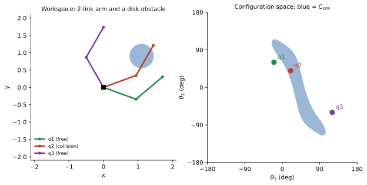
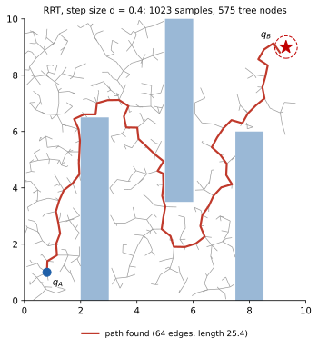

<ul class="post-sources">
<li markdown="span">[Princeton ROB 345 Introduction to Robotics](https://irom-lab.princeton.edu/intro-to-robotics/) Lecture 3 ([video](https://youtu.be/KDIe1094FMo))</li>
</ul>

[강의 2](/blog/2026/11/10/rob-02-graph-search/)에서는 공간을 격자로 나누고 BFS, Dijkstra, A* 같은 그래프 탐색으로 경로를 찾았다. 이때 로봇은 **크기가 없는 점**이라고 가정했다. 이번 강의는 이 가정을 걷어낸다. 실제 로봇은 모양과 크기가 있고, 같은 위치라도 어떤 자세로 있느냐에 따라 장애물에 걸리기도 하고 안 걸리기도 한다. 이 문제를 제대로 다루면 차원이 높은 구성 공간이 나오고, 격자 기반 탐색은 그 앞에서 무너진다. 그 해결책이 샘플링 기반 계획, 특히 **RRT**다.

## 로봇에게 크기가 있다면

### 첫 시도: 원으로 감싸기

평면 쿼드로터를 생각하자. 상태는 무게 중심의 위치 $$(x, y)$$와 기운 각도 $$\theta$$다. 그래프 탐색을 그대로 쓰면서 로봇의 크기를 반영하는 가장 간단한 방법은 무엇일까?

로봇 전체를 감싸는 **가장 작은 원**을 찾는다. 반지름을 $$r$$이라 하자. 그리고 모든 장애물을 바깥으로 $$r$$만큼 **부풀린다(inflate)**. 이제 로봇을 원의 중심점 하나로 보고, 부풀린 장애물 사이에서 점의 경로를 찾으면 된다.

- 원이 로봇을 완전히 감싸므로, 원의 중심이 부풀린 장애물 밖에 있으면 **로봇이 어떤 자세를 하든** 실제 장애물과 겹치지 않는다.
- 그래서 $$\theta$$는 신경 쓸 필요가 없고, 문제는 다시 [강의 2](/blog/2026/11/10/rob-02-graph-search/)의 2차원 점 로봇 문제가 된다.

장애물을 부풀리는 연산에는 이름이 있다. 두 집합 $$A$$, $$B$$의 **민코프스키 합(Minkowski sum)**은

$$
A \oplus B = \{\, a + b : a \in A,\ b \in B \,\}
$$

이다. 장애물 $$O$$를 반지름 $$r$$인 원판 $$D_r$$(원점 중심)과 더한 $$O \oplus D_r$$이 부풀린 장애물이다. 그림으로는 장애물의 모든 점에 원을 하나씩 찍고, 그 원들을 모두 합친 모양이다. 직사각형 장애물이라면 모서리가 둥글게 깎인 더 큰 직사각형이 된다.

### 원 근사의 한계

이 방법은 장애물이 드문드문한 열린 공간에서는 잘 통하지만, **복잡한 환경에서는 너무 보수적**이다. 숫자로 보자.

- 평면 쿼드로터의 폭이 30 cm, 높이가 5 cm라고 하자. 감싸는 원의 지름은 적어도 30 cm다.
- 앞에 높이 10 cm짜리 가로로 긴 틈이 있다. 쿼드로터가 수평을 유지하면 5 cm 높이의 몸체가 10 cm 틈을 충분히 통과한다.
- 하지만 원 근사에서는 지름 30 cm 원이 10 cm 틈을 지날 수 없다. 장애물을 15 cm씩 부풀리면 틈이 아예 막혀 버린다.

실제로는 갈 수 있는 길이 "길 없음"으로 판정된다. 로봇이 **자세를 바꿔서** 좁은 곳을 지나갈 수 있다는 사실을 버렸기 때문이다. 자세까지 제대로 다루려면 구성 공간으로 돌아가야 한다.

## 구성 공간으로 돌아가기

[강의 2](/blog/2026/11/10/rob-02-graph-search/)에서 정의한 것을 다시 쓰면 다음과 같다.

- **자유도**: 시스템이 독립적으로 움직일 수 있는 방법의 수, 즉 구성을 완전히 정하는 데 필요한 최소 좌표 수. 평면 쿼드로터는 3, 3차원 쿼드로터는 6(위치 3, 자세 3)이다.
- **구성 공간** $$\mathcal{C}$$: 가능한 모든 구성의 집합. 평면 쿼드로터는 $$\mathbb{R}^2 \times S^1$$.
- **자유 공간** $$\mathcal{C}_{free}$$와 **장애물 공간** $$\mathcal{C}_{obs} = \mathcal{C} \setminus \mathcal{C}_{free}$$.

핵심은 구성 공간에서는 **로봇이 다시 점이 된다**는 것이다. 크기와 모양은 모두 $$\mathcal{C}_{obs}$$의 모양에 녹아 들어간다. 그 대신 $$\mathcal{C}_{obs}$$는 실제 장애물과 전혀 다른, 복잡한 모양이 된다.

### 예: 2-링크 로봇 팔

평면 위의 로봇 팔을 보자. 길이 1인 링크 두 개가 이어져 있고, 첫 링크는 원점에 고정된 관절에서 각도 $$\theta_1$$만큼, 둘째 링크는 첫 링크에 대해 각도 $$\theta_2$$만큼 돈다. 자유도는 2이고 구성은 $$q = (\theta_1, \theta_2)$$다. 작업 공간에 원형 장애물(중심 $$(1.1, 0.9)$$, 반지름 $$0.35$$)이 하나 있다.


*왼쪽: 작업 공간에서 팔의 세 자세. 오른쪽: 같은 세 자세를 구성 공간 $$(\theta_1, \theta_2)$$의 점으로 찍은 것. 파란 띠가 $$\mathcal{C}_{obs}$$다.*

- 작업 공간에서 둥근 원판 하나였던 장애물이 구성 공간에서는 휘어진 띠가 되었다.
- 원판 중심은 원점에서 $$\sqrt{1.1^2 + 0.9^2} \approx 1.42$$ 떨어져 있다. 반지름을 빼도 $$1.07 > 1$$이라 첫째 링크는 절대 닿지 않는다. 충돌은 둘째 링크에서만 생기므로 $$\mathcal{C}_{obs}$$는 $$\theta_1$$과 $$\theta_2$$의 특정 조합에만 나타난다.
- 각도는 $$-180^\circ$$와 $$180^\circ$$가 같으므로, 이 정사각형의 왼쪽 끝과 오른쪽 끝, 위쪽 끝과 아래쪽 끝은 실제로 붙어 있다. 2-링크 팔의 구성 공간은 도넛 모양의 **토러스(torus)** $$S^1 \times S^1$$이다.

$$q_1$$과 $$q_3$$은 자유 공간에 있으니, 두 자세를 잇는 경로를 찾는다는 것은 오른쪽 그림에서 파란 띠를 피해 두 점을 잇는 곡선을 찾는 것과 같다. 크기와 모양이 있는 팔의 문제가 점의 문제로 바뀌었다.

3자유도 로봇이라면 구성 공간은 3차원이다. 평면 위의 삼각형 로봇이라면 $$(x, y, \theta)$$ 축의 상자이고, 평면에서는 단순한 다각형이던 장애물이 이 상자 안에서 꼬인 덩어리가 된다.

## 구성 공간을 격자로 나누면

개념적으로는 이제 쉽다. 구성 공간을 격자로 나누고, 강의 2의 그래프 탐색을 돌리면 된다. 문제는 두 가지다.

### 차원의 저주

각 차원을 $$B$$칸으로 나누고 자유도가 $$d$$라면 칸의 수는

$$
B^d
$$

다. 차원에 대해 **지수적으로** 늘어난다. 한 차원을 $$B = 100$$칸으로 나눈다고 하자.

| 시스템 | 자유도 $$d$$ | 칸 수 $$100^d$$ |
|---|---|---|
| 평면 위의 점 | 2 | $$10^4$$ |
| 평면 쿼드로터 | 3 | $$10^6$$ |
| 3차원 쿼드로터, 피아노 | 6 | $$10^{12}$$ |
| 로봇 팔 | 7 | $$10^{14}$$ |
| 휴머노이드 | 30–40 | $$10^{60}$$–$$10^{80}$$ |

$$10^{80}$$은 관측 가능한 우주의 원자 수와 비슷한 규모다. 이 현상을 **차원의 저주(curse of dimensionality)**라 한다([Q-73. 차원의 저주](/blog/2026/11/02/knowledge-73-curse-of-dimensionality/)도 참고). 현실적으로 격자 기반 탐색은 구성 공간이 3–4차원을 넘어가면 쓸 수 없다.

### 장애물 공간을 만들 수 없다

더 근본적인 문제가 있다. 격자에서 장애물 칸을 지우려면 $$\mathcal{C}_{obs}$$가 어디인지 알아야 한다. 하지만 위의 2-링크 팔 그림만 봐도 $$\mathcal{C}_{obs}$$는 간단한 공식으로 쓸 수 없는 모양이다. $$B^d$$개 칸 하나하나에 대해 충돌 여부를 판정하는 것은 탐색을 시작하기도 전에 불가능하다. **$$\mathcal{C}_{obs}$$를 표현하는 것 자체가** 계산적으로 감당이 안 된다.

## RRT: 빠르게 퍼져 나가는 무작위 트리

### 세 가지 핵심 아이디어

**RRT(Rapidly-exploring Random Tree)**는 1998–2000년 무렵 LaValle와 동료들이 제안한 알고리즘으로, 위의 두 문제를 정면으로 피해 간다.

1. **미리 이산화하지 않는다.** 연속적인 구성 공간에서 직접 작업한다.
2. **$$\mathcal{C}_{obs}$$를 명시적으로 만들지 않는다.** 장애물 공간을 수식으로도, 격자로도 표현하지 않는다.
3. **빠른 충돌 검사만 쓴다.** "이 구성 $$q$$에서 로봇이 장애물과 겹치는가?"라는 질문 하나에만 답할 수 있으면 된다.

세 번째가 RRT가 잘 동작하는 가장 큰 이유다. 특정 구성 하나에서 두 물체가 겹치는지 판정하는 문제는 비디오 게임과 컴퓨터 그래픽스에서 오래 다듬어진 문제라 매우 빠른 알고리즘이 많다. 대표적인 것이 Gilbert, Johnson, Keerthi의 이름을 딴 **GJK 알고리즘**이다. 두 볼록 도형 $$A$$, $$B$$의 **민코프스키 차** $$A \ominus B = \{\, a - b : a \in A,\ b \in B \,\}$$를 생각하면, 두 도형이 겹친다는 것은 어떤 $$a = b$$가 있다는 뜻이므로 **원점이 $$A \ominus B$$에 들어 있다**는 것과 같다. GJK는 이 차집합 도형 전체를 만들지 않고 원점 포함 여부만 효율적으로 판정한다. 볼록하지 않은 물체는 볼록한 조각 여러 개로 나눠 검사한다.

### 한 번의 반복

트리는 출발 구성 $$q_A$$ 하나에서 시작해 한 번에 가지 하나씩 자란다. 한 번의 반복은 다음과 같다.

1. **무작위 샘플**: 구성 공간 전체에서 무작위로 구성 $$q_{rand}$$를 하나 뽑는다. 이때 **장애물은 무시한다.** $$q_{rand}$$가 장애물 안에 있어도 상관없다.
2. **가장 가까운 정점**: 지금까지 만든 트리의 정점 중 $$q_{rand}$$에 가장 가까운 $$q_{near}$$를 찾는다.
3. **한 걸음 뻗기(extend)**: $$q_{near}$$에서 $$q_{rand}$$ 쪽으로 정해진 **보폭(step size)** $$d$$만큼 직선으로 나아간 점을 $$q_s$$라 한다(식은 아래).
4. **충돌 검사**: $$q_s$$가 충돌이면 버리고 다음 반복으로 간다. 충돌이 아니면 $$q_s$$를 트리에 추가하고 $$q_{near}$$와 간선으로 잇는다. 장애물이 고려되는 것은 **이 단계뿐**이다.
5. **종료 검사**: $$\lVert q_s - q_B \rVert < \epsilon$$이면 목표 근처에 도달했으므로 성공을 반환한다.

3단계의 뻗은 점은

$$
q_s = q_{near} + d \, \frac{q_{rand} - q_{near}}{\lVert q_{rand} - q_{near} \rVert}
$$

이다. $$q_{rand}$$가 $$d$$보다 가까우면 $$q_s = q_{rand}$$로 둔다.

**숫자 예.** 트리의 정점이 $$(1, 1)$$과 $$(1, 2)$$ 둘이고, $$q_{rand} = (4, 5)$$, $$d = 0.5$$라 하자. 두 정점까지의 거리는 $$\sqrt{3^2 + 4^2} = 5$$와 $$\sqrt{3^2 + 3^2} \approx 4.24$$이므로 $$q_{near} = (1, 2)$$다. 방향 벡터는 $$(3, 3)/4.24 \approx (0.707, 0.707)$$이고

$$
q_s \approx (1, 2) + 0.5\,(0.707, 0.707) = (1.354, 2.354)
$$

이다. 이 점이 충돌하지 않으면 트리에 추가된다.

### 왜 사슬이 아니라 트리가 되는가

2단계에서 $$q_{near}$$는 **가장 최근에 추가한 정점이 아니라 트리 전체에서 가장 가까운 정점**이다. 그래서 새 가지가 트리 곳곳에서 돋아난다. 이렇게 만든 그래프에는 순환(cycle)이 생기지 않는다. 새 정점은 항상 기존 정점 하나에만 연결되기 때문이다. 순환이 없는 연결 그래프가 **트리(tree)**이고, 루트는 $$q_A$$다.

### 경로 복원

[강의 2](/blog/2026/11/10/rob-02-graph-search/)의 그래프 탐색처럼, 정점을 추가할 때 부모($$q_{near}$$)를 기록해 둔다. 종료 후 마지막 정점에서 부모를 따라 $$q_A$$까지 거슬러 올라가 뒤집으면 경로가 된다. 트리에는 순환이 없으므로 이 역추적은 항상 $$q_A$$에서 끝난다.

### 전체 알고리즘

```python
def rrt(q_A, q_B, d, eps, sample, in_collision):
    V = [q_A]                 # 트리의 정점
    parent = {0: None}
    while True:               # 목표에 닿을 때까지
        q_rand = sample()     # 장애물 무시, 구성 공간에서 균일하게
        i = argmin(dist(v, q_rand) for v in V)
        q_near = V[i]
        q_s = steer(q_near, q_rand, d)   # q_rand 쪽으로 d만큼
        if in_collision(q_near, q_s):    # 선분 전체를 검사 (아래 참고)
            continue
        V.append(q_s); parent[len(V) - 1] = i
        if dist(q_s, q_B) < eps:
            return trace_back(parent, V)  # 부모를 따라 q_A까지
```


*세 직사각형 장애물 사이에서 자란 RRT ($$d = 0.4$$, $$\epsilon = 0.4$$). 회색이 트리, 빨간 선이 찾은 경로, 점선 원이 목표의 $$\epsilon$$ 반경이다.*

이 실행에서는 1023번 샘플을 뽑았고, 그중 449번은 뻗은 점이나 선분이 장애물에 걸려 버려졌으며, 나머지 574번이 트리에 추가되어 정점이 575개가 되었다. 찾은 경로는 간선 64개, 길이 25.4다. 출발점과 목표 사이의 직선거리가 약 11.7이고 장애물을 돌아가야 한다는 점을 감안해도, 경로가 지그재그로 꽤 들쭉날쭉하다. RRT는 **갈 수 있는 경로**를 찾을 뿐 **좋은 경로**를 찾지는 않는다.

### 빈 곳으로 먼저 퍼지는 성질

장애물이 없는 공간에서 RRT를 돌려 보면, 처음 몇 번 만에 트리가 서너 방향으로 크게 뻗어 공간을 거칠게 나누고, 반복할수록 그 사이를 점점 촘촘하게 채운다. 이름의 "rapidly-exploring"이 이 성질이다.

이유는 **보로노이 영역(Voronoi region)**으로 설명된다. 트리의 각 정점 $$v$$에 대해, "트리 정점 중 $$v$$가 가장 가까운 점들"의 영역을 $$v$$의 보로노이 영역 $$\mathcal{V}(v)$$라 한다. $$q_{rand}$$는 균일하게 뽑히므로, 정점 $$v$$가 $$q_{near}$$로 뽑힐 확률은

$$
P(q_{near} = v) = \frac{\operatorname{vol}(\mathcal{V}(v))}{\operatorname{vol}(\mathcal{C})}
$$

이다. $$\operatorname{vol}$$은 부피(2차원이면 넓이)다. 트리의 바깥쪽 끝에 있는 정점은 아직 아무도 차지하지 않은 넓은 빈 공간을 보로노이 영역으로 갖는다. 그래서 그런 정점이 자주 뽑혀 바깥쪽으로 뻗는다. 탐색이 자연스럽게 **아직 가 보지 않은 곳**으로 쏠리는 것이다.

### 실제로 구현할 때의 세부 사항

**선분 전체의 충돌.** 위의 4단계는 끝점 $$q_s$$만 검사했다. 하지만 $$q_{near}$$와 $$q_s$$가 둘 다 자유 공간에 있어도, 그 사이 선분이 얇은 장애물을 가로지를 수 있다. 로봇은 순간 이동을 할 수 없으니 선분 전체가 자유 공간이어야 한다. 실제로는

- 선분 위의 여러 점을 촘촘히 뽑아 검사하거나, 이분법(bisection)으로 중간점을 재귀적으로 검사하고,
- 보폭 $$d$$를 충분히 작게 잡고,
- 검사점 사이로 빠져나가는 충돌을 막기 위해 장애물을 살짝 부풀려 둔다.

위 그림의 실행은 선분마다 10개 점을 검사했다.

**보폭 $$d$$.** 너무 작으면 트리가 느리게 자라고, 너무 크면 대부분의 뻗기가 장애물에 걸려 버려지고 좁은 통로를 지나기 어렵다.

**목표 반경 $$\epsilon$$.** 연속 공간에서 무작위로 뻗은 점이 $$q_B$$에 정확히 떨어질 확률은 0이므로 $$\epsilon > 0$$이 필요하다. 그렇다고 $$\epsilon$$을 크게 잡으면 알고리즘은 금방 끝나지만, 남은 "$$\epsilon$$ 근처에서 $$q_B$$까지 가기"가 원래 문제만큼 어려울 수 있다. 극단적으로 $$\epsilon$$을 방 크기로 잡으면 아무것도 계획하지 않은 것과 같다. 목표에 정확히 도달하는 간단한 방법이 두 가지 있다.

- $$\epsilon$$ 안에 들어온 정점에서 $$q_B$$로 직선 연결을 시도한다(선분이 충돌하지 않으면 성공).
- 가끔(예: 5% 확률로) $$q_{rand}$$ 대신 $$q_B$$ 자체를 샘플로 써서, 트리가 목표 쪽으로 뻗도록 유도한다(goal biasing). A*의 휴리스틱처럼 탐색을 목표 쪽으로 기울이는 아이디어다.

### RRT가 해낸 것들

RRT는 격자 탐색이 손을 못 대는 고차원 문제를 실제로 푼다.

- **피아노 운반**: 3차원 공간의 강체인 피아노는 6자유도다. RRT는 피아노의 무작위 자세를 뽑고, 가까운 자세에서 뻗고, 충돌만 검사하는 과정을 반복해 좁은 문과 계단을 통과하는 경로를 찾는다. 환경에 대해 묻는 것은 충돌 검사 단계뿐이다.
- **휴머노이드와 양팔 로봇**: 자유도가 수십인 로봇이 탁자 밑의 물건을 집는 경로를, 잘 구현하면 몇 초 안에 찾는다.
- **고속 드론**: 건물 안에서 한 지점에서 다른 지점까지 가는 대략적인 경로를 RRT로 찾고, 동역학을 고려해 다듬어 초속 수 미터로 비행한 사례가 있다. 동역학을 고려하는 방법은 [강의 4](/blog/2026/11/10/rob-04-quadrotor-dynamics/)부터 다룬다.

## RRT*와 다른 변형

### 들쭉날쭉한 경로와 RRT*

RRT 경로는 실행할 수는 있지만 쓸데없는 우회와 흔들림이 많다. 양팔 로봇에 RRT를 쓰면 팔이 목표로 곧장 가지 않고 이리저리 휘저으며 간다. 경로 계획에는 두 기준이 있다.

- **실행 가능성(feasibility)**: 충돌 없이 A에서 B로 간다. 반드시 필요하다.
- **최적성(optimality)**: 시간, 에너지, 경로 길이 같은 비용을 최소화한다. 있으면 좋다.

**RRT***(RRT-star)는 RRT의 구조(샘플, 가장 가까운 정점, 뻗기, 충돌 검사)를 그대로 두고 **재배선(rewiring)** 단계를 더한다. 새 정점을 추가할 때 주변 정점들을 살펴, 새 정점을 거쳐 가는 것이 더 싼 정점이 있으면 그 정점의 부모를 새 정점으로 바꾼다. 트리를 국소적으로 계속 고쳐 나가는 것이다. 그 결과

- 처음 찾은 경로는 RRT처럼 들쭉날쭉하지만, 반복할수록 경로 길이가 줄어 최적 경로에 점점 가까워진다(점근적 최적성).
- 한 번 찾은 경로가 다시 불가능해지지는 않는다. 그래서 계산 시간이 허락하는 만큼 돌리다 **아무 때나 멈춰도 그때까지의 최선의 경로**를 쓸 수 있다. 이런 성질을 **anytime** 성질이라 한다. 계산 자원이 제한된 로봇에 아주 좋은 성질이다.
- 재배선은 국소 연산이라 추가 비용이 크지 않다.

RRT*가 목표에서 먼 곳까지 계속 탐색하는 데도 이유가 있다. 장애물을 왼쪽으로 돌아가는 길과 오른쪽으로 돌아가는 길처럼, 연속적으로 변형해서는 서로 바꿀 수 없는 **위상적으로 다른(다른 호모토피 클래스의)** 경로들이 있을 수 있다. 처음 찾은 경로를 국소적으로 아무리 다듬어도 더 나아지지 않을 때, 완전히 다른 쪽의 경로가 더 짧을 수 있으므로 전역 최적을 원한다면 넓게 탐색해야 한다.

### 그 밖의 변형

RRT 변형은 수천 편의 논문이 있을 만큼 많다. 대표적인 것 두 가지만 짚는다.

- **양방향 RRT(bi-directional RRT)**: $$q_A$$와 $$q_B$$ 양쪽에서 트리를 하나씩 키우고, 두 트리가 서로 연결되면 끝낸다. 목표 근처가 좁을 때 특히 효과적이다.
- **PRM(Probabilistic Roadmap)**: 강의에서 다루지는 않았지만 같은 계열의 고전적인 방법이다. 자유 공간에서 무작위로 점을 많이 뽑고(충돌하는 점은 버림), 가까운 점끼리 충돌 없는 직선으로 이어 **로드맵 그래프**를 미리 만든다. 그다음 질의가 들어오면 $$q_A$$, $$q_B$$를 로드맵에 붙이고 강의 2의 그래프 탐색으로 경로를 찾는다. 같은 환경에서 여러 번 계획할 때 유리하고, RRT는 한 번의 질의에 집중할 때 유리하다.

### 무엇을 최적화할 것인가

최적성을 말하려면 비용 함수를 정해야 하는데, 이것이 생각보다 어렵다. 자율 주행차라면 빨리 가고 싶지만 속도 제한을 넘으면 안 되고, 에너지를 아끼고 싶지만 그것만 따지면 너무 느려지며, 승차감도 중요하다. 이런 항목들의 가중치를 정하는 일은 결국 "우리가 진짜로 원하는 것이 무엇인가"를 수식으로 적는 일이다. 비용 함수가 의도를 다 담지 못하면 알고리즘은 비용을 잘 줄이면서도 엉뚱한 행동을 할 수 있다. 이 문제는 보상을 최적화하는 강화학습에서 더 두드러진다([Deep Learning 15](/blog/2026/10/22/dl-15-policy-gradients/)).

## 완전성

### 완전성과 확률적 완전성

경로가 존재한다면 RRT가 반드시 찾을까? 이 질문을 정확하게 하는 개념이 완전성이다.

**완전(complete)** 한 계획 알고리즘은 다음 두 가지를 만족한다.

1. 출발에서 목표까지 경로가 존재하면, **유한 시간 안에** 경로를 찾는다.
2. 경로가 존재하지 않으면, 영원히 돌지 않고 **유한 시간 안에 실패를 보고**한다.

[강의 2](/blog/2026/11/10/rob-02-graph-search/)의 BFS, DFS, Dijkstra, A*는 **이산화된 그래프에 대해서** 완전하다. 그래프는 유한하므로 모든 정점을 다 꺼내면 끝나고, 그때까지 목표를 못 찾으면 길이 없다는 것을 확실히 안다. (다만 이것은 격자 위에서의 완전성이다. 해상도가 거칠어 좁은 통로가 칸에 묻히면 연속 공간에는 있는 길을 못 찾는다.)

RRT는 **완전하지 않다.** 두 번째 조건을 만족할 수 없다. 출발과 목표 사이에 벽이 있어 길이 아예 없으면, RRT는 "충분히 탐색했으니 길이 없다"고 판단할 방법이 없어 영원히 돈다. 대신 RRT는 더 약한 성질을 갖는다.

> **확률적 완전성(probabilistic completeness)**: 경로가 존재하면, 반복 횟수가 무한대로 갈 때 RRT가 경로를 찾을 확률이 1로 수렴한다.

직관은 이렇다. RRT는 무작위로 공간을 채워 나가므로, 통로가 아무리 좁아도 폭이 0이 아닌 한 언젠가는 샘플이 그 근처에 떨어지고 트리가 그 안으로 뻗는다.

### 주의할 점

- 확률적 완전성은 환경에 대한 약한 조건, 대략 "경로 주변에 어느 정도 여유 공간이 있다"는 조건을 필요로 한다. 폭이 정확히 0인 통로처럼 수학적으로는 정의되지만 물리적으로는 있을 수 없는 이상한 환경을 만들면 이 성질이 깨진다. 실제 로봇이 마주치는 문제에서는 성립한다.
- "확률 1로 수렴"은 "곧 찾는다"는 뜻이 아니다. 통로가 좁을수록 그 안에 샘플이 떨어질 확률이 작아 오래 걸린다. 좁은 통로(narrow passage)는 샘플링 기반 계획의 대표적인 약점이다.
- 경로가 없을 때는 끝나지 않는다. 실제로는 시간 제한이나 반복 횟수 제한을 두고, 그 안에 못 찾으면 포기한다.

## 흔한 실수

- **$$q_{rand}$$가 충돌이면 버린다.** 버리는 것은 뻗은 점 $$q_s$$(와 선분)이다. $$q_{rand}$$는 방향만 알려 주는 역할이라 장애물 안에 있어도 된다. 장애물 안의 $$q_{rand}$$를 버리면 장애물 근처 방향으로의 탐색이 줄어든다.
- **끝점만 검사한다.** 보폭이 크면 선분이 얇은 장애물을 관통할 수 있다. 선분 전체를 검사해야 한다.
- **가장 최근 정점에서 뻗는다.** 그러면 트리가 아니라 한 줄짜리 사슬이 되어 무작위 걷기가 된다. 반드시 트리 전체에서 가장 가까운 정점을 찾아야 한다.
- **RRT 경로를 그대로 쓴다.** RRT 경로는 들쭉날쭉하다. 실제로는 RRT*를 쓰거나, 찾은 경로의 정점을 건너뛰며 직선으로 잇는 단축(shortcutting) 같은 후처리를 한다.
- **각도 차원의 거리를 잘못 잰다.** $$\theta = 179^\circ$$와 $$-179^\circ$$는 $$358^\circ$$가 아니라 $$2^\circ$$ 떨어져 있다. 구성 공간의 $$S^1$$ 성분은 한 바퀴 돌아오는 거리로 재야 한다.

## 정리

- 로봇을 원으로 감싸고 장애물을 민코프스키 합으로 부풀리면 점 로봇 문제로 바꿀 수 있지만, 자세를 바꿔 지나갈 수 있는 길을 놓쳐 너무 보수적이다.
- 구성 공간에서는 로봇이 점이 되는 대신 $$\mathcal{C}_{obs}$$가 복잡해진다. 구성 공간을 격자로 나누면 칸 수가 $$B^d$$로 늘고, $$\mathcal{C}_{obs}$$를 만드는 것조차 불가능하다.
- RRT는 연속 공간에서 직접, $$\mathcal{C}_{obs}$$를 만들지 않고, 개별 구성의 충돌 검사만으로 트리를 키운다. 반복마다 무작위 샘플 → 가장 가까운 정점 → 보폭 $$d$$만큼 뻗기 → 충돌 검사 → 목표 검사를 한다.
- 보로노이 편향 덕분에 트리는 빈 곳으로 빠르게 퍼진다. 경로는 실행 가능하지만 최적과 거리가 멀다.
- RRT*는 재배선으로 경로를 점점 최적에 가깝게 만들고, 언제 멈춰도 쓸 수 있는 경로를 준다.
- 격자 탐색은 이산화된 문제에 대해 완전하고, RRT는 확률적으로 완전하다(경로가 있으면 확률 1로 찾지만, 없으면 끝나지 않는다).
