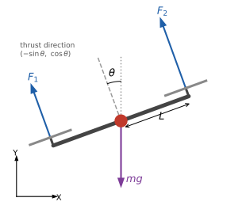
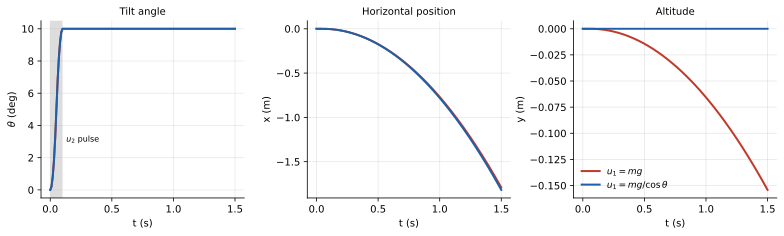

<ul class="post-sources">
<li markdown="span">[Princeton ROB 345 Introduction to Robotics](https://irom-lab.princeton.edu/intro-to-robotics/) Lecture 4 ([video](https://youtu.be/upI4KaGawyE))</li>
</ul>

[강의 2](/blog/2026/11/10/rob-02-graph-search/)와 [강의 3](/blog/2026/11/10/rob-03-rrt/)에서는 장애물을 피해 A에서 B로 가는 **기하학적** 경로를 찾았다. 그때 "어떤 연속 경로든 로봇이 따라갈 수 있다"고 가정했다. 이번 강의부터 이 가정을 걷어낸다. 첫걸음은 로봇이 실제로 어떻게 움직이는지, 즉 **동역학(dynamics)**을 수식으로 쓰는 것이다. 예제는 이 강의의 실습용 로봇인 쿼드로터다.

## 기하학적 계획의 두 가지 한계

### 동적 실현 가능성

**동적 실현 가능성(dynamic feasibility)** 문제란, 기하학적으로는 충돌이 없는 경로라도 로봇이 물리적으로 그대로 따라갈 수 없을 수 있다는 것이다. 예를 들면 다음과 같다.

- **옆으로 가는 자동차.** 바퀴가 전방향 바퀴가 아닌 한, 자동차는 제자리에서 옆으로 미끄러지듯 이동할 수 없다. 주차 공간에 옆으로 쏙 들어가는 경로는 실행할 수 없다.
- **수평 자세로 옆으로 가는 드론.** 쿼드로터의 프로펠러는 항상 **기체에 수직인 방향**으로만 추력을 낸다. 기체가 수평이면 추력은 위쪽으로만 향하므로, 수평 자세를 유지한 채 옆으로 이동할 힘이 없다. 옆으로 가려면 먼저 기울어야 한다.
- **급격한 방향 전환.** RRT 경로의 날카로운 꺾임을 그대로 따라가려면, 꺾이는 지점에서 속도를 순간적으로 바꿔야 한다. 유한한 힘으로는 불가능하다.

### 오차와 외란

계획이 동역학적으로 실현 가능하더라도, 우리가 쓰는 동역학 모델은 완벽하지 않다. 복잡한 공기역학 효과는 대부분 무시하고, 야외에서는 예측할 수 없는 돌풍이 분다. 그래서 로봇은 계획한 경로에서 벗어나게 된다.

강의의 순서는 이렇다. 이번 강의를 포함한 세 강의([강의 5](/blog/2026/11/10/rob-05-differential-flatness/), [강의 6](/blog/2026/11/10/rob-06-trajectory-optimization/))는 **동역학을 고려한 계획**을 다루고, 그다음 [강의 7](/blog/2026/11/10/rob-07-stability-pd/)부터 **피드백 제어**로 오차와 외란을 보정한다. 오늘의 목표는 쿼드로터의 운동 방정식이 **어떤 모양인지** 감을 잡는 것이다. 운동 방정식을 직접 유도하는 능력까지는 요구하지 않는다. 주어진 방정식을 이해하고 쓸 수 있으면 된다.

## 평면 쿼드로터

### 모델

3차원 쿼드로터 대신, 정면에서 본 것처럼 **수직 평면 안에서만 움직이는** 단순화된 모델부터 시작한다. 프로펠러가 두 개라 사실상 "바이로터"지만 관례상 **평면 쿼드로터(planar quadrotor)**라 부른다.

- **자유도 3**: 무게 중심의 위치 $$x$$(수평), $$y$$(수직)와 기체의 기울기 $$\theta$$(반시계 방향이 양수).
- **입력**: 왼쪽 프로펠러의 추력 $$F_1$$과 오른쪽 프로펠러의 추력 $$F_2$$. 지금은 추력을 원하는 대로 직접 정할 수 있다고 가정한다(실제로 정하는 것은 모터 속도다. 뒤에서 다룬다).
- **물리 상수**: 질량 $$m$$, 무게 중심에 대한 **관성 모멘트(moment of inertia)** $$I$$, 무게 중심에서 각 프로펠러까지의 **팔 길이** $$L$$, 중력 가속도 $$g$$.

관성 모멘트는 질량이 회전축으로부터 얼마나 멀리 퍼져 있는지를 나타내는 값으로, 같은 토크를 줘도 $$I$$가 클수록 천천히 돈다. CAD 모델에서 계산하거나 실험으로 측정한다.


*기울기 $$\theta$$인 평면 쿼드로터. 두 추력은 기체에 수직으로 작용하고, 중력 $$mg$$는 무게 중심에서 아래로 작용한다. 추력 방향의 단위 벡터는 $$(-\sin\theta, \cos\theta)$$다.*

### 1자유도부터: 위아래로만 움직이는 경우

먼저 기체를 수평($$\theta = 0$$)으로 고정하고 위아래로만 움직이게 하자. 자유도는 1이고 구성은 높이 $$y$$ 하나다. **뉴턴의 제2법칙** $$m\ddot{y} = (\text{알짜힘})$$을 쓰면

$$
m\ddot{y} = F_1 + F_2 - mg
$$

이다. 총 추력을 $$u_1 \triangleq F_1 + F_2$$로 두면

$$
\ddot{y} = \frac{u_1}{m} - g
$$

가 된다. $$u_1 = mg$$이면 가속도가 0이라 제자리 비행(hover)을 하고, $$u_1 > mg$$이면 위로 가속한다.

### 3자유도 운동 방정식

이제 기울기까지 풀어 준다. 그림처럼 기체가 $$\theta$$만큼 기울면 총 추력 $$u_1$$은 $$(-\sin\theta, \cos\theta)$$ 방향을 향한다. 병진 운동은 뉴턴의 제2법칙, 회전 운동은 회전 버전인 $$I\ddot{\theta} = (\text{알짜 토크})$$로 쓴다. 오른쪽 추력 $$F_2$$는 기체를 반시계 방향(+)으로, 왼쪽 추력 $$F_1$$은 시계 방향(−)으로 돌리고, 둘 다 팔 길이 $$L$$만큼 떨어져 있으므로 알짜 토크는 $$(F_2 - F_1)L$$이다. 이를 $$u_2 \triangleq (F_2 - F_1)L$$로 두면

$$
\ddot{x} = -\frac{u_1}{m}\sin\theta, \qquad
\ddot{y} = \frac{u_1}{m}\cos\theta - g, \qquad
\ddot{\theta} = \frac{u_2}{I}
$$

이다. 몇 가지로 확인해 보자.

- $$\theta = 0$$이면 $$\ddot{x} = 0$$, $$\ddot{y} = u_1/m - g$$로 1자유도 식과 같다.
- $$\theta$$가 작은 양수(반시계로 기울어 추력이 왼쪽을 향함)이고 $$u_1 > 0$$이면 $$\sin\theta > 0$$이라 $$\ddot{x} < 0$$, 즉 왼쪽으로 가속한다. 그림과 맞다.
- 수평 가속도는 $$\sin\theta$$를 통해서만 생긴다. 앞에서 말한 "옆으로 가려면 먼저 기울어야 한다"가 식에 그대로 나타난다.

입력을 $$(F_1, F_2)$$ 대신 $$(u_1, u_2)$$로 쓰는 것은 편의를 위해서다. 두 쌍은 $$F_1 = u_1/2 - u_2/(2L)$$, $$F_2 = u_1/2 + u_2/(2L)$$로 언제든 오갈 수 있다.

### 숫자로 보기

Crazyflie 크기 정도의 값으로 $$m = 0.033$$ kg, $$I = 1.4 \times 10^{-5}$$ kg·m², $$L = 0.046$$ m, $$g = 9.81$$ m/s²을 쓰자(설명용 값이다).

- **제자리 비행**: $$u_1 = mg = 0.324$$ N, 두 프로펠러가 0.162 N씩 낸다.
- **10° 기운 채 같은 추력**: $$\ddot{x} = -g\sin 10^\circ \approx -1.70$$ m/s², $$\ddot{y} = g(\cos 10^\circ - 1) \approx -0.149$$ m/s². 옆으로 가속하는 동시에 고도가 떨어진다. 추력의 수직 성분이 $$mg\cos 10^\circ$$로 줄었기 때문이다.
- **고도를 유지하려면**: $$\ddot{y} = 0$$이 되도록 $$u_1 = mg/\cos\theta$$로 추력을 늘린다. 10°에서는 약 1.5% 더($$1/\cos 10^\circ \approx 1.0154$$) 내면 되고, 이때 수평 가속도는 $$-g\tan 10^\circ \approx -1.73$$ m/s²이다.
- **회전**: $$F_1 = 0.15$$ N, $$F_2 = 0.17$$ N이면 $$u_2 = 0.02 \times 0.046 = 9.2 \times 10^{-4}$$ N·m이고 $$\ddot{\theta} = u_2/I \approx 65.7$$ rad/s²이다. 추력 차이가 0.02 N밖에 안 되는데도 각가속도가 매우 크다. 작은 드론은 관성 모멘트가 아주 작아서 자세가 순식간에 바뀐다.

아래는 이 값들로 운동 방정식을 수치 적분한 결과다. 처음 0.1초 동안 $$u_2$$를 $$+U$$, $$-U$$로 짧게 줘서 기체를 10° 기울이고 각속도를 다시 0으로 만든 뒤, 두 가지 추력으로 1.5초간 비행한다.


*10° 기운 뒤 $$u_1 = mg$$(빨강)와 $$u_1 = mg/\cos\theta$$(파랑). 1.5초 뒤 둘 다 왼쪽으로 약 1.8 m 갔지만, 빨강은 고도가 15 cm 떨어졌고 파랑은 그대로다.*

$$u_1 = mg$$로 두면 1.5초 뒤 $$x \approx -1.79$$ m, $$y \approx -0.154$$ m이고, $$u_1 = mg/\cos\theta$$로 두면 $$x \approx -1.82$$ m, $$y = 0$$이다. 손으로도 확인할 수 있다. 기울기가 0에서 10°로 커지는 처음 0.1초는 대략 절반만 기운 셈으로 치면, 10° 기울기로 등가속도 운동한 유효 시간은 약 1.45초다. 등가속도 운동 공식 $$\frac{1}{2}at^2$$에 넣으면 고도 손실은 $$\frac{1}{2}(0.149)(1.45)^2 \approx 0.157$$ m, 수평 이동은 $$\frac{1}{2}(1.70)(1.45)^2 \approx 1.79$$ m로 시뮬레이션과 거의 맞는다.

## 상태 공간 형태

### 2계를 1계로

위의 운동 방정식은 2계 도함수($$\ddot{x}$$ 등)가 들어 있는 **2계 상미분 방정식(ODE)**이다. 뉴턴 법칙은 가속도, 즉 위치의 2계 도함수를 다루므로 항상 2계 방정식이 나온다. 앞으로 계획과 제어에서는 이것을 **1계 방정식의 묶음**으로 바꿔 쓰는 것이 훨씬 편하다. 요령은 1계 도함수에 새 이름을 붙이는 것이다.

$$
v_x \triangleq \dot{x}, \qquad v_y \triangleq \dot{y}, \qquad \omega \triangleq \dot{\theta}
$$

그러면 원래 방정식은 이 새 변수들의 1계 방정식이 되고, 정의 자체도 1계 방정식이다. 합쳐서 6개의 1계 방정식을 얻는다.

$$
\begin{aligned}
\dot{x} &= v_x, & \dot{v}_x &= -\frac{u_1}{m}\sin\theta, \\
\dot{y} &= v_y, & \dot{v}_y &= \frac{u_1}{m}\cos\theta - g, \\
\dot{\theta} &= \omega, & \dot{\omega} &= \frac{u_2}{I}.
\end{aligned}
$$

일반적으로 2계 방정식 $$n$$개는 1계 방정식 $$2n$$개가 된다.

### 상태, 입력, 구성 변수

이것을 벡터로 묶는다. 이 강의는 벡터를 윗줄로 표시한다.

- **상태(state)** $$\bar{x} = [x,\ y,\ \theta,\ \dot{x},\ \dot{y},\ \dot{\theta}]^T$$. 상태는 시스템의 미래를 예측하는 데 필요한 모든 것이다.
- **제어 입력(control input)** $$\bar{u} = [u_1,\ u_2]^T$$. 우리가 직접 명령할 수 있는 값이다.
- **구성 변수(configuration variables)** $$[x,\ y,\ \theta]$$. 상태 중에서 시간 도함수가 아닌 부분으로, 강의 2, 3의 구성 공간 좌표와 같다.

상태의 성분 수를 **상태의 수**라 한다. 평면 쿼드로터는 6, 위아래로만 움직이는 1자유도 버전은 $$[y, \dot{y}]$$로 2다. 일반적으로 자유도가 $$n$$이면 상태는 $$2n$$차원이다.

그러면 운동 방정식은 다음 한 줄로 쓸 수 있다.

$$
\dot{\bar{x}} = f(\bar{x}, \bar{u})
$$

좌변은 상태의 시간 도함수, 우변은 상태와 입력(그리고 $$m$$, $$I$$, $$g$$ 같은 상수)의 함수다. 이 형태가 중요한 이유는, **초기 상태 $$\bar{x}(0)$$과 시간에 따른 입력 $$\bar{u}(t)$$가 주어지면 이 방정식을 (해석적으로든 수치적으로든) 풀어 미래의 모든 상태를 예측할 수 있기 때문**이다. 위의 시뮬레이션 그림도 정확히 이렇게 만들었다. 동역학을 고려한 계획과 피드백 제어는 모두 이 형태에서 출발한다. 앞으로 다루는 로봇의 운동 방정식은 언제나 이 형태로 쓸 수 있다.

```python
def f(state, u, m=0.033, I=1.4e-5, g=9.81):
    x, y, th, vx, vy, w = state
    u1, u2 = u
    return [vx, vy, w,
            -u1 / m * sin(th),
             u1 / m * cos(th) - g,
             u2 / I]

# 오일러 적분으로 미래 상태 예측 (실제로는 RK4 등 더 정확한 방법을 쓴다)
for k in range(N):
    state = state + dt * array(f(state, u_of_t(k * dt)))
```

## 모터 모델

### 추력은 회전 속도의 제곱에 비례한다

지금까지 프로펠러를 "원하는 추력을 내는 장치"로 취급했지만, 실제로 명령하는 것은 **모터의 회전 속도**다. 다행히 둘 사이에는 간단한 관계가 있다.

$$
F_i = k_f\, \omega_i^2, \qquad i = 1, 2, 3, 4
$$

$$F_i$$는 프로펠러 $$i$$의 추력, $$\omega_i$$는 그 회전 속도(rad/s), $$k_f$$는 **추력 계수(thrust coefficient)**다. $$k_f$$는 프로펠러의 크기와 날개 각도 같은 기하에 따라 정해진다. 유체 역학 시뮬레이션으로 계산할 수도 있지만 직접 재는 것이 훨씬 쉽다. 제곱 관계이므로 추력을 2배로 하려면 회전 속도를 $$\sqrt{2} \approx 1.41$$배만 올리면 된다.

### 추력 계수 재기

간단한 실험으로 잰다. 드론을 **뒤집어서** 저울 위에 올리고 모터 속도를 바꿔 가며 저울 눈금을 읽는다. 뒤집으면 추력이 드론을 저울 쪽으로 누르므로 눈금 변화가 곧 추력이다. 주의할 점이 하나 있다. 프로펠러가 저울 바로 위에 있으면 아래로 불어낸 공기가 저울에 부딪혀 되돌아오면서 측정을 왜곡한다. 그래서 드론을 받침대 위로 높이 올려 이 효과를 없앤다.

**숫자 예.** 네 모터를 같은 속도 $$\omega$$로 돌려 다음과 같이 쟀다고 하자(그램 단위 눈금에 $$g/1000$$을 곱해 뉴턴으로 바꿈).

| $$\omega$$ (rad/s) | 1000 | 1500 | 2000 | 2500 |
|---|---|---|---|---|
| 저울 눈금 (g) | 8.3 | 18.1 | 32.9 | 50.8 |
| 총 추력 $$T$$ (N) | 0.0814 | 0.1776 | 0.3227 | 0.4983 |

모터가 4개이므로 $$T = 4 k_f \omega^2$$이다. 가로축에 $$\omega^2$$, 세로축에 $$T$$를 그리면 원점을 지나는 직선이고, 기울기가 $$4k_f$$다. 원점을 지나는 최소제곱 직선의 기울기는 $$\sum T\omega^2 / \sum \omega^4$$이므로

$$
k_f = \frac{\sum T \omega^2}{4 \sum \omega^4} \approx 2.0 \times 10^{-8}\ \text{N}/(\text{rad/s})^2
$$

이다. 이 값이면 $$m = 0.033$$ kg 드론이 제자리 비행할 때 모터 하나가 $$mg/4 \approx 0.081$$ N을 내야 하고, 필요한 회전 속도는 $$\omega = \sqrt{0.081 / (2.0 \times 10^{-8})} \approx 2010$$ rad/s, 분당 약 19,200회전이다.

이 모델은 모든 모터가 똑같다고 가정하고 복잡한 공기역학을 하나의 상수로 뭉뚱그린 근사다. 완벽하지는 않지만 기본적인 비행을 구현하기에는 충분하다. 평면 쿼드로터는 이로써 물리 파라미터 세 개 $$m$$, $$I$$, $$k_f$$로 완전히 정해진다.

## 3차원 쿼드로터

### 자유도와 오일러 각

3차원 쿼드로터의 자유도는 6이다. 위치 $$x, y, z$$에 3, 자세(방향)에 3. 평면에서는 자세가 각도 $$\theta$$ 하나였지만, 3차원 자세를 나타내려면 조금 더 손이 간다. 이 강의는 **오일러 각(Euler angles)**을 쓴다.

먼저 좌표계 두 개를 정한다.

- **관성 좌표계(inertial frame)** $$\mathcal{I}$$: 방에 고정된 좌표계. 축은 $$\bar{e}_x, \bar{e}_y, \bar{e}_z$$.
- **기체 좌표계(body frame)** $$\mathcal{B}$$: 드론의 무게 중심에 붙어 함께 움직이는 좌표계. $$\bar{b}_x$$는 앞, $$\bar{b}_y$$는 왼쪽, $$\bar{b}_z$$는 위를 가리킨다(오른손 좌표계).

기체 좌표계를 관성 좌표계에 맞춰 놓은 상태에서 출발해, 다음 세 번의 회전으로 임의의 자세를 만든다.

1. $$\bar{e}_x$$ 축을 중심으로 $$\phi$$만큼 회전한다. **롤(roll)**.
2. $$\bar{e}_y$$ 축을 중심으로 $$\theta$$만큼 회전한다. **피치(pitch)**.
3. $$\bar{e}_z$$ 축을 중심으로 $$\psi$$만큼 회전한다. **요(yaw)**.

회전 방향은 오른손 법칙을 따른다. 엄지를 축 방향으로 두었을 때 나머지 손가락이 감기는 방향이 양수다. 예를 들어 $$\bar{e}_y$$가 왼쪽을 가리키므로 양의 피치는 기수(앞쪽)가 **아래로** 숙여지는 방향이다.

세 회전이 모두 **고정된 관성 좌표계의 축**(1번 $$x$$, 2번 $$y$$, 3번 $$z$$)을 중심으로 하므로 이 약속을 **space 1-2-3 규약**이라 한다. 기체를 관성 좌표계로 돌리는 회전 행렬은 기본 회전 행렬 $$R_x, R_y, R_z$$를 적용 순서대로 왼쪽에 곱해

$$
R(\phi, \theta, \psi) = R_z(\psi)\, R_y(\theta)\, R_x(\phi)
$$

가 된다. 회전 행렬은 [보이는 선형대수학 4](/blog/2026/11/05/hpla-04-inverse-rank-null/)의 직교 행렬이다. 길이를 보존하고, 역행렬이 전치 행렬이다.

### 규약이 많다는 것의 위험

오일러 각의 규약은 여러 가지다.

- 회전 순서를 바꿀 수 있다(3-2-1, 2-3-1 등).
- 고정된 관성 축 대신, 매번 **회전한 뒤의 새 기체 축**을 중심으로 돌릴 수 있다. 이것을 **body 규약**이라 한다.

분야마다 역사적인 이유로 선호하는 규약이 다르다. 참고로 space 1-2-3(관성 축 $$x \to y \to z$$)은 body 3-2-1(기체 축 $$z \to y' \to x''$$)과 같은 회전을 만든다. 두 경우 모두 회전 행렬이 $$R_z R_y R_x$$이기 때문이다. 그래서 같은 회전을 서로 다른 이름으로 부르기도 한다.

실제로는 **규약이 섞여서 생기는 버그**가 아주 흔하다. 모션 캡처 시스템, 센서 드라이버, 시뮬레이터가 각자 다른 규약으로 각도를 내보내는데 이를 모르고 공식을 섞어 쓰면, 몇 주를 헤매도 원인을 찾기 어렵다. 팀으로 일한다면 모두가 같은 규약을 쓰는지 반드시 확인해야 한다.

오일러 각에는 한계도 있다. 같은 자세를 나타내는 각도 조합이 여럿일 수 있고, 피치가 $$\pm 90^\circ$$이면 롤과 요가 구별되지 않는 특이점(gimbal lock)이 생긴다. 이런 문제가 없는 **사원수(quaternion)** 같은 표현도 있지만, 이 강의에서는 직관적인 오일러 각을 쓴다.

### 상태와 입력

자유도가 6이므로 뉴턴 법칙에서 2계 방정식 6개가 나오고, 1계로 바꾸면 **상태가 12차원**이다.

$$
\bar{x} = [x,\ y,\ z,\ \phi,\ \theta,\ \psi,\ \dot{x},\ \dot{y},\ \dot{z},\ p,\ q,\ r]^T
$$

마지막 세 성분은 오일러 각의 도함수 $$\dot{\phi}, \dot{\theta}, \dot{\psi}$$를 쓸 수도 있지만, 실제로는 **기체 좌표계에서 잰 각속도** $$p, q, r$$(각각 $$\bar{b}_x, \bar{b}_y, \bar{b}_z$$ 축 둘레의 회전 속도)을 쓰는 것이 방정식이 더 간단해서 편하다. 자이로스코프가 재는 값도 바로 이것이다. 두 표현은 서로 바꿀 수 있다. space 1-2-3 규약에서

$$
\begin{bmatrix} \dot{\phi} \\ \dot{\theta} \\ \dot{\psi} \end{bmatrix}
=
\begin{bmatrix}
1 & \sin\phi\tan\theta & \cos\phi\tan\theta \\
0 & \cos\phi & -\sin\phi \\
0 & \sin\phi/\cos\theta & \cos\phi/\cos\theta
\end{bmatrix}
\begin{bmatrix} p \\ q \\ r \end{bmatrix}
$$

이다. $$\cos\theta = 0$$, 즉 피치가 $$\pm 90^\circ$$에서 이 행렬이 정의되지 않는 것이 앞에서 말한 특이점이다.

**제어 입력**은 네 프로펠러의 추력 $$F_1, \ldots, F_4$$이지만, 평면에서 $$(u_1, u_2)$$를 쓴 것처럼 다음 조합을 쓰는 것이 편하다.

$$
\bar{u} = [F_{tot},\ M_1,\ M_2,\ M_3]^T
$$

$$F_{tot}$$는 총 추력, $$M_1, M_2, M_3$$은 각각 기체의 $$\bar{b}_x$$, $$\bar{b}_y$$, $$\bar{b}_z$$ 축 둘레의 모멘트(토크)다. 이들은 $$F_1, \ldots, F_4$$와 드론의 기하로부터 계산되고, 거꾸로도 계산할 수 있다(아래 예).

### 요 회전은 어떻게 하는가: 반작용 모멘트

드론은 수평으로 미는 힘은 못 내지만 제자리에서 $$\bar{b}_z$$ 축 둘레로 돌 수는 있다. 프로펠러 추력은 모두 위를 향하는데 어떻게 수직축 둘레의 토크가 생길까?

프로펠러가 공기를 휘저으면 공기 저항이 프로펠러의 회전을 거스르는 토크를 준다. 모터는 이 저항을 이기려고 프로펠러에 토크를 가하고, 뉴턴의 제3법칙에 따라 같은 크기의 반대 방향 토크가 기체에 걸린다. 이 **반작용(공기역학적 항력) 모멘트**도 회전 속도의 제곱에 비례한다.

$$
M_i^{aero} = k_m\, \omega_i^2
$$

$$k_m$$은 **모멘트 계수**다. 프로펠러가 모두 같은 방향으로 돌면 기체가 계속 반대로 돌아 버리므로, **이웃한 프로펠러는 서로 반대 방향으로 돈다.** 평소에는 두 쌍의 반작용 모멘트가 상쇄되고, 요 회전을 하고 싶으면 한 쌍을 빠르게, 다른 쌍을 느리게 돌린다. 반대로 도는 프로펠러는 날개의 비틀림 방향도 반대로 만들어서, 어느 방향으로 돌든 추력은 위로 나온다.

### 예: 추력과 모멘트 사이 변환

강의는 변환 식을 구체적으로 쓰지 않았지만, 한 가지 배치로 직접 만들어 보자. 프로펠러 1, 2, 3, 4가 각각 기체의 앞($$+\bar{b}_x$$), 왼쪽($$+\bar{b}_y$$), 뒤, 오른쪽에 팔 길이 $$L$$만큼 떨어져 있는 "+"자 배치이고, 1, 3번은 위에서 볼 때 시계 방향, 2, 4번은 반시계 방향으로 돈다고 하자. $$\gamma \triangleq k_m / k_f$$로 두면 $$M_i^{aero} = \gamma F_i$$다.

- 왼쪽(2번)의 추력은 기체를 $$\bar{b}_x$$ 둘레 양의 방향으로, 오른쪽(4번)은 음의 방향으로 돌린다: $$M_1 = L(F_2 - F_4)$$.
- 앞(1번)의 추력은 기수를 들어 올리므로 $$\bar{b}_y$$ 둘레 음의 방향, 뒤(3번)는 양의 방향: $$M_2 = L(F_3 - F_1)$$.
- 시계 방향으로 도는 1, 3번의 반작용은 기체를 반시계(+)로 돌린다: $$M_3 = \gamma(F_1 - F_2 + F_3 - F_4)$$.

정리하면

$$
\begin{bmatrix} F_{tot} \\ M_1 \\ M_2 \\ M_3 \end{bmatrix}
=
\begin{bmatrix}
1 & 1 & 1 & 1 \\
0 & L & 0 & -L \\
-L & 0 & L & 0 \\
\gamma & -\gamma & \gamma & -\gamma
\end{bmatrix}
\begin{bmatrix} F_1 \\ F_2 \\ F_3 \\ F_4 \end{bmatrix}
$$

이고, $$L \neq 0$$, $$\gamma \neq 0$$이면 이 행렬은 가역이라 원하는 $$(F_{tot}, M_1, M_2, M_3)$$에서 각 프로펠러 추력을 거꾸로 구할 수 있다. 예를 들어 $$m = 0.033$$ kg, $$L = 0.046$$ m, $$\gamma = 0.006$$ m일 때 제자리에서 $$M_3 = 1.0 \times 10^{-4}$$ N·m의 요 모멘트를 내려면 $$F_{tot} = mg = 0.3237$$ N, $$M_1 = M_2 = 0$$으로 놓고 풀어

$$
F_1 = F_3 \approx 0.0851\ \text{N}, \qquad F_2 = F_4 \approx 0.0768\ \text{N}
$$

을 얻는다. 시계 방향 쌍을 $$\Delta = M_3 / (4\gamma) \approx 0.0042$$ N만큼 세게, 반시계 방향 쌍을 그만큼 약하게 돌려 총 추력은 그대로 두고 요 모멘트만 만든 것이다. (실제 Crazyflie는 프로펠러가 대각선에 있는 "×"자 배치라 $$M_1$$, $$M_2$$에 네 프로펠러가 모두 기여하지만, 원리는 같다.)

### 운동 방정식의 구조

전체 3차원 운동 방정식을 다 쓰면 길지만, 구조는 평면의 경우와 같다. 위치 벡터를 $$\bar{r} = [x, y, z]^T$$라 하면 병진 운동은

$$
\ddot{\bar{r}} = \begin{bmatrix} 0 \\ 0 \\ -g \end{bmatrix} + R(\phi, \theta, \psi) \begin{bmatrix} 0 \\ 0 \\ F_{tot}/m \end{bmatrix}
$$

이다. 기체 좌표계에서 총 추력은 $$\bar{b}_z$$ 방향(위)이고, 회전 행렬 $$R$$이 이를 관성 좌표계로 돌려 준다. 평면 쿼드로터의 $$(-\sin\theta, \cos\theta)$$가 이 식의 2차원 판이다. 회전 운동은 각속도 벡터 $$\bar{\omega} = [p, q, r]^T$$와 **관성 행렬(inertia matrix)** $$\mathbf{I} = \operatorname{diag}(I_{xx}, I_{yy}, I_{zz})$$로

$$
\dot{\bar{\omega}} = \mathbf{I}^{-1}\left( -\bar{\omega} \times (\mathbf{I}\bar{\omega}) + \begin{bmatrix} M_1 \\ M_2 \\ M_3 \end{bmatrix} \right)
$$

이다. $$\times$$는 벡터의 외적이다. 첫 항은 여러 축으로 동시에 돌 때 생기는 자이로 효과이고, 한 축으로만 돌면 사라져서 평면의 $$\ddot{\theta} = u_2/I$$로 돌아간다. 여기에 오일러 각 도함수와 $$(p, q, r)$$의 관계식, $$\dot{\bar{r}} = $$ 속도를 합치면 12개의 1계 방정식, 즉

$$
\dot{\bar{x}} = f(\bar{x}, \bar{u})
$$

가 된다. 자세한 유도는 Powers, Mellinger, Kumar의 "Quadrotor Kinematics and Dynamics"(Handbook of Unmanned Aerial Vehicles)에 있다. 이 강의에서 기억할 것은 방정식의 세부보다 **이 형태**다.

## 흔한 실수

- **수평 자세에서 수평 힘을 기대한다.** 쿼드로터의 추력은 기체에 수직이다. 수평 가속은 기울기를 통해서만 얻는다. 그래서 수평 위치는 입력에서 두 단계(입력 → 각가속도 → 기울기 → 수평 가속도) 떨어져 있고, 이 점이 다음 강의들의 계획과 제어를 어렵게 만든다.
- **기울인 채 추력을 그대로 둔다.** 위 시뮬레이션처럼 고도가 떨어진다. 고도를 유지하려면 $$u_1 = mg/\cos\theta$$로 올려야 한다.
- **상태와 구성을 혼동한다.** 구성 $$[x, y, \theta]$$는 지금 어디에 어떤 자세로 있는지만 알려 준다. 미래를 예측하려면 속도까지 포함한 상태가 필요하다. 같은 위치라도 움직이는 중인지 멈춰 있는지에 따라 다음 순간이 다르다.
- **오일러 각 규약을 섞는다.** 다른 소프트웨어에서 받은 각도는 어떤 순서, 어떤 축(space 또는 body) 규약인지 먼저 확인한다.
- **추력이 회전 속도에 비례한다고 생각한다.** $$F = k_f\omega^2$$이므로 회전 속도를 2배 올리면 추력은 4배가 된다.

## 정리

| 시스템 | 자유도 | 상태 차원 | 입력 |
|---|---|---|---|
| 1자유도(위아래만) | 1 | 2: $$[y, \dot{y}]$$ | $$u_1$$ |
| 평면 쿼드로터 | 3 | 6: $$[x, y, \theta, \dot{x}, \dot{y}, \dot{\theta}]$$ | $$u_1 = F_1 + F_2$$, $$u_2 = (F_2 - F_1)L$$ |
| 3차원 쿼드로터 | 6 | 12: 위치, 오일러 각, 속도, $$p, q, r$$ | $$F_{tot}, M_1, M_2, M_3$$ |

- 기하학적 경로는 동역학적으로 실행 불가능할 수 있고(동적 실현 가능성), 모델 오차와 외란 때문에 계획대로 실행되지 않을 수 있다.
- 평면 쿼드로터의 운동 방정식은 $$\ddot{x} = -\frac{u_1}{m}\sin\theta$$, $$\ddot{y} = \frac{u_1}{m}\cos\theta - g$$, $$\ddot{\theta} = \frac{u_2}{I}$$다.
- 1계 도함수에 이름을 붙이면 2계 방정식 $$n$$개가 1계 방정식 $$2n$$개가 되고, 운동 방정식은 항상 $$\dot{\bar{x}} = f(\bar{x}, \bar{u})$$ 꼴이 된다. 초기 상태와 입력이 주어지면 미래 상태가 정해진다.
- 모터 모델: 추력 $$F_i = k_f\omega_i^2$$, 반작용 모멘트 $$M_i^{aero} = k_m\omega_i^2$$. $$k_f$$는 뒤집은 드론을 저울에 올려 추력 대 $$\omega^2$$의 기울기로 잰다.
- 3차원 자세는 space 1-2-3 오일러 각(롤, 피치, 요)으로 나타내고, 규약을 일관되게 지키는 것이 중요하다.
