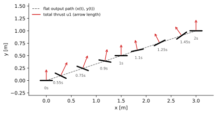
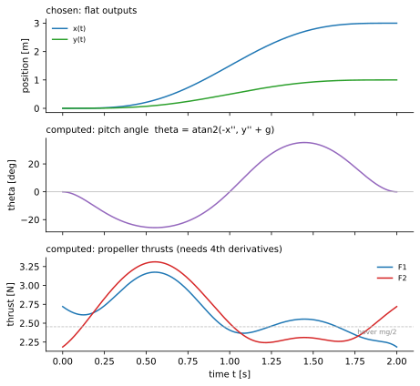

<ul class="post-sources">
<li markdown="span">[Princeton ROB 345 Introduction to Robotics](https://irom-lab.princeton.edu/intro-to-robotics/) Lecture 5 ([video](https://youtu.be/64Rfzm359Xg))</li>
</ul>

[강의 2](/blog/2026/11/10/rob-02-graph-search/)와 [강의 3](/blog/2026/11/10/rob-03-rrt/)의 모션 계획은 "충돌하지 않는 경로"만 찾았다. 그 경로를 로봇이 실제로 따라갈 수 있는지는 묻지 않았다. [강의 4](/blog/2026/11/10/rob-04-quadrotor-dynamics/)에서 쿼드로터의 운동 방정식을 세웠으니, 이제 그 방정식을 지키는 계획을 세울 차례다. 이번 강의는 그중 특히 다루기 쉬운 경우, **미분 평탄 시스템(differentially flat system)**을 다룬다. 핵심 메시지는 한 줄이다. **평탄 출력이라는 몇 개의 변수에 대해 매끄러운 궤적을 아무것이나 정하면, 나머지 상태와 필요한 제어 입력은 미분과 대수 계산만으로 나온다.**

## 왜 동역학을 고려한 계획이 필요한가

### RRT의 확장 단계가 가정한 것

[RRT](/blog/2026/11/10/rob-03-rrt/)는 매 반복마다 구성 공간에서 점 $$\bar{q}_{rand}$$를 뽑고, 트리에서 가장 가까운 정점 $$\bar{q}_{near}$$를 찾은 뒤, $$\bar{q}_{near}$$에서 $$\bar{q}_{rand}$$ 쪽으로 일정 거리만큼 **직선으로** 나아가 새 정점 $$\bar{q}_s$$를 만든다. 이 **확장(extension)** 단계는 "구성 공간의 두 점을 잇는 선분을 로봇이 그대로 따라갈 수 있다"는 가정 위에 서 있다.

이 가정은 많은 로봇에서 틀린다.

- **자동차.** 위에서 내려다본 자동차가 지금 위치에서 차 폭만큼 옆으로 평행 이동한 위치로 가고 싶다고 하자. 구성 공간에서 두 점은 가깝고 선분도 짧지만, 바퀴가 옆으로 굴러가지 않으므로 그 선분을 따라갈 수 없다. 앞뒤로 몇 번 움직이는 평행 주차 같은 기동이 필요하다.
- **쿼드로터.** 수평을 유지한 채 옆으로 미끄러지듯 이동하는 경로도 불가능하다. 프로펠러 추력은 항상 몸체에 수직이므로, 옆으로 가속하려면 먼저 몸체를 기울여야 한다.

물리적으로 실행 가능한 경로, 즉 운동 방정식을 만족하는 입력이 존재하는 경로를 **동역학적으로 실행 가능한(dynamically feasible)** 경로라고 한다. 이번 강의의 목표는 장애물은 잠시 잊고, RRT 확장 단계 하나를 동역학적으로 실행 가능하게 바꾸는 것이다.

### 평면 쿼드로터 다시 보기

예제로 쓸 시스템은 [강의 4](/blog/2026/11/10/rob-04-quadrotor-dynamics/)의 평면 쿼드로터다. 질량 중심 위치 $$(x, y)$$($$y$$가 위쪽), 기울기 $$\theta$$(반시계 방향이 양수), 질량 $$m$$, 관성 모멘트 $$I$$, 팔 길이 $$L$$, 중력 가속도 $$g$$, 왼쪽과 오른쪽 프로펠러 추력 $$F_1, F_2$$에 대해 운동 방정식은 다음과 같다.

$$
\ddot{x} = -\frac{F_1 + F_2}{m}\sin\theta \quad (1), \qquad
\ddot{y} = \frac{F_1 + F_2}{m}\cos\theta - g \quad (2), \qquad
\ddot{\theta} = \frac{(F_2 - F_1)L}{I} \quad (3)
$$

상태는 $$\bar{x} = [x, y, \theta, \dot{x}, \dot{y}, \dot{\theta}]^T \in \mathbb{R}^6$$, 제어 입력은 $$\bar{u} = [F_1, F_2]^T \in \mathbb{R}^2$$다. 이 강의 시리즈에서 막대(bar)는 벡터를 뜻한다. 식 (1)이 앞 절의 직관을 그대로 말해 준다. $$\theta = 0$$이면 $$\ddot{x} = 0$$이므로, 수평 가속을 하려면 반드시 기울어야 한다.

## 평면 쿼드로터는 질량 중심 궤적만 정하면 된다

추상적인 정의보다 예제를 먼저 본다.

### 주장

누군가 질량 중심의 궤적

$$
\bar{z}(t) = \begin{bmatrix} x(t) \\ y(t) \end{bmatrix}, \qquad 0 \le t \le T
$$

를 가져왔다고 하자. 그러면 다음 두 가지를 계산할 수 있다.

1. 드론이 정확히 이 질량 중심 궤적을 따라가게 하는 **제어 입력 궤적** $$\bar{u}(t) = [F_1(t), F_2(t)]^T$$.
2. 그때 드론이 거치는 **전체 상태 궤적** $$\bar{x}(t)$$.

단서가 둘 있다. 첫째, 정할 수 있는 것은 $$x(t), y(t)$$뿐이고 $$\theta(t)$$는 정할 수 없다. $$\theta$$는 질량 중심을 원하는 대로 움직이기 위해 "쓰이는" 자유도이고, 결과로 나올 뿐이다. 둘째, 궤적은 **충분히 매끄러워야** 한다. 순간 이동하거나 갑자기 꺾이는 궤적은 물리 법칙이 허용하지 않는다. 얼마나 매끄러워야 하는지는 유도 과정에서 정확히 나온다.

### 상태 복원: 기울기는 가속도 방향이 정한다

$$x(t), y(t)$$를 미분하면 $$\dot{x}, \dot{y}$$가 바로 나온다. 상태 6개 중 4개가 해결되었으므로 남은 것은 $$\theta$$와 $$\dot{\theta}$$다.

식 (1)과 (2)에서 총 추력 $$u_1 = F_1 + F_2$$를 한쪽으로 모으면

$$
u_1 \sin\theta = -m\ddot{x}, \qquad u_1 \cos\theta = m(\ddot{y} + g)
$$

이다. 둘을 나누면 $$u_1$$과 $$m$$이 약분되어

$$
\tan\theta = \frac{-\ddot{x}}{\ddot{y} + g}
\quad\Longrightarrow\quad
\theta = \operatorname{atan2}\left(-\ddot{x},\ \ddot{y} + g\right) \quad (4)
$$

를 얻는다. 해석은 간단하다. 추력 벡터 $$u_1(-\sin\theta, \cos\theta)$$는 "원하는 가속도에 중력을 보탠 벡터" $$m(\ddot{x}, \ddot{y} + g)$$와 같아야 하므로, 몸체의 위쪽 방향은 그 벡터 방향을 가리켜야 한다. 오른쪽으로 가속하려면($$\ddot{x} > 0$$) 몸체가 오른쪽으로 기울어야 하고, 이 좌표계에서 그것은 $$\theta < 0$$이다.

(4)를 쓰려면 $$\ddot{x}, \ddot{y}$$가 있어야 하므로 궤적이 적어도 두 번 미분 가능해야 한다. $$\dot{\theta}$$는 (4)를 한 번 더 미분해서 얻는다. $$a = -\ddot{x}$$, $$b = \ddot{y} + g$$로 두면

$$
\dot{\theta} = \frac{b\dot{a} - a\dot{b}}{a^2 + b^2}
$$

이고, 여기에는 3계 도함수 $$\dddot{x}, \dddot{y}$$가 들어간다.

### 입력 복원: 4계 도함수까지 필요하다

크기 쪽에서는 두 식을 제곱해 더하면 총 추력이 나온다.

$$
u_1 = F_1 + F_2 = m\sqrt{\ddot{x}^2 + (\ddot{y} + g)^2}
$$

차이 $$F_2 - F_1$$은 식 (3)에서 나온다. $$\theta(t)$$를 알고 있으므로 두 번 미분해 $$\ddot{\theta}(t)$$를 구하면

$$
F_2 - F_1 = \frac{I\ddot{\theta}}{L}
$$

이다. 이제 $$F_1, F_2$$에 대한 **선형 연립방정식 두 개**가 생겼으므로

$$
F_1 = \frac{1}{2}\left(u_1 - \frac{I\ddot{\theta}}{L}\right), \qquad
F_2 = \frac{1}{2}\left(u_1 + \frac{I\ddot{\theta}}{L}\right)
$$

로 풀린다. (강의에서는 $$u_1$$ 대신 식 (1)과 (3)을 연립했는데, $$\theta$$를 이미 알고 있으므로 같은 결과다.) $$\ddot{\theta}$$를 쓰면

$$
\ddot{\theta} = \frac{(b\ddot{a} - a\ddot{b})(a^2 + b^2) - 2(b\dot{a} - a\dot{b})(a\dot{a} + b\dot{b})}{(a^2 + b^2)^2}
$$

인데, $$\ddot{a} = -x^{(4)}$$, $$\ddot{b} = y^{(4)}$$이므로 **위치의 4계 도함수(snap)**가 들어간다. 정리하면, 평면 쿼드로터에 대해 이 주장이 성립하려면 $$x(t), y(t)$$가 네 번 미분 가능하면 된다.

## 미분 평탄성의 정의

### 정의

동역학이 $$\dot{\bar{x}} = f(\bar{x}, \bar{u})$$, $$\bar{x} \in \mathbb{R}^n$$, $$\bar{u} \in \mathbb{R}^m$$으로 주어졌다고 하자. 이 시스템이 **미분 평탄(differentially flat)**하다는 것은 다음을 만족하는 **평탄 출력(flat output)** $$\bar{z}$$가 존재한다는 뜻이다.

- $$\bar{z}$$는 상태와 입력, 입력의 도함수들로 계산된다: $$\bar{z} = \alpha(\bar{x}, \bar{u}, \dot{\bar{u}}, \ldots, \bar{u}^{(p)})$$.
- 상태와 입력이 모두 $$\bar{z}$$와 그 도함수들로 표현된다:

$$
\bar{x} = \beta(\bar{z}, \dot{\bar{z}}, \ldots, \bar{z}^{(q)}), \qquad
\bar{u} = \gamma(\bar{z}, \dot{\bar{z}}, \ldots, \bar{z}^{(q)})
$$

여기서 $$\bar{u}^{(p)}$$는 $$p$$계 시간 도함수다. 평면 쿼드로터에 대응시키면 이렇다.

| 정의의 기호 | 평면 쿼드로터 |
|---|---|
| $$\alpha$$ | 상태의 첫 두 성분 $$(x, y)$$를 꺼내는 함수 (입력은 쓰지 않음) |
| $$\beta$$ | $$\dot{x}, \dot{y}$$를 미분으로, $$\theta, \dot{\theta}$$를 식 (4)와 그 미분으로 계산 |
| $$\gamma$$ | $$u_1$$과 $$\ddot{\theta}$$로 $$F_1, F_2$$를 계산 |
| $$q$$ | 4 ($$\ddot{\theta}$$에 snap이 필요) |

정의 자체는 "이런 함수들을 찾을 수 있으면 평탄하다고 부르자"는 이름 붙이기다. 실제로 쓰이는 평탄 출력은 대부분 상태만의 함수이고, 입력까지 허용하는 것은 정의를 최대한 일반적으로 두기 위해서다.

### 실제로 쓰는 흐름

평탄성이 강력한 이유는 계획의 순서를 뒤집기 때문이다. 상태 공간에서 운동 방정식을 지키는 궤적을 찾는 대신, 평탄 출력 공간에서 **매끄럽기만 한** 궤적을 마음대로 그린다. 그 다음 $$\gamma$$로 입력을, $$\beta$$로 상태를 계산하면 끝이다. 그림으로 그리면 왼쪽 하나만 사람이 정하고, 오른쪽 두 개는 계산으로 따라 나온다.

$$
\underbrace{\bar{z}(t)}_{\text{정한다}}
\ \xrightarrow{\ \gamma\ }\ \underbrace{\bar{u}(t)}_{\text{필요한 입력}},
\qquad
\bar{z}(t)\ \xrightarrow{\ \beta\ }\ \underbrace{\bar{x}(t)}_{\text{따라오는 상태}}
$$

### 평탄 출력의 개수

증명 없이 알아 두면 좋은 정리가 있다. **평탄 출력의 개수는 제어 입력의 개수와 같다.** 평면 쿼드로터는 입력이 2개($$F_1, F_2$$)이고 평탄 출력도 2개($$x, y$$)다.

3D 쿼드로터는 입력이 4개(프로펠러 4개)이므로 평탄 출력도 4개여야 한다. 질량 중심 위치 $$x, y, z$$가 셋이고, 나머지 하나는 **요(yaw) 각도** $$\psi$$다. 요는 프로펠러의 회전 방향 차이로 생기는 반토크로 독립적으로 돌릴 수 있는 축이어서, 위치와 함께 자유롭게 정할 수 있다. 반면 롤과 피치는 위치를 맞추는 데 쓰이므로 결과로 나올 뿐이다. 3D 쿼드로터의 평탄성 증명은 Powers, Mellinger, Kumar의 "Quadrotor Kinematics and Dynamics"(Handbook of Unmanned Aerial Vehicles) 16.2.6절에 있다.

자동차(뒷바퀴 축 중심 위치가 평탄 출력), 트레일러를 끄는 자동차, 수직 이착륙 후 고정익 비행으로 전환하는 테일시터(tailsitter) 비행기도 평탄하다고 알려져 있다.

## 예제: 3 m 옆, 1 m 위로 2초 만에

숫자로 따라가 보자. 파라미터는 $$m = 0.5$$ kg, $$I = 0.005$$ kg·m², $$L = 0.15$$ m, $$g = 9.81$$ m/s²로 둔다. 호버링에 필요한 총 추력은 $$mg = 4.905$$ N, 프로펠러 하나당 2.45 N이다.

### 평탄 출력 궤적 고르기

정지 상태 $$(0, 0)$$에서 출발해 $$T = 2$$초 뒤 $$(3, 1)$$에서 다시 정지하고 싶다. 출발과 도착에서 속도, 가속도, 저크(jerk, 3계 도함수)까지 0이면 시작 순간 기울기와 각속도도 0이 되어 호버링에서 매끄럽게 출발한다. 경계 조건이 양쪽에 4개씩 8개이므로 7차 다항식이 딱 맞는다. $$\tau = t/T \in [0, 1]$$에 대해

$$
s(\tau) = 35\tau^4 - 84\tau^5 + 70\tau^6 - 20\tau^7
$$

은 $$s(0) = 0$$, $$s(1) = 1$$이고 양 끝에서 1-3계 도함수가 모두 0이다. 이것으로

$$
x(t) = 3\, s(t/T), \qquad y(t) = 1 \cdot s(t/T)
$$

로 둔다. 이 다항식은 같은 경계 조건에서 $$\int_0^T (x^{(4)})^2 dt$$를 최소화하는 궤적이기도 하다. 이것이 Mellinger와 Kumar의 **최소 스냅(minimum snap)** 궤적 생성의 가장 단순한 경우다.

### 한 시점에서 손으로 계산하기

$$t = 0.5$$초($$\tau = 0.25$$)를 보자. $$s(0.25) \approx 0.0706$$이므로 위치는 $$(0.212, 0.071)$$이고, 가속도를 계산하면 $$\ddot{x} \approx 5.537$$, $$\ddot{y} \approx 1.846$$ m/s²다.

- 기울기: $$\theta = \operatorname{atan2}(-5.537,\ 1.846 + 9.81) = \operatorname{atan2}(-5.537,\ 11.656) \approx -25.4^\circ$$. 오른쪽으로 가속 중이므로 오른쪽으로 기울어 있다.
- 총 추력: $$u_1 = 0.5\sqrt{5.537^2 + 11.656^2} \approx 0.5 \times 12.90 \approx 6.45$$ N. 호버링보다 32% 많다. 기울어진 만큼 수직 성분이 줄어드는 것을 보충하고, 위로도 가속해야 하기 때문이다.
- 각가속도: snap까지 넣어 계산하면 $$\ddot{\theta} \approx 4.15$$ rad/s²이고, $$I\ddot{\theta}/L \approx 0.005 \times 4.15 / 0.15 \approx 0.138$$ N이다.
- 프로펠러: $$F_1 \approx (6.452 - 0.138)/2 \approx 3.16$$ N, $$F_2 \approx (6.452 + 0.138)/2 \approx 3.30$$ N.

계산한 $$\theta, u_1$$을 식 (1), (2)에 다시 넣으면 처음의 $$\ddot{x}, \ddot{y}$$가 수치 오차 수준($$10^{-15}$$)으로 그대로 나온다.


*정한 질량 중심 경로(점선)와 몇 시점의 드론 자세. 검은 막대가 몸체, 빨간 화살표가 총 추력이다. 가속 구간에서는 진행 방향으로, 감속 구간에서는 반대로 기울고, 중간 지점(1초)에서는 가속도가 0이라 수평이다.*

### 전체 궤적

모든 시점에 같은 계산을 하면 아래 그림을 얻는다. 기울기는 0.55초 근처에서 약 $$-25^\circ$$, 1.45초 근처에서 최대 약 $$35^\circ$$다. 감속 구간에서 더 크게 기우는 것은 감속 중에는 위로 가는 속도도 줄여야 해서($$\ddot{y} < 0$$) 식 (4)의 분모 $$\ddot{y} + g$$가 작아지기 때문이다. 추력은 2.18-3.31 N 범위로 항상 양수다.


*위: 직접 정한 평탄 출력 $$x(t), y(t)$$. 가운데: 식 (4)로 계산한 기울기. 아래: 계산한 프로펠러 추력. 시작 순간 $$F_1, F_2$$가 호버링 값(점선)에서 바로 벌어지는 것은 이 다항식의 snap이 $$t = 0$$에서 0이 아니기 때문이다.*

마지막 그림의 시작 부분은 중요한 디테일이다. 출발 직전 드론은 $$F_1 = F_2 = 2.45$$ N으로 호버링하고 있었는데, $$t = 0$$에서 $$x^{(4)}(0) = 3 \times 840 / 2^4 = 157.5$$ m/s⁴이므로 $$\ddot{\theta}(0) \approx -16$$ rad/s²가 필요하고, 추력이 순간적으로 $$F_1 \approx 2.72$$, $$F_2 \approx 2.18$$ N으로 바뀌어야 한다. 실제 모터는 추력을 순간적으로 바꿀 수 없으므로, 입력까지 연속이길 원하면 snap도 경계에서 0으로 맞추는 더 높은 차수의 다항식을 써야 한다.

## RRT와 결합하기

평탄 시스템이라면 RRT를 구성 공간이 아니라 **평탄 출력 공간**에서 돌리면 된다. 3D 쿼드로터라면 무작위 $$(x, y, z, \psi)$$를 뽑고, 확장 단계에서 매끄러운 다항식 조각으로 $$\bar{z}_{near}$$와 $$\bar{z}_{rand}$$ 방향의 새 점을 잇는다. 평탄성 덕분에 어떤 매끄러운 평탄 출력 궤적이든 실행할 수 있으므로 확장이 항상 실행 가능하다.

```python
def extend_flat(tree, z_rand, step):
    z_near = nearest(tree, z_rand)
    z_new = z_near.point + step * unit(z_rand - z_near.point)
    # 다항식 조각: z_near에서 도착한 속도, 가속도, 저크(필요하면 snap)를
    # 그대로 이어받아야 정점에서도 충분히 매끄럽다
    seg = poly_segment(start=z_near.point, start_derivs=z_near.derivs,
                       end=z_new, duration=dt)
    if collision_free(seg, robot_radius):   # 드론을 공으로 근사
        tree.add(z_new, parent=z_near, segment=seg)
```

주의할 점이 두 가지 있다. 첫째, 정점에서 두 조각이 만날 때 위치만 이어지면 안 되고 4계 도함수까지 이어져야 한다. 다항식은 미분이 쉬우므로 "앞 조각 끝의 $$k$$계 도함수 = 뒤 조각 시작의 $$k$$계 도함수"라는 선형 제약을 넣으면 된다. 둘째, 충돌 검사는 평탄 출력만으로 해야 하므로 롤과 피치를 모른다고 가정하고 드론을 **구로 근사**한다. 강의에서 보여 준 GRASP 연구실의 영상(던진 고리를 통과하는 쿼드로터)은 날아가는 고리의 위치를 모션 캡처로 추적하며 고리를 통과하는 $$(x, y, z, \psi)$$ 궤적을 실시간으로 계획하고 평탄성으로 입력을 계산한 결과다.

## 한계와 흔한 실수

- **평탄 출력이 아닌 상태는 제어할 수 없다.** 평면 쿼드로터가 좁은 틈을 특정 기울기로 통과해야 한다면 평탄성만으로는 부족하다. $$\theta$$는 $$x(t), y(t)$$가 정해지는 순간 결정되기 때문이다. 상태 궤적이 꽤 "이상하게" 나올 수도 있다. 이 한계 때문에 다음 강의에서 [궤적 최적화](/blog/2026/11/10/rob-06-trajectory-optimization/)를 다룬다.
- **입력 제약은 자동으로 지켜지지 않는다.** 평탄성은 입력을 계산해 줄 뿐, 그 입력이 모터의 한계 안에 있다는 보장은 없다. 위 예제에서 같은 경로를 1초에 날게 하면 가속도가 4배가 되어 필요한 추력과 기울기가 훨씬 커진다. 계산한 $$F_1, F_2$$가 0 이상, 최대 추력 이하인지 반드시 확인해야 한다.
- **$$\arctan$$ 대신 $$\operatorname{atan2}$$를 써야 한다.** $$\tan\theta$$만 보면 $$\theta$$와 $$\theta + \pi$$를 구별할 수 없다. 후자는 몸체를 뒤집고 추력을 음수로 내는 해인데, 프로펠러는 음의 추력을 낼 수 없으므로 $$u_1 > 0$$이 되는 가지를 골라야 한다. 또 $$\ddot{x} = 0$$이고 $$\ddot{y} = -g$$(자유 낙하)인 순간에는 방향이 정해지지 않아 식 (4)가 특이해진다.
- **평탄 출력을 찾는 일반적인 방법은 없다.** $$\dot{\bar{x}} = f(\bar{x}, \bar{u})$$를 넣으면 평탄 출력을 돌려주는 알고리즘은 없고, 시스템마다 통찰이 필요하다. 어떤 시스템이 평탄하다는 사실 하나로 논문 한 편이 되기도 한다.
- **매끄러움 조건을 잊는다.** 꺾인 직선 경로(구성 공간 RRT의 출력)를 그대로 넣으면 꺾이는 점에서 가속도가 무한대가 된다. 평면 쿼드로터는 4계 도함수까지 존재해야 한다.

## 정리

| 질문 | 답 |
|---|---|
| 무엇이 문제인가 | 구성 공간의 직선 확장은 자동차나 쿼드로터가 따라갈 수 없다 |
| 미분 평탄이란 | 평탄 출력 $$\bar{z}$$와 그 도함수로 상태($$\beta$$)와 입력($$\gamma$$)을 모두 표현할 수 있음 |
| 평면 쿼드로터의 평탄 출력 | 질량 중심 $$(x, y)$$, $$\theta = \operatorname{atan2}(-\ddot{x}, \ddot{y} + g)$$ |
| 필요한 매끄러움 | $$x, y$$의 4계 도함수(snap) |
| 3D 쿼드로터의 평탄 출력 | $$(x, y, z, \psi)$$, 입력 개수 4와 같음 |
| 계획에 쓰는 법 | 평탄 출력 공간에서 매끄러운 다항식으로 RRT 확장, 최소 스냅 궤적 |
| 한계 | 다른 상태는 못 정함, 입력 한계는 따로 확인, 평탄 출력 찾기는 비구성적 |
