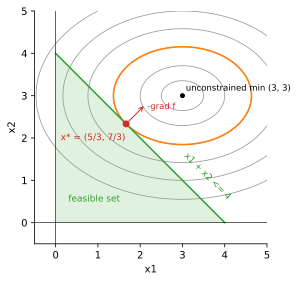
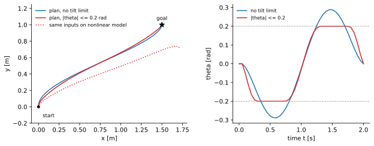

<ul class="post-sources">
<li markdown="span">[Princeton ROB 345 Introduction to Robotics](https://irom-lab.princeton.edu/intro-to-robotics/) Lecture 6 ([video](https://youtu.be/ETOwJ-aPWe8))</li>
</ul>

[강의 5](/blog/2026/11/10/rob-05-differential-flatness/)의 미분 평탄성은 강력하지만 두 가지 경우에 막힌다. 하나는 **평탄 출력이 아닌 상태를 제어하고 싶을 때**다. 평면 쿼드로터가 좁은 틈을 특정 기울기로 통과해야 한다면, $$\theta$$는 질량 중심 궤적이 정해지는 순간 결정되므로 따로 요구할 수 없다. 다른 하나는 **시스템이 평탄한지 모를 때**다. 새 로봇을 만들었는데 평탄 출력을 찾지 못했다면 평탄성은 쓸 수 없다. 이번 강의는 더 일반적인 도구인 **궤적 최적화(trajectory optimization)**를 다룬다.

## RRT에 동역학을 넣는 두 가지 방법

동역학이 $$\dot{\bar{x}} = f(\bar{x}, \bar{u})$$로 주어졌을 때, [RRT](/blog/2026/11/10/rob-03-rrt/)를 구성 공간이 아니라 **상태 공간**에서 키운다고 하자. 평면 쿼드로터라면 상태는 6차원, 3D 쿼드로터라면 12차원이다.

### 아이디어 1: 아무 입력이나 넣어 보기

가장 단순한 방법은 이미 아는 동역학을 그대로 시뮬레이션하는 것이다.

```python
tree = [x_start]
while True:
    x_rand = random_vertex(tree)          # 트리 안의 정점에서 고른다
    u_rand = random_input()
    x_s = simulate(f, x_rand, u_rand, dt) # x_rand + ∫ f(x(t), u_rand) dt
    if collision_free(x_rand, x_s):
        tree.append(x_s)
        if close(x_s, x_goal): break
```

새 점은 언제나 동역학을 따라 적분해서 만들었으므로 트리의 모든 가지가 실행 가능하다. 반복을 무한히 하면 해가 있을 때 찾을 확률이 1로 가므로 **확률적 완전성(probabilistic completeness)**도 증명할 수 있다.

그런데 실제로는 거의 쓸모가 없다. 원래 RRT에서 탐색을 앞으로 밀어내는 힘은 "구성 공간 전체에서 무작위 점을 뽑고 그 쪽으로 자란다"는 데서 나온다. 아이디어 1은 이미 트리에 있는 점에서만 출발하고 방향도 무작위 입력에 맡기므로, 트리가 시작점 근처에서 뭉쳐 맴돌 뿐 빈 공간으로 뻗어 나가지 않는다.

### 아이디어 2: 확장을 경계값 문제로 바꾸기

RRT의 구조는 그대로 두고 **확장 단계만** 바꾼다. 상태 공간에서 $$\bar{x}_{rand}$$를 뽑고, 가장 가까운 정점 $$\bar{x}_{near}$$를 찾고, 그 방향으로 새 상태 $$\bar{x}_s$$를 정하는 것까지는 같다. 다만 $$\bar{x}_{near}$$와 $$\bar{x}_s$$를 선분으로 잇는 대신, **$$\bar{x}_{near}$$에서 출발해 $$\bar{x}_s$$에 도착하게 하는 제어 입력 열**을 찾는다.

시작 상태와 끝 상태가 주어지고 그 사이를 잇는 입력을 찾는 문제를 **경계값 문제(boundary value problem)**라 하고, 모션 계획 분야에서는 보통 **궤적 최적화**라 부른다. 같은 두 상태를 잇는 방법은 여러 가지이므로(평행 주차를 앞으로 먼저 할 수도, 뒤로 먼저 할 수도 있다) "그중 가장 좋은 것"을 고르는 최적화 문제로 쓰는 것이 자연스럽다.

일반적인 비선형 경계값 문제는 어렵다. 그러나 **동역학이 선형이면** 아주 효율적으로 풀린다. 그래서 먼저 비선형 동역학을 선형으로 근사하는 법을 본다.

## 동역학의 선형화

### 기준점: 호버링

평면 쿼드로터를 1차 미분 방정식으로 쓰면 다음과 같다. 입력은 [강의 4](/blog/2026/11/10/rob-04-quadrotor-dynamics/)처럼 총 추력 $$u_1 = F_1 + F_2$$와 모멘트 $$u_2 = (F_2 - F_1)L$$로 둔다. 이렇게 묶는 것은 식을 짧게 쓰기 위해서일 뿐이다.

$$
\dot{\bar{x}} = \frac{d}{dt}\begin{bmatrix} x \\ y \\ \theta \\ \dot{x} \\ \dot{y} \\ \dot{\theta} \end{bmatrix}
= f(\bar{x}, \bar{u}) =
\begin{bmatrix} \dot{x} \\ \dot{y} \\ \dot{\theta} \\ -\frac{u_1}{m}\sin\theta \\ \frac{u_1}{m}\cos\theta - g \\ \frac{u_2}{I} \end{bmatrix}
$$

$$\sin\theta$$, $$\cos\theta$$, 그리고 $$u_1$$과 $$\theta$$의 곱 때문에 $$f$$는 비선형이다. 선형 근사에는 기준점이 필요하다. 가장 자연스러운 기준은 **호버링**이다.

$$
\bar{x}_0 = [x_0, y_0, 0, 0, 0, 0]^T, \qquad \bar{u}_0 = [mg, 0]^T
$$

수평 자세로 멈춰 있고, 총 추력이 중력을 정확히 상쇄하고, 모멘트는 0이다. 대입하면 $$\sin 0 = 0$$, $$\cos 0 = 1$$이므로 $$f(\bar{x}_0, \bar{u}_0) = [0, 0, 0, 0, mg/m - g, 0]^T = \bar{0}$$이다. 이 상태에서 이 입력을 주면 영원히 그 자리에 머문다. ($$x_0, y_0$$는 아무 값이어도 된다. 좌표 원점을 옮기면 0으로 둘 수 있다.)

### 1차 테일러 근사

다변수 함수의 1차 테일러 전개를 쓰면

$$
\dot{\bar{x}} = f(\bar{x}, \bar{u}) \approx
\underbrace{f(\bar{x}_0, \bar{u}_0)}_{=\,\bar{0}}
+ \underbrace{\left.\frac{\partial f}{\partial \bar{x}}\right\rvert_{\bar{x}_0, \bar{u}_0}}_{A}(\bar{x} - \bar{x}_0)
+ \underbrace{\left.\frac{\partial f}{\partial \bar{u}}\right\rvert_{\bar{x}_0, \bar{u}_0}}_{B}(\bar{u} - \bar{u}_0)
$$

이다. $$A$$는 $$n \times n$$, $$B$$는 $$n \times m$$ 상수 행렬이고, 각각 $$f$$의 상태와 입력에 대한 [야코비 행렬(Jacobian)](/blog/2026/11/02/knowledge-120-jacobian/)을 기준점에서 계산한 것이다. 행 $$i$$는 $$f$$의 $$i$$번째 성분, 열 $$j$$는 $$j$$번째 변수로 미분한다.

**$$A$$ 계산.** 첫 세 행은 $$f_1 = \dot{x}$$, $$f_2 = \dot{y}$$, $$f_3 = \dot{\theta}$$이므로 자기 자신으로 미분한 자리만 1이다. 넷째 행 $$f_4 = -\frac{u_1}{m}\sin\theta$$는 $$\theta$$에만 의존하고 $$\partial f_4 / \partial\theta = -\frac{u_1}{m}\cos\theta$$다. 기준점에서 $$u_1 = mg$$, $$\cos 0 = 1$$이므로 $$-g$$다. 다섯째 행 $$f_5 = \frac{u_1}{m}\cos\theta - g$$의 $$\theta$$ 미분은 $$-\frac{u_1}{m}\sin\theta$$로, $$\theta = 0$$에서 0이다. 여섯째 행은 상태에 의존하지 않는다.

$$
A = \begin{bmatrix}
0 & 0 & 0 & 1 & 0 & 0 \\
0 & 0 & 0 & 0 & 1 & 0 \\
0 & 0 & 0 & 0 & 0 & 1 \\
0 & 0 & -g & 0 & 0 & 0 \\
0 & 0 & 0 & 0 & 0 & 0 \\
0 & 0 & 0 & 0 & 0 & 0
\end{bmatrix}, \qquad
B = \begin{bmatrix}
0 & 0 \\ 0 & 0 \\ 0 & 0 \\ 0 & 0 \\ \frac{1}{m} & 0 \\ 0 & \frac{1}{I}
\end{bmatrix}
$$

**$$B$$ 계산.** $$\partial f_5 / \partial u_1 = \frac{\cos\theta}{m} = \frac{1}{m}$$, $$\partial f_6 / \partial u_2 = \frac{1}{I}$$이고, $$\partial f_4 / \partial u_1 = -\frac{\sin\theta}{m}$$은 $$\theta = 0$$에서 0이다. 나머지는 모두 0이다.

이 행렬들이 말하는 물리가 선명하다. 호버링 근처에서 수직 운동은 $$\ddot{y} = (u_1 - mg)/m$$으로 추력에만 반응하고, 수평 운동은 $$\ddot{x} = -g\theta$$로 기울기에만 반응하며, 기울기는 $$\ddot{\theta} = u_2 / I$$로 모멘트에만 반응한다. 즉 수평으로 가려면 **모멘트 → 기울기 → 수평 가속**이라는 사슬을 거쳐야 한다.

손으로 하면 지루한 계산이고 3D 쿼드로터(12×12)는 더 그렇다. 실제로는 자동 미분이나 유한 차분으로 계산한다. $$m = 0.5$$, $$I = 0.005$$로 두고 중앙 차분 $$\left(f(\bar{x}_0 + \epsilon\bar{e}_j, \bar{u}_0) - f(\bar{x}_0 - \epsilon\bar{e}_j, \bar{u}_0)\right) / 2\epsilon$$으로 계산해 보면 위 행렬과 같고, $$B$$의 0이 아닌 성분은 $$1/m = 2$$, $$1/I = 200$$이다.

이 근사는 기준점 근처에서만 정확하다. $$\theta = 0.2$$ rad(약 11°)에서 $$\sin\theta \approx \theta$$의 오차는 0.7%로 작지만, $$\cos\theta \approx 1$$의 오차는 2%라서 수직 추력을 계속 과대평가하게 된다. 이 차이가 뒤의 예제에서 눈에 띄는 결과를 만든다.

## 선형 동역학의 궤적 최적화

### 시간 이산화

연속 시간 미분 방정식을 그대로 최적화하기는 불편하므로, **오일러 이산화(Euler discretization)**로 시간 간격 $$\Delta t$$마다 끊는다.

$$
\bar{x}[t + \Delta t] \approx \bar{x}[t] + \Delta t\left[A(\bar{x}[t] - \bar{x}_0) + B(\bar{u}[t] - \bar{u}_0)\right]
$$

### 최적화 문제

이제 궤적 최적화를 다음과 같이 쓴다. $$t = 0, \Delta t, 2\Delta t, \ldots, T$$에 대해

$$
\begin{aligned}
\text{find} \quad & \bar{x}[t],\ \bar{u}[t] \\
\text{minimize} \quad & \sum_{t} \lVert \bar{u}[t] - \bar{u}_0 \rVert_2^2 \\
\text{subject to} \quad & \bar{x}[t + \Delta t] = \bar{x}[t] + \Delta t\left[A(\bar{x}[t] - \bar{x}_0) + B(\bar{u}[t] - \bar{u}_0)\right] \\
& \bar{x}[0] = \bar{x}_{start}, \quad \bar{x}[T] = \bar{x}_{goal} \\
& C\bar{x}[t] \le \bar{d}
\end{aligned}
$$

- **결정 변수**는 모든 시점의 상태와 입력이다. 상태도 변수로 두고 동역학을 제약으로 거는 방식이다.
- **목적 함수**는 제어 노력(control effort)이다. "가능한 한 게으르게" 움직이라는 뜻이다. 강의 노트는 $$\lVert \bar{u}[t] \rVert^2$$로 썼는데, 쿼드로터는 호버링에만 $$mg$$를 써야 하므로 여기서는 호버링 입력에서 벗어난 양 $$\bar{u} - \bar{u}_0$$에 벌점을 준다. 둘 다 아래에서 말하는 QP다.
- **첫 제약**은 상태와 입력이 선형화·이산화한 동역학을 따르게 한다.
- **둘째 줄**은 경계 조건이다.
- **마지막 제약**은 상태가 선형 부등식들로 정의된 영역, 즉 **다면체(polytope)** 안에 머물게 한다. $$C$$는 $$k \times n$$, $$\bar{d}$$는 $$k \times 1$$이고, $$C$$의 각 행은 "상태가 어떤 초평면의 한쪽에 있어야 한다"는 조건 하나다. 장애물 사이의 빈 공간을 다면체로 근사하거나, 기울기를 $$\lvert\theta\rvert \le \theta_{max}$$로 제한하는 데 쓴다.

### 왜 이것이 쉬운가: 볼록 이차 계획

목적 함수는 결정 변수의 **볼록한(convex) 이차 함수**이고, 제약은 모두 결정 변수에 대한 **선형 등식과 선형 부등식**이다. 이런 문제를 **볼록 이차 계획(convex quadratic program, QP)**이라 한다. 볼록 QP는 지역 최솟값이 곧 전역 최솟값이고([볼록 함수](/blog/2026/11/02/knowledge-21-convex/) 참고), 변수가 수천 개여도 밀리초 단위로 풀린다. Mosek, Gurobi, OSQP 같은 솔버가 있고, 평면 쿼드로터 크기라면 잘 짠 구현으로 마이크로초 단위까지도 가능하다.

2차원으로 감을 잡아 보자. 변수 $$(x_1, x_2)$$에 대해

$$
\min_{x_1, x_2}\ (x_1 - 3)^2 + 2(x_2 - 3)^2 \quad \text{s.t.} \quad x_1 + x_2 \le 4,\ x_1 \ge 0,\ x_2 \ge 0
$$

를 생각하자. 제약이 없으면 최솟값은 $$(3, 3)$$이지만 그 점은 $$x_1 + x_2 = 6 > 4$$라서 허용되지 않는다. 그러면 최적점은 경계 $$x_1 + x_2 = 4$$ 위에서 등고선 타원이 그 직선에 **접하는** 점이다. 접점에서는 목적 함수의 기울기 $$\nabla f = (2(x_1 - 3),\ 4(x_2 - 3))$$가 직선의 법선 $$(1, 1)$$과 평행해야 하므로 $$2(x_1 - 3) = 4(x_2 - 3)$$, 즉 $$x_1 - 3 = 2(x_2 - 3)$$이다. $$x_1 = 4 - x_2$$를 넣으면 $$1 - x_2 = 2x_2 - 6$$에서 $$x_2 = 7/3$$, $$x_1 = 5/3$$이고, 최솟값은 $$(4/3)^2 + 2(2/3)^2 = 24/9 \approx 2.67$$이다.


*볼록 QP의 그림. 회색 타원은 목적 함수의 등고선, 초록 영역은 허용 집합이다. 최적점 $$x^*$$(빨강)는 허용 집합 경계에서 등고선(주황)이 접하는 점이고, 거기서 $$-\nabla f$$는 경계의 바깥쪽 법선 방향을 향한다.*

궤적 최적화도 같은 그림의 고차원 버전이다. 변수가 수백 개, 제약이 수백 개일 뿐이다.

### 예제: 1.5 m 옆, 1 m 위로 이동

$$m = 0.5$$ kg, $$I = 0.005$$ kg·m², 호버링 $$(0, 0)$$에서 호버링 $$(1.5, 1)$$로 $$T = 2$$초 안에 옮겨 가는 문제를 $$\Delta t = 0.05$$초(40단계)로 풀어 보자. 변수는 상태 $$41 \times 6 = 246$$개, 입력 $$40 \times 2 = 80$$개로 326개이고, 등식 제약은 동역학 240개와 경계 조건 12개다.

- **기울기 제약 없음.** 해의 비용은 약 7.51이고 기울기는 최대 0.288 rad(16.5°)까지 간다.
- **$$\lvert\theta[t]\rvert \le 0.2$$ rad 추가.** 부등식 82개가 더해진다. 해는 기울기가 $$\pm 0.2$$에 딱 붙어 머무는 구간이 생기는 모양으로 바뀌고(41개 시점 중 18개에서 제약이 활성), 비용은 약 7.54로 거의 늘지 않는다.

비용이 거의 그대로인 이유는 단위 때문이다. 수직 이동에 필요한 추력 변화 $$\tilde{u}_1$$은 뉴턴 단위로 0.7 N 안팎인 반면, 모멘트 $$u_2$$는 기울기 제약이 있을 때도 최대 0.1 N·m 정도라서 제곱하면 비용에 거의 기여하지 않는다. 게다가 선형 모델에서 수직 운동과 수평 운동은 완전히 분리되어 있어서 기울기 제약이 $$u_1$$을 전혀 바꾸지 않는다. 실제 설계에서는 각 항에 가중치를 다르게 주는데, 이 생각은 [강의 8](/blog/2026/11/10/rob-08-lqr/)의 $$Q$$, $$R$$ 행렬로 이어진다.


*왼쪽: QP로 얻은 질량 중심 경로(파랑: 기울기 제약 없음, 빨강: $$\lvert\theta\rvert \le 0.2$$)와, 빨간 해의 입력을 비선형 모델에 그대로 넣어 시뮬레이션한 결과(점선). 오른쪽: 기울기 궤적. 제약을 넣은 해는 $$\pm 0.2$$ rad에 붙어 있는 구간이 있다.*

왼쪽 그림의 점선이 중요하다. 선형 모델에서 찾은 입력을 진짜 비선형 동역학에 그대로 넣으면 드론은 $$(1.5, 1)$$이 아니라 약 $$(1.72, 0.71)$$에 도착한다. 30 cm 가까이 모자란 높이는 앞에서 말한 $$\cos\theta \approx 1$$의 오차가 2초 동안 쌓인 결과다. 선형 모델은 기울어도 수직 추력이 줄지 않는다고 믿었지만 실제로는 줄었다. 이것이 다음 두 가지 이야기의 출발점이다. 계획 단계에서는 아래의 순차 QP로 비선형성을 반영하고, 실행 단계에서는 [강의 7](/blog/2026/11/10/rob-07-stability-pd/)의 피드백 제어로 남은 오차를 고친다.

## 비선형 시스템: 순차 이차 계획

동역학이 비선형이고 장애물 제약(예: "원 모양 장애물 바깥에 있어라")도 비선형이면 문제가 더 이상 QP가 아니다. 그래도 QP를 반복해서 풀어 접근할 수 있다. 이것을 **순차 이차 계획(sequential quadratic programming, SQP)**이라 한다.

```python
traj = straight_line_guess(x_start, x_goal)   # 장애물을 뚫어도 상관없다
for it in range(max_iters):
    A_t, B_t = linearize(f, traj)              # 현재 궤적의 각 시점에서 선형화
    C_t, d_t = linearize_constraints(obstacles, traj)
    new_traj = solve_qp(A_t, B_t, C_t, d_t, x_start, x_goal,
                        trust_region=traj)     # 현재 궤적 근처로 제한
    if converged(new_traj, traj): break
    traj = new_traj
```

출발점은 대충 그린 추측이다. 처음에는 직선이라 장애물을 관통하고 동역학도 지키지 않는다. 그 궤적의 각 시점에서 동역학과 장애물 제약을 선형화하면 QP가 되고, 그 QP를 풀어 궤적을 고치고, 고친 궤적에서 다시 선형화한다. 장애물 위반에 대한 벌점을 처음에는 약하게 주고 점점 키우는 방법도 쓴다. 선형화는 현재 궤적 근처에서만 믿을 수 있으므로, 한 번에 너무 멀리 움직이지 않도록 신뢰 영역(trust region)을 두는 것이 보통이다.

SQP에는 보장이 없다. **지역 최적해**로 수렴할 뿐이고, 초기 추측이 나쁘거나 장애물이 많고 환경이 복잡할수록 실행 가능한 해를 못 찾을 수 있다. 그래서 RRT와 결합한다. RRT 확장 한 번은 짧은 시간 구간의 작은 경계값 문제이므로 SQP가 빠르고 안정적으로 풀고, 넓은 공간의 탐색은 RRT가 맡는다.

목적 함수는 제어 노력 외에도 경로 길이나 도달 시간을 쓸 수 있다. 최소 시간 문제의 해는 보통 입력을 최댓값과 최솟값 사이에서 번갈아 쓰는 **뱅뱅 제어(bang-bang control)**가 되는데, 실제 기계에는 무리가 가므로 여러 항을 섞는 경우가 많다.

### 궤적 최적화가 만든 동작들

강의에서는 SQP로 계획한 예를 몇 가지 보여 준다. **아크로봇(acrobot)**은 어깨에는 모터가 없고 팔꿈치에만 모터가 있는 이중 진자로, 철봉에 매달린 체조 선수나 걷는 로봇 다리의 단순 모델이다. 모터가 자유도보다 적은 이런 시스템을 **과소 구동(underactuated)** 시스템이라 한다. 아래로 늘어진 상태에서 흔들어 거꾸로 선 상태까지 올리는 입력 열을 궤적 최적화로 찾을 수 있다. 또 고정익 비행기가 날개 폭 정도 간격의 장애물 사이를 칼날처럼 비스듬히 통과하는 기동도 같은 방식으로 계획된다. 실시간으로 풀 시간이 없을 때는 여러 궤적을 미리 오프라인에서 최적화해 **궤적 라이브러리(trajectory library)**로 저장해 두고, 비행 중에는 장애물과 충돌하지 않는 것을 골라 쓰기만 하는 방법도 있다.

## 흔한 실수와 한계

- **선형화된 모델의 해가 실제로도 실행 가능하다고 믿는다.** 위 예제처럼 기준점에서 멀어질수록 오차가 커진다. 계획한 궤적은 비선형 모델로 다시 시뮬레이션해 확인해야 한다. 강의에서는 수치 적분 오차만으로도 계획한 궤적에서 눈에 띄게 벗어나고, 질량이나 관성을 10%만 바꿔도 장애물에 부딪히는 시뮬레이션을 보여 주었다.
- **장애물 회피를 볼록 제약 하나로 쓸 수 있다고 생각한다.** "장애물 바깥"은 일반적으로 볼록 집합이 아니다. $$C\bar{x} \le \bar{d}$$ 한 덩어리는 볼록한 빈 공간 하나만 표현할 수 있으므로, 여러 장애물 사이를 지나는 경로는 SQP나 공간 분할이 필요하다.
- **SQP가 전역 최적해를 준다고 생각한다.** 볼록 QP 하나는 전역 최적이지만, 그것을 반복하는 SQP는 초기 추측에 따라 다른 지역해로 간다.
- **열린 루프로 실행한다.** 최적 입력 열을 시간표대로 재생하는 것은 모델이 완벽할 때만 맞다. 실행 중 생기는 오차를 고치는 것은 피드백의 몫이다.

## 정리

| 단계 | 내용 |
|---|---|
| 문제 | 평탄성이 없거나, 평탄 출력이 아닌 상태도 제어해야 할 때 |
| RRT 아이디어 1 | 무작위 입력으로 시뮬레이션: 확률적으로 완전하지만 탐색이 안 됨 |
| RRT 아이디어 2 | 확장 단계를 경계값 문제(궤적 최적화)로 |
| 선형화 | 호버링 $$\bar{x}_0, \bar{u}_0 = (mg, 0)$$에서 $$\dot{\bar{x}} \approx A(\bar{x} - \bar{x}_0) + B(\bar{u} - \bar{u}_0)$$ |
| 이산화 | 오일러: $$\bar{x}[t + \Delta t] = \bar{x}[t] + \Delta t\,\dot{\bar{x}}[t]$$ |
| 선형 궤적 최적화 | 이차 비용 + 선형 제약 = 볼록 QP, 빠르고 전역 최적 |
| 비선형 | 순차 QP: 현재 궤적에서 선형화 → QP → 반복, 지역해, RRT와 결합 |
| 남은 문제 | 모델 오차와 외란은 계획만으로 못 고침 → 피드백 제어 |
