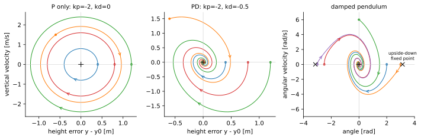
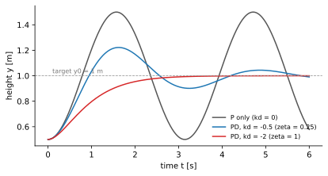

<ul class="post-sources">
<li markdown="span">[Princeton ROB 345 Introduction to Robotics](https://irom-lab.princeton.edu/intro-to-robotics/) Lecture 7 ([video](https://youtu.be/nn022Copybg))</li>
</ul>

지금까지 모션 계획 모듈은 장애물을 피하는 기하학적 경로([강의 2](/blog/2026/11/10/rob-02-graph-search/), [강의 3](/blog/2026/11/10/rob-03-rrt/))에서 출발해 동역학을 지키는 궤적([강의 5](/blog/2026/11/10/rob-05-differential-flatness/), [강의 6](/blog/2026/11/10/rob-06-trajectory-optimization/))까지 왔다. 이번 강의와 다음 강의는 이 모듈의 마지막 퍼즐, **피드백 제어(feedback control)**를 다룬다. 이번에는 피드백 제어기에 무엇을 요구해야 하는지, 즉 "안정하다"는 말을 수학적으로 정의하고, 가장 기본적인 설계인 **PD 제어**를 본다.

## 계획만으로는 부족하다

### 계획대로 날지 않는 드론

[강의 6](/blog/2026/11/10/rob-06-trajectory-optimization/)에서 궤적 최적화로 찾은 입력 열을 시간표대로 재생하면 어떻게 될까. 강의의 시뮬레이션에서는 모델을 전혀 바꾸지 않았는데도 궤적 끝부분에서 계획과 실제가 눈에 띄게 어긋났다. 원인은 수치 적분 오차뿐이었다. 질량이나 관성을 10% 바꾸면 차이는 훨씬 커져서, 관성을 바꾼 경우는 장애물을 아슬아슬하게 스치고 질량을 바꾼 경우는 실제로 부딪혔다. 강의 6의 예제에서도 선형 모델로 찾은 입력을 비선형 모델에 넣자 목표보다 30 cm 가까이 낮게 도착했다.

[강의 1](/blog/2026/11/10/rob-01-intro/)에서 로봇 공학의 어려움은 결국 **불확실성**이라고 했다. 계획 단계가 무시한 불확실성은 세 가지다.

- **불완전한 동역학 모델.** 모델링하지 않은 공기역학 효과가 있고, 관성 같은 물리 파라미터도 실험으로 추정한 값이라 오차가 있으며, 배터리가 닳으면 같은 명령에도 추력이 달라진다.
- **외란(disturbance).** 바람이 불면 드론이 밀린다.
- **상태와 지도에 대한 불완전한 지식.** 로봇이 자기 위치와 주변 환경을 정확히 안다고 가정했다.

앞의 두 가지는 이번 강의와 다음 강의에서, 세 번째는 다음 모듈(위치 추정과 [필터링](/blog/2026/11/10/rob-11-bayes-filter/))에서 다룬다.

### 피드백 제어 법칙

가장 단순한 과제인 **호버링**을 생각하자. 드론이 바람에 밀려 목표 지점에서 벗어났을 때 직관적으로 할 일은 분명하다.

- 목표보다 **아래**에 있으면 두 프로펠러의 추력을 모두 키워 올라간다.
- 목표보다 **왼쪽**에 있으면 오른쪽으로 기울어야 하므로 왼쪽 추력을 키우고 오른쪽 추력을 줄인다. 기울어진 뒤에는 추력의 수평 성분이 드론을 오른쪽으로 민다.
- 기울어져 있으면 반대쪽으로 모멘트를 줘서 수평으로 돌린다.

이 직관을 모든 상태로 확장한 것이 **피드백 제어 법칙(feedback control law)** 또는 **제어기(controller)** $$\bar{u}(\bar{x})$$다. 상태 공간의 모든 점에 "여기서는 이 입력을 쓴다"는 화살표를 붙인 일종의 벡터장이다. 시간표대로 재생하는 열린 루프(open-loop) 입력 $$\bar{u}(t)$$와 달리, 현재 상태를 보고 입력을 정하므로 어디로 밀려나든 대응할 수 있다.

계획을 아주 빠르게 반복해도 피드백이 된다. 궤적을 계획하고, 조금 실행하고, 현재 상태를 측정해서 다시 계획하는 방식으로, **모델 예측 제어(model predictive control, MPC)** 또는 **후퇴 지평 제어(receding horizon control)**라 한다. 실제로 매우 많이 쓰이지만, 매 순간 최적화를 빨리 풀어야 한다는 부담이 있다. 이번 강의와 다음 강의의 제어기는 반복 계획 없이 상태를 바로 입력으로 바꾸는 함수다.

## 고정점

### 정의

시스템 $$\dot{\bar{x}} = f(\bar{x}, \bar{u})$$에 대해, 어떤 입력 $$\bar{u}_0$$가 있어서

$$
f(\bar{x}_0, \bar{u}_0) = \bar{0}
$$

을 만족하는 상태 $$\bar{x}_0$$를 **고정점(fixed point)** 또는 **평형점(equilibrium point)**이라 한다. $$\bar{u}_0$$를 계속 주면 $$\bar{x}_0$$에서 영원히 움직이지 않는 상태다. [강의 6](/blog/2026/11/10/rob-06-trajectory-optimization/)에서 선형화 기준점으로 쓴 호버링, $$\bar{x}_0 = [x_0, y_0, 0, 0, 0, 0]^T$$와 $$\bar{u}_0 = [mg, 0]^T$$가 평면 쿼드로터의 고정점이다.

### 속도가 0이 아닌 고정점이 있을까

평면 쿼드로터의 상태 $$[x, y, \theta, \dot{x}, \dot{y}, \dot{\theta}]^T$$에서 $$\dot{x}_0, \dot{y}_0, \dot{\theta}_0$$ 중 하나라도 0이 아닌 고정점이 있을까? 없다. 상태 미분 $$\dot{\bar{x}}$$의 첫 세 성분이 바로 $$\dot{x}, \dot{y}, \dot{\theta}$$이므로, 그중 하나라도 0이 아니면 $$\dot{\bar{x}} \neq \bar{0}$$이다. 움직이고 있으면 같은 상태에 머물 수 없다는 당연한 말이다. 반면 위치 $$x_0, y_0$$는 아무 값이나 된다. 어디서든 중력을 상쇄하면 그 자리에 머문다.

기울기 $$\theta_0 \neq 0$$도 일반적으로 안 된다. 기울어진 채 추력을 내면 수평 성분이 생겨 옆으로 가속한다. (몸체를 완전히 뒤집고 추력을 음수로 내는 $$\theta_0 = \pi$$는 수식상 고정점이지만, 프로펠러가 음의 추력을 낼 수 없으니 모델의 부산물일 뿐이다.)

### 닫힌 루프 동역학

제어기 $$\bar{u}(\bar{x})$$를 정해서 동역학에 넣으면 우변이 상태만의 함수가 된다.

$$
\dot{\bar{x}} = f(\bar{x}, \bar{u}(\bar{x})) \triangleq f_{cl}(\bar{x})
$$

이것을 **닫힌 루프 동역학(closed-loop dynamics)**이라 한다. 아래의 안정성 정의는 모두 제어기를 이미 넣은 $$f_{cl}$$에 대한 것이다. 표기를 줄이기 위해 아래에서는 $$\dot{\bar{x}} = f(\bar{x})$$로 쓰고, $$\bar{x}(t)$$는 초기 상태 $$\bar{x}(0)$$에서 출발한 해의 시각 $$t$$에서의 값, $$\bar{x}_0$$는 고정점을 뜻한다. ($$\bar{x}(0)$$와 $$\bar{x}_0$$를 헷갈리지 않도록 주의한다.)

## 안정성의 여러 얼굴

"안정하다"에는 여러 정의가 있다. 로봇 공학에서 가장 자주 쓰는 것들을 그림을 떠올리며 하나씩 본다.

### 끌어당김: 결국 돌아오는가

**전역 끌어당김(global attractivity).** 모든 초기 상태에 대해

$$
\lim_{t \to \infty} \lVert \bar{x}(t) - \bar{x}_0 \rVert = 0
$$

이다. 어디서 출발하든 결국 고정점으로 다가간다는 뜻이다.

이 요구는 한편으로 **너무 강하다.** 드론에 적용하면 빛의 속도의 0.99배로 날고 있든, 거꾸로 뒤집혀 있든, 수천 km 떨어져 있든 목표로 돌아오라는 말이다. 다른 한편으로는 **너무 약하다.** 언젠가 돌아오기만 하면 되므로, 출발 직후 엄청나게 멀리 날아갔다가 몇 년 뒤에 돌아와도 정의를 만족한다.

**국소 끌어당김(local attractivity).** 첫 번째 문제는 범위를 좁혀 해결한다. 어떤 $$R > 0$$이 있어서 $$\lVert \bar{x}(0) - \bar{x}_0 \rVert < R$$인 모든 초기 상태에 대해 위 극한이 0이면 국소적으로 끌어당긴다고 한다. 고정점 주위 반지름 $$R$$인 공 안에서 출발한 상태만 책임지고, 공 밖에서 출발한 상태에 대해서는 아무 말도 하지 않는다.

### 리아푸노프 안정성: 멀리 가지 않는가

두 번째 문제, "멀리 갔다 돌아오기"를 막는 정의가 **리아푸노프 의미의 안정성(stability in the sense of Lyapunov, ISL)**이다. 처음 보면 까다로우니 게임으로 생각하면 좋다.

1. 상대가 고정점 주위에 반지름 $$\epsilon$$인 공을 내민다. 아무리 작아도 된다.
2. 나는 반지름 $$\delta$$인 공을 찾아야 한다. 단, $$\delta$$ 공 안에서 출발한 상태는 **영원히** $$\epsilon$$ 공을 벗어나면 안 된다.

어떤 $$\epsilon$$을 내밀어도 이런 $$\delta$$를 항상 찾을 수 있으면 리아푸노프 안정이다. 수식으로는

$$
\forall \epsilon > 0,\ \exists \delta = \delta(\epsilon) > 0:\quad
\lVert \bar{x}(0) - \bar{x}_0 \rVert < \delta \ \Longrightarrow\ \lVert \bar{x}(t) - \bar{x}_0 \rVert < \epsilon \quad \forall t \ge 0
$$

이다. 몇 가지를 짚어 두자.

- $$\delta$$는 $$\epsilon$$보다 클 수 없다. 더 크면 $$\epsilon$$ 공 밖이면서 $$\delta$$ 공 안인 점에서 출발할 수 있고, 그 상태는 처음부터 $$\epsilon$$ 공 밖이다.
- $$\epsilon$$ 공 안에서 출발한 모든 상태가 $$\epsilon$$ 공 안에 머물 필요는 없다. 경계 근처에서 출발하면 나갈 수도 있다. 충분히 안쪽($$\delta$$ 공)에서 출발한 상태만 지키면 된다.
- 어떤 집합 안에서 출발하면 그 집합에 영원히 머무는 성질을 **불변성(invariance)**이라 한다. $$\delta = \epsilon$$으로 둘 수 있는 시스템은 모든 공이 불변이다.
- 리아푸노프 안정성은 **돌아온다는 보장이 없다.** 마찰 없는 진자는 아래쪽 평형점 근처에서 계속 흔들리기만 하고, 흔들림의 크기가 처음과 같으므로 리아푸노프 안정이지만 끌어당기지는 않는다.

### 두 성질을 합친 점근 안정성

그래서 두 성질을 합친 것을 주로 쓴다.

| 이름 | 조건 |
|---|---|
| 전역 점근 안정(globally asymptotically stable) | 전역 끌어당김 + 리아푸노프 안정 |
| 국소 점근 안정(locally asymptotically stable) | 국소 끌어당김 + 리아푸노프 안정 |

관계를 정리하면 다음과 같다.

- 전역 끌어당김이면 국소 끌어당김이다(공 안의 점도 "모든 점"에 포함되므로). 따라서 전역 점근 안정이면 국소 점근 안정이다.
- 끌어당김이 리아푸노프 안정을 뜻하지는 않는다. 모든 궤적이 결국 고정점으로 가지만, 고정점 바로 옆에서 출발해도 크게 한 바퀴 돌고 오는 시스템이 있다. 그래서 두 조건을 따로 요구한다.
- **선형 시스템에서는 국소 점근 안정과 전역 점근 안정이 같다.** 선형 시스템은 상태를 몇 배 키워도 해가 똑같이 몇 배가 될 뿐이므로, 작은 공에서 성립하는 성질이 모든 크기로 퍼진다. 비선형 시스템에서는 그렇지 않다.

선형 시스템 $$\dot{\tilde{x}} = A\tilde{x}$$($$\tilde{x} = \bar{x} - \bar{x}_0$$)에서는 판정도 쉽다. **$$A$$의 모든 [고윳값](/blog/2026/10/22/la-07-eigendecomposition/)의 실수부가 음수이면, 그리고 그때만 점근 안정이다.** 해가 $$e^{\lambda t}$$ 꼴의 모드들의 합이기 때문이다. 나머지 고윳값의 실수부는 음수이고 실수부가 0인 고윳값이 중복 없이 있으면(예: 순허수 쌍 $$\pm i\omega$$) 진동이 줄지 않고 계속되어 리아푸노프 안정이지만 점근 안정은 아니다.

*위상 평면 그림. 왼쪽: P 제어만 쓴 높이 제어. 궤적이 닫힌 타원을 돌며 고정점(+)으로 다가가지 않는다(리아푸노프 안정, 점근 안정 아님). 가운데: PD 제어. 모든 궤적이 나선을 그리며 고정점으로 들어간다(전역 점근 안정). 오른쪽: 감쇠 진자 $$\ddot{\theta} = -9.81\sin\theta - 1.5\dot{\theta}$$. 아래쪽 평형점($$\theta = 0$$)은 국소 점근 안정이지만, 거꾸로 선 평형점($$\theta = \pm\pi$$, ×)에서 출발하면 영원히 그 자리에 있으므로 전역은 아니다.*

## 안정화 가능성

안정성은 제어기에 바라는 것이다. 그런데 그런 제어기가 **존재하기는 하는가?** 다음 시스템을 보자. 목표 고정점은 원점이다.

$$
\dot{x}_1 = x_1, \qquad \dot{x}_2 = x_2 + u
$$

입력 $$u$$는 $$x_2$$에만 들어가고, $$x_1$$의 식에는 $$u$$도 $$x_2$$도 나오지 않는다. $$x_1$$은 $$x_1(t) = x_1(0)e^{t}$$로 지수적으로 커지고, 어떤 제어기를 써도 이를 막을 수 없다. 이 시스템은 안정화할 수 없다.

부호만 바꿔 $$\dot{x}_1 = -x_1$$이면 이야기가 다르다. $$u$$가 여전히 $$x_1$$에 닿지 않지만 $$x_1$$은 저절로 0으로 줄어든다. $$x_2$$는 예컨대 $$u = -2x_2$$로 두면 $$\dot{x}_2 = -x_2$$가 되어 안정해진다. ($$u = -x_2$$면 $$\dot{x}_2 = 0$$이라 제자리에 머물 뿐 줄어들지 않는다. $$u = -kx_2$$에서 $$k > 1$$이면 된다.) 즉 "입력이 모든 변수에 직접 닿는가"만으로는 판단할 수 없고, 닿지 않는 부분이 스스로 안정한지가 중요하다.

정의하면, 어떤 초기 상태든 입력을 적절히 골라 $$\lim_{t \to \infty} \lVert \bar{x}(t) - \bar{x}_0 \rVert = 0$$으로 만들 수 있을 때, 즉 닫힌 루프를 (전역) 점근 안정으로 만드는 제어기가 존재할 때 그 시스템이 $$\bar{x}_0$$에 대해 **안정화 가능(stabilizable)**하다고 한다. 선형 시스템의 안정화 가능성은 $$A$$, $$B$$에 대한 고윳값 조건으로 확인할 수 있고, 다음 강의의 LQR 도구가 이를 자동으로 검사해 준다.

## PD 제어

### 높이만 움직이는 쿼드로터

평면 쿼드로터를 $$\theta = 0$$으로 묶고 위아래로만 움직이게 하자. 자유도는 높이 $$y$$ 하나이고 운동 방정식은

$$
\ddot{y} = \frac{u_1}{m} - g
$$

다. 상태는 $$\bar{x} = [y, \dot{y}]^T$$, 입력은 총 추력 $$u_1$$이다. 목표 높이 $$y_0$$에서 호버링하는 $$\bar{x}_0 = [y_0, 0]^T$$는 $$u_0 = mg$$와 함께 고정점이다.

### P 제어: 용수철

가장 먼저 떠오르는 제어기는 높이 오차에 비례해 추력을 바꾸는 것이다.

$$
u_1(\bar{x}) = u_0 + k_p(y - y_0)
$$

$$k_p$$를 **비례 이득(proportional gain)**이라 하고, 낮을 때 추력을 키워야 하므로 $$k_p < 0$$이다. 높이 오차 $$\tilde{y} = y - y_0$$로 쓰면 $$y_0$$가 상수이므로 $$\ddot{\tilde{y}} = \ddot{y}$$이고, 대입하면

$$
\ddot{\tilde{y}} = \frac{mg + k_p\tilde{y}}{m} - g = \frac{k_p}{m}\tilde{y}
$$

이다. **감쇠 없는 용수철-질량 시스템**이다. 아래에 있으면 위로 당기지만, 목표에 도착하는 순간 속도가 최대라서 그대로 지나쳐 올라가고, 위에서는 다시 아래로 당긴다. 영원히 진동한다. 위상 평면 그림의 왼쪽 패널이 이것이고, 앞에서 본 대로 리아푸노프 안정이지만 점근 안정이 아니다.

### PD 제어: 용수철에 댐퍼를 단다

진동을 죽이려면 속도에 반대하는 힘, 즉 감쇠가 필요하다.

$$
u_1(\bar{x}) = u_0 + k_p(y - y_0) + k_d\dot{y}
$$

$$k_d$$는 **미분 이득(derivative gain)**이다. 위로 빠르게 올라가는 중이면($$\dot{y} > 0$$) 추력을 줄여 브레이크를 건다. 닫힌 루프는

$$
\ddot{\tilde{y}} = \frac{k_p}{m}\tilde{y} + \frac{k_d}{m}\dot{\tilde{y}}
$$

로 **감쇠가 있는 용수철-질량-댐퍼 시스템**이다. 이것이 **비례-미분(proportional-derivative, PD) 제어**다. $$k_p < 0$$이고 $$k_d < 0$$이면 전역 점근 안정이다. $$k_d > 0$$이면 속도를 오히려 키우는 "음의 감쇠"가 되어 발산한다.

행렬로 쓰면 제어기는

$$
\bar{u}(\bar{x}) = \bar{u}_0 + K(\bar{x} - \bar{x}_0) = u_0 + \begin{bmatrix} k_p & k_d \end{bmatrix}\begin{bmatrix} y - y_0 \\ \dot{y} \end{bmatrix}
$$

이고, $$K$$를 **이득 행렬(gain matrix)**이라 한다. 다음 강의의 LQR도 정확히 이 모양의 제어기를 만든다.

### 숫자로 보기

$$m = 0.5$$ kg, 목표 $$y_0 = 1$$ m, 출발 $$y(0) = 0.5$$ m(정지)로 두자. 닫힌 루프의 상태 행렬은

$$
A_{cl} = \begin{bmatrix} 0 & 1 \\ k_p/m & k_d/m \end{bmatrix}
$$

이고 특성 방정식은 $$s^2 - \frac{k_d}{m}s - \frac{k_p}{m} = 0$$이다. 표준형 $$s^2 + 2\zeta\omega_n s + \omega_n^2$$과 비교하면 고유 진동수 $$\omega_n = \sqrt{-k_p/m}$$, 감쇠비 $$\zeta = -k_d / (2m\omega_n)$$이다.

| 제어기 | 고윳값 | $$\zeta$$ | 결과 |
|---|---|---|---|
| $$k_p = -2,\ k_d = 0$$ | $$\pm 2i$$ | 0 | 0.5 m와 1.5 m 사이를 주기 $$\pi \approx 3.14$$초로 영원히 진동 |
| $$k_p = -2,\ k_d = -0.5$$ | $$-0.5 \pm 1.94i$$ | 0.25 | 1.62초에 1.22 m까지 넘쳤다가 진동하며 수렴 |
| $$k_p = -2,\ k_d = -2$$ | $$-2$$ (중근) | 1 | 넘치지 않음, 1초 0.80 m, 2초 0.95 m, 3초 0.99 m |

$$\omega_n = \sqrt{2 / 0.5} = 2$$ rad/s이다. $$\zeta = 0.25$$일 때 오버슈트는 이론적으로 처음 오차의 $$e^{-\pi\zeta/\sqrt{1 - \zeta^2}} \approx 0.44$$배, 즉 $$0.5 \times 0.44 \approx 0.22$$ m로 시뮬레이션과 맞다. $$\zeta = 1$$은 넘치지 않으면서 가장 빨리 수렴하는 **임계 감쇠(critical damping)**다.

*0.5 m에서 출발해 1 m에서 호버링하려는 높이 응답. 회색: P 제어만 쓰면 영원히 진동한다. 파랑: 약한 감쇠($$\zeta = 0.25$$)는 넘쳤다가 진동하며 수렴한다. 빨강: 임계 감쇠($$\zeta = 1$$)는 넘치지 않고 수렴한다.*

## 흔한 실수와 한계

- **부호 규약을 섞는다.** 이 강의는 $$\bar{u} = \bar{u}_0 + K(\bar{x} - \bar{x}_0)$$로 쓰므로 안정한 이득이 음수다. 많은 교재는 $$u = -K\tilde{x}$$로 써서 양의 이득을 쓴다. 다른 자료의 이득을 가져올 때 부호를 확인하지 않으면 불안정한 제어기를 만든다.
- **"전역" 보장을 그대로 믿는다.** 위 결과는 추력이 무한히 크게도, 음수로도 나올 수 있다고 가정했다. 실제 프로펠러는 0 이상, 최대 추력 이하만 낼 수 있으므로 오차가 크면 보장이 깨진다.
- **미분 항을 잡음이 많은 신호에서 그대로 계산한다.** 위치 측정을 숫자로 미분하면 잡음이 증폭된다. 실제로는 속도를 따로 추정하거나 필터를 거친다.
- **수평 위치도 같은 방식으로 PD 제어할 수 있다고 생각한다.** 평면 쿼드로터의 $$x$$는 추력으로 바로 움직이지 않고 모멘트 → 기울기 → 수평 가속의 사슬을 거친다. 상태 6개와 입력 2개가 얽힌 시스템에서 이득 행렬 $$K$$(2×6)의 12개 숫자를 손으로 고르기는 어렵다. 이 문제를 체계적으로 푸는 것이 [강의 8](/blog/2026/11/10/rob-08-lqr/)의 LQR이다.

## 정리

| 개념 | 한 줄 정의 |
|---|---|
| 피드백 제어 법칙 | 상태를 입력으로 바꾸는 함수 $$\bar{u}(\bar{x})$$ |
| 고정점 | $$f(\bar{x}_0, \bar{u}_0) = \bar{0}$$인 상태, 속도 성분은 0이어야 함 |
| 닫힌 루프 동역학 | $$\dot{\bar{x}} = f(\bar{x}, \bar{u}(\bar{x}))$$ |
| 끌어당김(전역/국소) | 모든(또는 반지름 $$R$$ 공 안의) 초기 상태가 결국 고정점으로 |
| 리아푸노프 안정 | 충분히 가까이서 출발하면 원하는 만큼 가까이 머문다 |
| 점근 안정 | 끌어당김 + 리아푸노프 안정, 선형 시스템은 국소와 전역이 같음 |
| 선형 판정 | $$A_{cl}$$의 모든 고윳값 실수부가 음수 |
| 안정화 가능성 | 점근 안정으로 만드는 제어기가 존재 |
| PD 제어 | $$u = u_0 + k_p\tilde{y} + k_d\dot{y}$$, 용수철-질량-댐퍼, 이 규약에서 $$k_p, k_d < 0$$ |
