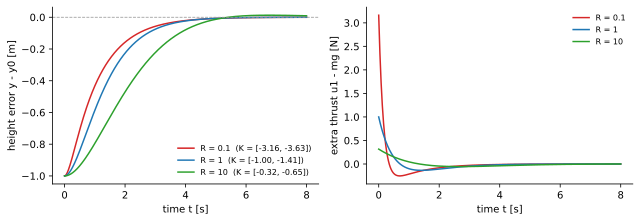
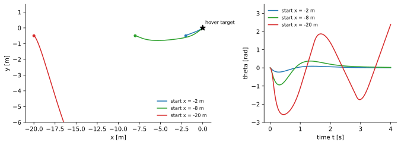

<ul class="post-sources">
<li markdown="span">[Princeton ROB 345 Introduction to Robotics](https://irom-lab.princeton.edu/intro-to-robotics/) Lecture 8 ([video](https://youtu.be/zqi9QhUio8s))</li>
</ul>

[강의 7](/blog/2026/11/10/rob-07-stability-pd/)에서 피드백 제어기에 바라는 성질을 안정성으로 정의하고, 높이만 움직이는 쿼드로터를 PD 제어로 안정화했다. 남은 질문은 두 가지였다. 상태와 입력이 여럿인 시스템에서 이득 행렬 $$K$$를 **어떻게 고를 것인가**, 그리고 안정하기만 하면 되는가, 아니면 **더 좋은** 안정한 제어기가 있는가. 이번 강의의 **선형 이차 조절기(linear quadratic regulator, LQR)**는 두 질문에 한꺼번에 답한다. 선형 시스템을 안정화하면서, 동시에 사람이 정한 성능 지표를 최소화하는 이득을 계산해 준다.

## 설정: 선형화한 시스템과 감지-판단-행동 루프

### 감지-판단-행동

피드백 제어는 [강의 1](/blog/2026/11/10/rob-01-intro/)의 감지-판단-행동 루프 그 자체다.

1. 시각 $$t$$의 상태 $$\bar{x}(t)$$를 감지한다.
2. 원하는 상태 $$\bar{x}_0$$와 비교한다.
3. 둘을 보고 입력 $$\bar{u}$$를 골라 적용한다.
4. 반복한다.

쿼드로터의 호버링이라면 이 루프가 대략 500 Hz로, 즉 2 ms마다 한 번씩 돈다.

### 선형 시스템으로 바꾸기

LQR은 **선형** 시스템에 대한 이론이다. 쿼드로터처럼 비선형인 시스템은 [강의 6](/blog/2026/11/10/rob-06-trajectory-optimization/)처럼 고정점 $$(\bar{x}_0, \bar{u}_0)$$(예: 호버링)에서 선형화하고

$$
\dot{\bar{x}} = f(\bar{x}, \bar{u}) \approx A(\bar{x} - \bar{x}_0) + B(\bar{u} - \bar{u}_0), \qquad \bar{x} \in \mathbb{R}^n,\ \bar{u} \in \mathbb{R}^m
$$

이 선형 모델로 제어기를 설계한 뒤, 그 제어기를 원래 비선형 시스템에 쓴다. 고정점 근처에서는 선형 모델이 정확하므로 제어기도 잘 동작하리라는 기대다. 이 기대가 어디까지 맞는지는 뒤의 예제에서 확인한다.

식을 짧게 쓰기 위해 원점을 고정점으로 옮긴다. **상태 편차** $$\tilde{x} = \bar{x} - \bar{x}_0$$와 **입력 편차** $$\tilde{u} = \bar{u} - \bar{u}_0$$를 정의하면, $$\bar{x}_0$$가 상수이므로 $$\dot{\tilde{x}} = \dot{\bar{x}}$$이고

$$
\dot{\tilde{x}} = A\tilde{x} + B\tilde{u}
$$

이다. 목표는 $$\tilde{x} = 0$$으로 보내는 것이다.

## 비용 함수

### 무엇을 최소화할까

안정성 외에 바랄 만한 것이 두 가지 있다.

- 상태가 원하는 상태에서 **오래, 많이 벗어나 있지 않기**.
- 입력이 호버링 입력에서 **과하게 벗어나지 않기**. 추력을 수천 뉴턴으로 올려 순식간에 돌아오는 제어기는 실제 모터로 만들 수 없고 효율도 나쁘다.

둘을 합쳐 다음 적분을 생각하자.

$$
J(\tilde{x}(0)) = \int_0^\infty \left[\tilde{x}(t)^T\tilde{x}(t) + \tilde{u}(t)^T\tilde{u}(t)\right]dt
= \int_0^\infty \left[\lVert \tilde{x}(t) \rVert^2 + \lVert \tilde{u}(t) \rVert^2\right]dt
$$

매 순간 상태 오차의 제곱과 입력 편차의 제곱을 벌점으로 매기고, 0부터 무한대까지 시간에 대해 더한다. 영원히 목표에서 조금이라도 떨어져 있으면 적분이 무한대가 되므로, 이 값을 유한하게 만들려면 결국 목표로 돌아와야 한다. 여기서 $$\tilde{x}(t)$$는 $$\tilde{x}(0)$$에서 출발해 정해진 입력을 따랐을 때 시각 $$t$$의 상태다. 입력이 정해지면 미래 상태가 모두 정해지므로 $$J$$는 초기 상태만의 함수다.

### 가중치 행렬 Q와 R

위 식은 모든 성분을 똑같이 취급한다는 문제가 있다. 위치 오차 1 m와 기울기 오차 1 rad와 추력 1 N은 단위부터 다르고 중요도도 다르다. 그래서 가중치를 넣는다.

$$
J(\tilde{x}(0)) = \int_0^\infty \left[\tilde{x}(t)^T Q\,\tilde{x}(t) + \tilde{u}(t)^T R\,\tilde{u}(t)\right]dt
$$

$$Q$$($$n \times n$$)와 $$R$$($$m \times m$$)은 설계자가 고르는 **비용 행렬**이다. 둘 다 대칭이고 [양의 정부호(positive definite)](/blog/2026/11/02/knowledge-113-positive-definite/), 즉 0이 아닌 모든 $$\bar{z}$$에 대해 $$\bar{z}^TQ\bar{z} > 0$$이도록 고른다. (엄밀히는 $$Q$$는 양의 준정부호여도 되지만 $$R$$은 양의 정부호여야 한다.) 실제로는 거의 항상 대각 행렬로 둔다. $$Q = \operatorname{diag}(q_1, \ldots, q_n)$$이면

$$
\tilde{x}^TQ\tilde{x} = q_1\tilde{x}_1^2 + q_2\tilde{x}_2^2 + \cdots + q_n\tilde{x}_n^2
$$

이므로 $$q_i$$는 "$$i$$번째 상태 오차를 얼마나 싫어하는가"다. $$R$$도 마찬가지다. 3D 쿼드로터라면 입력이 총 추력(N)과 세 축의 모멘트(N·m)이므로, 모멘트 쪽 대각 원소를 팔 길이에 맞춰 스케일하는 식으로 단위 차이를 보정할 수 있다.

## LQR의 해

### 결과: 최적 제어기는 선형이다

이 비용을 **모든 초기 상태에 대해** 최소화하는 제어기는 상태에 대한 선형 함수다.

$$
\tilde{u}^*(\tilde{x}) = K^*\tilde{x}
$$

놀라운 결과다. 상태 편차에 고정된 행렬 하나를 곱하는 것만으로, 어디서 출발하든 비용이 최소가 된다는 뜻이다. 모양은 [강의 7](/blog/2026/11/10/rob-07-stability-pd/)의 PD 제어기 $$\bar{u} = \bar{u}_0 + K(\bar{x} - \bar{x}_0)$$와 같고, 다른 점은 $$K^*$$를 아래 두 단계로 **계산한다**는 것이다.

**1단계.** 다음 행렬 방정식을 $$n \times n$$ 행렬 $$S$$에 대해 푼다.

$$
0 = Q - SBR^{-1}B^TS + SA + A^TS
$$

이것을 **대수 리카티 방정식(algebraic Riccati equation, ARE)**이라 한다. $$A, B, Q, R$$은 모두 알고 있고 미지수는 $$S$$뿐이다. $$S$$가 두 번 곱해진 항이 있어 선형 방정식은 아니지만, 1960-70년대에 정립된 안정적인 수치 해법이 있다. 그 해(대칭이고 양의 정부호인 해)를 $$S^*$$라 하자.

**2단계.** 행렬 곱 하나로 이득을 얻는다.

$$
K^* = -R^{-1}B^TS^*
$$

원래 좌표로 돌리면 제어기는

$$
\bar{u}(\bar{x}) = \bar{u}_0 + K^*(\bar{x} - \bar{x}_0)
$$

이다.

### 왜 이런 식이 나오나 (스케치)

강의에서는 유도를 생략했지만, 결과가 어디서 오는지 감을 잡을 수 있는 짧은 논증이 있다. 최적 비용이 $$V(\tilde{x}) = \tilde{x}^TS\tilde{x}$$ 꼴이라고 가정하자. 최적으로 움직일 때 남은 비용은 지금 내는 벌점만큼 줄어야 하므로, 매 순간

$$
\min_{\tilde{u}}\left[\tilde{x}^TQ\tilde{x} + \tilde{u}^TR\tilde{u} + 2\tilde{x}^TS(A\tilde{x} + B\tilde{u})\right] = 0
$$

이어야 한다(마지막 항이 $$dV/dt$$다). 괄호 안을 $$\tilde{u}$$로 미분해 0으로 두면 $$2R\tilde{u} + 2B^TS\tilde{x} = 0$$, 즉 $$\tilde{u} = -R^{-1}B^TS\tilde{x}$$로 2단계의 식이 나온다. 이것을 다시 넣으면 $$\tilde{x}^T(Q - SBR^{-1}B^TS + SA + A^TS)\tilde{x} = 0$$이 모든 $$\tilde{x}$$에 대해 성립해야 하고, 그것이 1단계의 리카티 방정식이다.

### S의 의미: 최적 비용

이 스케치에서 보이듯 $$S^*$$는 최적 비용 그 자체를 준다.

$$
J^*(\tilde{x}(0)) = \tilde{x}(0)^TS^*\tilde{x}(0)
$$

초기 편차만 알면, 최적 제어기로 무한 시간 동안 치를 상태 벌점과 입력 벌점의 합을 시뮬레이션 없이 행렬 곱 하나로 알 수 있다.

### 안정성

비용만 최소화했을 뿐 안정성은 따로 말하지 않았다. 그런데 (시스템이 안정화 가능하면) LQR 제어기는 **선형 시스템을 전역 점근 안정으로 만든다.** 닫힌 루프는

$$
\dot{\tilde{x}} = A\tilde{x} + BK^*\tilde{x} = (A + BK^*)\tilde{x}
$$

이고, $$A + BK^*$$의 모든 고윳값 실수부가 음수다. 직관적으로도, 비용이 유한하려면 상태가 0으로 가야 한다. 정리하면 LQR은 다음 두 가지를 동시에 준다.

- 상태 편차와 입력 편차를 함께 줄이는 합리적인 성능 지표의 **최적** 제어기.
- 선형 시스템에 대한 **전역 점근 안정성**.

고정점이 아니라 시간에 따라 변하는 궤적을 따라가야 할 때도 거의 같은 방법이 있다. 그때는 리카티 방정식이 행렬 미분 방정식이 되고 이득 $$K(t)$$가 시간에 따라 변한다.

### 코드로는 한 줄

실제로는 리카티 방정식을 직접 풀지 않는다. Python에서는 다음과 같이 한다.

```python
import numpy as np
from scipy.linalg import solve_continuous_are

S = solve_continuous_are(A, B, Q, R)     # 1단계: ARE의 해 S*
K = -np.linalg.solve(R, B.T @ S)         # 2단계: K* = -R^{-1} B^T S*
u = u0 + K @ (x - x0)                     # 이 강의의 규약
```

**부호에 주의해야 한다.** MATLAB의 `lqr`이나 Python `control` 패키지의 `lqr`은 $$\tilde{u} = -K\tilde{x}$$ 규약을 써서, 돌려주는 $$K$$가 이 강의의 $$K^*$$와 부호가 반대다. 그대로 $$\bar{u}_0 + K(\bar{x} - \bar{x}_0)$$에 넣으면 드론을 **불안정하게** 만드는 제어기가 된다. 이 라이브러리들은 시스템이 안정화 가능한지도 검사해서, 아니면 오류를 낸다.

## 예제 1: 높이 제어를 손으로 풀기

[강의 7](/blog/2026/11/10/rob-07-stability-pd/)의 높이 시스템 $$\ddot{y} = u_1/m - g$$를 LQR로 다시 풀어 보자. $$\tilde{x} = [y - y_0, \dot{y}]^T$$, $$\tilde{u} = u_1 - mg$$로 두면

$$
A = \begin{bmatrix} 0 & 1 \\ 0 & 0 \end{bmatrix}, \qquad B = \begin{bmatrix} 0 \\ b \end{bmatrix}, \quad b = \frac{1}{m}
$$

이다. $$Q = \operatorname{diag}(q_1, q_2)$$, $$R = r$$(스칼라), $$S = \begin{bmatrix} s_1 & s_2 \\ s_2 & s_3 \end{bmatrix}$$로 두고 리카티 방정식에 넣는다. $$SB = b\,[s_2, s_3]^T$$이므로 $$SBR^{-1}B^TS = \frac{b^2}{r}\begin{bmatrix} s_2^2 & s_2s_3 \\ s_2s_3 & s_3^2 \end{bmatrix}$$이고, $$SA = \begin{bmatrix} 0 & s_1 \\ 0 & s_2 \end{bmatrix}$$, $$A^TS = \begin{bmatrix} 0 & 0 \\ s_1 & s_2 \end{bmatrix}$$이다. 성분별로 쓰면

$$
\begin{aligned}
(1,1):&\quad q_1 - \tfrac{b^2}{r}s_2^2 = 0 &&\Rightarrow\ s_2 = \tfrac{\sqrt{q_1 r}}{b} \\
(2,2):&\quad q_2 - \tfrac{b^2}{r}s_3^2 + 2s_2 = 0 &&\Rightarrow\ s_3 = \tfrac{\sqrt{r(q_2 + 2s_2)}}{b} \\
(1,2):&\quad s_1 - \tfrac{b^2}{r}s_2s_3 = 0 &&\Rightarrow\ s_1 = \tfrac{b^2}{r}s_2s_3
\end{aligned}
$$

(양의 정부호 해를 고르기 위해 양의 제곱근을 택한다.) 이득은 $$K^* = -\frac{b}{r}[s_2, s_3]$$다.

$$m = 0.5$$($$b = 2$$), $$Q = I$$, $$R = 1$$을 넣으면 $$s_2 = 0.5$$, $$s_3 = \sqrt{2}/2 \approx 0.707$$, $$s_1 = 4 \times 0.5 \times 0.707 \approx 1.414$$이고

$$
S^* = \begin{bmatrix} 1.414 & 0.5 \\ 0.5 & 0.707 \end{bmatrix}, \qquad K^* = -\begin{bmatrix} 1 & 1.414 \end{bmatrix}
$$

이다. 바로 $$k_p = -1$$, $$k_d = -1.414$$인 **PD 제어기**다. 닫힌 루프 $$\ddot{\tilde{y}} = 2(-\tilde{y} - 1.414\dot{\tilde{y}})$$의 특성 방정식은 $$s^2 + 2.83s + 2 = 0$$이고 고윳값은 $$-1.414$$ 중근, 감쇠비는 정확히 1이다. LQR이 스스로 임계 감쇠를 골랐다.

최적 비용도 확인해 보자. 1 m 위에서 정지 상태로 출발하면 $$\tilde{x}(0) = [1, 0]^T$$이고 $$J^* = s_1 \approx 1.414$$다. 시뮬레이션으로 적분해도 같은 값이 나온다. 다른 PD 이득과 비교하면

| 이득 $$[k_p, k_d]$$ | 비용 $$J$$ |
|---|---|
| $$[-1, -1.414]$$ (LQR) | 1.414 |
| $$[-1, -1.5]$$ | 1.418 |
| $$[-1, -1]$$ | 1.501 |
| $$[-2, -2]$$ | 1.628 |

로 LQR 이득이 가장 작다. $$[-2, -2]$$는 더 빨리 돌아오지만 입력 벌점을 더 많이 낸다.

### R을 바꾸면

$$R$$은 입력의 "가격"이다. $$Q = I$$로 두고 $$R$$만 바꿔 1 m 아래에서 출발시키면 다음과 같다.

| $$R$$ | $$K^*$$ | 닫힌 루프 고윳값 | 처음 추가 추력 |
|---|---|---|---|
| 0.1 | $$-[3.16, 3.63]$$ | $$-1.01,\ -6.24$$ | 3.16 N |
| 1 | $$-[1.00, 1.41]$$ | $$-1.41$$ (중근) | 1.00 N |
| 10 | $$-[0.32, 0.65]$$ | $$-0.65 \pm 0.47i$$ | 0.32 N |


*1 m 아래에서 출발한 높이 오차(왼쪽)와 추가 추력(오른쪽). 입력이 싸면($$R = 0.1$$) 처음에 추력을 크게 써서 빨리 돌아오고, 비싸면($$R = 10$$) 추력을 아껴 천천히 돌아오며 약간 넘친다.*

## 예제 2: 평면 쿼드로터 전체

이제 상태 6개, 입력 2개인 평면 쿼드로터 전체에 LQR을 적용한다. $$A, B$$는 [강의 6](/blog/2026/11/10/rob-06-trajectory-optimization/)에서 구한 호버링 선형화이고, $$m = 0.5$$ kg, $$I = 0.005$$ kg·m², $$L = 0.15$$ m, $$Q = I_6$$, $$R = I_2$$로 두면

$$
K^* = \begin{bmatrix}
0 & -1 & 0 & 0 & -1.414 & 0 \\
1 & 0 & -5.50 & 1.457 & 0 & -1.027
\end{bmatrix}
$$

이다(열 순서는 $$x, y, \theta, \dot{x}, \dot{y}, \dot{\theta}$$). 손으로 고르기 어려웠던 12개 숫자가 한 번에 나왔다. 해석해 보면

- 첫 행(총 추력): 높이 오차와 수직 속도만 본다. 예제 1과 똑같은 PD 제어기다. 선형 모델에서 수직 운동이 다른 운동과 분리되어 있기 때문이다.
- 둘째 행(모멘트): 드론이 목표의 오른쪽에 있으면($$\tilde{x} > 0$$) $$u_2 > 0$$, 즉 반시계 방향 모멘트로 몸체를 $$\theta > 0$$ 쪽으로 기울인다. 그러면 $$\ddot{x} = -g\theta < 0$$으로 왼쪽, 목표 쪽으로 가속한다. $$\theta$$와 $$\dot{\theta}$$ 항은 기울기 자체를 안정시킨다. 강의 7에서 말한 "모멘트 → 기울기 → 수평 가속" 사슬을 이득 행렬이 알아서 처리한 것이다.

닫힌 루프 $$A + BK^*$$의 고윳값은 $$-200$$, $$-2.21 \pm 2.21i$$, $$-1$$, $$-1.41$$(중근)로 모두 실수부가 음수다. $$-200$$은 관성 모멘트가 작아 아주 빠르게 반응하는 회전 모드다.

### 선형 이론의 약속은 어디까지 지켜지나

선형 모델에서는 전역 점근 안정이니 어디서 출발해도 돌아와야 한다. 실제 비선형 모델에, 각 프로펠러의 추력을 0 이상 $$mg$$(=2.45 N) 이하로 제한하고(추력 대 무게비 2) 시뮬레이션하면 다음과 같다. 출발 높이는 모두 목표보다 0.5 m 아래다.

- **2 m 왼쪽에서 출발.** 최대 기울기가 0.23 rad로 작고, 선형 모델이 예측한 경로와 3 cm 이내로 겹치며 돌아온다.
- **8 m 왼쪽에서 출발.** 기울기가 0.94 rad(54°)까지 커지고 기울어진 동안 수직 추력이 모자라 0.8 m 아래까지 처지지만 결국 돌아온다.
- **20 m 왼쪽에서 출발.** 제어기가 큰 기울기를 요구하고, 추력 한계 때문에 모멘트와 총 추력을 동시에 낼 수 없게 되면서 기울기가 $$\pm 2.5$$ rad까지 크게 흔들리고 드론은 추락한다.

추력 제한을 없애면 20 m에서도 돌아온다. 즉 실패의 원인은 선형 모델이 모르는 **입력 한계**와 큰 각도에서의 **비선형성**이다. 선형 이론의 "전역"은 실제로는 "고정점 근처에서"로 읽어야 한다.


*추력 제한이 있는 비선형 평면 쿼드로터에 LQR($$Q = I$$, $$R = I$$)을 적용한 결과. 왼쪽: 질량 중심 경로, 오른쪽: 기울기. 2 m, 8 m 떨어진 곳에서는 호버링 목표로 돌아오지만, 20 m 떨어진 곳에서는 기울기가 크게 흔들리다 추락한다.*

## Q와 R 고르기

이론상으로는 양의 정부호인 $$Q, R$$이면 무엇이든 안정하다. 그러나 실제로는

1. 시스템이 비선형이고(선형화는 근사일 뿐이다),
2. 모델 자체가 불완전하며(모델링하지 않은 공기역학),
3. 제어기를 쓰려면 상태를 정확히 알아야 하는데 실제로는 추정값을 쓴다.

그래서 어떤 $$Q, R$$은 실제 드론을 잘 띄우고 어떤 것은 그렇지 않다. 고르는 일은 시행착오가 섞인 기술에 가깝다. 3D 쿼드로터의 상태 $$\bar{x} = [x, y, z, \phi, \theta, \psi, \dot{x}, \dot{y}, \dot{z}, p, q, r]^T$$(위치, 롤·피치·요, 속도, 각속도)와 대각 $$Q$$(12개), $$R$$(4개)를 기준으로 경험칙을 정리하면 다음과 같다.

| 관찰한 증상 | 조정 |
|---|---|
| 높이 $$z$$가 목표에서 계속 벗어난다 | $$Q_{33}$$($$z$$ 벌점)을 예컨대 10배로 키운다 |
| 높이가 평균은 맞는데 위아래로 진동한다 | $$Q_{99}$$($$\dot{z}$$ 벌점)을 키워 속도를 감쇠시킨다 |
| 롤 $$\phi$$가 잘 안정되지 않는다 | $$Q_{44}$$를 키운다 |
| 거의 반응하지 않고 그대로 처지거나 떨어진다 | $$R$$ 전체를 줄여 입력을 더 쓰게 한다 |
| 입력이 너무 공격적이고 덜컹거린다 | $$R$$ 전체를 키운다 |

$$R$$은 보통 행렬 전체에 곱하는 스칼라 하나로 조절한다. 평면 쿼드로터에서 위치를 더 중시하도록 $$Q = \operatorname{diag}(10, 10, 1, 1, 1, 1)$$로 바꾸면, 목표에서 1 m 왼쪽, 0.5 m 아래에서 출발했을 때 5 cm 안으로 들어오는 시간이 3.5초에서 1.4초로 줄고, 대신 최대 기울기가 0.12 rad에서 0.28 rad로 커진다. 위치 오차를 더 싫어하게 만들면 더 공격적으로 기울여 빨리 돌아오는 것이다.

## 흔한 실수와 한계

- **라이브러리의 $$K$$를 부호 확인 없이 쓴다.** 위에서 말했듯 $$u = -Kx$$ 규약의 $$K$$를 $$u = Kx$$에 넣으면 불안정해진다.
- **선형 모델의 전역 안정성을 실제 로봇에 그대로 기대한다.** 선형화는 고정점 근처에서만 맞고, 입력 한계는 아예 모델에 없다. 큰 편차에서는 예제 2처럼 실패할 수 있다.
- **상태를 안다고 가정한다.** LQR은 전체 상태 $$\bar{x}$$를 매 순간 정확히 안다고 가정한다. 실제로는 센서로 추정해야 하고, 이것이 다음 모듈([강의 9](/blog/2026/11/10/rob-09-optical-flow/)부터의 센싱과 추정)의 주제다.
- **단위를 무시하고 $$Q = I$$, $$R = I$$를 최종 답으로 쓴다.** 미터와 라디안과 뉴턴을 같은 무게로 더한 것이므로 출발점일 뿐이다.
- **$$Q$$, $$R$$을 대각이 아니게 써야만 좋은 결과가 난다고 생각한다.** 비대각 항으로 상태 사이의 상호 작용을 표현할 수 있지만, 실제로는 대각 행렬만으로 충분한 경우가 대부분이다.

## 정리

| 항목 | 내용 |
|---|---|
| 대상 | 선형(화한) 시스템 $$\dot{\tilde{x}} = A\tilde{x} + B\tilde{u}$$ |
| 비용 | $$J = \int_0^\infty (\tilde{x}^TQ\tilde{x} + \tilde{u}^TR\tilde{u})\,dt$$, $$Q, R$$은 대칭 양의 정부호 |
| 1단계 | 리카티 방정식 $$0 = Q - SBR^{-1}B^TS + SA + A^TS$$의 해 $$S^*$$ |
| 2단계 | $$K^* = -R^{-1}B^TS^*$$, 제어기 $$\bar{u} = \bar{u}_0 + K^*(\bar{x} - \bar{x}_0)$$ |
| 최적 비용 | $$J^* = \tilde{x}(0)^TS^*\tilde{x}(0)$$ |
| 보장 | 최적성 + 선형 시스템의 전역 점근 안정 |
| 실제 | 비선형성, 입력 한계, 모델 오차, 상태 추정 때문에 $$Q, R$$ 튜닝 필요 |
| 주의 | 라이브러리의 $$u = -Kx$$ 부호 규약 |
