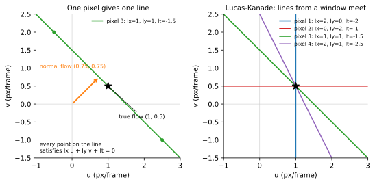
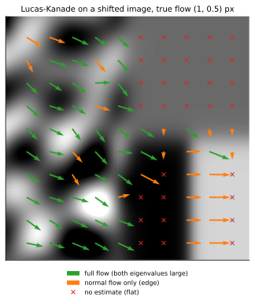

<ul class="post-sources">
<li markdown="span">[Princeton ROB 345 Introduction to Robotics](https://irom-lab.princeton.edu/intro-to-robotics/) Lecture 9 ([video](https://youtu.be/wvuVX9L7v4Y))</li>
</ul>

지금까지 계획([강의 2](/blog/2026/11/10/rob-02-graph-search/), [강의 3](/blog/2026/11/10/rob-03-rrt/))과 제어([강의 7](/blog/2026/11/10/rob-07-stability-pd/), [강의 8](/blog/2026/11/10/rob-08-lqr/))에서는 로봇이 자기 상태 $$\bar{x}$$를 정확히 안다고 가정했다. PD 제어기든 LQR이든 $$\bar{u} = K\bar{x}$$처럼 상태를 입력으로 받는다. 그렇다면 실제 드론은 자기 속도를 어떻게 아는가? 이번 강의는 그 답 하나인 **광학 흐름(optical flow)**을 다룬다. 카메라 영상만으로 "화면 속 무늬가 어느 쪽으로 얼마나 움직였는가"를 계산하는 방법이고, 이 과정에서 센싱이 얼마나 불완전한지도 드러난다. 이것이 다음 강의부터 이어지는 상태 추정(state estimation)의 출발점이다.

## 광학 흐름이란

### 드론은 어떻게 자기 속도를 아는가

작은 실내 드론(예: Crazyflie)에는 GPS가 없고, 실습실에 모션 캡처 같은 외부 카메라도 없다고 하자. 먼저 떠오르는 것은 **관성 측정 장치(IMU)**다. 가속도계가 세 축의 가속도를 주니 두 번 적분하면 위치가 나온다. 하지만 초기 속도를 정확히 모르면 그 오차가 시간에 비례해 위치 오차로 쌓이고, 더 큰 문제로 가속도 측정에 섞인 잡음이 적분할 때마다 불어난다. 잡음을 한 번 적분하면 속도가 표류하고, 두 번 적분하면 위치는 금방 쓸모없어진다. 그래서 드론은 바닥을 내려다보는 작은 카메라와 높이를 재는 거리 센서를 단다. 드론이 앞으로 날면 카메라에 비친 바닥 무늬가 뒤로 흘러간다. 무늬가 한 프레임에 몇 픽셀 흘러갔는지 알면, 높이와 카메라의 초점 거리로 실제 속도를 거꾸로 계산할 수 있다.

카메라가 높이 $$h$$에서 바로 아래를 보고, 수평 속도 $$V$$로 움직인다고 하자. 핀홀 카메라에서 바닥 위 거리 $$\Delta X$$는 영상에서 $$f\,\Delta X / h$$ 픽셀로 보인다($$f$$는 픽셀 단위 초점 거리). 프레임 간격이 $$\Delta t$$이면 한 프레임 동안 바닥은 $$V\Delta t$$만큼 지나가므로, 영상 속 흐름 $$u$$(픽셀/프레임)는

$$
u = \frac{f\,V\,\Delta t}{h} \quad\Longrightarrow\quad V = \frac{u\,h}{f\,\Delta t}
$$

이다. **예.** $$f = 300$$ px, $$h = 1$$ m, 30 fps($$\Delta t = 1/30$$ s)에서 흐름이 6 px/프레임이면 $$V = 6 \cdot 1 / (300/30) = 0.6$$ m/s다. 같은 흐름이라도 높이가 2 m이면 속도는 두 배다. 높이 센서가 함께 필요한 이유다. (드론이 기울거나 회전해도 무늬가 흐르므로, 실제로는 자이로로 회전 성분을 빼 준다.)

그러니 핵심 문제는 **두 영상 사이에서 각 픽셀이 얼마나 움직였는지** 구하는 것이다.

### 정의: 겉보기 움직임

광학 흐름은 영상에서 보이는 물체의 **겉보기 움직임(apparent motion)**이다. "겉보기"라는 말이 중요하다. 영상의 밝기 패턴이 움직이는 것이지, 실제 3차원 움직임과 꼭 같지는 않다. 겉보기 움직임은 여러 원인에서 생긴다.

- 카메라 시야 안의 물체가 움직인다.
- 카메라 자신이 움직인다(드론의 경우).
- 조명이 바뀐다.

그래서 둘이 어긋나는 경우가 생긴다.

- **실제 움직임은 있는데 광학 흐름이 없다.** 무늬가 전혀 없는 공이 제자리에서 돌거나, 하얀 벽 앞에서 카메라가 벽과 평행하게 움직이면 영상은 변하지 않는다.
- **실제 움직임은 없는데 광학 흐름이 있다.** 정지한 장면에서 조명만 움직이면 그림자와 밝은 부분이 이동해 흐름이 보인다. 이발소 회전 기둥(barber pole)은 기둥이 수평으로 돌 뿐인데 줄무늬가 위로 올라가는 것처럼 보인다(뒤의 조리개 문제).

동물도 광학 흐름을 쓴다. 잉꼬를 좁은 통로로 날게 한 실험에서, 벽에 세로줄을 그리면(옆을 지날 때 흐름이 크게 보인다) 가로줄일 때보다 느리게 날았다. 한쪽 벽만 세로줄이면 그 벽에서 멀어져 가로줄 벽 쪽으로 붙어 날았다. 새가 양쪽 눈에 들어오는 흐름의 크기를 맞추며 속도와 위치를 조절한다는 뜻이다. 꿀벌은 꿀이 있는 곳의 거리를 동료에게 엉덩이 춤(waggle dance)의 길이로 알리는데, 이 "거리"의 단위는 미터가 아니라 날아가는 동안 쌓인 광학 흐름의 양이다. 같은 경로라도 주변 무늬를 바꿔 흐름을 키우면 벌은 더 먼 거리를 알린다. 드론에서도 광학 흐름으로 가까운 장애물을 피하는 생체 모방 연구가 많다.

## 밝기 항상성과 광학 흐름 방정식

### 설정

흑백 영상을 함수 $$I(x, y, t)$$로 쓴다. $$(x, y)$$는 픽셀 위치, $$t$$는 프레임 번호, $$I$$는 밝기(intensity)다. 목표는 프레임 $$t$$의 픽셀 $$(x, y)$$가 프레임 $$t+1$$에서 어디로 갔는지, 즉 **변위 $$(u, v)$$**를 픽셀마다 따로 추정하는 것이다. 이 $$(u, v)$$를 모든 픽셀에서 모은 벡터장이 광학 흐름이다.

### 두 가지 가정

1. **밝기 항상성(brightness constancy).** 한 점은 다음 프레임에서도 같은 밝기로 보인다.
2. **작은 움직임(small motion).** 한 프레임 사이에 점이 멀리 가지 않는다.

가정 1을 식으로 쓰면

$$
I(x, y, t) = I(x + u,\; y + v,\; t + 1)
$$

이다. 오른쪽을 $$(x, y, t)$$ 근처에서 1차 테일러 전개한다. 가정 2 덕분에 $$(u, v)$$가 작아서 이 근사가 잘 맞는다.

$$
I(x + u, y + v, t + 1) \approx I(x, y, t) + I_x u + I_y v + I_t
$$

여기서 $$I_x = \partial I / \partial x$$, $$I_y = \partial I / \partial y$$는 영상의 공간 기울기(가로, 세로 방향으로 밝기가 얼마나 빨리 변하는가), $$I_t$$는 같은 픽셀에서 두 프레임의 밝기 차이다. 실제 영상에서는 이웃 픽셀끼리의 차분으로 계산한다. 위 두 식을 합치면 왼쪽의 $$I(x, y, t)$$가 지워지고

$$
I_x u + I_y v + I_t = 0
\qquad\text{즉}\qquad
\nabla I \cdot \begin{bmatrix} u \\ v \end{bmatrix} + I_t = 0
$$

을 얻는다. 이것이 **광학 흐름 제약식(optical flow constraint equation)**이다. $$\nabla I = (I_x, I_y)$$는 밝기 기울기 벡터다.

**직관.** 밝기가 오른쪽으로 갈수록 밝아지는($$I_x > 0$$) 곳에서 무늬가 오른쪽으로 1 픽셀 움직이면, 그 자리에는 왼쪽의 더 어두운 부분이 들어오므로 픽셀이 어두워진다($$I_t = -I_x$$). 기울기와 밝기 변화를 보면 움직임을 거꾸로 알 수 있다는 것이 이 식의 내용이다.

## 조리개 문제

### 식 하나, 미지수 둘

제약식은 픽셀 하나에 대해 **스칼라 식 하나**인데 미지수는 $$u, v$$ 두 개다. 해가 하나로 정해지지 않는다. $$(u, v)$$ 평면에서 이 식은 직선 하나이고, 그 위의 모든 점이 똑같이 식을 만족한다.

더 정확히 말하면, **기울기 방향의 움직임만 알 수 있고 기울기에 수직인 방향의 움직임은 알 수 없다.** $$(u', v')$$이 $$\nabla I$$에 수직이라 하자. 즉 $$\nabla I \cdot (u', v') = 0$$이다. $$(u, v)$$가 제약식을 만족하면

$$
\nabla I \cdot \begin{bmatrix} u + u' \\ v + v' \end{bmatrix} + I_t
= \underbrace{\nabla I \cdot \begin{bmatrix} u \\ v \end{bmatrix} + I_t}_{=\,0} + \underbrace{\nabla I \cdot \begin{bmatrix} u' \\ v' \end{bmatrix}}_{=\,0} = 0
$$

이므로 $$(u + u', v + v')$$도 만족한다. 결정되는 것은 기울기 방향 성분뿐이고, 이를 **법선 흐름(normal flow)**이라 한다. 직선 위에서 원점에 가장 가까운 점이며

$$
\mathbf{d}_\perp = -\frac{I_t}{\lVert \nabla I \rVert^2}\, \nabla I
$$

다. 이 모호함을 **조리개 문제(aperture problem)**라 한다. 작은 구멍(조리개)으로 움직이는 직선 모서리를 보면, 모서리를 따라 미끄러지는 성분은 구멍 안에서 아무 변화도 만들지 않아 보이지 않는다. 이발소 기둥에서 줄무늬가 실제 회전 방향(수평)이 아니라 줄무늬에 수직인 방향, 그리고 기둥의 긴 테두리를 따라 위로 움직이는 것처럼 보이는 것도 이 때문이다.


*왼쪽: 픽셀 하나($$I_x = I_y = 1$$, $$I_t = -1.5$$)의 제약식은 $$(u, v)$$ 평면의 직선이다. 직선 위 어느 점(초록 점 포함)도 답이 될 수 있고, 확실한 것은 주황색 법선 흐름 $$(0.75, 0.75)$$뿐이다. 오른쪽: 기울기 방향이 서로 다른 네 픽셀의 직선은 참 흐름 $$(1, 0.5)$$ 한 점에서 만난다.*

## Lucas-Kanade 방법

### 추가 가정: 이웃은 함께 움직인다

식이 부족하면 식을 더 모으면 된다. Lucas와 Kanade(1981)는 세 번째 가정을 더한다.

3. **공간 일관성(spatial coherence).** 한 픽셀과 그 이웃들은 같은 $$(u, v)$$로 움직인다.

픽셀 $$p$$를 중심으로 $$5 \times 5$$ 창(window)을 잡으면 픽셀 25개가 모두 같은 $$(u, v)$$를 공유하므로 식이 25개 생긴다. 창 안의 픽셀을 $$p_1, \dots, p_{25}$$라 하면

$$
\underbrace{\begin{bmatrix} I_x(p_1) & I_y(p_1) \\ I_x(p_2) & I_y(p_2) \\ \vdots & \vdots \\ I_x(p_{25}) & I_y(p_{25}) \end{bmatrix}}_{A \;(25 \times 2)}
\underbrace{\begin{bmatrix} u \\ v \end{bmatrix}}_{\bar{d}}
=
\underbrace{-\begin{bmatrix} I_t(p_1) \\ I_t(p_2) \\ \vdots \\ I_t(p_{25}) \end{bmatrix}}_{\bar{b}}
$$

이다. 미지수 2개에 식 25개인 과결정(overdetermined) 시스템이고, 잡음과 근사 오차 때문에 정확히 맞는 해는 보통 없다. 그래서 $$\lVert A\bar{d} - \bar{b} \rVert_2^2$$를 최소화하는 **최소자승(least squares)** 해를 쓴다([Linear Algebra 5](/blog/2026/10/22/la-05-least-squares/)).

$$
\bar{d}^* = (A^TA)^{-1}A^T\bar{b}
$$

창 크기에 정답은 없다. $$5 \times 5$$나 $$7 \times 7$$이 흔하고, 고해상도 영상이면 더 크게, 저가 카메라의 저해상도 영상이면 더 작게 잡는다.

그림으로 보면 픽셀마다 $$(u, v)$$ 평면에 직선이 하나씩 생기고, 기울기 방향이 다양하면 이 직선들이 한 점 근처에서 만난다(위 그림 오른쪽). 최소자승 해는 모든 직선에 "가장 가까운" 점이다.

### $$A^TA$$의 구조

$$A^TA$$는 $$2 \times 2$$ 행렬로, 창 안의 합 $$\Sigma$$로 쓰면

$$
A^TA = \begin{bmatrix} \Sigma I_x I_x & \Sigma I_x I_y \\ \Sigma I_x I_y & \Sigma I_y I_y \end{bmatrix},
\qquad
A^T\bar{b} = -\begin{bmatrix} \Sigma I_x I_t \\ \Sigma I_y I_t \end{bmatrix}
$$

이다. 해를 구하려면 $$A^TA$$가 가역이어야 하고, 그 조건은

$$
\det(A^TA) = (\Sigma I_x I_x)(\Sigma I_y I_y) - (\Sigma I_x I_y)^2 \neq 0
$$

이다. 코시-슈바르츠 부등식에 의해 이 값은 항상 0 이상이고, 창 안의 기울기 벡터 $$\nabla I(p_i)$$들이 모두 한 방향(또는 0)일 때만 0이 된다.

### 손으로 풀어 보기

창 안에 픽셀이 4개만 있고, 참 흐름이 $$(u, v) = (1, 0.5)$$라 하자. 각 픽셀의 기울기와 시간 차분이 다음과 같다($$I_t = -(I_x u + I_y v)$$로 만들었다).

| 픽셀 | $$I_x$$ | $$I_y$$ | $$I_t$$ |
|---|---|---|---|
| 1 | 2 | 0 | $$-2$$ |
| 2 | 0 | 2 | $$-1$$ |
| 3 | 1 | 1 | $$-1.5$$ |
| 4 | 2 | 1 | $$-2.5$$ |

그러면

$$
A^TA = \begin{bmatrix} 4 + 0 + 1 + 4 & 0 + 0 + 1 + 2 \\ 3 & 0 + 4 + 1 + 1 \end{bmatrix} = \begin{bmatrix} 9 & 3 \\ 3 & 6 \end{bmatrix},
\qquad
A^T\bar{b} = \begin{bmatrix} 2 \cdot 2 + 1 \cdot 1.5 + 2 \cdot 2.5 \\ 2 \cdot 1 + 1 \cdot 1.5 + 1 \cdot 2.5 \end{bmatrix} = \begin{bmatrix} 10.5 \\ 6 \end{bmatrix}
$$

이고 $$\det(A^TA) = 54 - 9 = 45$$다. 따라서

$$
\bar{d}^* = \frac{1}{45}\begin{bmatrix} 6 & -3 \\ -3 & 9 \end{bmatrix}\begin{bmatrix} 10.5 \\ 6 \end{bmatrix} = \frac{1}{45}\begin{bmatrix} 45 \\ 22.5 \end{bmatrix} = \begin{bmatrix} 1 \\ 0.5 \end{bmatrix}
$$

로 참 흐름이 정확히 나온다. 픽셀 3 하나만 있었다면 법선 흐름 $$(0.75, 0.75)$$밖에 알 수 없었다.

반대로 기울기가 모두 $$(2, 1)$$의 스칼라배, 예를 들어 $$(2, 1), (4, 2), (1, 0.5), (2, 1)$$이면 $$A^TA = \begin{bmatrix} 25 & 12.5 \\ 12.5 & 6.25 \end{bmatrix}$$이고 행렬식이 $$25 \cdot 6.25 - 12.5^2 = 0$$이다. 네 직선이 모두 평행해서 한 점에서 만나지 않는다. 창을 키워도 조리개 문제가 그대로 남는 것이다.

### 알고리즘

```python
def lucas_kanade(I0, I1, window=5):
    Ix, Iy = spatial_gradient(I0)        # 이웃 픽셀 차분
    It = I1 - I0                         # 프레임 차분
    flow = {}
    for p in pixels:
        W = window_around(p, window)     # 5x5 = 25 픽셀
        A = stack([Ix[W], Iy[W]])        # 25 x 2
        b = -It[W]                       # 25
        M = A.T @ A
        if min_eigenvalue(M) > threshold:   # 텍스처가 충분할 때만
            flow[p] = solve(M, A.T @ b)
    return flow
```

## Lucas-Kanade가 실패하는 곳

$$A^TA$$의 두 고윳값 $$\lambda_1 \ge \lambda_2 \ge 0$$을 보면 창 안의 상황을 진단할 수 있다([고윳값](/blog/2026/11/02/knowledge-118-eigenvalue/)). 큰 고윳값의 고유벡터는 기울기가 주로 향하는 방향이다.

- **텍스처가 적은 영역(low texture).** 밝기가 거의 균일하면 $$I_x, I_y \approx 0$$이라 $$A^TA \approx 0$$이고, 두 고윳값이 모두 작다. 움직여도 영상이 변하지 않으니 아무것도 알 수 없다.
- **모서리(edge).** 창 안의 기울기가 모두 같은 방향이면 $$\lambda_2 \approx 0$$이다. 모서리에 수직인 성분(법선 흐름)만 알 수 있다. 조리개 문제 그 자체다.
- **꼭짓점이나 풍부한 텍스처(corner, texture).** 기울기 방향이 다양해 두 고윳값이 모두 크다. 이런 곳에서만 흐름이 믿을 만하다. (이 기준은 그대로 특징점 검출기인 Harris, Shi-Tomasi 코너 검출기의 기준이기도 하다.)


*합성 영상을 $$(1, 0.5)$$ 픽셀 옮긴 뒤 $$7 \times 7$$ 창으로 Lucas-Kanade를 적용한 결과(화살표는 4배 확대). 왼쪽 텍스처 영역은 대부분 참 흐름에 가까운 초록 화살표, 오른쪽 아래 세로 모서리는 가로 성분만 나오는 주황 화살표(법선 흐름), 오른쪽 위 균일 영역은 추정 불가(빨간 ×)다.*

그림에서 텍스처 영역의 초록 화살표 평균은 약 $$(0.94, 0.53)$$으로 참값 $$(1, 0.5)$$에 가깝다. 정확히 일치하지 않는 것은 1 픽셀 이동이 이 무늬에 대해 아주 작지는 않아서 1차 테일러 근사에 오차가 있기 때문이다. 세로 모서리의 주황 화살표는 모두 수평, 즉 $$(u, 0)$$ 꼴이다. 세로 성분 $$v = 0.5$$는 모서리를 따라 미끄러지는 움직임이라 보이지 않는다. 텍스처 영역 안에서도 우연히 한 방향 줄무늬처럼 생긴 창은 주황색으로 분류된다.

### 가정이 깨질 때

세 가정 각각이 깨질 수 있다.

1. **밝기 항상성 위반.** 조명이 바뀌거나, 반짝이는 표면처럼 보는 각도에 따라 밝기가 달라지거나, 그림자가 지나간다.
2. **작은 움직임 위반.** 빠르게 움직이거나 프레임률이 낮아 한 프레임에 여러 픽셀을 움직이면 테일러 근사가 무너진다. 실제로는 영상을 축소한 피라미드(image pyramid)에서 먼저 큰 움직임을 잡고 해상도를 올려 가며 다듬는다.
3. **공간 일관성 위반.** 창이 서로 다르게 움직이는 두 물체의 경계에 걸치거나, 물체가 회전·확대되어 창 안의 픽셀이 다르게 움직인다.

요즘은 시뮬레이션에서 정답 흐름을 대량으로 만들어 신경망이 광학 흐름을 직접 예측하도록 학습시키는 방법이 Lucas-Kanade보다 정확하다. 그래도 Lucas-Kanade를 직접 유도해 보면 어떤 가정이 숨어 있고 어디서 깨지는지가 분명히 보인다.

이것은 로봇이 다닐 환경에 대한 요구로 이어진다. 광학 흐름으로 속도를 재는 드론은 무늬 없는 하얀 바닥이나 반사가 심한 바닥, 깜빡이는 조명 아래에서 잘 날지 못한다. 실험실에서 바닥에 무늬 있는 매트를 까는 이유다.

### 흔한 실수

- **광학 흐름을 실제 3차원 움직임과 같다고 생각한다.** 광학 흐름은 영상 평면의 겉보기 움직임이다. 같은 흐름이 가까이서 느리게 움직이는 물체에서도, 멀리서 빠르게 움직이는 물체에서도 나온다. 그래서 드론은 높이를 따로 잰다.
- **창을 키우면 조리개 문제가 해결된다고 생각한다.** 창 안의 기울기 방향이 다양해야 해결된다. 긴 직선 모서리 위에서는 창을 아무리 키워도 $$A^TA$$가 특이에 가깝다. 창이 커지면 오히려 공간 일관성 가정이 깨지기 쉽다.
- **$$I_t$$의 부호를 놓친다.** $$\bar{b}$$는 $$-I_t$$다. 부호를 바꾸면 흐름이 정반대로 나온다.

## 센싱은 불완전하다

광학 흐름이 보여 주는 것은, 센서 측정에서 상태를 알아내는 일이 생각보다 훨씬 어렵다는 점이다. 어떤 방법을 쓰든 흐름 추정에는 오차가 있고, 그 속도를 적분해 위치를 구하면 오차는 더 커진다. 측정은 가정에 의존하고, 그 가정은 자주 깨지며, 결과에는 잡음과 모호함이 남는다. 그런데 계획과 제어는 모두 상태를 안다는 가정 위에 서 있었다. 다음 강의부터는 **불완전한 측정을 어떻게 다룰 것인가**를 정면으로 다룬다. 먼저 가능한 상태의 집합을 추적하는 비결정적 필터([강의 10](/blog/2026/11/10/rob-10-nondeterministic-filter/))에서 시작해, 확률 분포를 추적하는 베이즈 필터([강의 11](/blog/2026/11/10/rob-11-bayes-filter/)), 그리고 실제로 쓰는 칼만 필터와 파티클 필터([강의 12](/blog/2026/11/10/rob-12-kalman-particle-filter/))로 간다.

## 정리

| 개념 | 내용 |
|---|---|
| 광학 흐름 | 영상 속 밝기 패턴의 겉보기 움직임 $$(u, v)$$. 물체 운동, 카메라 운동, 조명 변화가 원인 |
| 가정 | 밝기 항상성, 작은 움직임, (Lucas-Kanade) 공간 일관성 |
| 제약식 | $$I_x u + I_y v + I_t = 0$$. 픽셀 하나에 식 하나, 미지수 둘 |
| 조리개 문제 | 기울기에 수직인 성분은 알 수 없고 법선 흐름만 결정됨 |
| Lucas-Kanade | 창 안 픽셀의 식을 모아 최소자승: $$\bar{d}^* = (A^TA)^{-1}A^T\bar{b}$$ |
| 실패 조건 | 균일 영역(두 고윳값 작음), 모서리(한 고윳값 작음), 가정 위반 |
| 드론 속도 | $$V = u h / (f \Delta t)$$. 높이 센서와 회전 보정이 필요 |
