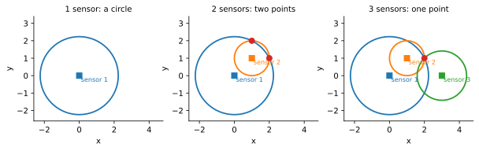
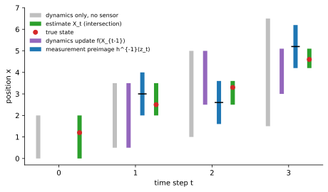

<ul class="post-sources">
<li markdown="span">[Princeton ROB 345 Introduction to Robotics](https://irom-lab.princeton.edu/intro-to-robotics/) Lecture 10 ([video](https://youtu.be/T7Uf2u3VVZ8))</li>
</ul>

계획과 제어를 다룬 앞의 강의들은 두 가지를 당연하게 여겼다.

- 로봇은 센서로 매 순간 자기 **상태 $$\bar{x}(t)$$를 정확히** 안다.
- 로봇은 장애물이 어디 있는지, 즉 환경의 **지도(map)**를 안다.

실제로는 둘 다 성립하지 않는다. [강의 9](/blog/2026/11/10/rob-09-optical-flow/)의 광학 흐름에서 봤듯이 속도 하나를 재는 것도 가정이 많고 잡음이 끼는 일이다. 이제부터 몇 강의에 걸쳐 로봇이 (1) 잡음 섞인 측정으로 **자기 상태를 추정**하고, (2) **환경의 지도를 만드는** 방법을 다룬다. 끝에 가면 이 둘을 동시에 하는 SLAM에 이른다. 이 분야의 표준 교재는 Thrun, Burgard, Fox의 *Probabilistic Robotics*다.

이번 강의는 확률을 쓰기 전 단계로, **가능한 상태의 집합**을 추적하는 가장 단순한 틀인 비결정적 필터를 만든다. 다음 강의의 베이즈 필터는 이 틀에서 집합을 확률 분포로 바꾼 것이다.

## 한 번의 측정으로 알 수 있는 것

### 거리 센서 예

평면 위의 점 로봇을 생각하자. 상태는 위치 $$\bar{x} = (x, y)$$다. 로봇에는 원점까지의 거리를 재는 센서가 있다(무선 비콘까지의 거리를 재는 것을 떠올리면 된다). 측정값이 $$r$$이면 로봇이 알 수 있는 것은

$$
\sqrt{x^2 + y^2} = r
$$

뿐이다. 즉 원점을 중심으로 하는 반지름 $$r$$의 **원 위 어딘가**에 있다.

센서를 하나 더 달아 점 $$(1, 1)$$까지의 거리도 잰다고 하자. 이제 로봇은 두 원의 교점에 있다. 그런데 두 원은 보통 두 점에서 만나므로 여전히 어느 쪽인지 모른다. 세 번째 센서를 달면 세 원의 공통점, 보통 한 점으로 위치가 정해진다. GPS가 위성 여러 개의 거리로 위치를 잡는 것과 같은 원리다.

**숫자로 확인.** 로봇이 실제로 $$(2, 1)$$에 있다고 하자.

- 센서 1(원점): $$r_1 = \sqrt{4 + 1} = \sqrt{5}$$. 원 $$x^2 + y^2 = 5$$ 위의 모든 점이 후보다.
- 센서 2(점 $$(1, 1)$$): $$r_2 = 1$$. 원 $$(x - 1)^2 + (y - 1)^2 = 1$$을 전개하면 $$x^2 + y^2 - 2x - 2y + 1 = 0$$이고, 여기에 $$x^2 + y^2 = 5$$를 넣으면 $$x + y = 3$$이다. 이를 다시 첫 원에 넣으면 $$x^2 + (3 - x)^2 = 5$$, 즉 $$x^2 - 3x + 2 = 0$$이므로 $$x = 1$$ 또는 $$2$$다. 후보는 $$(1, 2)$$와 $$(2, 1)$$ 두 점이다.
- 센서 3(점 $$(3, 0)$$): $$r_3 = \sqrt{1 + 1} = \sqrt{2}$$. 후보 $$(1, 2)$$에서는 이 거리가 $$\sqrt{4 + 4} = 2\sqrt{2}$$라 맞지 않는다. 남는 것은 $$(2, 1)$$ 하나다.


*센서가 하나면 원 위 어디든, 둘이면 두 교점 중 하나, 셋이면 한 점 $$(2, 1)$$로 위치가 정해진다. 빨간 점은 각 단계에서 측정과 모순되지 않는 상태다.*

### 센서 모델과 원상

이것을 일반화하자. 센서 측정값을 모은 벡터를 **측정(measurement)** 또는 **관측(observation)** $$\bar{z}$$라 한다. 위의 센서 세 개 예에서는 각 측정이 스칼라 거리이므로 $$\bar{z} \in \mathbb{R}^3$$이다. 그리고 상태가 주어지면 어떤 측정이 나오는지를 알려 주는 **센서 모델(sensor model)**이 있다고 가정한다.

$$
\bar{z} = h(\bar{x})
$$

$$h$$를 센서 함수(sensor mapping)라고도 한다. 위 예에서는

$$
h(x, y) = \left( \sqrt{x^2 + y^2},\; \sqrt{(x - 1)^2 + (y - 1)^2},\; \sqrt{(x - 3)^2 + y^2} \right)
$$

이다. 상태 공간을 $$X$$라 할 때, 측정 $$\bar{z}$$의 **원상(preimage)**을

$$
h^{-1}(\bar{z}) = \{\, \bar{x} \in X : h(\bar{x}) = \bar{z} \,\}
$$

로 정의한다. 말로 하면 "측정 $$\bar{z}$$를 받은 것과 **모순되지 않는 모든 상태**의 집합"이다. 센서가 하나일 때는 원, 둘일 때는 두 점, 셋일 때는 한 점이었다.

**표기 주의.** $$h$$는 일반적으로 역함수가 없다. 센서가 하나인 예에서 원 위의 무수한 상태가 모두 같은 측정을 낸다. 그래서 $$h^{-1}(\bar{z})$$는 수학적 역함수가 아니라, 측정에서 거꾸로 상태 쪽으로 가는 **집합**을 가리키는 관례적 표기다. 원상이 원소 하나뿐이면 상태가 유일하게 정해진 것이고, 이는 $$h$$가 (적어도 그 근처에서) 역함수를 가진다는 뜻이다.

## 동역학을 더하기: 이상적인 다단계 추정

### 이산 시간 모델

지금까지는 측정 하나만 봤다. 그런데 로봇은 움직이고, 우리는 그 움직임의 모델도 안다. 상태 추정에서는 **이산 시간(discrete-time)** 동역학을 쓰는 것이 편하다.

$$
\bar{x}_{t+1} = f(\bar{x}_t, \bar{u}_t) \qquad \text{(입력을 무시하면 } \bar{x}_{t+1} = f(\bar{x}_t)\text{)}
$$

연속 시간 모델([강의 4](/blog/2026/11/10/rob-04-quadrotor-dynamics/)의 운동 방정식 같은)을 시간 간격 $$\Delta t$$로 이산화해서 얻을 수도 있고, 처음부터 이산 시간 모델을 세울 수도 있다. 당분간 입력 $$\bar{u}$$는 생략한다.

### 동역학 갱신

시각 0에 로봇이 있을 수 있는 상태의 집합 $$\hat{X}_0 \subseteq X$$를 안다고 하자. 모든 원소를 동역학에 통과시키면 시각 1에 있을 수 있는 상태의 집합이 나온다.

$$
f(\hat{X}_0) = \{\, \bar{x} \in X : \text{어떤 } \bar{x}_0 \in \hat{X}_0 \text{에 대해 } f(\bar{x}_0) = \bar{x} \,\}
$$

(계산이 쉬운지는 일단 제쳐 둔다. 원리상 가능하다는 것이 중요하다.)

동역학 갱신만 반복하면 집합은 어떻게 될까? 1차원 예 $$x_{t+1} = \lambda x_t$$($$\lambda > 1$$)를 보자. 원점에서 멀어지는 불안정한 시스템이다. $$\hat{X}_0 = [-\epsilon, \epsilon]$$이면 $$f(\hat{X}_0) = [-\lambda\epsilon, \lambda\epsilon]$$이고, $$t$$단계 뒤에는 $$[-\lambda^t\epsilon, \lambda^t\epsilon]$$이다. 처음의 작은 불확실성이 지수적으로 커진다. 반대로 센서가 상태를 정확히 알려 준다면 동역학이 아무리 불안정해도 상관없다. 결국 추정의 질은 동역학과 센서 사이의 줄다리기다.

### 측정 갱신과 교집합

시각 1에 측정 $$\bar{z}_1$$을 받는다. 그 원상 $$h^{-1}(\bar{z}_1)$$은 측정과 모순되지 않는 상태들이다. 로봇의 상태는 **동역학으로 도달할 수 있으면서 동시에 측정과도 모순되지 않아야** 하므로 두 집합의 교집합에 있다.

$$
\hat{X}_1 = f(\hat{X}_0) \cap h^{-1}(\bar{z}_1)
$$

이 교집합의 위력은 위 예에서 바로 보인다. 센서가 둘뿐이라 원상이 $$\{(1, 2), (2, 1)\}$$ 두 점이어도, 동역학이 "로봇은 $$x \ge 1.5$$인 쪽에 있다"고 말해 주면 $$(2, 1)$$ 하나로 정해진다. 세 번째 센서 대신 **움직임에 대한 지식**이 모호함을 없앤 것이다.

## 비결정적 필터

### 알고리즘

이 과정을 매 시각 반복하면 된다. 시각 $$t$$마다

1. **동역학 갱신(dynamics update):** $$f(\hat{X}_{t-1})$$을 계산한다.
2. **측정 갱신(measurement update):** $$h^{-1}(\bar{z}_t)$$를 계산한다.
3. **융합:** $$\hat{X}_t = f(\hat{X}_{t-1}) \cap h^{-1}(\bar{z}_t)$$.

이것을 **비결정적 필터(non-deterministic filter)**라 한다. "필터"라는 이름은 측정이 들어올 때마다 추정을 순차적으로 걸러 다듬는다는 데서 왔다. $$\hat{X}_t$$는 하나의 점이 아니라 **집합**이라는 점에 주의하자.

입력이 있으면 동역학 갱신만 바꾸면 된다. 시각 $$t - 1$$에 가한 입력 $$\bar{u}_{t-1}$$을 알고 있으므로

$$
f(\hat{X}_{t-1}, \bar{u}_{t-1}) = \{\, f(\bar{x}, \bar{u}_{t-1}) : \bar{x} \in \hat{X}_{t-1} \,\}
$$

을 쓴다.

```python
def nondeterministic_filter(X_hat, u_prev, z):
    X_pred = {f(x, u_prev) for x in X_hat}            # 1. dynamics update
    X_meas = {x for x in state_space if h(x) == z}    # 2. preimage of z
    return X_pred & X_meas                            # 3. intersection
```

### 현실적인 경우: 불확실성이 있는 모델

지금까지는 모델이 완벽하다고 가정했다. 실제로는 두 군데에 불확실성이 있다.

- **동역학의 불확실성.** 바퀴가 미끄러지거나 바람이 불어서, 같은 상태와 입력에서도 정확히 어디로 갈지 모른다.
- **측정의 불확실성.** 센서에 잡음이 있어서 같은 상태에서도 정확히 어떤 측정이 나올지 모른다. 예를 들어 거리 센서가 참 거리에서 $$\pm\epsilon$$ 범위 안의 값을 낸다.

불확실성을 "이 범위 안의 어떤 값이든 나올 수 있다"는 **집합으로** 표현하는 것을 **비결정적(non-deterministic) 불확실성 모델**이라 한다. 확률은 쓰지 않고, 가능한지 아닌지만 따진다. 필터는 개념적으로 쉽게 확장된다. 동역학 잡음 $$\bar{w}$$가 집합 $$W$$ 안에, 측정 잡음 $$\bar{v}$$가 집합 $$V$$ 안에 있다고 하면

$$
f(\hat{X}_{t-1}, \bar{u}_{t-1}) = \{\, f(\bar{x}, \bar{u}_{t-1}) + \bar{w} : \bar{x} \in \hat{X}_{t-1},\; \bar{w} \in W \,\}
$$

$$
h^{-1}(\bar{z}_t) = \{\, \bar{x} \in X : \text{어떤 } \bar{v} \in V \text{에 대해 } \bar{z}_t = h(\bar{x}) + \bar{v} \,\}
$$

이고, 나머지(교집합)는 같다. 거리 센서 예라면 원상이 원(선)에서 두께 $$2\epsilon$$의 고리(annulus)로 두꺼워지고, 교집합도 점이 아니라 작은 영역이 된다.

### 손으로 풀어 보기: 1차원 로봇

직선 위의 로봇이 매 단계 오른쪽으로 1만큼 가라는 명령을 받는다. 실제 이동은 $$1 \pm 0.5$$ 범위 안에서 정해지고, 센서는 위치를 $$\pm 1$$ 오차로 잰다.

$$
x_t = x_{t-1} + 1 + w_t,\quad \lvert w_t \rvert \le 0.5; \qquad z_t = x_t + v_t,\quad \lvert v_t \rvert \le 1
$$

집합이 모두 구간이므로 계산이 쉽다. 구간 $$[a, b]$$를 동역학에 통과시키면 $$[a + 0.5,\; b + 1.5]$$이고, 측정 $$z$$의 원상은 $$[z - 1,\; z + 1]$$이다. 초기 추정이 $$\hat{X}_0 = [0, 2]$$, 측정이 차례로 $$z_1 = 3.0$$, $$z_2 = 2.6$$, $$z_3 = 5.2$$라 하자.

| $$t$$ | 동역학 갱신 $$f(\hat{X}_{t-1})$$ | 원상 $$h^{-1}(z_t)$$ | 추정 $$\hat{X}_t$$ | 폭 |
|---|---|---|---|---|
| 0 | | | $$[0, 2]$$ | 2.0 |
| 1 | $$[0.5, 3.5]$$ | $$[2.0, 4.0]$$ | $$[2.0, 3.5]$$ | 1.5 |
| 2 | $$[2.5, 5.0]$$ | $$[1.6, 3.6]$$ | $$[2.5, 3.6]$$ | 1.1 |
| 3 | $$[3.0, 5.1]$$ | $$[4.2, 6.2]$$ | $$[4.2, 5.1]$$ | 0.9 |

실제 위치(1.2, 2.5, 3.3, 4.6)는 매번 추정 구간 안에 있다. 세 가지를 눈여겨볼 만하다.

- **측정만 쓴 구간(폭 2)보다 추정 구간이 좁다.** 동역학이 측정의 일부를 잘라 낸다.
- **동역학만 쓰면 구간이 계속 넓어진다.** 매 단계 폭이 1씩 늘어 $$t = 3$$에는 $$[1.5, 6.5]$$, 폭 5가 된다. 측정이 이 성장을 막는다.
- $$t = 2$$의 측정 $$2.6$$은 실제 위치 3.3보다 0.7 작은데, 동역학이 아래쪽을 잘라 내서 추정은 $$[2.5, 3.6]$$으로 실제 위치를 놓치지 않는다.


*1차원 비결정적 필터. 각 시각에서 왼쪽부터 동역학만 쓴 구간(회색), 동역학 갱신(보라), 측정 원상(파랑, 검은 눈금이 측정값), 그 교집합인 추정(초록)이다. 빨간 점은 실제 위치다.*

## 한계

비결정적 필터는 실제로 그대로 쓰이는 경우가 드물다. 이유는 네 가지다.

1. **계산이 어렵다.** 1차원 구간은 쉽지만, 일반적인 비선형 $$f$$와 $$h$$에서 집합 $$f(\hat{X}_{t-1})$$과 $$h^{-1}(\bar{z}_t)$$를 표현하고 교집합을 구하는 것은 매우 어렵다. 집합의 모양이 단계마다 복잡해진다. 집합을 다면체(polytope) 같은 다루기 쉬운 모양으로 근사할 수는 있다. 상태 공간을 격자로 나눠 칸마다 "가능/불가능"을 표시하는 방법도 있지만, 3차원 쿼드로터의 12차원 상태 공간을 각 축 10칸만으로 나눠도 $$10^{12}$$칸이다.
2. **불확실성 모델을 정하기 어렵다.** 센서 오차가 "정확히 $$\pm 1$$ 이내"라고 장담하기 어렵다. 범위를 작게 잡았다가 한 번 벗어나면 교집합이 공집합이 되어 필터가 무너지고, 크게 잡으면 쓸모없이 넓어진다.
3. **지나치게 보수적이다.** 필터는 일어날 수 있는 모든 경우, 즉 최악의 경우를 추적한다. 동역학 잡음이 매번 $$+0.5$$로 몰리는 일은 거의 없지만, 집합은 그 가능성까지 담는다. 어느 상태가 **더 그럴듯한지**는 말해 주지 못한다.
4. **결과가 집합이다.** LQR 같은 제어기 $$\bar{u} = K\bar{x}$$는 상태 하나를 입력으로 받는다. 집합 $$\hat{X}_t$$에서 어떤 점을 골라 넣어야 할지 이 틀은 답하지 않는다.

그럼에도 "동역학으로 예측하고, 측정으로 걸러 내고, 둘을 합친다"는 구조는 실제로 쓰는 모든 필터의 뼈대다. 다음 강의에서는 집합 대신 **확률 분포**를 추적한다. 교집합은 곱셈과 정규화로, 원상 계산은 베이즈 규칙으로 바뀐다([강의 11](/blog/2026/11/10/rob-11-bayes-filter/)). 미리 [베이즈 정리](/blog/2026/11/02/knowledge-34-bayes-theorem/)와 [조건부 확률](/blog/2026/11/02/knowledge-49-conditional/)을 복습해 두면 좋다.

### 흔한 실수

- **$$h^{-1}$$을 역함수로 읽는다.** $$h^{-1}(\bar{z})$$는 집합이고, $$h$$가 역함수를 갖지 않아도 항상 정의된다. 원소가 0개(모델이 틀렸거나 잡음 범위를 너무 작게 잡음)일 수도, 무수히 많을 수도 있다.
- **측정 갱신만으로 충분하다고 생각한다.** 측정이 모호해도(두 교점) 동역학과 합치면 모호함이 풀릴 수 있다. 반대로 동역학만 쓰면 불확실성이 쌓이기만 한다.
- **입력의 시각을 헷갈린다.** $$\hat{X}_t$$를 만들 때는 직전 시각의 입력 $$\bar{u}_{t-1}$$을 쓴다.

## 정리

| 개념 | 내용 |
|---|---|
| 상태 추정 | 잡음 섞인 측정과 모델로 로봇의 상태를 알아내는 문제 |
| 센서 모델 | $$\bar{z} = h(\bar{x})$$ |
| 원상 | $$h^{-1}(\bar{z}) = \{\bar{x} : h(\bar{x}) = \bar{z}\}$$, 측정과 모순되지 않는 상태의 집합 |
| 동역학 갱신 | $$f(\hat{X}_{t-1}, \bar{u}_{t-1})$$, 도달 가능한 상태의 집합 |
| 비결정적 필터 | $$\hat{X}_t = f(\hat{X}_{t-1}, \bar{u}_{t-1}) \cap h^{-1}(\bar{z}_t)$$ |
| 비결정적 불확실성 | 잡음을 집합(예: $$\pm\epsilon$$)으로 표현, 확률은 쓰지 않음 |
| 한계 | 계산 어려움, 모델 지정 어려움, 최악의 경우 기준의 보수성, 집합 출력 |
