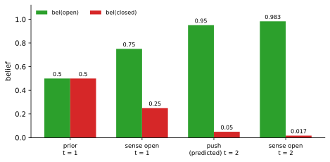
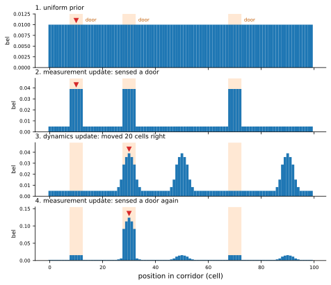

<ul class="post-sources">
<li markdown="span">[Princeton ROB 345 Introduction to Robotics](https://irom-lab.princeton.edu/intro-to-robotics/) Lecture 11 ([video](https://youtu.be/mno8-hG7tJc))</li>
</ul>

[강의 10](/blog/2026/11/10/rob-10-nondeterministic-filter/)의 비결정적 필터는 매 시각 세 단계를 반복했다.

1. 동역학 갱신: $$f(\hat{X}_{t-1})$$
2. 측정 갱신: $$h^{-1}(\bar{z}_t)$$
3. 융합: $$\hat{X}_t = f(\hat{X}_{t-1}) \cap h^{-1}(\bar{z}_t)$$

결과 $$\hat{X}_t$$는 로봇이 있을 수 있는 상태의 **집합**이었다. 그런데 이 방법은 계산이 어렵고, 최악의 경우까지 모두 담아 지나치게 보수적이며, 무엇보다 집합을 받아서 무엇을 해야 할지 모호하다. LQR 제어기 $$\bar{u} = K\bar{x}$$([강의 8](/blog/2026/11/10/rob-08-lqr/))에 넣을 상태 하나를 집합에서 어떻게 고를 것인가?

이번 강의의 답은 집합 대신 **확률 분포**를 추적하는 것이다. 시각 $$t$$의 상태에 대한 확률 분포를 **믿음(belief)** $$\text{bel}(\bar{x}_t)$$라 부른다. 집합이 "어디에 있을 수 있는가"만 말한다면, 믿음은 "어디에 있을 **가능성이 얼마나 큰가**"까지 말한다.

## 확률 기초

필요한 도구는 몇 가지뿐이다. (*Probabilistic Robotics* 2.2절에 요약이 있다.)

- **확률.** $$p(X = x)$$는 확률 변수 $$X$$가 값 $$x$$를 가질 확률이다. 동전이라면 $$p(X = \text{앞}) = p(X = \text{뒤}) = 0.5$$. 이산 변수는 $$\sum_x p(x) = 1$$, 연속 변수는 확률 밀도로 $$\int p(x)\,dx = 1$$이다.
- **결합 분포(joint distribution).** $$p(x, y) = p(X = x \text{ 그리고 } Y = y)$$.
- **독립(independence).** $$X$$와 $$Y$$가 독립이면 $$p(x, y) = p(x)p(y)$$.
- **조건부 분포(conditional distribution).** $$p(y) > 0$$일 때 $$p(x \mid y) = p(x, y) / p(y)$$. $$X$$와 $$Y$$가 독립이면 $$p(x \mid y) = p(x)p(y)/p(y) = p(x)$$로, $$Y$$를 알아도 $$X$$에 대해 새로 아는 것이 없다. ([조건부 확률](/blog/2026/11/02/knowledge-49-conditional/))
- **전확률 정리(theorem of total probability).** $$p(x) = \sum_y p(x \mid y)p(y)$$, 연속이면 $$p(x) = \int p(x \mid y)p(y)\,dy$$. 이렇게 다른 변수를 합해 없앤 $$p(x)$$를 **주변 분포(marginal distribution)**라 한다. ([주변 확률](/blog/2026/11/02/knowledge-48-marginal/))

그리고 가장 중요한 **베이즈 규칙(Bayes' rule)**이다.

$$
p(x \mid y) = \frac{p(y \mid x)\,p(x)}{p(y)} = \frac{p(y \mid x)\,p(x)}{\sum_{x'} p(y \mid x')\,p(x')}
$$

증명은 조건부 확률의 정의를 두 방향으로 쓰는 것으로 끝난다. $$p(x \mid y)p(y) = p(x, y) = p(y \mid x)p(x)$$에서 양변을 $$p(y)$$로 나누면 된다. 분모는 전확률 정리로 펼친 것이다.

베이즈 규칙의 의미는 조건부 확률을 **뒤집는** 데 있다. 로봇은 보통 "상태가 이러면 센서가 무엇을 낼까", 즉 $$p(\bar{z} \mid \bar{x})$$를 안다(센서를 설계하고 시험하면 얻을 수 있다). 하지만 정작 알고 싶은 것은 "센서가 이렇게 나왔으니 상태는 무엇일까", 즉 $$p(\bar{x} \mid \bar{z})$$다. 이 뒤집기는 비결정적 필터에서 원상 $$h^{-1}(\bar{z})$$를 계산한 것에 해당한다. 용어로는 $$p(x)$$를 **사전 분포(prior)**, $$p(y \mid x)$$를 **가능도(likelihood)**, $$p(x \mid y)$$를 **사후 분포(posterior)**라 한다([베이즈 정리](/blog/2026/11/02/knowledge-34-bayes-theorem/), [가능도, 사전, 사후](/blog/2026/11/02/knowledge-39-likelihood-prior-posterior/)).

## 예제: 문이 열려 있는가

(*Probabilistic Robotics* 2.4.2절의 예.)

### 측정 하나로 믿음 갱신하기

로봇 앞에 문이 있고, 상태 $$X_t$$는 "열림" 또는 "닫힘" 둘 중 하나다. 로봇에는 문이 열렸는지 감지하는 센서가 있는데 완벽하지 않다. **센서 모델** $$p(Z_t \mid X_t)$$가 다음과 같다.

| | 열림이라고 감지 | 닫힘이라고 감지 |
|---|---|---|
| 실제로 열림 | 0.6 | 0.4 |
| 실제로 닫힘 | 0.2 | 0.8 |

닫힌 문은 꽤 잘 알아보지만(틀릴 확률 0.2), 열린 문은 자주 틀린다(틀릴 확률 0.4). 각 행의 합이 1이라는 점에 주의하자. 주어진 상태에서 나올 수 있는 측정의 확률이므로 행 단위로 합이 1이다.

측정하기 전 로봇은 아무 정보가 없어서 **사전 믿음**을 반반으로 둔다. $$p(X_1 = \text{열림}) = p(X_1 = \text{닫힘}) = 0.5$$. (이 건물의 문이 대개 닫혀 있다는 것을 안다면 사전 믿음을 그쪽으로 기울여도 된다.)

시각 1에 센서가 "열림"을 감지했다. 베이즈 규칙으로

$$
\text{bel}(X_1 = \text{열림}) = p(X_1 = \text{열림} \mid Z_1 = \text{열림 감지})
= \frac{\overbrace{0.6}^{\text{센서 모델}} \times \overbrace{0.5}^{\text{사전}}}{0.6 \times 0.5 + 0.2 \times 0.5}
= \frac{0.3}{0.4} = 0.75
$$

이다. 분모 $$p(Z_1 = \text{열림 감지}) = 0.4$$는 문이 열렸을 때와 닫혔을 때 각각 "열림"이 감지될 확률을 사전 확률로 가중해 더한 것이다(전확률 정리). 문의 상태는 둘 중 하나이므로 $$\text{bel}(X_1 = \text{닫힘}) = 0.25$$다. 센서가 완벽하지 않아도 측정 하나로 믿음이 0.5에서 0.75로 올라갔다.

### 행동을 더하기: 문을 민다

이제 동역학, 즉 행동의 효과를 넣는다. 로봇이 문을 밀 수 있고, **동역학 모델** $$p(X_t \mid X_{t-1}, U_{t-1})$$이 다음과 같다.

| $$U_{t-1} = \text{밀기}$$ | $$X_t = \text{열림}$$ | $$X_t = \text{닫힘}$$ |
|---|---|---|
| $$X_{t-1} = \text{열림}$$ | 1 | 0 |
| $$X_{t-1} = \text{닫힘}$$ | 0.8 | 0.2 |

열린 문은 밀어도 열린 채로 있고, 닫힌 문은 밀면 0.8 확률로 열린다.

(표기 주의: 이 강의는 시각 $$t - 1$$에 가한 입력이 $$t$$의 상태를 정한다는 뜻으로 $$p(X_t \mid X_{t-1}, U_{t-1})$$로 쓴다. *Probabilistic Robotics* 책은 같은 것을 $$p(X_t \mid X_{t-1}, U_t)$$로 쓴다. 책의 $$U_t$$가 여기의 $$U_{t-1}$$이다.)

시각 1에 로봇이 문을 밀었다. 비결정적 필터처럼 두 단계로 간다.

**1단계: 동역학 갱신.** 측정하기 전, 밀고 난 직후의 믿음을 $$\overline{\text{bel}}$$(위에 줄)로 쓴다. 시각 2에 열려 있으려면 "원래 열려 있었고 밀어도 열림" 또는 "원래 닫혀 있었는데 밀어서 열림" 둘 중 하나다. 전확률 정리로

$$
\overline{\text{bel}}(X_2 = \text{열림}) = 1 \times \underbrace{0.75}_{\text{bel}(X_1 = \text{열림})} + 0.8 \times \underbrace{0.25}_{\text{bel}(X_1 = \text{닫힘})} = 0.95
$$

이고 $$\overline{\text{bel}}(X_2 = \text{닫힘}) = 0.05$$다. 믿음을 동역학 모델로 한 걸음 **앞으로 전파**한 것이다.

**2단계: 측정 갱신.** 시각 2에 센서가 다시 "열림"을 감지했다. 이번에는 $$\overline{\text{bel}}$$이 사전 역할을 한다.

$$
\text{bel}(X_2 = \text{열림}) = \frac{0.6 \times 0.95}{0.6 \times 0.95 + 0.2 \times 0.05} = \frac{0.57}{0.58} \approx 0.983
$$

이고 $$\text{bel}(X_2 = \text{닫힘}) \approx 0.017$$이다.


*문 예제에서 믿음의 변화. 측정(열림 감지)과 행동(밀기)이 쌓일수록 "열림" 쪽 믿음이 0.5 → 0.75 → 0.95 → 0.983으로 커진다.*

만약 시각 2에 센서가 "닫힘"을 감지했다면 $$\text{bel}(X_2 = \text{열림}) = \frac{0.4 \times 0.95}{0.4 \times 0.95 + 0.8 \times 0.05} = \frac{0.38}{0.42} \approx 0.905$$다. 측정이 반대 방향을 가리켜도 믿음이 0.95에서 0.905로 조금 내려갈 뿐이다. 앞서 쌓인 증거가 강하고, 이 센서는 열린 문을 "닫힘"으로 잘못 보는 일이 흔하기(0.4) 때문이다. 집합 기반 필터라면 이런 정도의 차이를 표현할 수 없다.

## 베이즈 필터

### 알고리즘

위의 두 단계를 일반화한 것이 **베이즈 필터(Bayes filter)**다. 매 시각 $$t$$마다 **모든 상태 $$\bar{x}_t$$에 대해**

1. **동역학 갱신(dynamics update, 예측):**

   $$
   \overline{\text{bel}}(\bar{x}_t) = \sum_{\bar{x}_{t-1}} p(\bar{x}_t \mid \bar{x}_{t-1}, \bar{u}_{t-1})\, \text{bel}(\bar{x}_{t-1})
   $$

2. **측정 갱신(measurement update, 보정):**

   $$
   \text{bel}(\bar{x}_t) = \frac{p(\bar{z}_t \mid \bar{x}_t)\, \overline{\text{bel}}(\bar{x}_t)}{p(\bar{z}_t)}
   $$

를 계산한다. 분모 $$p(\bar{z}_t) = \sum_{\bar{x}} p(\bar{z}_t \mid \bar{x})\overline{\text{bel}}(\bar{x})$$는 $$\bar{x}_t$$와 상관없는 상수이므로, 실제로는 분자를 모든 상태에 대해 계산한 뒤 합이 1이 되도록 나누기만 하면 된다. 그래서 흔히 정규화 상수 $$\eta$$를 써서 $$\text{bel}(\bar{x}_t) = \eta\, p(\bar{z}_t \mid \bar{x}_t)\, \overline{\text{bel}}(\bar{x}_t)$$로 쓴다.

비결정적 필터와 나란히 놓으면 구조가 똑같다.

| | 비결정적 필터 | 베이즈 필터 |
|---|---|---|
| 추적하는 것 | 집합 $$\hat{X}_t$$ | 확률 분포 $$\text{bel}(\bar{x}_t)$$ |
| 동역학 갱신 | 집합의 상 $$f(\hat{X}_{t-1})$$ | 전확률 정리로 합 |
| 측정 갱신 | 원상 $$h^{-1}(\bar{z}_t)$$와 교집합 | 가능도 곱하고 정규화 |
| 필요한 모델 | $$f$$, $$h$$, 잡음 집합 | $$p(\bar{x}_t \mid \bar{x}_{t-1}, \bar{u}_{t-1})$$, $$p(\bar{z}_t \mid \bar{x}_t)$$ |

실제로 가능도가 0 또는 1뿐이고 믿음을 "균등 분포"로만 두면, 베이즈 필터는 비결정적 필터로 돌아간다. 교집합 밖의 상태는 확률 0이 되고, 안의 상태는 같은 확률을 갖는다. 베이즈 필터는 비결정적 필터의 **확률 버전**이다.

```python
def bayes_filter(bel, u_prev, z):
    # 1. dynamics update (prediction)
    bel_bar = {x: sum(p_dyn(x, xp, u_prev) * bel[xp] for xp in states)
               for x in states}
    # 2. measurement update (correction)
    unnorm = {x: p_meas(z, x) * bel_bar[x] for x in states}
    eta = 1.0 / sum(unnorm.values())
    return {x: eta * unnorm[x] for x in states}
```

### 왜 이 두 식이 맞는가

믿음의 정확한 뜻은 지금까지의 모든 측정과 입력이 주어졌을 때 상태의 조건부 분포다.

$$
\text{bel}(\bar{x}_t) = p(\bar{x}_t \mid \bar{z}_{1:t}, \bar{u}_{0:t-1}),
\qquad
\overline{\text{bel}}(\bar{x}_t) = p(\bar{x}_t \mid \bar{z}_{1:t-1}, \bar{u}_{0:t-1})
$$

($$\bar{z}_{1:t}$$는 $$\bar{z}_1, \dots, \bar{z}_t$$를 줄여 쓴 것이다.) 두 식은 다음 두 가지 **마르코프(Markov) 가정**에서 나온다.

- **상태가 충분하다.** 현재 상태 $$\bar{x}_t$$를 알면, 과거의 측정과 입력은 현재 측정 $$\bar{z}_t$$에 대해 더 알려 주는 것이 없다: $$p(\bar{z}_t \mid \bar{x}_t, \bar{z}_{1:t-1}, \bar{u}_{0:t-1}) = p(\bar{z}_t \mid \bar{x}_t)$$.
- 마찬가지로 직전 상태와 입력을 알면 더 이전의 기록은 다음 상태에 대해 더 알려 주는 것이 없다: $$p(\bar{x}_t \mid \bar{x}_{t-1}, \bar{z}_{1:t-1}, \bar{u}_{0:t-1}) = p(\bar{x}_t \mid \bar{x}_{t-1}, \bar{u}_{t-1})$$.

측정 갱신은 $$\overline{\text{bel}}$$을 사전으로 한 베이즈 규칙에 첫 번째 가정을 쓴 것이다. 동역학 갱신은 $$\bar{x}_{t-1}$$에 대한 전확률 정리에 두 번째 가정을 쓴 것이다(그리고 아직 실행하지 않은 $$\bar{u}_{t-1}$$이 $$\bar{x}_{t-1}$$에 대한 믿음을 바꾸지 않는다는 점). 자세한 증명은 *Probabilistic Robotics* 2.4.3절에 있다.

### 예제 2: 복도에서 자기 위치 찾기

문 예제는 상태가 둘뿐이었다. 상태가 많을 때도 그대로 적용된다. 복도를 100칸으로 나누고(끝과 처음이 이어진 원형 복도), 10, 30, 70번 칸 근처에 문이 있다고 하자. 로봇은 지도(문 위치)는 알지만 자기 위치는 모른다. 센서는 문 앞에서 0.8, 벽 앞에서 0.1의 확률로 "문"을 감지한다. 로봇은 실제로 10번 칸에 있다.

1. **사전.** 모든 칸에 균등하게 $$1/100$$.
2. **"문" 감지.** 문 앞 칸은 가능도 0.8, 나머지는 0.1이 곱해지고 정규화된다. 문 앞 칸의 믿음은 벽 앞 칸의 8배가 되어, 세 문 앞에 똑같은 높이의 봉우리 셋이 생긴다. 어느 문인지는 아직 모른다.
3. **오른쪽으로 20칸 이동.** 동역학 갱신으로 믿음 전체가 20칸 오른쪽으로 밀리고, 이동 오차 때문에 봉우리가 퍼진다. 봉우리는 이제 30, 50, 90번 칸에 있다.
4. **"문" 다시 감지.** 봉우리 셋 중 30번 칸의 것만 실제 문 위에 있어 가능도 0.8을 받고, 50과 90번 칸 봉우리는 0.1을 받는다. 30번 칸 근처(25–35번)에 믿음의 약 56%가 모이고, 나머지 두 봉우리는 각각 약 9%로 줄어든다.


*격자 위의 베이즈 필터(히스토그램 필터). 주황색 띠는 문, 빨간 삼각형은 실제 위치다. 문을 한 번 본 뒤에는 세 후보가 남지만, 이동 후 다시 문을 보면 문 사이 간격과 맞는 후보 하나로 믿음이 모인다.*

측정 하나만으로는 세 문을 구별할 수 없지만, **움직임과 지도**를 결합하면 구별된다. 강의 10에서 두 원의 교점 둘 중 하나를 동역학으로 골라낸 것과 같은 이야기다. 이처럼 믿음이 여러 봉우리를 가질 수 있다는 것(multimodal)이 다음 강의에서 중요해진다.

## 베이즈 필터를 쓰려면

### 필요한 것

베이즈 필터를 돌리려면 세 가지가 필요하다.

1. **동역학 모델** $$p(\bar{x}_t \mid \bar{x}_{t-1}, \bar{u}_{t-1})$$: 물리 법칙에서 출발해 잡음을 붙이거나, 데이터를 모아 추정한다. 바퀴 로봇이라면 바퀴 회전량에서 이동량을 계산하고 미끄러짐을 잡음으로 모델링한다.
2. **측정 모델** $$p(\bar{z}_t \mid \bar{x}_t)$$: 센서의 사양서나, 상태를 정확히 아는 상황에서 측정을 반복해 얻는 통계로 정한다.
3. **초기 믿음** $$\text{bel}(\bar{x}_0)$$: 아무것도 모르면 균등 분포.

### 계산의 어려움

상태, 입력, 측정 공간이 이산적이고 작을 때(문 예제, 복도 격자)는 위 식을 그대로 계산하면 된다. 하지만 로봇의 상태는 대개 연속이다. 그러면 합이 적분이 된다.

$$
\overline{\text{bel}}(\bar{x}_t) = \int p(\bar{x}_t \mid \bar{x}_{t-1}, \bar{u}_{t-1})\, \text{bel}(\bar{x}_{t-1})\, d\bar{x}_{t-1}
$$

이 적분을 모든 $$\bar{x}_t$$에 대해 계산하는 것은 일반적으로 불가능하다. 격자로 나누면 차원이 늘 때 칸 수가 지수적으로 늘어난다. 예를 들어 평면 쿼드로터의 상태 6차원을 각 축 100칸으로 나누면 $$100^6 = 10^{12}$$칸이다. 해결책은 두 갈래다.

- **정확히 계산할 수 있는 특수한 경우를 찾는다.** 모델이 선형이고 잡음이 가우시안이면 믿음이 항상 가우시안으로 남아 평균과 공분산만 갱신하면 된다. 이것이 **Kalman filter**다.
- **근사한다.** 믿음을 많은 샘플로 표현하면 어떤 모양의 분포도 다룰 수 있다. 이것이 **파티클 필터(particle filter)**다.

둘 다 [강의 12](/blog/2026/11/10/rob-12-kalman-particle-filter/)에서 다룬다.

### 흔한 실수

- **측정 갱신에서 정규화를 잊는다.** $$p(\bar{z}_t \mid \bar{x}_t)\overline{\text{bel}}(\bar{x}_t)$$는 합이 1이 아니다. 문 예제에서 분자만 보면 0.3과 0.1로, 정규화해야 0.75와 0.25가 된다.
- **센서 모델의 행과 열을 헷갈린다.** $$p(z \mid x)$$는 상태를 고정했을 때 측정에 대한 분포라서 $$\sum_z p(z \mid x) = 1$$이다. $$\sum_x p(z \mid x)$$는 1일 필요가 없다(문 예제에서 "열림 감지" 열의 합은 0.8).
- **$$p(\bar{z} \mid \bar{x})$$와 $$p(\bar{x} \mid \bar{z})$$를 같은 것으로 본다.** 센서가 열린 문을 0.6 확률로 "열림"이라 한다고 해서, "열림" 감지 후 문이 열렸을 확률이 0.6인 것은 아니다. 사전에 따라 달라지며 위 예에서는 0.75였다.
- **예측 단계를 건너뛴다.** 측정이 없는 시각에도 동역학 갱신은 해야 한다. 측정 없이 동역학 갱신만 반복하면 믿음이 점점 퍼진다(불확실성이 커진다).

## 정리

| 개념 | 내용 |
|---|---|
| 믿음 | $$\text{bel}(\bar{x}_t) = p(\bar{x}_t \mid \bar{z}_{1:t}, \bar{u}_{0:t-1})$$, 상태에 대한 확률 분포 |
| 베이즈 규칙 | $$p(x \mid y) = p(y \mid x)p(x)/p(y)$$, 센서 모델을 "뒤집는" 도구 |
| 동역학 갱신 | $$\overline{\text{bel}}(\bar{x}_t) = \sum_{\bar{x}_{t-1}} p(\bar{x}_t \mid \bar{x}_{t-1}, \bar{u}_{t-1})\text{bel}(\bar{x}_{t-1})$$ |
| 측정 갱신 | $$\text{bel}(\bar{x}_t) = \eta\, p(\bar{z}_t \mid \bar{x}_t)\overline{\text{bel}}(\bar{x}_t)$$ |
| 문 예제 | 0.5 → 0.75(감지) → 0.95(밀기) → 0.983(감지) |
| 필요한 것 | 동역학 모델, 측정 모델, 초기 믿음 |
| 한계 | 연속·고차원 공간에서는 적분을 계산할 수 없음 → Kalman filter(정확, 선형-가우시안), 파티클 필터(근사) |
