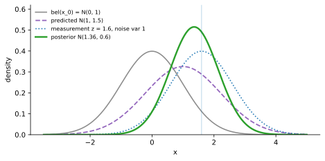
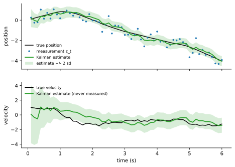
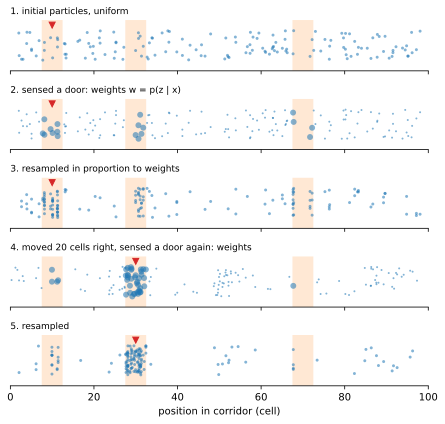

<ul class="post-sources">
<li markdown="span">[Princeton ROB 345 Introduction to Robotics](https://irom-lab.princeton.edu/intro-to-robotics/) Lecture 12 ([video](https://youtu.be/a3Wmophohxo))</li>
</ul>

[강의 11](/blog/2026/11/10/rob-11-bayes-filter/)의 베이즈 필터는 동역학 모델 $$p(\bar{x}_t \mid \bar{x}_{t-1}, \bar{u}_{t-1})$$, 센서 모델 $$p(\bar{z}_t \mid \bar{x}_t)$$, 초기 믿음이 주어지면 매 시각 두 단계를 반복했다.

1. 동역학 갱신: $$\overline{\text{bel}}(\bar{x}_t) = \sum_{\bar{x}_{t-1}} p(\bar{x}_t \mid \bar{x}_{t-1}, \bar{u}_{t-1})\, \text{bel}(\bar{x}_{t-1})$$
2. 측정 갱신: $$\text{bel}(\bar{x}_t) = p(\bar{z}_t \mid \bar{x}_t)\, \overline{\text{bel}}(\bar{x}_t) / p(\bar{z}_t)$$

문이 열렸는지 닫혔는지처럼 상태가 몇 개뿐이면 이 계산은 정확하고 빠르다. 하지만 드론의 위치와 속도처럼 상태가 **연속**이면 합이 적분이 되고, 임의의 모델에 대해 이 적분을 모든 $$\bar{x}_t$$에서 계산하는 것은 불가능하다. 이번 강의는 연속 공간에서 베이즈 필터를 실제로 돌리는 두 방법을 다룬다.

- **Kalman filter:** 모델에 강한 가정(선형, 가우시안)을 두어 적분을 **정확히** 계산한다.
- **파티클 필터(particle filter):** 가정을 두지 않는 대신 믿음을 샘플로 **근사**한다.

둘 다 *Probabilistic Robotics* 3, 4장에 자세히 나온다.

## Kalman filter의 세 가지 가정

베이즈 필터의 입력은 동역학 모델, 센서 모델, 초기 믿음 세 가지다. Kalman filter는 각각에 구체적인 가정을 둔다.

### 1. 선형-가우시안 동역학

LQR([강의 8](/blog/2026/11/10/rob-08-lqr/))에서 쓴 이산 시간 선형 동역학 $$\bar{x}_t = A_t\bar{x}_{t-1} + B_t\bar{u}_{t-1}$$ ($$\bar{x}_t \in \mathbb{R}^n$$, $$\bar{u}_t \in \mathbb{R}^m$$)에 잡음 항을 더한다.

$$
\bar{x}_t = A_t\bar{x}_{t-1} + B_t\bar{u}_{t-1} + \bar{\varepsilon}_t,
\qquad \bar{\varepsilon}_t \sim \mathcal{N}(\bar{0}, R_t)
$$

$$\bar{\varepsilon}_t$$는 매 시각 **독립적으로** 뽑히는 평균 0의 가우시안 잡음으로, 돌풍이나 모델의 부정확함처럼 "정확히 어디로 갈지 모르는" 부분을 나타낸다. $$R_t$$는 그 공분산 행렬이다. $$A_t$$, $$B_t$$, $$R_t$$에 아래 첨자 $$t$$가 붙은 것은 시간에 따라 바뀌어도 된다는 뜻이다. 미리 계획한 궤적을 따라 선형화하면 기준점이 바뀌면서 행렬이 바뀌고, 연료를 태워 질량이 줄어드는 로켓도 동역학이 시간에 따라 변한다. 물론 상수여도 된다.

**가우시안 복습.** 다변수 정규 분포 $$\mathcal{N}(\bar{\mu}, \Sigma)$$는 평균 벡터 $$\bar{\mu}$$와 공분산 행렬 $$\Sigma$$([공분산](/blog/2026/11/02/knowledge-35-covariance-correlation/)) 두 가지로 완전히 정해지고, 확률 밀도 함수는

$$
p(\bar{x}) = \det(2\pi\Sigma)^{-1/2} \exp\left[ -\tfrac{1}{2}(\bar{x} - \bar{\mu})^T \Sigma^{-1} (\bar{x} - \bar{\mu}) \right]
$$

이다. 1차원이면 익숙한 종 모양 곡선이고, $$\Sigma$$는 분산 $$\sigma^2$$이다.

센서 없이 동역학만 반복하면 믿음은 매 단계 잡음이 더해져 점점 넓게 퍼진다. 밀도 함수의 넓이는 항상 1이므로, 폭이 넓어지면 봉우리 높이는 낮아진다. $$R_t$$가 클수록 빨리 퍼진다.

### 2. 선형-가우시안 측정

$$
\bar{z}_t = C_t\bar{x}_t + \bar{\delta}_t,
\qquad \bar{\delta}_t \sim \mathcal{N}(\bar{0}, Q_t)
$$

잡음이 없다면 센서는 상태의 선형 함수 $$C_t\bar{x}_t$$를 보고한다. 실제로는 공분산 $$Q_t$$인 가우시안 오차 $$\bar{\delta}_t$$가 더해진다. 1차원에서 $$C = 0.8$$, $$Q = 0.6$$이라면, 로봇이 $$x = 2$$에 있을 때 측정은 평균 $$0.8 \times 2 = 1.6$$, 분산 0.6인 정규 분포를 따른다. $$x = 5$$이면 평균 4.0인 다른 정규 분포를 따른다.

**$$C$$는 무엇을 재는지를 말한다.** [강의 4](/blog/2026/11/10/rob-04-quadrotor-dynamics/)의 평면 쿼드로터는 상태가 $$\bar{x} = (x, y, \theta, \dot{x}, \dot{y}, \dot{\theta})$$로 6차원이다. 센서가 $$x$$ 위치와 기울기 $$\theta$$만 잰다면 $$\bar{z}_t \in \mathbb{R}^2$$이므로 $$C$$는 $$2 \times 6$$이고, 각 행이 상태의 한 성분을 골라낸다.

$$
C = \begin{bmatrix} 1 & 0 & 0 & 0 & 0 & 0 \\ 0 & 0 & 1 & 0 & 0 & 0 \end{bmatrix},
\qquad
C\bar{x} = \begin{bmatrix} x \\ \theta \end{bmatrix}
$$

$$\bar{\delta}_t$$도 2차원이다. 더 현실적인 경우는 드론을 추적하는 카메라가 $$x, y, \theta$$를 잡음과 함께 재는 것으로, $$C = \begin{bmatrix} I_3 & 0_{3 \times 3} \end{bmatrix}$$이다. 이때도 Kalman filter는 측정되지 않는 속도 $$\dot{x}, \dot{y}, \dot{\theta}$$까지 포함한 6차원 전체에 대한 믿음을 유지한다. 사진 한 장으로는 속도를 알 수 없지만, 시간에 따른 위치 측정을 동역학 모델과 엮으면 속도를 추론할 수 있다.

### 3. 가우시안 초기 믿음

$$
\text{bel}(\bar{x}_0) = \mathcal{N}(\bar{\mu}_0, \Sigma_0)
$$

### 핵심 결과: 믿음은 계속 가우시안이다

세 가정 아래에서 **모든 시각의 믿음이 가우시안**으로 남는다(증명은 *Probabilistic Robotics* 3.2.4절, 몇 쪽에 걸친 선형대수 계산이다). 직관은 이렇다.

- 가우시안 확률 변수에 선형 변환을 하면 여전히 가우시안이다. $$\bar{x} \sim \mathcal{N}(\bar{\mu}, \Sigma)$$이면 $$A\bar{x} + B\bar{u} \sim \mathcal{N}(A\bar{\mu} + B\bar{u},\; A\Sigma A^T)$$다. 공분산이 $$A\Sigma A^T$$가 되는 것은 $$\operatorname{Cov}(A\bar{x}) = E[A(\bar{x} - \bar{\mu})(\bar{x} - \bar{\mu})^TA^T] = A\Sigma A^T$$이기 때문이다.
- 독립인 가우시안 잡음을 더해도 가우시안이고, 공분산은 더해진다: $$A\Sigma A^T + R$$.
- 가우시안 사전과 선형-가우시안 가능도를 베이즈 규칙으로 곱하고 정규화해도 가우시안이다. 지수 안의 이차식끼리 더하면 또 이차식이기 때문이다.

그러니 무한차원 객체인 분포 전체를 들고 다닐 필요 없이 **평균 $$\bar{\mu}_t$$와 공분산 $$\Sigma_t$$만 갱신**하면 된다. 이것이 Kalman filter다.

## Kalman filter 알고리즘

### 식

시각 $$t - 1$$의 믿음 $$\mathcal{N}(\bar{\mu}_{t-1}, \Sigma_{t-1})$$에서 시작한다.

**1. 동역학 갱신** ($$\overline{\text{bel}}(\bar{x}_t) = \mathcal{N}(\bar{\mu}^-_t, \Sigma^-_t)$$를 계산)

$$
\bar{\mu}^-_t = A_t\bar{\mu}_{t-1} + B_t\bar{u}_{t-1},
\qquad
\Sigma^-_t = A_t\Sigma_{t-1}A_t^T + R_t
$$

**2. 측정 갱신** ($$\text{bel}(\bar{x}_t) = \mathcal{N}(\bar{\mu}_t, \Sigma_t)$$를 계산)

$$
K_t = \Sigma^-_t C_t^T \left( C_t\Sigma^-_t C_t^T + Q_t \right)^{-1}
$$

$$
\bar{\mu}_t = \bar{\mu}^-_t + K_t\left( \bar{z}_t - C_t\bar{\mu}^-_t \right),
\qquad
\Sigma_t = (I - K_tC_t)\Sigma^-_t
$$

$$K_t$$를 **Kalman 이득(Kalman gain)**이라 한다. 위 첨자 $$-$$는 측정을 반영하기 전이라는 뜻이다.

각 줄의 의미는 다음과 같다.

- $$\bar{\mu}^-_t$$: 평균을 동역학으로 한 걸음 옮긴다. 잡음의 평균은 0이므로 더할 것이 없다.
- $$\Sigma^-_t$$: 불확실성을 동역학으로 변환하고($$A\Sigma A^T$$), 동역학 잡음만큼 키운다($$+R$$). 예측하면 항상 불확실해진다.
- $$\bar{z}_t - C_t\bar{\mu}^-_t$$: 실제 측정과 "예측한 측정"의 차이로, **혁신(innovation)**이라 한다. 예측이 맞았다면 0이다.
- $$K_t$$: 혁신을 상태 공간으로 옮기며 얼마나 믿을지 정하는 가중치다. 예측이 불확실할수록($$\Sigma^-_t$$ 큼) 커지고, 센서가 부정확할수록($$Q_t$$ 큼) 작아진다.
- $$\Sigma_t$$: 측정을 반영하면 불확실성이 줄어든다.

행렬 곱셈과 역행렬 하나뿐이라 코드로는 다섯 줄이다.

```python
def kalman_filter(mu, Sigma, u, z, A, B, R, C, Q):
    mu_bar    = A @ mu + B @ u                                  # dynamics update
    Sigma_bar = A @ Sigma @ A.T + R
    K     = Sigma_bar @ C.T @ inv(C @ Sigma_bar @ C.T + Q)      # Kalman gain
    mu    = mu_bar + K @ (z - C @ mu_bar)                       # measurement update
    Sigma = (I - K @ C) @ Sigma_bar
    return mu, Sigma
```

($$C\Sigma^-C^T + Q$$는 대칭 양의 정부호라서 실제로는 역행렬 대신 [Cholesky 분해](/blog/2026/11/05/hpla-12-gram-schmidt-qr-cholesky/)로 푼다. 공분산 갱신식이 [Woodbury 항등식](/blog/2026/11/05/hpla-13-sherman-morrison/)과 같은 꼴이라는 점도 흥미롭다.)

### 손으로 풀어 보기: 1차원

모든 것이 스칼라인 경우를 계산해 보자. 직선 위 로봇이고

$$
\mu_0 = 0,\; \Sigma_0 = 1;\quad A = 1,\; B = 1,\; u_0 = 1,\; R = 0.5;\quad C = 1,\; Q = 1;\quad z_1 = 1.6
$$

이다. 처음 위치는 0 근처(분산 1), 오른쪽으로 1만큼 가라고 명령했고, 이동 오차의 분산은 0.5, 센서 오차의 분산은 1이다.

**동역학 갱신.** $$\mu^-_1 = 1 \cdot 0 + 1 \cdot 1 = 1$$, $$\Sigma^-_1 = 1 \cdot 1 \cdot 1 + 0.5 = 1.5$$. 한 걸음 가고 나니 더 불확실해졌다.

**측정 갱신.**

$$
K_1 = \frac{1.5}{1.5 + 1} = 0.6,
\qquad
\mu_1 = 1 + 0.6\,(1.6 - 1) = 1.36,
\qquad
\Sigma_1 = (1 - 0.6) \times 1.5 = 0.6
$$

새 평균 1.36은 예측 1과 측정 1.6 사이, 측정 쪽으로 60% 간 곳이다. 예측의 분산(1.5)이 측정의 분산(1)보다 커서 측정을 더 믿었다. 새 분산 0.6은 예측(1.5)보다도 측정(1)보다도 작다. 정보를 합치면 어느 한쪽보다 확실해진다.

1차원에서는 이것이 **정밀도(분산의 역수)의 덧셈**이라는 것이 보인다.

$$
\frac{1}{\Sigma_1} = \frac{1}{1.5} + \frac{1}{1} = \frac{5}{3} \;\Rightarrow\; \Sigma_1 = 0.6,
\qquad
\mu_1 = \Sigma_1\left( \frac{1}{1.5} \cdot 1 + \frac{1}{1} \cdot 1.6 \right) = 0.6 \times \frac{34}{15} = 1.36
$$

새 평균은 예측과 측정을 각자의 정밀도로 가중 평균한 것이다. 센서가 아주 정확하면($$Q \to 0$$) $$K \to 1$$이라 측정을 그대로 따르고, 센서가 쓸모없으면($$Q \to \infty$$) $$K \to 0$$이라 예측을 그대로 쓴다.


*1차원 Kalman filter 한 단계. 회색 $$\mathcal{N}(0, 1)$$이 동역학 갱신으로 보라 점선 $$\mathcal{N}(1, 1.5)$$이 되어 오른쪽으로 옮겨 가며 넓어진다. 측정 $$z = 1.6$$(파란 점선)과 합치면 초록 $$\mathcal{N}(1.36, 0.6)$$으로, 둘 사이에서 더 뾰족해진다.*

### 예제: 위치만 재서 속도 추정하기

이번에는 2차원 상태 $$\bar{x} = (p, v)$$(위치, 속도)를 시간 간격 $$\Delta t = 0.1$$ s로 추적한다. 가속도를 모르는 등속 모델이다.

$$
A = \begin{bmatrix} 1 & \Delta t \\ 0 & 1 \end{bmatrix},
\quad
R = q\,\bar{g}\bar{g}^T,\; \bar{g} = \begin{bmatrix} \Delta t^2/2 \\ \Delta t \end{bmatrix},\; q = 4,
\quad
C = \begin{bmatrix} 1 & 0 \end{bmatrix},
\quad
Q = 0.5^2
$$

$$R$$은 매 단계 분산 $$q$$인 무작위 가속도가 위치와 속도에 들어가는 효과를 나타낸다. 센서는 위치만 표준편차 0.5로 잰다. 60단계 시뮬레이션 결과, 측정 자체의 위치 오차(RMS)는 0.44였지만 Kalman 추정의 오차는 0.18로 절반 이하였다. 그리고 한 번도 재지 않은 속도도 추정한다. 처음에는 속도의 불확실성이 크다가(초기 분산 4) 위치 측정이 쌓이면서 표준편차가 약 0.5까지 줄어든다. 이득은 금방 일정한 값 $$K \approx (0.25, 0.35)$$로 수렴한다.


*위: 실제 위치(검정), 잡음 섞인 측정(파란 점), Kalman 추정(초록)과 $$\pm 2$$ 표준편차 띠. 아래: 측정하지 않는 속도의 추정. 처음엔 띠가 넓지만 위치 측정이 쌓이며 좁아진다.*

### 관측 가능성

그렇다면 무엇이든 추정할 수 있을까? 아니다. 앞의 $$C$$($$x$$와 $$\theta$$만 측정)로 쿼드로터의 $$\dot{y}$$를 추정할 수 있는지 생각해 보자. $$y$$를 전혀 재지 않으므로, 처음에 $$y$$와 $$\dot{y}$$가 불확실했다면 그 불확실성은 측정으로 줄어들지 않는다(입력과 동역학 모델로 간접적으로 아는 정도뿐이다). 주어진 센서로 상태의 어느 성분을 추정할 수 있는지를 **관측 가능성(observability)**이라 하고, 선형 시스템에서는 $$A$$와 $$C$$로 만든 행렬의 랭크로 판정한다(제어 공학 과목에서 자세히 다룬다). 위 예제에서 속도가 추정된 것은 위치의 변화가 속도로 정해지는 동역학($$A$$의 $$\Delta t$$ 항) 덕분이다.

### 실제 사용과 확장 Kalman filter

Kalman filter는 특히 항공우주 분야에서 매우 널리 쓰인다. 수업에서 쓰는 Crazyflie 드론도 Kalman filter의 변형으로 높이 센서와 IMU 등을 융합해 상태를 추정한다([Bitcraze 설명 글](https://www.bitcraze.io/2024/01/explaining-kalman-filters-with-the-crazyflie/)).

가장 큰 문제는 **현실은 선형이 아니라는 것**이다. 쿼드로터의 동역학에는 $$\sin\theta$$가, 거리 센서에는 $$\sqrt{x^2 + y^2}$$이 들어 있다. 비선형 모델 $$\bar{x}_t = g(\bar{x}_{t-1}, \bar{u}_{t-1}) + \bar{\varepsilon}_t$$, $$\bar{z}_t = h(\bar{x}_t) + \bar{\delta}_t$$에 대해 **확장 Kalman filter(Extended Kalman Filter, EKF)**는 매 단계 **현재 평균 근처에서 선형화**한다.

$$
G_t = \frac{\partial g}{\partial \bar{x}}\bigg\rvert_{\bar{\mu}_{t-1}, \bar{u}_{t-1}},
\qquad
H_t = \frac{\partial h}{\partial \bar{x}}\bigg\rvert_{\bar{\mu}^-_t}
$$

평균은 비선형 함수로 그대로 옮기고($$\bar{\mu}^-_t = g(\bar{\mu}_{t-1}, \bar{u}_{t-1})$$, 혁신은 $$\bar{z}_t - h(\bar{\mu}^-_t)$$), 공분산과 이득 계산에서 $$A_t$$, $$C_t$$ 자리에 [야코비안](/blog/2026/11/02/knowledge-120-jacobian/) $$G_t$$, $$H_t$$를 넣는다. 하지만 EKF도 믿음이 **가우시안이라는 가정은 그대로**다. 이것이 근본적인 한계다.

### 가우시안이 맞지 않는 경우

1차원 복도에 문이 두 개 있고, 로봇의 센서는 문을 보면 그 문까지의 거리를 알려 준다고 하자(문의 크기를 알면 카메라로 거리를 잴 수 있다). 로봇이 문을 봤다. 그런데 **어느 문인지는 모른다.** 올바른 믿음은 두 문 근처에 각각 봉우리가 있는 **쌍봉(bimodal) 분포**다. 가우시안은 봉우리가 하나뿐이라 이것을 표현할 수 없다. 한쪽 문을 고르고 다른 쪽을 버리거나, 두 문 사이에 넓게 걸치는 수밖에 없는데, 후자는 센서를 생각하면 로봇이 있을 리 없는 한가운데에 가장 높은 확률을 준다. [강의 11](/blog/2026/11/10/rob-11-bayes-filter/)의 복도 예에서도 문을 한 번 본 뒤의 믿음은 봉우리가 셋이었다. 이런 다봉(multimodal) 믿음에는 다른 방법이 필요하다.

## 파티클 필터

### 핵심 아이디어: 믿음을 샘플로 표현한다

파티클 필터는 믿음의 모양에 아무 가정도 두지 않는다. 가우시안도, 가우시안 혼합도 아니다. 대신 믿음을 **입자(particle)** $$M$$개의 집합으로 표현한다.

$$
S_t = \left\{ \bar{x}_t^{[1]}, \bar{x}_t^{[2]}, \dots, \bar{x}_t^{[M]} \right\}
$$

각 입자는 "로봇이 여기 있을지도 모른다"는 하나의 구체적인 가설(상태 벡터)이다. 입자들은 믿음 분포에서 뽑은 샘플이라고 생각하면 된다. 확률이 높은 곳에는 입자가 빽빽하고, 낮은 곳에는 드문드문하다. 쌍봉 분포라면 두 봉우리 근처에 입자 무리가 둘 생긴다. $$M$$은 수천, 수백만처럼 클수록 근사가 정확하다.

Sebastian Thrun(*Probabilistic Robotics*의 저자 중 한 명)의 유명한 시연에서, 건물 지도는 알지만 자기 위치를 모르는 로봇이 거리 센서를 쓰면, 처음 건물 전체에 흩어져 있던 입자들이 몇 걸음 만에 복도로 모이고, 복도가 대칭이라 두 무리로 남았다가, 로봇이 모양이 다른 방으로 들어가는 순간 한 무리만 남는다.

### 알고리즘

매 시각 이전 입자 집합 $$S_{t-1}$$, 입력 $$\bar{u}_{t-1}$$, 측정 $$\bar{z}_t$$를 받아

**동역학 갱신과 가중치.** $$m = 1, \dots, M$$에 대해

- **샘플링:** $$\bar{x}_t^{[m]} \sim p(\bar{x}_t \mid \bar{x}_{t-1}^{[m]}, \bar{u}_{t-1})$$
- **중요도 가중치(importance weight):** $$w_t^{[m]} = p(\bar{z}_t \mid \bar{x}_t^{[m]})$$

**재샘플링(resampling).** $$S_t$$를 비우고, $$M$$번 반복해서 입자 $$i$$를 $$w_t^{[i]}$$에 **비례하는 확률로** 뽑아 $$S_t$$에 넣는다.

```python
def particle_filter(S_prev, u_prev, z):
    M = len(S_prev)
    X = [sample_dynamics(x, u_prev) for x in S_prev]   # x_t[m] ~ p(x_t | x_{t-1}[m], u)
    w = [p_meas(z, x) for x in X]                       # w[m] = p(z_t | x_t[m])
    w = normalize(w)
    return random.choices(X, weights=w, k=M)            # resample with replacement
```

각 단계가 베이즈 필터의 어디에 해당하는지 보자.

- **샘플링이 동역학 갱신이다.** 각 입자를 확률적 동역학 모델에 통과시키면, 새 입자들은 $$\overline{\text{bel}}(\bar{x}_t)$$의 샘플이 된다. 모델이 선형이거나 가우시안일 필요가 없다. 모델에서 샘플을 뽑을 수만 있으면 된다(예: 시뮬레이터를 잡음과 함께 한 번 돌린다).
- **가중치와 재샘플링이 측정 갱신이다.** 베이즈 규칙에서 사후는 사전 × 가능도였다. 입자들이 사전 $$\overline{\text{bel}}$$의 샘플이므로, 각 입자에 가능도 $$p(\bar{z}_t \mid \bar{x}_t^{[m]})$$를 가중치로 주고 그 비율대로 다시 뽑으면 사후의 샘플이 된다. 측정을 잘 설명하는 입자는 여러 번 뽑혀 살아남고, 설명하지 못하는 입자는 사라진다.

재샘플링은 **복원 추출(with replacement)**이라서 같은 입자가 여러 번 뽑힐 수 있다. 문제없다. 같은 자리에 입자가 몰려 있다는 것은 그 상태를 강하게 믿는다는 뜻이다. 다음 동역학 갱신에서 잡음이 더해지면 복제된 입자들은 다시 조금씩 흩어진다.

**표기 주의: 샘플링과 밀도 계산은 다르다.** $$\bar{x}_t^{[m]} \sim p(\cdot)$$는 분포에서 **값 하나를 뽑는다**는 뜻이다. $$w_t^{[m]} = p(\bar{z}_t \mid \bar{x}_t^{[m]})$$는 주어진 $$\bar{x}_t^{[m]}$$에서 측정 $$\bar{z}_t$$의 **확률 밀도 값을 계산한다**는 뜻이다. 예를 들어 센서 모델이 $$\mathcal{N}(C\bar{x}, Q)$$라면, 가중치는 그 가우시안 밀도 함수에 $$\bar{z}_t$$를 넣은 값이다. 앞은 무작위이고 뒤는 결정적이다.

### 손으로 풀어 보기

복도의 10번과 30번 칸에 문이 있고(문 중심에서 2칸 이내면 "문 앞"), 센서는 문 앞에서 0.8, 아니면 0.1의 확률로 "문"을 감지한다. 동역학 갱신을 마친 입자 5개가 2, 10, 23, 30, 31번 칸에 있고, 센서가 "문"을 감지했다.

| 입자 위치 | 2 | 10 | 23 | 30 | 31 |
|---|---|---|---|---|---|
| 가중치 $$p(z \mid x)$$ | 0.1 | 0.8 | 0.1 | 0.8 | 0.8 |
| 정규화 ($$\div 2.6$$) | 0.038 | 0.308 | 0.038 | 0.308 | 0.308 |
| 재샘플링 후 기대 개수 ($$\times 5$$) | 0.19 | 1.54 | 0.19 | 1.54 | 1.54 |

5번 뽑으면 2번과 23번 칸 입자는 대개 사라지고(각각 한 번도 안 뽑힐 확률은 $$(1 - 0.038)^5 \approx 0.82$$), 문 앞 입자들이 한두 개씩 복제된다. 10번과 30번 칸 무리가 함께 남는다는 점, 즉 **쌍봉 믿음이 자연스럽게 유지된다**는 것이 Kalman filter와 다른 점이다.

### 시뮬레이션: 복도에서 위치 찾기

[강의 11](/blog/2026/11/10/rob-11-bayes-filter/)의 원형 복도 예(문 셋, 10번 칸에서 시작해 20칸 이동)를 입자 150개로 다시 풀면 다음과 같다.


*파티클 필터. 큰 점은 가중치가 큰(문 앞의) 입자다. 문을 처음 본 뒤 재샘플링하면 세 문 앞에 입자가 모이고, 20칸 이동 후 다시 문을 보면 30번 문 앞 입자만 큰 가중치를 받아 재샘플링 후 입자의 약 70%가 그 근처에 모인다. 빨간 삼각형은 실제 위치다.*

격자 위의 히스토그램 필터와 결과는 비슷하지만, 파티클 필터는 상태 공간을 칸으로 나누지 않고 **믿음이 큰 곳에 계산을 집중**한다. 그래서 고차원 연속 공간에서도 쓸 수 있고, 구현이 열 줄 남짓으로 매우 간단하다.

### 한계: 입자 고갈

파티클 필터는 위치 추정(localization)에서 가장 널리 쓰이는 방법 중 하나이고 실제로도 잘 동작한다. 하지만 한계도 있다.

- **차원과 복잡도.** 상태 공간의 차원이 높거나 믿음의 모양이 복잡하면 충분히 근사하는 데 입자가 아주 많이 필요하다.
- **입자 고갈(particle deprivation).** 재샘플링은 무작위라서, 운이 나쁘면 실제 상태 근처의 입자까지 모두 사라질 수 있다. 일단 그 근처에 입자가 하나도 없으면, 필터는 올바른 가설을 다시 만들어 낼 방법이 없어 회복하기 어렵다. 흔한 처방은 매 단계 일부 입자를 무작위 위치에 **새로 뿌려** 다양성을 유지하는 것이다. 그 밖에도 많은 변형이 있다.

다음 강의에서는 파티클 필터를 확장해 위치 추정과 지도 작성을 동시에 하는 SLAM으로 간다.

### 흔한 실수

- **$$R$$과 $$Q$$의 역할을 바꿔 쓴다.** 이 강의(와 *Probabilistic Robotics*)는 $$R_t$$를 **동역학** 잡음, $$Q_t$$를 **측정** 잡음의 공분산으로 쓴다. 많은 제어·신호처리 교재는 반대로 $$Q$$를 프로세스 잡음, $$R$$을 측정 잡음으로 쓴다. 다른 자료의 식을 가져올 때 꼭 확인해야 한다.
- **Kalman filter가 비선형 시스템에도 최적이라고 생각한다.** 선형-가우시안 가정 아래에서만 정확한 베이즈 필터다. EKF는 선형화 근사이고, 믿음이 다봉이면 가우시안 가정 자체가 틀린다.
- **측정하지 않는 상태는 추정할 수 없다고 생각한다.** 동역학이 측정 성분과 엮어 주면 추정된다(위 예제의 속도). 반대로 측정과도 동역학으로도 엮이지 않은 성분은 관측 불가능하다.
- **재샘플링 전에 가중치를 정규화하지 않거나, 가중치 대신 입자 개수로 평균을 낸다.** 재샘플링 전에는 가중 평균 $$\sum_m w^{[m]}\bar{x}^{[m]}$$을, 재샘플링 후에는 단순 평균을 써야 한다.

## 정리

| | Kalman filter | 파티클 필터 |
|---|---|---|
| 믿음 표현 | 가우시안 $$\mathcal{N}(\bar{\mu}_t, \Sigma_t)$$ | 입자 집합 $$S_t = \{\bar{x}_t^{[m]}\}$$ |
| 가정 | 선형-가우시안 동역학($$R_t$$)과 측정($$Q_t$$), 가우시안 초기 믿음 | 동역학에서 샘플링, 측정 가능도 계산이 가능하기만 하면 됨 |
| 동역학 갱신 | $$\bar{\mu}^- = A\bar{\mu} + B\bar{u}$$, $$\Sigma^- = A\Sigma A^T + R$$ | 각 입자를 동역학 모델에서 샘플링 |
| 측정 갱신 | $$K = \Sigma^-C^T(C\Sigma^-C^T + Q)^{-1}$$, 혁신만큼 보정 | 가중치 $$w = p(\bar{z} \mid \bar{x})$$로 복원 추출 |
| 정확성 | 가정 아래에서 정확 | 근사, $$M \to \infty$$에서 정확 |
| 다봉 믿음 | 표현 못 함 | 자연스럽게 표현 |
| 비선형 | EKF로 선형화 근사 | 그대로 적용 |
| 약점 | 선형·단봉 가정 | 고차원에서 입자 수, 입자 고갈 |
