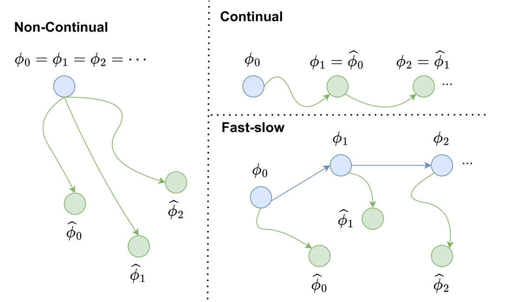
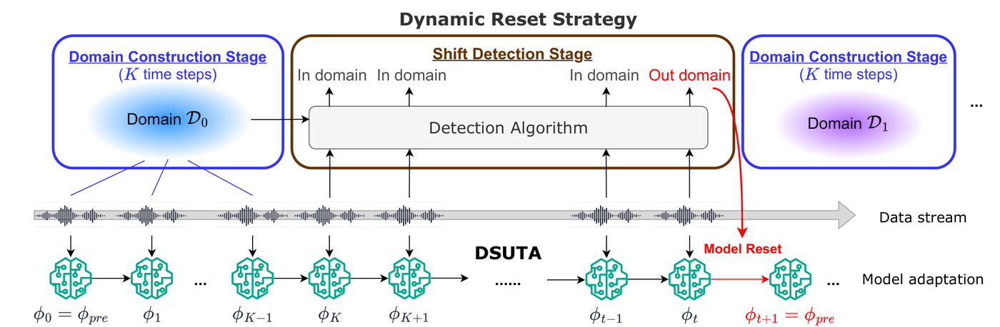
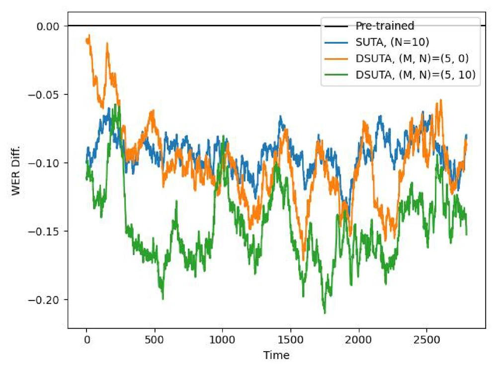
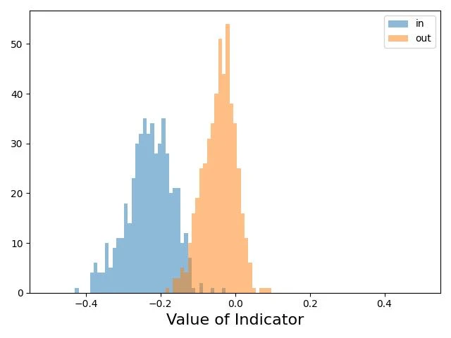

## Abstract

Test-time adaptation for ASR so far has been non-continual. SUTA, SGEM, and the wild-acoustic method all adapt the source model on one utterance and then throw the adapted weights away. Every utterance starts from scratch, so nothing learned from earlier audio in the same noisy environment is reused. Continual TTA keeps the adapted weights, but in a long stream it tends to drift and collapse, and the one continual ASR method at the time (AWMC) uses pseudo-labels and was only tested on a single domain.

The paper proposes a Fast-slow TTA framework that sits between the two: a set of meta-parameters is updated slowly across the stream, and each utterance gets a fast, throw-away adaptation that starts from those meta-parameters. The concrete method, Dynamic SUTA (DSUTA), uses SUTA's loss for both the fast and the slow updates. A dynamic reset strategy watches a loss-based shift statistic and resets the meta-parameters to the source model when the domain changes, without knowing the domain boundaries. On LibriSpeech with 10 kinds of added noise, multi-domain noise streams, and CHiME-3, DSUTA beats both non-continual (SUTA, SGEM) and continual (AWMC) baselines and is also faster than SUTA.

## Motivation

The paper frames TTA methods by where each utterance's adaptation starts and what is carried forward.

*Non-continual TTA adapts every sample from the same source weights; continual TTA carries the adapted weights forward; Fast-slow TTA carries slowly updated meta-parameters (blue) forward and adapts each sample from them (green). Figure from the paper.*

- **Non-continual** (left). Every adapted model $$\widehat{\phi}_t$$ starts from $$\phi_0$$. It can fit the current utterance hard, because the next utterance is unaffected, but whatever it learns is lost. This is SUTA, see [/blog/2026/11/25/suta-review/](/blog/2026/11/25/suta-review/).
- **Continual** (top right). The adapted weights become the starting point for the next sample. Knowledge accumulates, but fitting one utterance too hard harms every later one, and a long stream can drive the model to collapse. In the results below, the naive continual SUTA (CSUTA) has to use a single step per utterance and is still sometimes worse than no adaptation.
- **Fast-slow** (bottom right). The proposal keeps both: a slowly evolving starting point and an aggressive per-utterance adaptation that is not carried forward.

The second gap is that real streams change domain. A continual method that has drifted toward one noise type starts the next noise type from a bad place. Resetting to the source model at a fixed interval (as in RDumb from vision) helps, but the right interval is unknown. The paper wants the reset to happen when the domain actually changes, detected from the data.

## Method

*DSUTA with the dynamic reset strategy. DSUTA adapts along the data stream; a domain construction stage (K steps) builds a reference for the current domain, then a shift detection stage tests incoming samples and, when they look out of domain, resets the meta-parameters to the pre-trained ones. Figure from the paper.*

### Fast-slow TTA

Let $$x_t$$ be the utterance at time $$t$$, $$\phi_{pre}$$ the pre-trained ASR parameters, and $$\phi_t$$ the meta-parameters at time $$t$$. An adaptation algorithm $$A$$ and an update algorithm $$U$$ define the framework:

$$
\phi_0 = \phi_{pre},\qquad \widehat{\phi}_t = A(\phi_t, x_t),\qquad \widehat{y}_t = \widehat{\phi}_t(x_t),\qquad \phi_{t+1} = U(\phi_t, x_t).
$$

The prediction $$\widehat{y}_t$$ comes from the fast-adapted $$\widehat{\phi}_t$$, which is then discarded; only $$\phi_t$$ moves forward through $$U$$. If $$U$$ leaves $$\phi_t$$ unchanged, this is non-continual TTA. If $$U = A$$, so that $$\phi_{t+1} = \widehat{\phi}_t$$, it is plain continual TTA.

### Dynamic SUTA

Both algorithms use the SUTA loss on the CTC output of a wav2vec 2.0 model. With $$\mathbf{P}_{ij}$$ the temperature-smoothed probability of class $$j$$ at frame $$i$$ ($$L$$ frames, $$C$$ classes including the blank) and $$\mathbf{P}_{\cdot j} \in \mathbb{R}^{L}$$ the column for class $$j$$:

$$
\mathcal{L}_{suta} = \alpha\Big(-\frac{1}{L}\sum_{i=1}^{L}\sum_{j=1}^{C}\mathbf{P}_{ij}\log\mathbf{P}_{ij}\Big) + (1-\alpha)\sum_{j=1}^{C}\sum_{j' \neq j}^{C}\mathbf{P}_{\cdot j}^{\top}\mathbf{P}_{\cdot j'},
$$

an entropy term plus a minimum class confusion term, with $$\alpha = 0.3$$ and temperature 2.5 as in SUTA.

- **Fast adaptation $$A$$** is exactly SUTA, except that it starts from $$\phi_t$$: copy $$\phi_t$$, take $$N$$ gradient steps of $$\mathcal{L}_{suta}$$ on $$x_t$$, decode $$x_t$$.
- **Slow update $$U$$** uses a buffer $$\mathcal{B}$$ of size $$M$$. Each utterance is added to the buffer; every $$M$$ steps the meta-parameters take one gradient step on the buffer's average loss, and the buffer is emptied:

$$
\phi_{t+1} = \mathrm{Optimizer}\Big(\phi_t,\ \frac{1}{M}\sum_{x \in \mathcal{B}}\mathcal{L}_{suta}(\phi_t, x)\Big)\quad\text{if } M \text{ divides } t,\qquad \phi_{t+1} = \phi_t \text{ otherwise}.
$$

So the meta-parameters follow mini-batch gradient descent with batch size $$M$$ over the stream, one step per $$M$$ utterances, which is much gentler than carrying forward $$N$$ steps per utterance. DSUTA is SUTA with a moving starting point.

### Dynamic reset

After a reset (or at the start) at time $$r$$, the method alternates between two stages.

**Loss Improvement Index.** To measure how far a sample is from the current domain, the paper uses

$$
LII_t = \mathcal{L}_{suta}(\phi_{\mathcal{D}}, x_t) - \mathcal{L}_{suta}(\phi_{pre}, x_t),
$$

where $$\phi_{\mathcal{D}}$$ is a snapshot of the meta-parameters that has been adapted to the current domain. In-domain samples get a lower loss under $$\phi_{\mathcal{D}}$$, so $$LII_t$$ is more negative. Subtracting the pre-trained model's loss removes how hard the sample is in itself.

**Domain construction stage** ($$K$$ steps, no reset allowed). With $$k = \lfloor K/2 \rfloor$$, the snapshot is $$\phi_{\mathcal{D}} = \phi_{r+k}$$. The LIIs of the next $$K - k$$ samples are collected, and a Gaussian $$\mathcal{N}(\mu, \sigma^2)$$ is fitted to them. Half the stage is spent making $$\phi_{\mathcal{D}}$$ specific to the domain, and the other half gathering statistics.

**Shift detection stage.** Single-sample LII is too noisy, so the test is run every $$M$$ steps on the average LII of the $$M$$ samples in the buffer. A right-tailed z-test triggers the reset:

$$
\phi_{t+1} = \begin{cases} \phi_{pre}, & \text{if } \dfrac{\overline{LII}_{\mathcal{B}} - \mu}{\sigma/\sqrt{M}} > 2,\\[4pt] U_{DSUTA}(\phi_t, x_t), & \text{otherwise,} \end{cases}
$$

where $$\overline{LII}_{\mathcal{B}}$$ is the mean LII over the buffer. A threshold of 2 is slightly stricter than the usual 1.64 for a 5% one-sided test. In the implementation a patience parameter $$P$$ adds further stability. After a reset, a new domain construction stage begins.

### Default setting

Source model: wav2vec 2.0-base fine-tuned on LibriSpeech 960 h with CTC. For single-domain data, DSUTA uses $$M = 5$$, $$N = 10$$. For the multi-domain streams, $$(M, N) = (5, 5)$$ and the dynamic reset uses $$K = 100$$, $$P = 2$$. Utterances longer than 20 s are dropped from all experiments (about 1% of the data) to save GPU memory.

## Main Experiments

**Data.** LS-C is the LibriSpeech test set with one of 10 noises at 5 dB SNR: air conditioner (AC), airport announcement (AA), babble (BA), copy machine (CM), munching (MU), neighbors (NB), shutting door (SD), typing (TP), vacuum cleaner (VC) from MS-SNSD, and Gaussian noise (GS). Three multi-domain streams are built from it: MD-Easy (AC, CM, TP, AA, SD; 500 utterances each), MD-Hard (GS, MU, VC, BA, NB; 500 each), and MD-Long (random noise segments of 20 to 500 utterances, 10,000 in total). CHiME-3 is real noisy speech with its four environments mixed randomly in time.

**Baselines.** Non-continual: SUTA ($$N = 10$$) and SGEM. Continual: CSUTA (SUTA without reset; $$N = 1$$, since more steps collapse) and AWMC (pseudo-labeling with anchor, chaser, and leader models; re-implemented for wav2vec 2.0).

**WER (%) on single-domain LS-C and CHiME-3, from Table 1** (mean of 3 runs)

| Method | AA | AC | BA | CM | GS | MU | NB | SD | TP | VC | CHiME-3 |
|---|---|---|---|---|---|---|---|---|---|---|---|
| Source model | 40.6 | 27.7 | 66.9 | 49.7 | 75.6 | 51.4 | 120.1 | 19.4 | 25.8 | 49.7 | 30.0 |
| SUTA | 30.6 | 17.4 | 53.7 | 38.7 | 54.5 | 39.0 | 112.3 | 15.0 | 17.4 | 39.3 | 23.3 |
| SGEM | 30.9 | 17.8 | 54.5 | 39.2 | 56.3 | 39.2 | 113.0 | **14.9** | 17.5 | 40.3 | 23.5 |
| CSUTA | 39.8 | 22.6 | 63.4 | 53.4 | 58.4 | 54.7 | 68.1 | 23.2 | 23.0 | 50.9 | 27.6 |
| AWMC | 31.6 | 18.0 | 61.6 | 37.7 | 48.5 | 36.2 | 131.9 | 17.0 | 18.0 | 36.1 | 22.4 |
| **DSUTA** | **25.9** | **15.4** | **33.2** | **33.5** | **37.0** | **28.4** | **36.3** | 15.5 | **15.6** | **29.9** | **21.7** |

DSUTA is best on 9 of the 10 noises and on CHiME-3; on SD it is 0.6 behind SGEM. The gains are largest where the source model is worst: on NB, where insertions push the source WER above 100, SUTA only reaches 112.3 while DSUTA reaches 36.3, and on BA DSUTA cuts SUTA's 53.7 to 33.2. CSUTA shows why naive continual TTA is not enough: it is worse than the source model on CM, MU, SD, and VC. AWMC is close to DSUTA on some noises but collapses on NB (131.9).

*WER difference from the pre-trained model over the CM stream (window of 100). Orange is the meta-parameters alone with no per-utterance adaptation, blue is SUTA with 10 steps, green is DSUTA with 10 steps from the meta-parameters. Figure from the paper.*

This plot explains where the gain comes from. The meta-parameters by themselves (orange, $$N = 0$$) soon reach roughly SUTA's level without any per-utterance step, and running SUTA's 10 steps from them (green) ends up clearly below both. DSUTA gives the per-utterance adaptation a better starting point.

**WER (%) on multi-domain time-varying streams, from Table 2** (mean of 3 runs)

| Method | MD-Easy | MD-Hard | MD-Long |
|---|---|---|---|
| Source model | 32.7 | 74.6 | 61.0 |
| SUTA | 24.0 | 60.4 | 53.3 |
| SGEM | 25.0 | 61.0 | 53.4 |
| CSUTA | 37.3 | 83.6 | 100.3 |
| AWMC | 25.8 | 66.1 | 60.6 |
| DSUTA | 24.0 | 45.6 | 43.2 |
| **DSUTA w/ dynamic reset** | **22.7** | **39.8** | **35.8** |
| DSUTA w/ fixed reset (every 50) | 22.8 | 49.4 | 45.2 |
| DSUTA w/ oracle boundary | 21.7 | 36.9 | 39.5 |

With 5 adaptation steps instead of SUTA's 10, DSUTA already ties SUTA on MD-Easy and is far ahead on MD-Hard and MD-Long. Dynamic reset adds another 1.3 to 7.4 points. Fixed reset is worse than no reset on MD-Hard and MD-Long, so resetting too often throws away useful knowledge. On MD-Long, dynamic reset (35.8) even beats resetting at the true boundaries (39.5), which the authors read as evidence that knowledge from a previous noise type can still help, so a reset is not always wanted at every boundary. CSUTA exceeds 100% WER on MD-Long.

*Averaged LII over 5 samples, with $$\phi_{\mathcal{D}}$$ adapted on 100 GS utterances: GS samples (in) and samples from the other noises (out) form two mostly separate peaks. Figure from the paper.*

The detector works only if the indicator separates the two cases. With averaging over 5 samples it does; the paper also shows that single-sample LII, the loss without subtracting the pre-trained loss, and LII computed on the fast-adapted weights overlap much more.

**Cost on MD-Long, from Table 4** (RTX 3080 Ti; Avg is seconds per 1 s of audio)

| Method | #Forward | #Backward | Total runtime (s) | Avg (s) |
|---|---|---|---|---|
| SUTA | 100000 | 100000 | 5040 | 0.080 |
| SGEM | 100000 | 100000 | 11620 | 0.186 |
| AWMC | 300000 | 100000 | 11704 | 0.187 |
| DSUTA | 52000 | 52000 | 3885 | 0.062 |
| DSUTA w/ dynamic reset | 72000 | 52000 | 4149 | 0.066 |

Because DSUTA needs fewer per-utterance steps, it runs faster than SUTA, and the reset check costs only extra forward passes. In the appendix, DSUTA with dynamic reset also helps data2vec-base (59.6 source, 53.3 SUTA, 46.3) and HuBERT-large (43.3 source, 39.3 SUTA, 19.0) on MD-Long; for HuBERT-large, DSUTA without reset is even better (17.8).

## Limitations

- **Only background noise as the shift (stated by the authors).** Domains are noise types; accents, speakers, and speaking styles are not tested.
- **Only CTC models (stated by the authors).** All three source models are CTC encoders. Extending to encoder-decoder models, as SGEM did for non-continual TTA ([/blog/2026/11/25/sgem-review/](/blog/2026/11/25/sgem-review/)), is left open.
- **Forgetting (stated by the authors).** The meta-parameters follow the current domain and are reset on a shift, so earlier domains are not remembered.
- **Less useful on mild shift.** In the appendix noise-level study (AC, SD, TP at 0, 5, 10 dB, $$N = 5$$), DSUTA wins at 0 dB but SUTA is better at 10 dB on all three noises (for example AC: 10.6 for SUTA versus 11.5 for DSUTA), and also on SD at 5 dB. The continual part pays off mainly when the source model is far off.
- **Several knobs.** $$M$$, $$N$$, $$K$$, $$P$$, the z-threshold of 2, and the reset rule interact. The paper's sweep on MD-Long ($$M \in \{3, 5, 10\}$$, $$K \in \{50, 100, 200\}$$) shows moderate sensitivity (35.5 to 38.5 WER), but the sweep is on a test stream.
- **Detection is approximate.** Detected resets land near but not on the true boundaries (for example 540, 1530, 2010 against 500, 1000, 1500, 2000 on MD-Easy), some boundaries are missed, and on MD-Hard some runs also reset early (at step 155).
- **Synthetic streams.** Apart from CHiME-3, the streams are made by concatenating noise-corrupted LibriSpeech, with long blocks of a single noise type. Real streams may change more gradually or mix sources within one utterance.

## My Thoughts

<!-- TODO -->
