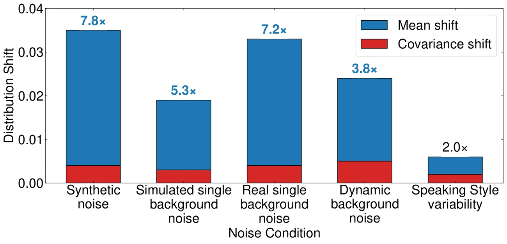
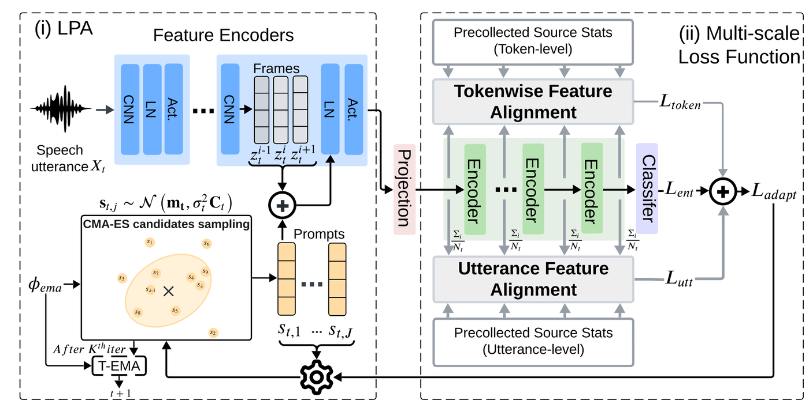
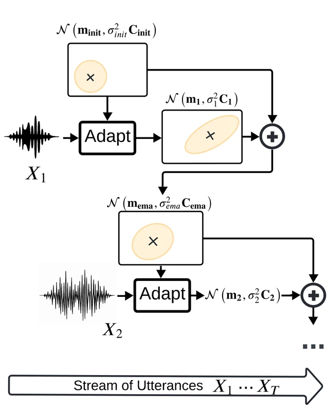
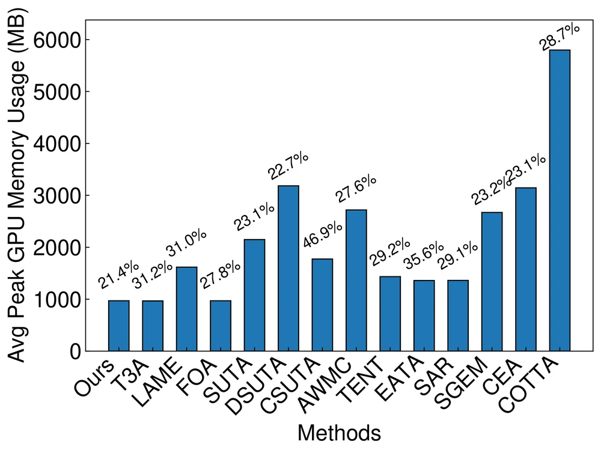
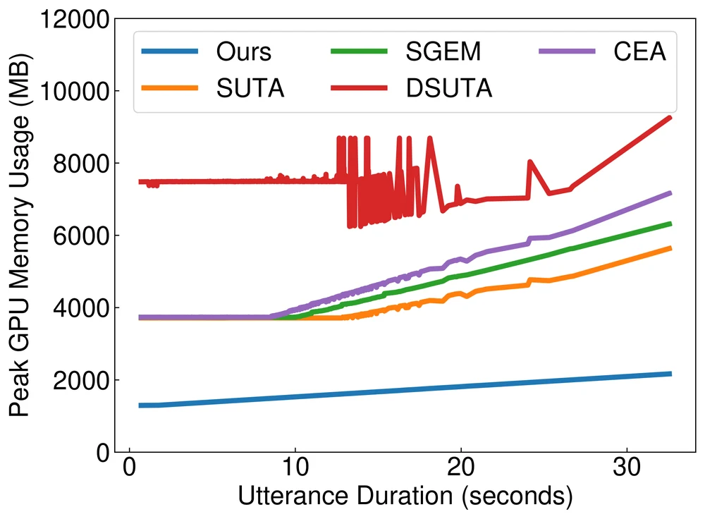

## Abstract

Speech models such as wav2vec 2.0 and HuBERT lose accuracy under acoustic shift: background noise, accents, other microphones. Test-time adaptation (TTA) for ASR, from [SUTA](/blog/2026/11/25/suta-review/) onward, fixes much of this by taking gradient steps on each test utterance. The cost is memory: backpropagation through a large model for every utterance needs several GB of GPU memory, and the need grows with utterance length. Backpropagation-free TTA methods exist, but they were built for image classifiers with batch normalization and large batches, and they do poorly on speech.

E-BATS is a backpropagation-free TTA method designed for speech models, adapting one utterance at a time. It adds one learnable vector (a "prompt") to every frame of the CNN feature encoder output and searches for it with CMA-ES, a derivative-free evolution strategy, using only forward passes. The search minimizes a multi-scale loss: entropy on non-blank frames, distance between the utterance's mean layer features and stored source means, and per-token feature alignment weighted by confidence. A test-time exponential moving average (T-EMA) carries the CMA-ES search distribution from one utterance to the next. On four noisy datasets and two backbones, E-BATS beats the other backpropagation-free methods, is competitive with gradient-based ASR TTA, and uses several times less GPU memory than gradient-based methods.

## Motivation

The paper gives three reasons why vision-style backpropagation-free TTA does not transfer to speech. First, speech models use layer normalization, so methods that re-estimate batch-norm statistics have nothing to work on. Second, the input is a sequence: an ASR model maps every frame to a token distribution, and noise changes over time within one utterance, unlike a fixed perturbation of an image. Third, speech TTA is usually run with batch size 1 because utterances vary so much, while vision methods rely on large batches for stable statistics.

To decide what to adapt, the authors measure how the latent features move under shift. They compare source and target embeddings at the feature-encoder output by two terms: the shift of the mean (centroid) and the change of the covariance. These are the two parts of the Fréchet distance.

*Distribution shift between source and target latent features, split into the mean part (blue) and the covariance part (red), for five conditions. The number on top is the mean-to-covariance ratio. Figure from the paper.*

In every noise condition the mean shift dominates, by 3.8× to 7.8×. Only speaking-style variability is more balanced (2.0×). The authors conclude that much of the acoustic shift looks like a translation of the feature cloud, so adding one well-chosen vector to the features could move target features back toward the source. The vector cannot be computed in closed form, because the noise differs from utterance to utterance, so it has to be searched for at test time.

## Method

*E-BATS for one utterance. (i) Lightweight prompt adaptation: CMA-ES samples $$J$$ candidate prompts, each is added to the CNN frame features $$z_t^i$$, and the model runs forward. (ii) Each candidate is scored by the multi-scale loss (token-level alignment, entropy, utterance-level alignment), and the scores update the CMA-ES distribution. After the last iteration, T-EMA smooths the distribution for the next utterance. Figure from the paper.*

### Setup

The source model $$\Theta = g \circ h$$ is a CTC model fine-tuned on LibriSpeech. $$h$$ is the CNN feature encoder, which maps each input frame $$\mathbf{x}_t^i$$ of utterance $$\mathbf{X}_t$$ to $$\mathbf{z}_t^i \in \mathbb{R}^d$$ ($$d = 512$$). $$g$$ is the projection, the stack of $$L$$ transformer layers, and the CTC head, which outputs a distribution over $$\mathcal{V}$$: 26 letters plus 6 special tokens, including the blank $$\varnothing$$. Test utterances $$\mathbf{X}_1, \ldots, \mathbf{X}_T$$ arrive one at a time, with batch size 1. The paper assumes covariate shift: the input distribution changes, but the label distribution and $$P(y \mid \mathbf{X})$$ do not.

### Lightweight prompt adaptation (LPA)

Let $$\mathbf{Z}_t = [\mathbf{z}_t^1, \ldots, \mathbf{z}_t^{N_t}] \in \mathbb{R}^{d \times N_t}$$ be the CNN features of the $$N_t$$ frames. The prompt $$\mathbf{s}_t \in \mathbb{R}^d$$ is added to every frame:

$$
\hat{\mathbf{Z}}_t = \mathbf{Z}_t + \mathbf{s}_t \mathbf{1}_{N_t}^\top .
$$

All model weights stay frozen. This differs from usual prompt tuning (as in [TPT](/blog/2026/10/22/tpt-review/) for CLIP, or FOA, a backpropagation-free vision method), where extra tokens are concatenated at the transformer input. Here the prompt is a translation of the acoustic features, which follows from the mean-shift observation above.

### Search with CMA-ES

There are no gradients, so the prompt is found with the Covariance Matrix Adaptation Evolution Strategy. At iteration $$k$$ for utterance $$t$$, CMA-ES keeps a Gaussian over prompts with mean $$\mathbf{m}_t^{(k)} \in \mathbb{R}^d$$, covariance $$\mathbf{C}_t^{(k)} \in \mathbb{R}^{d \times d}$$, and step size $$\sigma_t^{(k)} > 0$$, and samples $$J$$ candidates:

$$
\mathbf{s}_{t,j} \sim \mathcal{N}\big(\mathbf{m}_t^{(k)}, (\sigma_t^{(k)})^2 \mathbf{C}_t^{(k)}\big), \qquad j = 1, \ldots, J .
$$

Each candidate needs one forward pass and gets a loss $$L_{adapt}$$. CMA-ES uses the ranking of the candidates to update $$\mathbf{m}, \mathbf{C}, \sigma$$, and the loop repeats. Iteration stops after $$K$$ iterations, or earlier when the best loss improves by less than 0.001 for three iterations in a row. The prompt used for decoding is the best candidate seen:

$$
\mathbf{s}_t = \arg\min_{\mathbf{s}_{t,j}} L_{adapt}(\mathbf{X}_t, \mathbf{s}_{t,j}).
$$

The default population is $$J = 50$$.

### Multi-scale loss

The loss combines three terms:

$$
L_{adapt} = \alpha L_{ent} + \beta L_{utt} + c\, L_{token},
$$

with $$\alpha = 1$$ and $$\beta = 2$$, and $$c$$ set per utterance (below).

**Entropy on non-blank frames.** Most CTC frames predict the blank token, which would dominate a plain entropy average. Let $$\tilde{\mathbf{X}}_t$$ be the frames whose top prediction is not blank and $$\mathcal{H}$$ the Shannon entropy of the frame's token distribution:

$$
L_{ent} = \frac{1}{\lvert \tilde{\mathbf{X}}_t \rvert} \sum_{\mathbf{x}_t^i \in \tilde{\mathbf{X}}_t} \mathcal{H}\big(\Theta(\mathbf{x}_t^i)\big).
$$

Used alone, this has degenerate minima: predict blank everywhere, or collapse to a single character.

**Utterance-level alignment.** For each transformer layer $$l$$, the source model's frame-averaged features are averaged over clean LibriSpeech data once, before deployment, giving a stored centroid $$\boldsymbol{\mu}_{src}^l$$. For the current utterance, $$\boldsymbol{\mu}_{tgt}^l$$ is the mean of its layer-$$l$$ features over frames. The loss pulls the two together:

$$
L_{utt} = \frac{1}{L} \sum_{l} \big\lVert \boldsymbol{\mu}_{tgt}^l - \boldsymbol{\mu}_{src}^l \big\rVert_2^2 .
$$

This keeps the search near the source feature distribution and blocks the trivial entropy solutions. Storage is only $$L \times d$$ numbers.

**Token-level alignment.** One utterance contains only some tokens, and its mean is dominated by the frequent ones, so the utterance centroid alone is a biased target. E-BATS also stores, for every token class $$v$$ and layer $$l$$, the source mean $$\boldsymbol{\mu}_{src}^{v,l}$$ and standard deviation $$\boldsymbol{\sigma}_{src}^{v,l}$$ of the features. On the test utterance, frames are grouped by their pseudo-label (the predicted token), and the same statistics are matched:

$$
L_{token} = \frac{1}{L}\frac{1}{\lvert \mathcal{V} \rvert} \sum_{l} \sum_{v \in \mathcal{V}} \Big( \big\lVert \boldsymbol{\mu}_{tgt}^{v,l} - \boldsymbol{\mu}_{src}^{v,l} \big\rVert_2^2 + \big\lVert \boldsymbol{\sigma}_{tgt}^{v,l} - \boldsymbol{\sigma}_{src}^{v,l} \big\rVert_2^2 \Big).
$$

**Confidence weight.** Pseudo-labels are unreliable when the shift is large, so the token term is weighted down when the other two losses are high. With $$H = L_{ent} + L_{utt}$$,

$$
c = c_{max} - \frac{H - H_{min}}{H_{max} - H_{min} + \epsilon},
$$

using $$H_{min} = 0$$, $$H_{max} = 5$$, $$c_{max} = 2$$, and a small $$\epsilon$$.

### T-EMA across utterances

Restarting CMA-ES from scratch for every utterance throws away what was learned, while carrying the last distribution over directly can overfit to one utterance. T-EMA keeps a running average of the CMA-ES state. After the $$K$$ iterations on utterance $$t$$,

$$
\mathbf{m}_{ema} \leftarrow \gamma\, \mathbf{m}_{ema} + (1 - \gamma)\, \mathbf{m}_t^{(K)},
$$

and the covariance and step size are updated the same way. The next utterance starts its search from $$(\mathbf{m}_{ema}, \mathbf{C}_{ema}, \sigma_{ema})$$. The decay is $$\gamma = 0.9$$ for wav2vec 2.0 and $$\gamma = 0.8$$ for HuBERT.

*T-EMA. The search distribution after adapting to $$X_1$$ is mixed with the running average, and that average is the starting distribution for $$X_2$$. Figure from the paper.*

Only the prompt and the CMA-ES state change over the stream; the model weights never change, so there is no weight drift to undo.

## Main Experiments

The test data has four datasets and sixteen conditions. LibriSpeech test-other gets additive Gaussian noise with standard deviation $$\sigma \in \{0, 0.005, 0.01, 0.015, 0.02\}$$. CHiME-3 (Single) has its four real environments (bus, café, pedestrian, street) evaluated one at a time, and CHiME-3 (Mixed) concatenates them into one stream that switches environments. TED (TED-LIUM v2) has varied speakers and speaking styles, and CommonVoice has varied accents, devices, and rooms. All methods use batch size 1. The baselines are four general TTA methods (Tent, EATA, SAR, CoTTA), six speech TTA methods (SUTA, CEA, SGEM, AWMC, DSUTA, CSUTA), and three backpropagation-free methods (T3A, LAME, FOA). The metric is WER (%).

**WER (%) with wav2vec 2.0-base (Wav2Vec2ForCTC-Base), from Table 1**

| Method | BP-free | σ=0 | 0.005 | 0.01 | 0.015 | 0.02 | Gauss. avg | CHiME-3 single | CHiME-3 mixed | TED | CommonVoice |
|---|---|---|---|---|---|---|---|---|---|---|---|
| Source | — | 8.6 | 13.9 | 24.4 | 39.5 | 54.5 | 28.2 | 34.2 | 34.2 | 13.2 | 36.8 |
| TENT | no | 8.5 | 14.0 | 24.1 | 39.2 | 54.3 | 28.0 | 34.1 | 34.1 | 13.1 | 36.8 |
| EATA | no | 14.1 | 18.1 | 27.0 | 37.9 | 51.3 | 29.7 | 33.1 | 39.9 | 14.1 | 61.3 |
| SAR | no | 8.4 | 13.6 | 22.9 | 36.0 | 49.9 | 26.2 | 33.6 | 34.7 | 13.0 | 38.2 |
| CoTTA | no | 9.2 | 12.6 | 18.1 | 39.3 | 54.5 | 26.7 | 32.9 | 34.3 | 12.8 | 36.9 |
| CEA | no | 7.5 | 11.1 | 16.4 | 23.8 | 33.6 | 18.5 | 26.8 | 26.8 | 12.0 | 31.5 |
| SGEM | no | 7.3 | 10.9 | 16.4 | 23.8 | 33.9 | 18.5 | 27.2 | 27.1 | 11.9 | 31.2 |
| AWMC | no | 9.5 | 11.7 | 16.6 | 23.9 | 31.8 | 18.7 | 34.0 | 33.9 | 13.6 | 37.9 |
| SUTA | no | 7.3 | 10.9 | 16.5 | 24.1 | 34.1 | 18.6 | 26.8 | 26.8 | 11.9 | 31.5 |
| CSUTA | no | 13.1 | 17.5 | 24.5 | 31.4 | 37.0 | 24.7 | 26.5 | 32.6 | 15.6 | 135.0 |
| DSUTA | no | 9.0 | 11.7 | 16.1 | 21.1 | **24.1** | 16.4 | **24.0** | **24.1** | 12.7 | 36.1 |
| T3A | yes | 10.0 | 15.9 | 26.8 | 42.7 | 58.6 | 30.8 | 35.9 | 35.8 | 14.6 | 38.8 |
| LAME | yes | 9.1 | 15.0 | 26.0 | 42.4 | 58.2 | 30.1 | 36.0 | 36.0 | 14.0 | 38.8 |
| FOA | yes | 8.7 | 13.9 | 22.7 | 33.3 | 45.3 | 24.8 | 31.7 | 31.1 | 13.3 | 38.2 |
| **E-BATS** | yes | 7.7 | **10.5** | **14.8** | **19.9** | 25.3 | **15.6** | **24.0** | 24.3 | 12.5 | **30.6** |

Bold marks the best value over all methods (SGEM and SUTA share the best σ=0 score, 7.3, and the best TED score, 11.9).

Among backpropagation-free methods, E-BATS is best on every column. T3A and LAME, which only adjust the classifier output, are worse than doing nothing. FOA, which also uses CMA-ES but concatenates prompts at the transformer input, closes only part of the gap. Against gradient-based methods, E-BATS has the best Gaussian average and the best CommonVoice score, ties DSUTA on CHiME-3 single, and is close on CHiME-3 mixed. It loses at σ=0, at the strongest noise (25.3 vs 24.1 for DSUTA), and on TED (12.5 vs 11.9 for SUTA and SGEM). DSUTA, the strongest continual baseline, falls to 36.1 on CommonVoice, the most varied set, where E-BATS gets 30.6.

**WER (%) with HuBERT-large (HuBERTForCTC-Large), key rows from Table 2**

| Method | Gauss. avg | CHiME-3 single | CHiME-3 mixed | TED | CommonVoice |
|---|---|---|---|---|---|
| Source | 7.5 | 16.5 | 16.5 | 9.1 | 21.4 |
| CEA | **5.8** | 14.2 | 14.1 | **8.1** | **18.3** |
| SGEM | 6.1 | 14.2 | 14.2 | 8.3 | 18.4 |
| SUTA | **5.8** | 14.2 | 14.2 | 8.2 | 18.4 |
| DSUTA | 6.3 | **13.3** | **13.5** | 8.7 | 27.4 |
| LAME | 8.1 | 17.5 | 17.5 | 9.7 | 22.6 |
| FOA | 7.7 | 16.4 | 16.7 | 9.3 | 22.8 |
| **E-BATS** | 6.4 | 14.0 | 14.0 | 9.3 | 20.1 |

With the larger backbone, E-BATS is still the best backpropagation-free method (tied with FOA on TED), but the gradient-based speech methods are now ahead on most columns. SUTA and CEA are better on Gaussian noise, TED, and CommonVoice, and DSUTA is better on both CHiME-3 settings. E-BATS does beat SUTA, CEA, and SGEM on CHiME-3 (14.0 vs 14.1 to 14.2).

*Average peak GPU memory (bars) with wav2vec 2.0-base, with the average WER over all datasets written above each bar. Figure from the paper.*

E-BATS needs about the same memory as the other forward-only methods (T3A, FOA), at the lowest average WER (21.4%). With wav2vec 2.0-base it uses 1.5× to 5.9× less peak memory than the gradient-based methods, including 3.3× less than DSUTA, 3.2× less than CEA, and 2.8× less than SGEM. With HuBERT-large the saving is 2.4× to 6.8×.

*Peak GPU memory against utterance length on TED with HuBERT-large, for E-BATS and four gradient-based speech TTA methods. Figure from the paper.*

Gradient-based methods grow quickly with length and reach 6 to 12 GB for 30-second clips. E-BATS grows almost linearly, from about 1.1 GB at 1 second to just over 1.9 GB at 35 seconds according to the text.

**Ablations with wav2vec 2.0-base, WER (%), from Table 3**

| Study | Setting | Variant | WER |
|---|---|---|---|
| Prompt location | CHiME-3 single | added to CNN features (E-BATS) | **24.0** |
| | | concatenated at transformer input | 34.2 |
| Loss, with T-EMA | CHiME-3 single | $$L_{ent} + L_{utt} + L_{token}$$ | **24.0** |
| | | $$L_{ent} + L_{utt}$$ | 24.3 |
| | | $$L_{ent}$$ | 24.5 |
| Loss, without T-EMA | CHiME-3 mixed | $$L_{ent} + L_{utt} + L_{token}$$ | **25.4** |
| | | $$L_{ent} + L_{utt}$$ | 25.5 |
| | | $$L_{ent}$$ | 49.6 |
| Across utterances | CHiME-3 mixed | T-EMA | **24.3** |
| | | reset every utterance | 26.5 |
| | | carry over, no reset, no EMA | 25.4 |

Placing the prompt at the CNN output matters most: concatenating it at the transformer input, as vision prompt tuning does, leaves WER at the source level (34.2). Without T-EMA on the mixed stream, entropy alone collapses (49.6). In the appendix, 37.50% of its outputs are trivial (35.91% a single repeated character, 1.59% all blank), and adding $$L_{utt}$$ cuts this to 0.61%. The token term adds little on top (0.1 to 0.3 points). For carrying state across utterances, resetting is worst and plain carry-over is in between, so the running average does help.

## Limitations

- **Latency (stated by the authors).** Each utterance needs up to $$K$$ CMA-ES iterations of $$J = 50$$ forward passes, and the implementation does not run the candidates fully in parallel on the GPU. The paper says this latency is acceptable without strict real-time needs, but it reports only big-O complexity, not measured runtime, so the cost against SUTA-style gradient steps is unknown.
- **Needs source statistics.** The utterance centroids and per-token means and standard deviations come from clean LibriSpeech. They are small and do not expose individual samples, but the method is not source-free in the strict sense that SUTA is.
- **Shift-only adaptation.** The prompt is a single translation shared by all frames. The motivation shows that covariance shift is small but not zero, and for speaking-style variability it is half the mean shift. Time-varying noise inside one utterance also gets only one shift.
- **Gains shrink with a stronger backbone.** With HuBERT-large, on every column at least one gradient-based method (SUTA, CEA, or DSUTA) beats E-BATS. The case for E-BATS there rests on memory, not accuracy.
- **Many hand-set constants.** $$\alpha$$, $$\beta$$, $$c_{max}$$, $$H_{min}$$, $$H_{max}$$, $$\gamma$$ (tuned per backbone), $$J$$, and the stopping rule are all fixed by hand. $$c_{max}$$ and $$\gamma$$ were picked from grids, and the paper does not say which split was used to pick them.
- **Character CTC only.** The token-level loss stores statistics for the 32 output classes of a character-level CTC head. A model with a large subword vocabulary, or an encoder-decoder model such as Whisper, would need a different design. An appendix test on speech emotion recognition (IEMOCAP, 38.8% to 43.4% accuracy) is the only non-ASR result.
- **Order-dependent.** T-EMA makes each result depend on the utterances seen before it, and the paper does not report the variance over stream orders or seeds.

## My Thoughts

<!-- TODO -->
