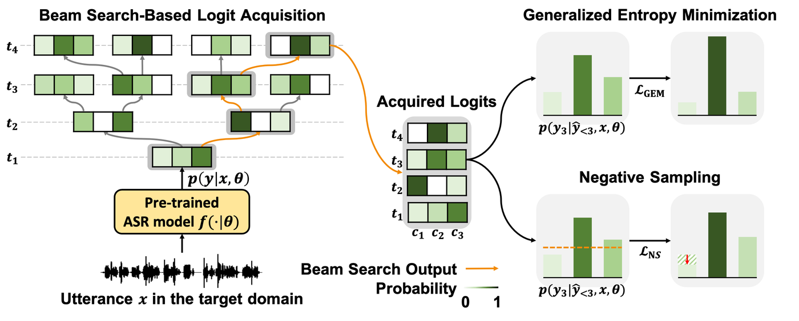
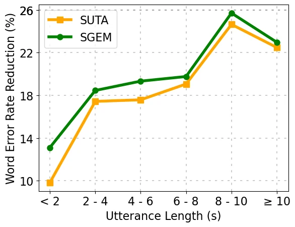

## Abstract

ASR models lose accuracy when the test audio differs from the training data: new speakers, new vocabulary, background noise, or accents. Test-time adaptation (TTA) updates a pre-trained model on the unlabeled test input itself, without the source data. The first TTA method for ASR, SUTA ([review](/blog/2026/11/25/suta-review/)), adapts a model on a single utterance with entropy minimization and minimum class confusion, but it was built for CTC models and computes its losses on the frame-level outputs of greedy decoding.

SGEM (Sequential-level Generalized Entropy Minimization) is a single-utterance TTA method meant for general ASR models, including ones that decode autoregressively or with beam search and an external language model. It first runs beam search to find the most plausible transcript and takes the model's output distributions along that transcript. It then adapts the model with two unsupervised losses on those distributions: a generalized (Rényi) entropy loss and a negative sampling loss that pushes down low-probability classes. On three model types (a wav2vec 2.0 CTC model, Conformer-CTC, and Conformer-Transducer) and 12 test sets, SGEM has a lower average WER than SUTA for every model.

## Motivation

The paper has no motivating figure; the argument is about how SUTA computes its loss. SUTA takes the output of greedy decoding at each frame and minimises its entropy, as if every frame's argmax were a reliable target. Two things make this a poor fit for ASR models other than CTC:

- **Greedy decoding is not how these models are used.** Autoregressive and transducer models condition each token on the previous ones, and in practice most ASR systems decode with beam search, often with an external language model. The greedy path can differ from the transcript the system would actually output, so the model may be adapted toward wrong labels.
- **Frame-level losses ignore the sequence.** Treating each timestep independently looks at the joint probability of the transcript only one step at a time. For a model whose token distribution depends on the earlier tokens, the distributions along the greedy path are not the ones along the decoded transcript.

The authors also argue that Shannon entropy is not necessarily the best unsupervised objective for a single short utterance, where only a few output tokens are available, and look for a better one in the Rényi entropy family. The goal is to keep SUTA's setting (one utterance at a time, no source data, model reset after each utterance) while making the adaptation signal match the way the model actually decodes.

## Method

*SGEM. Beam search over the pre-trained model's outputs gives the most plausible transcript (orange path), and the output distributions along it are collected. Generalized entropy minimization sharpens each distribution, and negative sampling pushes down the classes below a probability threshold. Figure from the paper.*

### Setting

$$f(\cdot \mid \theta)$$ is an ASR model with parameters $$\theta$$, trained on a labeled source domain. For a waveform $$x$$ it returns logits $$f(x \mid \theta) \in \mathbb{R}^{L \times C}$$, where $$L$$ is the number of output timesteps and $$C$$ the vocabulary size. A transcript $$\mathbf{y} = (y_1, \dots, y_L)$$ is scored as

$$
\log p(\mathbf{y} \mid x, \theta) = \sum_{i=1}^{L} \log p_{\text{AM}}(y_i \mid y_{<i}, x, \theta) + \lambda_{\text{LM}} \log p_{\text{LM}}(y_i \mid y_{<i}) + Z,
$$

where $$p_{\text{AM}}$$ is the acoustic model's probability, $$p_{\text{LM}}$$ an external autoregressive language model with weight $$\lambda_{\text{LM}}$$, and $$Z$$ a normalising constant. Decoding approximates $$\mathbf{y}^{*} = \arg\max_{\mathbf{y}} \log p(\mathbf{y} \mid x, \theta)$$. In single-utterance TTA the model is fine-tuned on each test utterance $$x$$ alone with unsupervised losses, then used to transcribe it, and reset to the pre-trained weights before the next utterance.

### Beam search-based logit acquisition

With beam width $$B$$, SGEM runs beam search (with the language model when one is used) to get the most plausible transcript $$\hat{\mathbf{y}} = (\hat{y}_1, \dots, \hat{y}_L)$$. To save memory it does not keep the logits of all beam candidates. Instead, $$\hat{\mathbf{y}}$$ is fed back to the model, and the log-probabilities at each step conditioned on that prefix are collected:

$$
o_{ij} = \log p(y_i = j \mid \hat{y}_{<i}, x, \theta), \qquad \mathbf{o}_i = (o_{i1}, \dots, o_{iC}).
$$

The adaptation losses below are computed on these $$\mathbf{o}_i$$, so the model is adapted toward the transcript it would actually output rather than the greedy one.

### Generalized entropy minimization

The Rényi entropy of order $$\alpha$$ of a distribution over $$C$$ classes is $$\mathrm{H}_{\alpha} = \frac{1}{1-\alpha} \log \sum_{j=1}^{C} p_j^{\alpha}$$. As $$\alpha \to 1$$ it becomes Shannon entropy, and as $$\alpha \to \infty$$ it becomes the cross-entropy with the argmax pseudo-label. SGEM assumes a good value lies in between ($$\alpha > 1$$) and uses

$$
\mathcal{L}_{\text{GEM}} = \frac{1}{L} \sum_{i=1}^{L} \frac{1}{1-\alpha} \log \Big( \sum_{j=1}^{C} p_{ij}^{\alpha} \Big), \qquad p_{ij} = \frac{\exp(o_{ij}/T)}{\sum_{j'=1}^{C} \exp(o_{ij'}/T)},
$$

where $$T$$ is a temperature that softens the distribution so the gradient does not vanish on already-confident steps. As in SUTA, timesteps where the blank token has the highest probability are left out, because blank frames dominate CTC outputs.

### Negative sampling

For a labeled step, the cross-entropy term can be written as $$\log p_{i,y_i} = \log(1 - \sum_{j \neq y_i} p_{ij})$$: it pushes down the total probability of all wrong classes. Without labels, SGEM replaces the wrong classes with the classes that are clearly unlikely, those whose untempered probability $$p'_{ij} = \mathrm{softmax}(\mathbf{o}_i)_j$$ is below a threshold $$\tau$$:

$$
\mathcal{L}_{\text{NS}} = -\frac{1}{L} \sum_{i=1}^{L} \log \Big( 1 - \sum_{j=1}^{C} \mathbf{1}[p'_{ij} < \tau]\, p_{ij} \Big).
$$

This idea comes from negative learning in semi-supervised learning. It does not need to know the right class, only which classes are almost certainly wrong.

### Overall objective

$$
\mathcal{L} = \mathcal{L}_{\text{GEM}} + \lambda_{\text{NS}} \mathcal{L}_{\text{NS}},
$$

with weight $$\lambda_{\text{NS}}$$. Each utterance gets $$N = 10$$ AdamW steps with a cosine learning-rate schedule, and the model is reset afterwards (episodic adaptation). Only the CNN feature extractor is updated for the wav2vec 2.0 model, and only the encoder for the Conformer models. Shared settings are $$T = 2.5$$ and $$\tau = 0.4/C$$. The per-model choices are $$(B, \lambda_{\text{LM}}, \alpha, \lambda_{\text{NS}}) = (5, 0.3, 1.5, 1)$$ for the CTC model, $$(5, 0.3, 1.25, 2)$$ for Conformer, and $$(3, 0, 1.25, 0.5)$$ for the Transducer, which uses no language model. All hyperparameters are tuned on CHiME-3.

## Main Experiments

The models are wav2vec 2.0 Base fine-tuned on LibriSpeech (CTC), Conformer-CTC (small) trained on LibriSpeech, and Conformer-Transducer (small) trained on NeMo ASRSET. The test sets are CHiME-3 (CH), TED-LIUM 2 (TD), Common Voice (CV), and Valentini (VA), plus LibriSpeech test-other mixed at 10 dB SNR with eight MS-SNSD noises: air conditioner (AC), airport announcement (AA), babble (BA), copy machine (CM), munching (MU), neighbors (NB), shutting door (SD), and typing (TP). The metric is WER (%).

**WER (%) with greedy decoding for inference, from Table 1**

| Model | Method | CH | TD | CV | VA | AC | AA | BA | CM | MU | NB | SD | TP | Avg. |
|---|---|---|---|---|---|---|---|---|---|---|---|---|---|---|
| CTC | Unadapted | 31.2 | 13.2 | 36.9 | 14.5 | 28.1 | 40.9 | 66.6 | 49.8 | 50.4 | 119.2 | 19.2 | 26.2 | 41.4 |
| CTC | SUTA | 25.0 | 12.0 | 31.4 | 11.8 | 17.7 | 31.3 | 55.2 | 39.4 | 39.7 | 113.0 | 15.0 | 17.8 | 34.1 |
| CTC | **SGEM** | 24.7 | 12.0 | 31.1 | 11.6 | 17.3 | 30.7 | 53.1 | 38.5 | 38.6 | 110.5 | 14.8 | 17.5 | **33.4** |
| Conformer | Unadapted | 28.7 | 15.1 | 36.8 | 17.4 | 18.8 | 44.8 | 74.3 | 45.7 | 56.0 | 122.1 | 20.8 | 36.9 | 43.1 |
| Conformer | SUTA | 25.2 | 13.4 | 32.4 | 14.7 | 14.5 | 39.8 | 73.3 | 38.4 | 48.7 | 125.5 | 16.4 | 28.8 | 39.3 |
| Conformer | **SGEM** | 24.5 | 13.3 | 31.6 | 14.6 | 14.4 | 38.5 | 70.4 | 38.7 | 48.5 | 120.9 | 16.8 | 28.9 | **38.4** |
| Transducer | Unadapted | 11.8 | 7.2 | 12.9 | 6.5 | 14.1 | 20.4 | 31.0 | 29.7 | 31.3 | 74.6 | 12.7 | 16.2 | 22.4 |
| Transducer | SUTA | 10.3 | 6.8 | 12.1 | 5.5 | 12.0 | 18.5 | 28.3 | 26.7 | 28.7 | 74.6 | 11.7 | 14.7 | 20.8 |
| Transducer | **SGEM** | 9.9 | 6.6 | 12.0 | 5.2 | 11.6 | 18.0 | 27.5 | 26.0 | 28.0 | 76.5 | 11.5 | 14.3 | **20.6** |

Greedy decoding is used for the final transcript here, following SUTA's protocol; beam search is still used inside SGEM to pick the adaptation targets.

**WER (%) of the CTC model with beam search and the 4-gram language model for inference, from Table 2**

| Method | CH | TD | CV | VA | AC | AA | BA | CM | MU | NB | SD | TP | Avg. |
|---|---|---|---|---|---|---|---|---|---|---|---|---|---|
| Unadapted | 29.5 | 12.2 | 36.9 | 13.0 | 26.1 | 38.6 | 58.9 | 48.9 | 49.0 | 91.6 | 17.4 | 23.7 | 37.2 |
| SUTA | 24.1 | 11.6 | 31.5 | 11.4 | 16.8 | 30.3 | 53.2 | 38.1 | 38.6 | 107.9 | 14.1 | 16.9 | 32.9 |
| **SGEM** | 24.1 | 11.7 | 31.1 | 11.1 | 16.5 | 29.8 | 51.6 | 37.7 | 37.7 | 106.7 | 14.0 | 16.9 | **32.4** |

SGEM has the best average for every model and both decoding methods: 34.1 to 33.4 (CTC, greedy), 32.9 to 32.4 (CTC, beam search), 39.3 to 38.4 (Conformer), and 20.8 to 20.6 (Transducer). Averaged over all settings, the paper reports a 15.6% relative WER reduction over the unadapted models. The margins over SUTA are small, mostly a few tenths of a point per dataset, and SUTA is still ahead in a few Conformer columns (CM, SD, TP). The neighbors (NB) noise breaks both methods: WER is above 100% for the CTC and Conformer models, SGEM is worse than the unadapted Transducer (76.5 vs 74.6), and with beam search both methods are far worse than no adaptation (106.7 and 107.9 vs 91.6).

**WER (%) of the CTC model on L2-Arctic, one speaker per first language, from Table 3**

| First language | Unadapted | SUTA | SGEM |
|---|---|---|---|
| Arabic | 32.5 | 27.1 | **26.5** |
| Mandarin | 28.5 | 23.3 | **23.1** |
| Hindi | 15.7 | 12.5 | **12.3** |
| Korean | 23.3 | 19.7 | **19.5** |
| Spanish | 35.7 | 29.8 | **29.3** |
| Vietnamese | 18.5 | 15.7 | **15.4** |
| **Average** | 25.7 | 21.4 | **21.0** |

On accented speech the pattern is the same: SGEM is best on all six first languages, by 0.2 to 0.6 points over SUTA.

*Relative WER reduction over the unadapted CTC model on CHiME-3, split by utterance length. SGEM is above SUTA in every bin, and the gap is largest for utterances shorter than 2 seconds. Figure from the paper.*

Short utterances give few output tokens to adapt on, which is the single-utterance version of TTA's small-batch problem. Below 2 seconds, SUTA reduces WER by about 10% relative and SGEM by about 13%. For long utterances the two methods are close.

**Ablation on CHiME-3, WER (%), from Table 4**

| Beam search | GEM | NS | CTC | Conformer | Transducer |
|---|---|---|---|---|---|
| | | | 31.2 | 28.7 | 11.8 |
| | ✓ | | 24.9 | 24.7 | 10.0 |
| | | ✓ | 25.2 | 25.0 | 10.1 |
| | ✓ | ✓ | 24.8 | 24.7 | 10.0 |
| ✓ | | ✓ | 24.8 | 24.7 | 10.1 |
| ✓ | ✓ | ✓ | **24.7** | **24.5** | **9.9** |

The first row is the unadapted model. Either loss alone gives almost all of the gain. Adding the other loss and switching from greedy to beam search targets each adds 0.1 to 0.2 points.

SGEM is later used as a baseline in the wild acoustic TTA paper ([review](/blog/2026/11/25/wild-acoustic-tta-review/)), which also builds on SUTA. There, on sung speech with the same 4-gram language model, SGEM ends up close to SUTA with greedy decoding (54.3 vs 54.4 average WER with wav2vec 2.0 Base).

## Limitations

- **Small gains over SUTA.** The average improvement over SUTA is 0.2 to 0.9 points WER depending on the model, and the ablation steps are 0.1 to 0.2 points. The paper reports single runs without variance, so it is hard to tell how many of the per-dataset wins are reliable.
- **Hyperparameters tuned on a test set.** All settings are chosen on CHiME-3 and then CHiME-3 results are reported in the main table and the ablation. Each model also gets its own learning rate, $$\alpha$$, $$\lambda_{\text{NS}}$$, beam width, and LM weight.
- **Failure on some shifts.** On the neighbors noise, adaptation can make WER worse than no adaptation, especially with beam search decoding (106.7 vs 91.6 for the unadapted model), and the paper offers no way to detect or avoid this.
- **The "sequential" part is weak for CTC.** A CTC model's frame outputs do not depend on earlier tokens, so feeding the beam search transcript back does not change $$\mathbf{o}_i$$ the way it does for an autoregressive model. The paper does not explain where the CTC gain from beam search comes from, and it is only 0.1 points in the ablation.
- **No autoregressive encoder-decoder model.** The motivation is about autoregressive ASR models, but the experiments use two CTC models and one transducer; there is no attention encoder-decoder model such as Whisper.
- **Cost.** Every utterance needs beam search plus 10 forward-backward passes. The paper reports about 0.771 s of adaptation per 1 s of audio, averaged over the three models.

## My Thoughts

<!-- TODO -->
