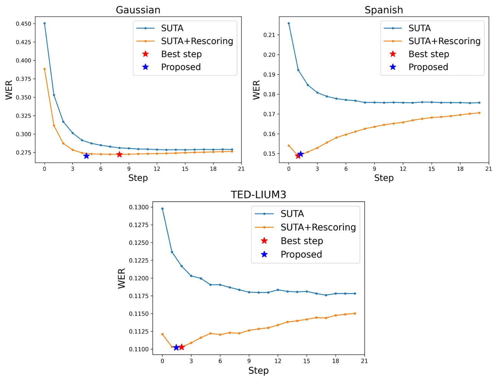
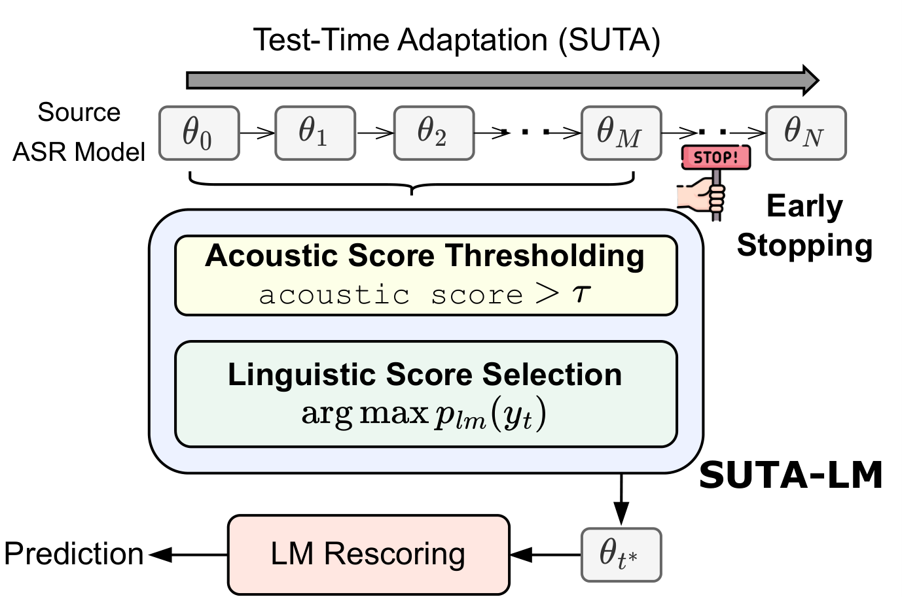
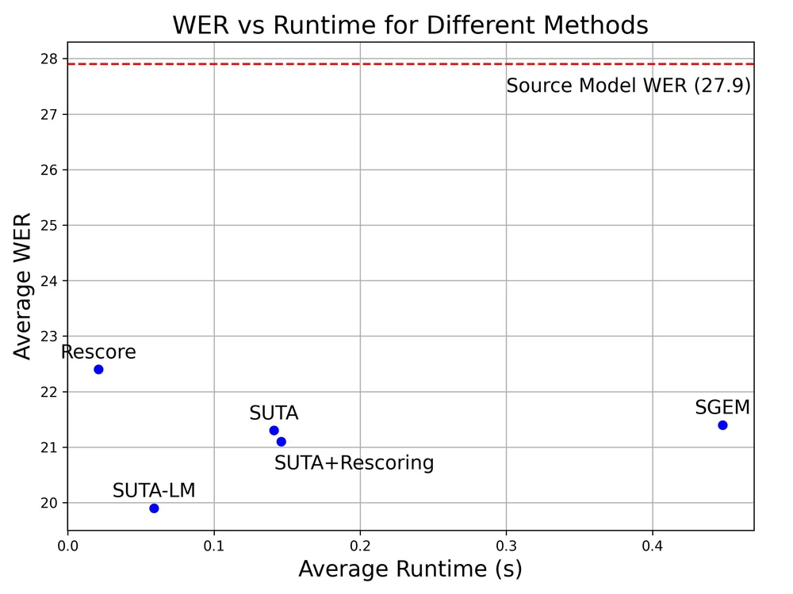
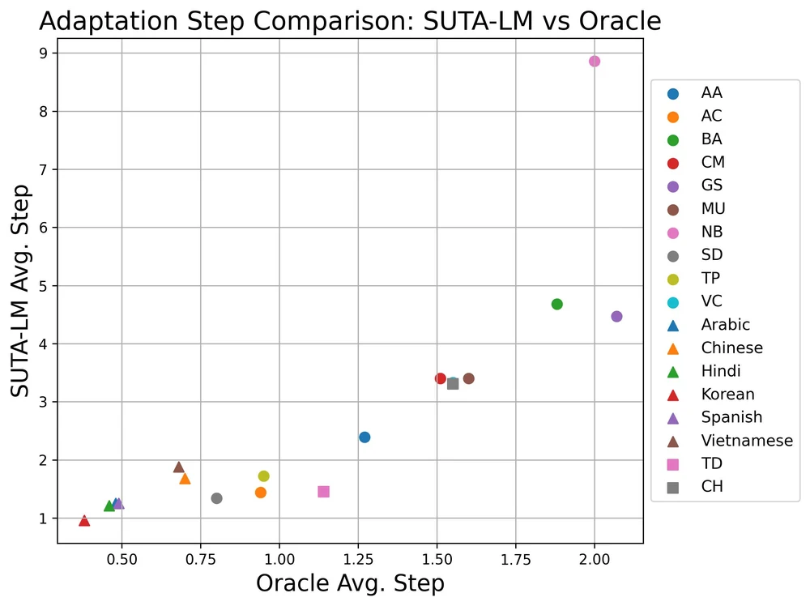

## Abstract

End-to-end ASR models lose accuracy on speech that differs from their training data: added noise, accented speakers, reverberant talks. Two inference-time fixes are common. Test-time adaptation (TTA) updates the acoustic model on the test utterance itself with an unsupervised loss. Language model (LM) rescoring keeps the acoustic model fixed and runs beam search with an external LM, which repairs linguistically implausible outputs. The two have mostly been studied separately.

This paper asks how to combine them and finds that the naive combination (adapt with [SUTA](/blog/2026/11/25/suta-review/), then rescore) can be worse than rescoring alone. The reason is the number of adaptation steps: too few leaves acoustic errors, too many hurts what rescoring can recover, and the best number changes from domain to domain. SUTA-LM keeps SUTA's update rule but chooses, per utterance, which intermediate model to decode. A step must pass a confidence threshold (acoustic score), and among those steps the one whose greedy transcript the LM likes most is chosen (linguistic score). An early-stopping rule ends adaptation once the choice stops changing. Across 18 test sets the method has the lowest average WER and runs faster than plain SUTA.

## Motivation

The authors first try the obvious pipeline, **SUTA+Rescoring**. For each test utterance $$x$$, SUTA adapts the source model $$\theta$$ for $$N$$ steps, giving $$\theta_0 = \theta, \theta_1, \ldots, \theta_N$$. The final logits $$\theta_N(x) \in \mathbb{R}^{L \times C}$$ ($$L$$ frames, $$C$$ output tokens) are decoded with beam search and a 4-gram LM using shallow fusion:

$$
\hat{y} = \arg\max_y \; \log p_\theta(y \mid x) + \alpha \log p_{lm}(y) + \beta\,\mathrm{length}(y),
$$

with $$(\alpha, \beta) = (0.5, 0)$$ fixed in every experiment. The acoustic model is wav2vec 2.0-base fine-tuned on LibriSpeech 960h.

**Preliminary study, WER (%), from Table 1** (averaged over 3 runs)

| Method | Gaussian | TED-LIUM3 | Spanish |
|---|---|---|---|
| Source model | 45.1 | 13.0 | 21.6 |
| SUTA | 28.1 | 11.7 | 17.7 |
| Rescoring | 38.9 | **11.2** | **15.4** |
| SUTA+Rescoring | **27.3** | 11.4 | 16.5 |

On 10 dB Gaussian noise, adapting first helps a lot (27.3 vs 38.9). On TED-LIUM3 and Spanish-accented L2Arctic speech the order flips: SUTA+Rescoring is worse than rescoring the unadapted model. Neither pipeline wins everywhere.

Rescoring alone is SUTA+Rescoring with $$N = 0$$, and SUTA's default is $$N = 10$$, so the authors sweep $$N$$ from 0 to 20.

*WER of SUTA (greedy, blue) and SUTA+Rescoring (orange) as the number of adaptation steps grows, on Gaussian noise, Spanish-accented speech, and TED-LIUM3. The red star is the best fixed step for SUTA+Rescoring; the blue star is SUTA-LM. Figure from the paper.*

Two things stand out. The best fixed step differs by domain: 8 for Gaussian noise, 2 for TED-LIUM3, 1 for Spanish. And $$N = 0$$ is never the best, so some adaptation always helps once the amount is right. The second point is the more surprising one: SUTA's greedy WER is flat or still falling after many steps, while the rescored WER climbs again on Spanish and TED-LIUM3. An adaptation that looks harmless under greedy decoding can still damage the result after rescoring. So the number of steps has to be chosen per input, and greedy WER is not a usable proxy for it.

## Method

*SUTA-LM. SUTA produces a trajectory of adapted models; acoustic score thresholding and linguistic score selection pick one step $$t^*$$, early stopping cuts the trajectory short, and the chosen model's logits go to beam search with LM rescoring. Figure from the paper.*

### Base TTA: SUTA

SUTA (single-utterance test-time adaptation) adapts a CTC model on one utterance at a time. It minimizes a mix of frame-level entropy and minimum class confusion on the model's own output, takes a fixed number of gradient steps, decodes, and then resets the model to the source weights before the next utterance. SUTA-LM changes nothing in this update; it only changes which step is decoded and how many steps are run. The implementation follows the official SUTA code, including its reweighting of the class-confusion loss.

### Auto-step selection

Instead of always decoding $$\theta_N$$, SUTA-LM picks a step from the whole trajectory:

$$
t = f(x, \theta_0, \theta_1, \ldots, \theta_N), \qquad 0 \le t \le N,
$$

aiming for the lowest WER after beam search on $$\theta_t(x)$$. Note that $$t = 0$$ (no adaptation, rescoring only) is a valid choice. The selector $$f$$ has two parts.

**Acoustic score thresholding.** Let $$c_l^t$$ be the probability of the top token at frame $$l$$ under $$\theta_t(x)$$. The acoustic score of step $$t$$ is the mean log confidence over frames,

$$
S_t = \frac{1}{L}\sum_{l=1}^{L} \log c_l^t ,
$$

and only steps with $$S_t \ge \tau$$ are kept:

$$
\mathcal{T} = \{\, t : S_t \ge \tau,\; 0 \le t \le N \,\}.
$$

This removes steps where the acoustic model is still unsure. The default is $$\tau = -0.05$$, which is strict: the average top-token probability must be about 0.95.

**Linguistic score selection.** Let $$y_t$$ be the greedy transcript from $$\theta_t(x)$$. Among the kept steps, SUTA-LM picks the one whose transcript has the highest LM probability:

$$
t^* = \arg\max_{t \in \mathcal{T}} \; p_{lm}(y_t).
$$

Ties go to the earliest step, because the preliminary study showed that extra adaptation can hurt after rescoring. If $$\mathcal{T}$$ is empty, the final step $$t^* = N$$ is used. The chosen logits $$\theta_{t^*}(x)$$ are then decoded with the shallow-fusion beam search above.

The two scores play different roles. The acoustic score says "the model is sure enough", and the linguistic score breaks the tie among confident steps by asking which transcript reads like real English.

### Early stopping

Running all $$N$$ steps and then selecting is wasteful, so the selection runs online. Adaptation continues step by step. Steps below the threshold are skipped; for steps in $$\mathcal{T}$$ the LM score of $$y_t$$ is tracked, and adaptation stops once the best LM score has not improved for $$P$$ consecutive valid steps (default $$P = 3$$). The step with the best LM score so far is returned. If no step ever passes the threshold, all $$N$$ steps run and $$\theta_N$$ is used. Experiments use a maximum of $$N = 20$$.

## Main Experiments

The benchmark has 18 test sets. LS-C is LibriSpeech test with 10 MS-SNSD noises at 10 dB SNR (AA airport announcement, AC air conditioner, BA babble, CM copy machine, GS Gaussian, MU munching, NB neighbors, SD shutting door, TP typing, VC vacuum cleaner). L2Arctic gives six non-native English accents. TED-LIUM3 (TD) covers real talks with mild reverberation, and CHiME-3 (CH) is real noisy WSJ speech. Utterances longer than 20 s are dropped (under 1% of the data). The baselines are SUTA, Rescoring, SUTA+Rescoring, and [SGEM](/blog/2026/11/25/sgem-review/), which also uses beam search with an LM, but inside its adaptation loss rather than for the final decoding. All use $$N = 20$$, and WER is averaged over 3 runs.

**WER (%) on LS-C noises, from Table 2**

| Method | AA | AC | BA | CM | GS | MU | NB | SD | TP | VC |
|---|---|---|---|---|---|---|---|---|---|---|
| Source model | 21.6 | 14.2 | 38.1 | 28.5 | 45.1 | 30.6 | 81.7 | 13.6 | 16.6 | 29.5 |
| SUTA | 16.2 | 10.6 | 27.7 | 21.5 | 28.1 | 22.1 | 64.6 | 10.8 | 12.1 | 20.6 |
| Rescoring | 17.6 | 10.8 | 31.6 | 23.8 | 38.9 | 25.9 | 65.7 | 10.5 | 12.9 | 24.7 |
| SGEM | 16.2 | 10.4 | 28 | 21.4 | 28.3 | 22.3 | 66.1 | 10.5 | 11.9 | 20.5 |
| SUTA+Rescoring | 15.9 | 10.2 | 27.5 | 21.1 | 27.6 | 21.9 | 64.6 | 10.5 | 11.8 | 20.1 |
| **SUTA-LM** | **15.2** | **9.6** | **26.9** | **20.2** | **27.0** | **21.2** | **63.8** | **9.7** | **11.1** | **19.4** |

**WER (%) on L2Arctic accents, TED-LIUM3, CHiME-3, and the 18-set average, from Table 2**

| Method | Arabic | Chinese | Hindi | Korean | Spanish | Vietnamese | TD | CH | Avg. |
|---|---|---|---|---|---|---|---|---|---|
| Source model | 21.4 | 27.5 | 17.1 | 17.3 | 21.6 | 34.8 | 13.0 | 30.0 | 27.9 |
| SUTA | 17.5 | 22.1 | 13.1 | 14.1 | 17.7 | 30.2 | 11.7 | 23.5 | 21.3 |
| Rescoring | **15.2** | 20.6 | 12.2 | 11.8 | 15.4 | 28.1 | 11.2 | 26.7 | 22.4 |
| SGEM | 17.3 | 22.2 | 12.9 | 13.9 | 17.5 | 30.1 | 11.6 | 23.4 | 21.4 |
| SUTA+Rescoring | 17.1 | 21.5 | 12.7 | 13.7 | 17.1 | 29.6 | 11.5 | 23.1 | 21.1 |
| **SUTA-LM** | **15.2** | **19.6** | **11.3** | **11.7** | **15.0** | **27.6** | **11.0** | **22.4** | **19.9** |

SUTA-LM is best or tied on every column, with an average of 19.9 against 21.1 for SUTA+Rescoring and 21.4 for SGEM. The table also shows the domain split from the motivation. On LS-C and CHiME-3 (strong acoustic shift), SUTA beats Rescoring. On L2Arctic and TED-LIUM3 (small acoustic shift), Rescoring beats SUTA, and SUTA+Rescoring falls behind Rescoring alone. SUTA-LM matches or slightly improves the better of the two in each regime, but the gains on accented speech over Rescoring are small (0.0 to 1.0 points).

*Average WER over the 18 sets against average runtime for a 1-second utterance. The dashed line is the source model (27.9). Figure from the paper.*

Because early stopping usually ends after a few steps, SUTA-LM is about 7× faster than SGEM and more than 2× faster than SUTA+Rescoring. It is still slower than rescoring alone, which needs no gradient steps.

*Average step chosen by SUTA-LM (y-axis) against an oracle that picks the lowest-WER step per utterance, earliest on ties (x-axis), for each of the 18 sets. Figure from the paper.*

The ordering of domains matches the oracle: accented sets get the fewest steps and BA, GS, and NB get the most. The scales differ, though. The oracle averages about 0.4 to 2.1 steps, while SUTA-LM averages about 1 to 9, so SUTA-LM adapts more than needed, especially on NB.

**Ablation, WER (%) on six representative sets, from Table 3**

| Variant | Korean | Spanish | TD | CH | GS | NB |
|---|---|---|---|---|---|---|
| SUTA-LM | **11.7** | 15.0 | **11.0** | **22.4** | **27.0** | **63.8** |
| w/o acoustic score thresholding | **11.7** | **14.8** | **11.0** | 22.9 | 27.5 | 64.0 |
| w/o early stop: thresholding + LM selection | 11.8 | 15.1 | 11.1 | 22.5 | **27.0** | 63.9 |
| w/o early stop: thresholding + random selection | 13.2 | 16.3 | 11.3 | 22.8 | 27.4 | 64.2 |

Without the acoustic threshold, the LM score alone tends to stop too early on noisy sets (CH, GS, NB), picking steps where the acoustic model is still unconfident but the transcript happens to look fluent. Early stopping costs nothing in accuracy. Replacing LM selection with a random confident step hurts most on accented speech (Korean 11.8 to 13.2, Spanish 15.1 to 16.3), where many steps pass the threshold and the LM is what separates them.

The threshold matters only at the extremes: averaged over the same six sets, WER is 26.2, 25.6, 25.2, 25.2, and 25.3 for $$\tau = -0.01, -0.03, -0.05, -0.1, -0.3$$. With other CTC backbones (data2vec-base and HuBERT-large), SUTA-LM is again lowest on the subset average (24.7 and 16.2), though on HuBERT-large it only ties SUTA+Rescoring.

## Limitations

- **Hand-set thresholds and LM weights.** $$\tau = -0.05$$ and $$P = 3$$ are fixed, and the fusion weights $$(\alpha, \beta) = (0.5, 0)$$ are not tuned. The $$\tau$$ sweep is run on the same six test sets that are reported in the ablation.
- **Overconfidence is the selection signal.** The acoustic score rewards confident frames, and entropy-minimizing TTA makes frames confident by construction. The method relies on the LM to catch steps that are confident but wrong, so it inherits the LM's domain. The 4-gram LM is the LibriSpeech LM released for wav2vec 2.0, and the paper does not test a case where the test text is far from the LM corpus.
- **More steps than the oracle.** SUTA-LM selects several times more steps than the oracle on average, so a part of the runtime and some accuracy is left on the table.
- **Small gains where rescoring is already strong.** On L2Arctic and TED-LIUM3, the improvement over Rescoring alone is at most 1.0 point, while SUTA-LM still runs gradient steps.
- **Narrow setting.** Only CTC models fine-tuned on LibriSpeech and an n-gram LM are used. Encoder-decoder models such as Whisper, neural LMs, and LLM-based correction (for example LI-TTA) are not compared. Each utterance is adapted independently with a reset, so nothing is carried across utterances.
- **Selection decodes greedily, the output uses beam search.** $$p_{lm}(y_t)$$ is computed on the greedy transcript, while the final output comes from beam search on the same logits. The paper does not analyze how often these two disagree.

## My Thoughts

<!-- TODO -->
