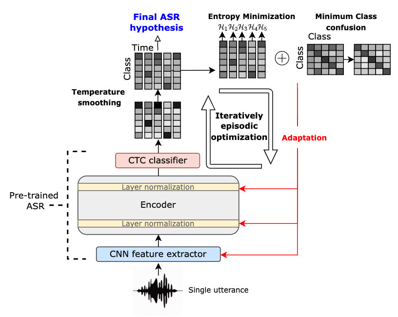
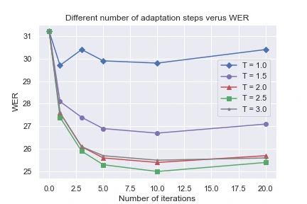
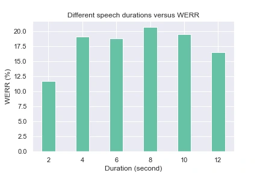

## Abstract

End-to-end ASR models work well when the test audio looks like the training audio, but WER climbs quickly under noise, a new recording setup, or a new speaking style. Unsupervised domain adaptation can help, but it needs the source data and a pile of target audio collected in advance, and it assumes that the target audio comes from one distribution. Test-time adaptation (TTA) removes the need for source data, but the vision methods at the time mostly adapted on batches of test samples and relied on Batch Normalization statistics, which ASR encoders usually do not have.

The paper proposes Single-Utterance Test-time Adaptation (SUTA), presented as the first TTA study for ASR. For each test utterance, starting again from the source weights, SUTA runs a few gradient steps on two unsupervised losses computed from the model's own CTC output: frame-level entropy minimization and minimum class confusion, both on a temperature-smoothed distribution. Only the layer normalization parameters and the CNN feature extractor are updated. The adapted model then decodes that utterance. On a wav2vec 2.0 CTC model trained on LibriSpeech, SUTA lowers WER on noisy LibriSpeech, CHiME-3, Common Voice, and TED-LIUM 3, and even on clean in-domain LibriSpeech.

## Motivation

The paper has no motivating figure; the argument is about the setting. Unsupervised domain adaptation for ASR (adversarial training, distillation, self-training) has three practical problems: (1) the source data may be unavailable for privacy or storage reasons, (2) target audio must be collected first and the adaptation is heavy, which adds latency, and (3) all target audio is assumed to come from the same distribution. Batch-level TTA, as in Tent, fixes (1) but not (2) or (3). A speech service cannot wait to collect a batch, and consecutive requests may come from a restaurant, a phone call, and a quiet room.

There is also an architecture gap. Much of TTA in vision works by re-estimating or adapting Batch Normalization layers on target data. Sequence models for ASR usually use Layer Normalization instead, because batched utterances have different lengths. So the vision recipes cannot be copied directly. The single-instance method SITA removes the batch requirement in vision, but it still depends on augmentation and BN statistics.

This leads to the setting the paper targets: adapt using only the current utterance, without labels or source data, with a small delay, and with no assumption that utterances share a distribution.

## Method

*SUTA. A single utterance passes through the pre-trained CTC model; the output is smoothed with a temperature, and entropy minimization plus minimum class confusion update the layer normalization and CNN feature extractor for a few steps before the final hypothesis is decoded. Figure from the paper.*

### Setting and notation

The ASR model $$g(y \mid x; \theta)$$ takes an utterance $$x$$ and outputs unnormalized scores for each vocabulary class $$y$$. Its parameters are split as $$\theta = (\theta_f, \theta_a)$$, where $$\theta_f$$ stays frozen and $$\theta_a$$ is updated at inference. The model is a wav2vec 2.0-base encoder with a CTC classifier over characters. Let $$C$$ be the number of character classes plus the CTC blank, and $$L$$ the number of output frames. The output is a logit matrix $$\mathbf{O} \in \mathbb{R}^{L \times C}$$, and $$\mathbf{P}_{ij}$$ is the probability of class $$j$$ at frame $$i$$.

### Entropy minimization

Following Tent, the first loss pushes each frame toward a confident prediction. It is the mean per-frame entropy $$\mathcal{H}_i$$:

$$
\mathcal{L}_{em} = \frac{1}{L}\sum_{i=1}^{L} \mathcal{H}_i = -\frac{1}{L}\sum_{i=1}^{L}\sum_{j=1}^{C} \mathbf{P}_{ij}\log \mathbf{P}_{ij}.
$$

In CTC output the blank token wins most frames. To keep the loss from being dominated by those easy frames, SUTA drops every frame whose most likely class is the blank before averaging.

### Minimum class confusion

The second loss reduces the overlap between classes across time. Let $$\mathbf{P}_{\cdot j} \in \mathbb{R}^{L}$$ be the probabilities of class $$j$$ over all $$L$$ frames. Their inner products form a $$C \times C$$ class confusion matrix, and MCC penalizes only its off-diagonal entries:

$$
\mathcal{L}_{mcc} = \sum_{j=1}^{C}\sum_{j' \neq j}^{C} \mathbf{P}_{\cdot j}^{\top}\mathbf{P}_{\cdot j'}.
$$

A small value means that frames that put mass on class $$j$$ do not also put mass on other classes. MCC was used before for domain adaptation and for batch TTA in vision; it behaves like entropy minimization but gives different gradients.

### Temperature smoothing

Used as is, the two losses help little (29.9 WER versus 31.2 unadapted on CHiME-3 at $$T = 1$$). The authors' explanation: a confident frame has near-zero entropy and therefore almost no gradient, so the update is driven by the uncertain frames, which are the least reliable. SUTA divides the logits by a temperature $$T > 1$$ before the softmax, for both losses:

$$
\mathbf{P}_{\cdot j} = \frac{\exp(\mathbf{O}_{\cdot j}/T)}{\sum_{j'=1}^{C}\exp(\mathbf{O}_{\cdot j'}/T)}.
$$

A flatter distribution keeps confident frames in the gradient and also tempers MCC on over-confident outputs.

### Objective and update loop

The two losses are mixed with a weight $$\alpha$$:

$$
\mathcal{L} = \alpha\,\mathcal{L}_{em} + (1-\alpha)\,\mathcal{L}_{mcc}.
$$

For each test utterance $$x$$, SUTA starts from the source weights, then repeats $$N$$ times: forward $$x$$, compute the smoothed $$\mathbf{P}$$ and $$\mathcal{L}$$, and update $$\theta_a$$ with the optimizer. The utterance is then greedily decoded with $$(\theta_f, \theta_a^{N})$$. The next utterance starts from the source weights again, so this is episodic adaptation: nothing carries over between utterances.

### Default setting

$$\theta_a$$ is the layer normalization parameters plus the CNN feature extractor (LN+Feat). The optimizer is AdamW with learning rate $$2 \times 10^{-5}$$ for LN+Feat ($$2 \times 10^{-4}$$ for LN only, $$10^{-6}$$ for the whole model). $$\alpha = 0.3$$, $$T = 2.5$$, and $$N = 10$$ steps. Hyperparameters were chosen on LibriSpeech test-other with Gaussian noise and reused for every corpus. On an RTX 3090, 10 steps take about 0.115 s per 1 s of audio.

## Main Experiments

The source model is wav2vec 2.0-base fine-tuned with CTC on LibriSpeech 960 h (3.4 / 8.6 WER on test-clean / test-other). Targets are LibriSpeech test-other with additive Gaussian noise of amplitude $$\delta \in \{0, 0.005, 0.01\}$$, CHiME-3 (CH, noisy WSJ, enhanced `et05`), Common Voice (CV, crowdsourced read speech), and TED-LIUM 3 (TD, talks). The only TTA baseline is SDPL, a single-utterance pseudo-labeling method the authors built: greedy CTC output is used as the label for CTC loss and refreshed every step (LN only, since it diverges with more parameters). No language model is used.

**WER (%), from Table 1**

| Model | LS $$\delta=0$$ | LS $$\delta=0.005$$ | LS $$\delta=0.01$$ | CH | CV | TD |
|---|---|---|---|---|---|---|
| SOTA trained on target | 2.5 | - | - | 5.8 | 15.4 | 5.6 |
| RASR (trained on LS) | 6.8 | - | - | - | 29.9 | 13.0 |
| Source model (wav2vec 2.0, LS) | 8.6 | 13.9 | 24.4 | 31.2 | 36.8 | 13.2 |
| + SDPL | 8.3 | 13.1 | 23.1 | 30.4 | 36.3 | 12.8 |
| + **SUTA** | **7.3** | **10.9** | **16.7** | **25.0** | **31.2** | **11.9** |

SUTA beats the source model and SDPL on every column. The gain grows with the shift: 1.3 points on clean LibriSpeech test-other, 7.7 points at $$\delta = 0.01$$, and 6.2 points on CHiME-3. Even the in-domain test set improves, from 8.6 to 7.3. RASR is a 36-layer transformer trained with SpecAugment, so it is a reference for a stronger source model, not a TTA baseline; SUTA on the smaller model comes close to it on CV and beats it on TD.

**Ablation on CHiME-3, from Table 2** (WERR is the relative WER reduction from the unadapted 31.2)

| Setting | WER (%) | WERR (%) |
|---|---|---|
| Unadapted | 31.2 | 0.0 |
| **SUTA ($$\alpha=0.3$$, LN+Feat, $$T=2.5$$)** | **25.0** | **19.9** |
| $$\alpha=1.0$$ (EM only) | 25.5 | 18.3 |
| $$\alpha=0.7$$ | 25.3 | 18.9 |
| $$\alpha=0.5$$ | 25.1 | 19.6 |
| $$\alpha=0.0$$ (MCC only) | 25.4 | 18.6 |
| $$T=1.0$$ | 29.9 | 4.2 |
| $$T=1.5$$ | 26.7 | 14.2 |
| $$T=2.0$$ | 25.6 | 17.9 |
| $$T=3.0$$ | 25.5 | 18.3 |
| $$\theta_a$$ = LN | 28.8 | 7.7 |
| $$\theta_a$$ = Feat | 25.1 | 19.6 |
| $$\theta_a$$ = All | 26.7 | 14.4 |

Each loss alone already gives most of the gain, and the mix adds about one point of WERR. Temperature is the component that matters most: without it the method gives only 4.2% WERR. Adapting LN alone is weak, while the feature extractor alone is nearly as good as LN+Feat. Freeing the whole model is worse, which fits a single-utterance setting where there is little signal to fit many parameters.

*WER on CHiME-3 against the number of adaptation steps for different temperatures. With $$T = 1$$ the curve is noisy and rises again; with $$T \ge 2$$ WER falls steadily until about 10 steps and then flattens or rises slightly. Figure from the paper.*

Most of the gain arrives in the first few steps, and 10 steps is close to the best for every temperature. After that, WER creeps up, the first sign of over-adapting to one utterance.

*Relative WER reduction on CHiME-3 grouped by utterance duration. Utterances under 2 seconds gain about 12%, longer ones around 17.5% according to the text. Figure from the paper.*

Short utterances contain only one or two words, so the output covers few classes and entropy minimization can collapse onto them. The gain is smaller there but still positive.

## Limitations

- **CTC only (stated by the authors).** The losses are defined on frame-level CTC posteriors. Attention-based encoder-decoder models (and later Whisper-style models) are left to future work; SGEM and the wild-acoustic paper later build on SUTA with other objectives and models, see [/blog/2026/11/25/sgem-review/](/blog/2026/11/25/sgem-review/) and [/blog/2026/11/25/wild-acoustic-tta-review/](/blog/2026/11/25/wild-acoustic-tta-review/).
- **Short utterances (stated by the authors).** Gains are smaller below 2 seconds, likely because of class collapse under entropy minimization.
- **Cost per utterance.** Each utterance needs 10 forward and backward passes through the feature extractor and encoder, about 0.115 s per second of audio on an RTX 3090. That is far from free for streaming or on-device use.
- **No memory across utterances.** Episodic reset makes it robust to changing domains, but it also throws away what was learned on earlier utterances from the same domain. The CoTTA-ASR paper (DSUTA) addresses exactly this, see [/blog/2026/11/25/cotta-asr-review/](/blog/2026/11/25/cotta-asr-review/).
- **Hyperparameters from a test set.** $$\alpha$$, $$T$$, the learning rate, and the step count were searched on noisy LibriSpeech test-other, and the ablation table is on the CHiME-3 evaluation set itself.
- **Narrow comparison.** One source model (wav2vec 2.0-base), one baseline built by the authors, Gaussian noise as the only synthetic shift, and greedy decoding without a language model. How SUTA interacts with LM decoding is studied later in SUTA-LM, see [/blog/2026/11/25/suta-lm-review/](/blog/2026/11/25/suta-lm-review/).

## My Thoughts

<!-- TODO -->
