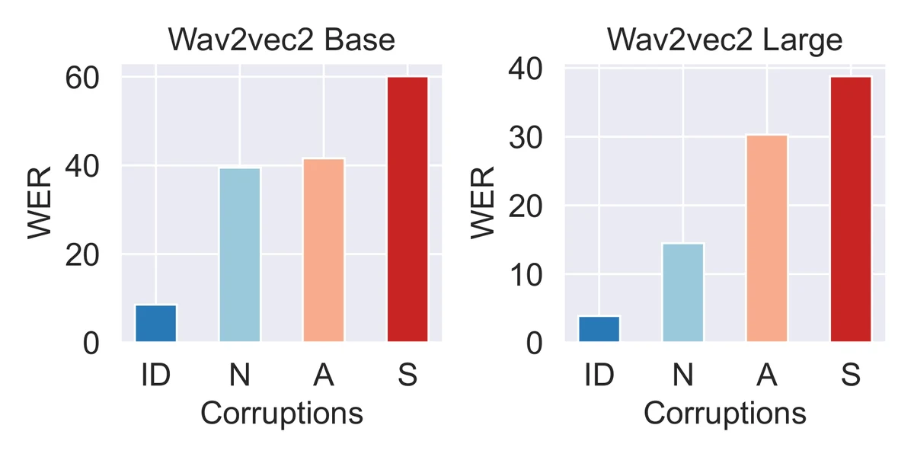
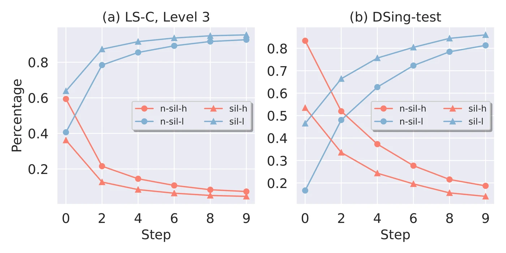
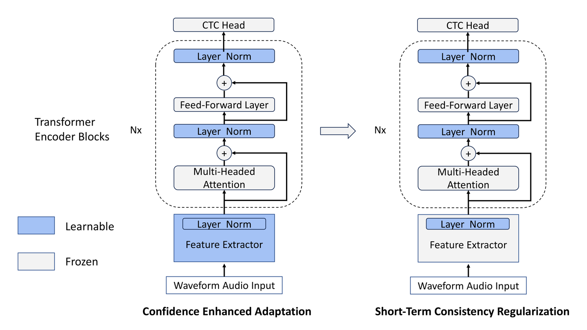

## Abstract

Speech foundation models fine-tuned for ASR, such as wav2vec 2.0, work well on clean read speech but degrade badly under strong shifts: heavy noise, environmental sounds, non-native accents, and singing. SUTA ([review](/blog/2026/11/25/suta-review/)) showed that test-time adaptation (TTA) on a single utterance helps, but it was tested on milder shifts. For harder, "wild" shifts, vision TTA has SAR, which stabilises adaptation by dropping high-entropy samples. The paper argues that this filtering does not transfer to speech, because in noisy speech the high-entropy frames are often the ones that carry the words.

The proposed method has two parts. Confidence-Enhanced Adaptation (CEA) minimises the entropy of the non-blank frames with a weight that grows with each frame's entropy, so uncertain frames get more attention rather than being removed. Short-Term Consistency Regularization (STCR) then pulls the features of nearby frames together, since speech changes slowly over short windows. Adaptation is episodic, one utterance at a time. On Gaussian noise, environmental sounds, L2 accents, and sung speech, the method beats Tent, SAR, TeCo, SUTA, and SGEM ([review](/blog/2026/11/25/sgem-review/)), though often by small margins over SUTA.

## Motivation

*WER of wav2vec 2.0 Base (left) and Large (right) on in-domain LibriSpeech test-other (ID), the same set with additive noise (N), L2-Arctic accents (A), and DSing sung speech (S). Singing is the hardest shift for both sizes. Figure from the paper.*

The first observation is that the shifts are large. wav2vec 2.0 Base goes from below 10% WER in domain to about 40% with noise or accents and about 60% on singing; the Large model is better but follows the same order.

The second observation is about which frames are uncertain. The authors split frames by the model's own pseudo-label into silent (predicted blank) and non-silent, and by entropy into high and low using the threshold $$0.4 \ln C$$ from EATA, where $$C$$ is the number of output classes.

*Fraction of high-entropy (red) and low-entropy (blue) frames among non-silent (circles) and silent (triangles) frames, over 10 adaptation steps of the proposed method, for wav2vec 2.0 Base on (a) LibriSpeech test-other with level-3 Gaussian noise and (b) DSing-test. Each curve averages 100 random utterances. Figure from the paper.*

At step 0, most non-silent frames are high-entropy: 59.4% on noisy LibriSpeech and over 80% on sung speech. Silent frames are the opposite, mostly low-entropy. So a SAR-style rule that throws away high-entropy inputs would throw away most of the frames that contain speech, which are exactly the frames needed to get the transcript right. The figure also shows the intended effect of the method: as adaptation proceeds, the high-entropy fractions fall and the low-entropy fractions rise for both frame types.

A third, speech-specific point motivates the second component. Neighbouring speech frames usually belong to the same phoneme, so their representations should be similar. Vision TTA methods treat the samples in a batch as independent and do not use this structure.

## Method

*The two stages for a CTC acoustic foundation model. Confidence-Enhanced Adaptation updates the feature extractor and the transformer's layer norms (blue); Short-Term Consistency Regularization then freezes the feature extractor except its layer norm and updates only layer-norm parameters. Figure from the paper.*

### Setting

The ASR model is $$f_{\Theta}(y \mid x) = h_{\theta}(g_{\phi}(x))$$, where $$g_{\phi}$$ is the feature extractor (the CNN on the waveform) with parameters $$\phi$$, $$h_{\theta}$$ is the transformer encoder with a CTC head, and $$\Theta = \{\theta, \phi\}$$. The input is one test utterance $$x_{1:n}$$ with $$n$$ frames. For frame $$i$$, $$\hat{y}^{c}_{i}$$ is the predicted probability of class $$c$$, $$\hat{y}_i$$ is the argmax pseudo-label, and $$c_0$$ is the blank class, which is used as a stand-in for silence. The model is reset after each utterance.

### Confidence-Enhanced Adaptation (CEA)

The uncertainty of frame $$i$$ is its prediction entropy

$$
E(x_i) = -\sum_{c} \hat{y}^{c}_{i} \log \hat{y}^{c}_{i}.
$$

Instead of a threshold that drops uncertain frames, CEA keeps all non-blank frames and weights each one by a sigmoid of its entropy:

$$
S(x_i) = \frac{1}{1 + \exp(-E(x_i))}\, \mathbb{I}[\hat{y}_i \neq c_0],
$$

$$
\min_{\Theta' = \{\phi,\, \theta_{\text{LN}}\}} \ \sum_{i=1}^{n} S(x_i)\, E(x_i),
$$

where $$\theta_{\text{LN}}$$ are the affine (scale and shift) parameters of the layer norms in the transformer encoder. Blank frames get weight 0. Among speech frames, the more uncertain ones get a larger weight, so the update focuses on "denoising" their representations. Updating the whole feature extractor, not only normalisation parameters, is meant to let the model handle large covariate shifts at the input.

### Short-Term Consistency Regularization (STCR)

After the CEA steps, a second stage adds a consistency term to plain entropy minimization:

$$
\min_{\Theta_{\text{LN}}} \ \sum_{i=1}^{n} E(x_i) + \alpha \sum_{i=1}^{n-k+1} \lVert z'_{k+i-1} - z'_{i} \rVert_2 \, \mathbb{I}[\hat{y}_i \neq c_0].
$$

Here $$\Theta_{\text{LN}}$$ are the layer-norm affine parameters of the whole model, $$z_i$$ is the feature of frame $$i$$ from the (already adapted) feature extractor, and $$z'_i$$ is that feature after a parameter-free self-attention over the utterance. In the released code this is $$Z' = \mathrm{softmax}(ZZ^{\top})Z + Z$$. $$k$$ is the window size and $$\alpha$$ the weight of the regulariser (0.3). The term pulls each non-blank frame's representation toward that of a frame a short, fixed offset later, set by the window size. It is applied only after CEA because, according to the authors, enforcing similarity between representations that are still noisy can mislead the optimisation.

### Default setting

All methods run 10 adaptation steps per utterance with AdamW. The learning rate is chosen from $$\{2, 5, 8\} \times 10^{-4}$$ for the layer-norm parameters and $$\{2, 5\} \times 10^{-5}$$ for the feature extractor. Following SUTA, hyperparameters are tuned on LibriSpeech test-other with noise level $$\delta = 0.01$$, and for singing on DSing-dev. Greedy decoding is the default; for the beam search comparison the same 4-gram language model as SGEM is used.

## Main Experiments

The main model is wav2vec 2.0 (Base, and Large for singing), fine-tuned on LibriSpeech 960h. Baselines are Tent (here: entropy minimization on the layer-norm affine parameters), TeCo (temporal coherence regularization from video TTA), SAR, SUTA, and SGEM. The metric is WER (%).

**LS-C: LibriSpeech test-other with Gaussian noise, wav2vec 2.0 Base, greedy decoding, WER (%), from Table 1**

| Method | Level 0 | Level 1 | Level 2 | Level 3 | Level 4 | Level 5 | Average |
|---|---|---|---|---|---|---|---|
| Noise amplitude $$\delta$$ | 0 | 0.005 | 0.01 | 0.015 | 0.02 | 0.03 | |
| Source | 8.6 | 13.9 | 24.4 | 39.5 | 54.5 | 75.7 | 31.6 |
| Tent | 7.7 | 11.6 | 19.7 | 32.2 | 46.3 | 69.2 | 31.1 |
| SAR | 8.2 | 12.7 | 21.5 | 35.0 | 49.2 | 72.0 | 33.1 |
| TeCo | 7.6 | 13.6 | 19.7 | 32.2 | 46.3 | 69.3 | 31.5 |
| SUTA | 7.3 | 10.9 | 16.7 | 24.6 | 34.7 | 56.5 | 25.1 |
| **Ours** | 7.3 | 10.7 | 16.2 | 24.0 | 34.1 | 56.5 | **24.8** |

The Average column is copied as printed. For every adapted row it equals the mean of the six levels, but the Source row's six values average to 36.1, not 31.6, so the printed source average (and the 21.5% relative improvement the paper derives from it) looks like a typo. SAR, which filters high-entropy inputs, gains much less than Tent, which supports the motivation. The gain over SUTA is 0.2 to 0.6 points per level and zero at levels 0 and 5.

**LS-P: LibriSpeech test-other with environmental sounds at five SNRs (dB), wav2vec 2.0 Base, WER (%), from Tables 2 and 3**

| Method | AC 10 | AC 5 | AC 0 | AC -5 | AC -10 | TP 10 | TP 5 | TP 0 | TP -5 | TP -10 |
|---|---|---|---|---|---|---|---|---|---|---|
| Source | 28.1 | 43.9 | 65.0 | 83.4 | 94.2 | 26.2 | 34.0 | 44.4 | 56.4 | 69.0 |
| Tent | 22.6 | 36.1 | 56.6 | 77.9 | 91.4 | 21.0 | 27.9 | 37.0 | 49.2 | 63.0 |
| SAR | 24.5 | 39.1 | 59.9 | 79.9 | 92.1 | 23.0 | 30.3 | 39.7 | 52.1 | 65.3 |
| TeCo | 22.5 | 36.2 | 56.6 | 77.9 | 91.3 | 21.0 | 27.8 | 37.0 | 49.1 | 63.0 |
| SUTA | 17.7 | 26.1 | 41.2 | 62.7 | 82.7 | 17.9 | 23.3 | 30.4 | 41.0 | 53.4 |
| **Ours** | **17.5** | **25.6** | **40.6** | **61.6** | **82.2** | **17.5** | **22.8** | **29.9** | **40.4** | **52.6** |

AC is air conditioner and TP is typing; the other six sounds are in the appendix. At 5 dB air conditioner noise the method cuts WER from 43.9 to 25.6, a 41.7% relative reduction, but almost all of that is also obtained by SUTA (26.1).

**Sung speech, WER (%), from Table 4**

| Decoding | Method | DSing-dev Base | DSing-dev Large | DSing-test Base | DSing-test Large | Hansen Base | Hansen Large | Avg. Base | Avg. Large |
|---|---|---|---|---|---|---|---|---|---|
| Greedy | Source | 61.8 | 40.6 | 60.1 | 38.8 | 64.3 | 43.7 | 62.1 | 41.0 |
| Greedy | Tent | 55.7 | 34.8 | 56.1 | 33.2 | 60.2 | 39.1 | 57.3 | 35.7 |
| Greedy | SAR | 58.8 | 40.6 | 57.2 | 38.2 | 62.7 | 42.7 | 59.6 | 40.5 |
| Greedy | TeCo | 56.2 | 35.0 | 55.6 | 33.1 | 60.0 | 39.1 | 57.3 | 35.7 |
| Greedy | SUTA | 53.9 | 34.9 | 51.3 | 33.6 | **58.0** | 39.3 | 54.4 | 35.9 |
| Greedy | **Ours** | **53.5** | **34.0** | **50.1** | **31.2** | **58.0** | **37.9** | **53.9** | **34.4** |
| Beam search | Source+LM | 58.6 | 41.1 | 55.3 | 37.6 | 60.1 | 43.5 | 58.0 | 40.7 |
| Beam search | SGEM | 54.4 | 34.4 | 50.8 | 33.0 | 57.8 | 38.6 | 54.3 | 35.3 |
| Beam search | **Ours+LM** | **53.2** | **33.3** | **50.0** | **30.3** | **57.7** | **37.5** | **53.6** | **33.7** |

Base and Large are wav2vec 2.0 Base and Large. Singing stays hard after adaptation: the best Base result is still above 50% WER. The method's largest gains over SUTA are on the Large model (35.9 to 34.4 average with greedy decoding). With greedy decoding it already beats SGEM with beam search on average, and adding the same language model gives a further small gain. The LibriSpeech-trained 4-gram LM hurts the Large source model (41.1 vs 40.6 on DSing-dev), which is a sign of the text-domain shift that no method here adapts to.

**Other ASR architectures, DSing-test, WER (%), from Table 5**

| Method | Conformer-CTC | Conformer-Transducer |
|---|---|---|
| Source | 62.2 | 48.8 |
| SUTA | 55.9 | 44.8 |
| SGEM | 55.7 | 44.5 |
| **Ours** | **55.4** | **43.0** |

These are the same two Conformer models used in the SGEM paper.

**Ablation, wav2vec 2.0 Base with greedy decoding, WER (%), from Table 6**

| Method | Noise | Accent | Singing |
|---|---|---|---|
| **Ours** | **24.0** | **23.0** | **50.1** |
| w/o STCR | 25.1 | 23.4 | 51.0 |
| w/o CEA | 35.9 | 26.9 | 54.5 |

Removing CEA costs much more than removing STCR. The Noise and Singing columns match LS-C level 3 and DSing-test in the tables above. The appendix adds two related checks on DSing-test: weighting only non-silent frames (50.1) beats weighting only silent frames (51.7) or all frames (50.6), and adding STCR to SUTA improves it from 51.3 to 50.9, still behind CEA with STCR. On L2-Arctic (reported per speaker in the appendix) and CHiME-3 (24.5 vs 25.0 for SUTA), the method is again slightly ahead of SUTA.

## Limitations

- **Small margins over SUTA.** On noise, accents, and CHiME-3 the gain over SUTA is usually a few tenths of a point, and SUTA ties or wins on some L2-Arctic speakers and noise levels. Results are single runs without variance.
- **Table error in the headline result.** The printed source average on LS-C (31.6) does not match its six entries (mean 36.1), and the paper's 21.5% average relative improvement is computed from it.
- **The weighting is mild.** Since entropy is non-negative, the sigmoid weight $$S(x_i)$$ lies between 0.5 and 1 for non-blank frames, so the most uncertain frame gets at most twice the weight of the most confident one. Much of CEA's effect may come from excluding blank frames and updating the feature extractor; the paper does not isolate the weight itself.
- **Blank as silence.** Silence is approximated by the CTC blank label, which also covers frames between characters inside words. The authors note this but do not compare against a real voice activity detector.
- **Slower adaptation (partly stated by the authors).** Adaptation takes 0.879 s per utterance on DSing-test versus 0.483 s for SUTA and 0.328 s for Tent. The method is not designed for streaming, which the authors list as future work.
- **Mostly CTC encoders.** The main experiments use wav2vec 2.0, HuBERT, and WavLM with CTC heads, plus a small Conformer check. There are no attention encoder-decoder models such as Whisper in the adaptation experiments, and the language model is not adapted to text-domain shift (stated by the authors).
- **Hyperparameters tuned on test data.** As in SUTA, settings are tuned on one noisy LibriSpeech level, and for singing on DSing-dev, which is also reported in the results table.

## My Thoughts

<!-- TODO -->
